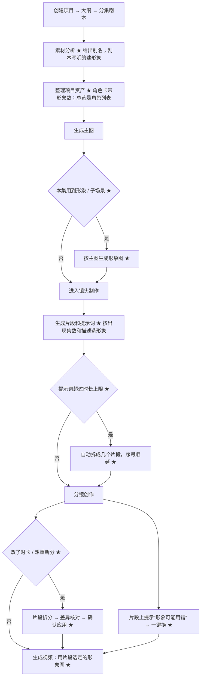

# v1.1.0 产品评审版

> 给产品负责人理解本版需求及受影响的完整用户链路，逐页核对和拍板；不是开发需求正文或检测报告。规则：工作台 `workflow/01-产品.md` 第 3 节。
> 本版产品需求：[requirements.md](requirements.md) · 全量基线：[当前产品文档](../../当前产品文档/README.md)（无；参考 v1.0.0，未上线） · 状态：已批准（2026-11-23） · 更新：2026-11-23
> 独立检测：[产品文档检测报告](detection-feedback.md)。检测通过与用户批准分别记录。
> 标记：AI 补出的规则标 `⚠️ 推导，待确认`。

## 1. 一句话版本

- 一个角色（场景）= 一张主图 + 多个形象：换装、换发型都归在同一个角色下，别名也归它；能在一个列表里找全，片段里不容易用错（R-01）。
- 片段拆分：提示词写超长时自动拆成几个片段；改了时长可以点“片段拆分”把整集重新组合（R-02）。

## 2. 本期范围

| 做 | 不做 |
|---|---|
| 角色：固定 ID、主名、别名、主图（三视图）、多个形象（也出三视图） | 道具的形象（道具只有一张图） |
| 场景：主图（俯视图）+ 多个子场景图 | 用形象再生成下一层形象 |
| AI 识别别名和形象；片段按出现集数和描述选形象；用错时提示 | 形象单独的声线（声线全角色共用） |
| 角色列表、场景列表（整理项目资产“总览”、资产库） | 自动把老的同名角色、独立副本合并成形象 |
| 资产库入库 / 导入带别名和形象；一键匹配时别名参与 | 角色列表的手机端 |
| 手机端：显示形象、片段里切换、生成形象图 | 手动拖动镜头、把一个镜头切两半 |
| 片段拆分：超长自动拆、整集按当前时长重新组合、三处都按本集设置的时长 | “片段拆分”时重写提示词（要重写用“批量生成提示词”） |

## 3. 产品全景流程

★ = 本版有变化。

## 4. 页面地图

本版涉及页面 6 个，弹框 4 个。

| 页面 | 用户来这里做什么 | 核心操作 | 去向 | 本版变化 |
|---|---|---|---|---|
| W-08 整理项目资产 | 给本集素材配图 | 看角色 / 场景卡、生成图、进入镜头制作 | 素材详情、分镜创作 | R-01：卡片显示形象数；“总览”改为角色列表 / 场景列表；缺图统计含本集用到的形象；去掉角色、场景的“本集独立修改” |
| W-13 素材详情 | 管理一个角色（场景）和它的形象 | 改主名、别名；切换形象；新增 / 生成 / 删除形象；看历史图；改出现集数 | 返回上一页 | R-01：“全部造型”= 形象列表（v1.0.0 做成了图片历史，改正） |
| W-12 创建素材 | 新建一个角色 / 场景 / 道具 | 填名称、特征、参考图，生成 | 素材详情 | R-01：新建的是主体和它的主形象；别名在详情里加 |
| W-11 资产库 | 跨项目找素材 | 按角色 / 场景归组浏览、搜索主名或别名、导入 | 素材详情 | R-01：角色列表 / 场景列表；入库、导入带别名和形象 |
| W-09 分镜创作 | 逐片段写提示词、生成视频 | 生成提示词、切换形象、片段拆分、生成视频 | 导出 | R-01：参考栏显示具体形象、可在同一角色内切换、用错提示；R-02：超长自动拆分、“片段拆分”按钮 |
| 手机端 视频编辑 / 素材页 | 同上（手机） | 显示形象、切换、生成形象图 | — | R-01 适配；R-02 只核对片段数量变化能正确显示 |

| 弹框 ID / 名称 | 何时出现 | 主要按钮及结果 | 本版变化 |
|---|---|---|---|
| 出现集数 | 素材详情点“出现在第…集” | 选集数 → 保存 | R-01：改的是**当前形象**的出现集数 |
| 新增形象 | 素材详情“全部造型”点“＋” | 填名称、特征 → 生成（以主图为参考） | R-01 新增 |
| 删除角色 / 形象确认 | 删除时 | 列出一起删的形象、受影响的片段数 → 确定 | R-01 新增 |
| 片段拆分确认 | 分镜页点“片段拆分” | 确认拆分 → 无需拆分提示，或打开差异核对 | R-02 新增（设计图已通过） |

（一键匹配已有素材弹框：结构不变，只是别名参与匹配，不单列。）

## 5. 逐页面功能 Checklist

### W-13 素材详情

| 检查项 | 当前需求 |
|---|---|
| □ 主名、别名 | 可改主名；别名可增删改；同一个项目里一个称呼只能属于一个角色，重复时保存失败并提示是哪个角色 |
| □ 全部造型（形象列表） | 第一个是主形象，其余是衍生形象；点哪个页面切到哪个；道具没有“＋” |
| □ 新增形象 | 填名称（如“婚纱”“短发”，只是标签，不算别名）和特征 → 以主图为参考生成，也出三视图；角色没有主图时不能生成，提示“请先生成主图” |
| □ 换主图 | 已有形象图不变，提示“主图已更新，可重新生成” |
| □ 出现集数 | 每个形象各有自己的出现集数，可编辑 |
| □ 历史记录 / 历史图 | 当前形象生成过的图；可预览、设为当前图 |
| □ 音色 | 全角色共用，改一处所有形象生效 |
| □ 删除 | 删形象：用到它的片段改用主图；删角色：形象一起删；都先确认并列出受影响片段数 |

### W-08 整理项目资产

| 检查项 | 当前需求 |
|---|---|
| □ 角色 / 场景卡 | 显示主图、主名、别名数、形象数；本集用到的形象能看到 |
| □ 总览 | 角色、场景按主体归组：一行一个角色，主名、别名、主图 + 全部形象图（没图的显示占位）；可按主名或别名搜索 |
| □ 缺图与进入镜头制作 | 本集用到的形象也要有图才能进入镜头制作 |
| □ 重新分析 / 素材分析 | 给出别名；剧本用别名称呼的不新建角色；剧本明确写了换装等才建形象（有名称和描述、没有图） |
| □ 本集独立修改 | 角色、场景不再提供；已有的独立副本照常可用；道具不变 |
| □ 一键匹配已有素材 | 主名和别名都参与名称匹配 |

### W-11 资产库 / W-12 创建素材

| 检查项 | 当前需求 |
|---|---|
| □ 角色列表 / 场景列表 | 同“总览”的形式，跨项目 |
| □ 入库、导入 | 角色 / 场景连同别名和形象一起 |
| □ 创建素材 | 建出主体和主形象；页面右下“历史记录（最多 3 条）”是这次创建过程里生成的图，选一张当主图 |

### W-09 分镜创作

| 检查项 | 当前需求 |
|---|---|
| □ 参考栏 | 显示具体形象的名称和缩略图（如“江敏·婚纱”） |
| □ 切换形象 | 只能在这个角色自己的主图和形象之间切换；可选“本场戏后面的片段都用这个” |
| □ AI 选形象 | 只从本集清单（出现集数包含本集的形象）里选；按形象描述和片段原文对应；没写明的用主图 |
| □ 一个片段两个形象 | 允许，但提示词里每一处要明确指向各自的形象 |
| □ 用错提示 | 原文提到某形象的关键词却用了别的形象 → 在片段上提示，不报错、不判失败 |
| □ 生成提示词超长（R-02） | 自动拆成几个片段，原片段保留视频和历史，新片段紧跟其后、序号顺延，并提示；单个镜头自己超长不拆 |
| □ 片段拆分按钮（R-02） | 确认后按当前时长重新组合：和现在一样 → 提示无需拆分；不一样 → 差异核对，确认才应用；镜头组成没变的片段原样保留 |
| □ 时长按本集设置（R-02） | 生成提示词、批量生成提示词、片段拆分都按分镜页“片段统一设置”的时长 |
| □ 生成视频 | 用片段上选定的形象图 |

## 6. 核心业务规则

### 角色与形象

| 规则 | 当前定义 |
|---|---|
| 认人 | 只靠主名和别名，由程序匹配；形象名称不参与（D-11） |
| 形象从哪来 | AI 在素材分析时按剧本明确描述建（宁少勿多），用户可增删改（D-03） |
| 形象图 | 以主图为参考，出三视图；只有两层（D-09、D-13） |
| 计费 | 生成形象图按现有图片生成报价、扣费、失败退回；识别、切换不扣积分（D-09） |
| 场景 | 主图出俯视图，子场景结构同形象（D-02、D-13） |

### 片段拆分

| 规则 | 当前定义 |
|---|---|
| 只在镜头之间切 | 不把一个镜头切两半；单个镜头超长不拆，标“时长不合理” |
| 不重写、不扣积分 | “片段拆分”只重新分组（D-18） |
| 先核对再应用 | 整集重新组合走差异核对（D-17） |

## 7. ⚠️ 必须人工确认的产品决策

| 决策 | 当前定义 | 为什么需要确认 |
|---|---|---|
| 暂无 | D-01～D-20 都已确认 | — |

留到设计 / 技术规划阶段验证（不是待定规则）：场景俯视图的出图效果；老数据里用“关联主场景”写在描述里的子场景是否自动归到主场景下。

## 8. 异常与边界行为

| 场景 | 当前行为 | 是否需要确认 |
|---|---|---|
| 没有主图就生成形象图 | 拒绝，提示“请先生成主图” | 否（已确认 2026-11-23） |
| 别名和别的角色重名 | 保存失败，提示属于哪个角色 | 否（D-09） |
| 删除被片段用着的形象 | 先确认；片段改用主图 | 否（D-09） |
| 老角色、老场景、已有独立副本 | 照常显示和使用，不迁移 | 否（D-07） |
| 生成提示词期间片段被改 | 结果作废，不写回、不拆分 | 否（v1.0.0 时已确认） |
| 旧版拆分的集点“片段拆分” | 置灰，提示先“批量生成提示词” | 否（D-19） |
| 有片段正在生成视频时点“片段拆分” | 置灰并提示 | 否 |

## 9. 用真实场景反向 Review

| 场景 | 当前产品行为 | 请确认 |
|---|---|---|
| 剧本第 3 集江敏穿婚纱，其余集穿日常 | 素材分析给江敏建形象“婚纱”，出现集数是第 3 集；第 3 集片段默认用它，其余集用主图 | 对吗？ |
| 第 3 集里既有婚礼也有回家换回日常 | 第 3 集清单里有主图和“婚纱”两个；AI 按片段原文选；选错时片段上提示，你一键换 | 对吗？ |
| 剧本里一会儿叫“老周”一会儿叫“周建国” | 是同一个角色的主名和别名，不会建两个角色 | 对吗？ |
| AI 把“周叔”认成了新角色 | 你在角色详情把“周叔”加成老周的别名，再删掉多出来的角色 | 这样处理可以吗？ |
| 你给江敏换了主图 | “婚纱”形象图不变，卡片上提示可重新生成；重新生成要再扣一次图片的积分 | 对吗？ |
| 时长从 15 秒改成 10 秒 | 点“片段拆分”→ 超长的拆开；没变的片段（含手改过的、有视频的）原样保留 | 对吗？ |
| 手机上打开网页拆分过的集 | 片段数量、序号和网页一致 | 对吗？ |

## 10. 状态变化速查

| 对象 | 正常路径 | 失败或恢复路径 |
|---|---|---|
| 形象 | AI 建立或手动新增（无图）→ 生成图 → 被片段使用 | 生成失败：积分退回，可再生成；删除：片段改用主图 |
| 片段（自动拆分） | 生成提示词 → 超长 → 拆成 N 个、序号顺延 | 拆不开：标“时长不合理”；期间被改：作废 |
| 片段（整集重新组合） | 片段拆分 → 差异待核对 → 确认应用 | 暂不应用：片段不变，顶部留“待核对”入口 |

## 11. 已确认 / 待确认

### 已确认

| 决策 | 最终定义 | 确认日期与依据 |
|---|---|---|
| D-01～D-13 | 角色 / 场景主图 + 形象的全部规则 | 2026-11-23，见 requirements-list.md 第 8 节 |
| D-14～D-20 | 片段拆分的全部规则 | 2026-11-20、2026-11-23，同上 |

### 待确认

| ID | 请直接回答 | 优先级 |
|---|---|---|
| — | 第 9 节的 7 个场景，有不对的请指出；都对就回“产品批准” | 普通 |
