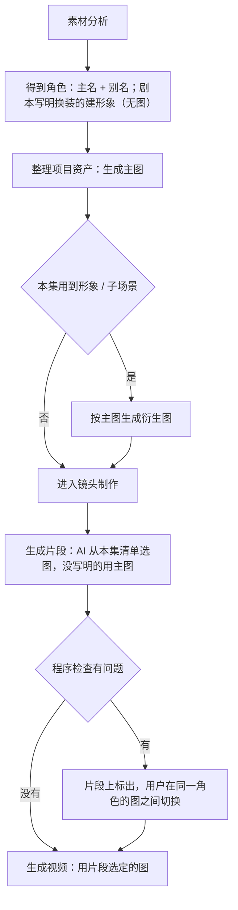

# v1.1.0 产品需求

> 本文件只写本版增量，供设计、技术规划、开发和验收使用；不是用户评审版。
> 状态：已批准（2026-11-23） · 更新：2026-11-23
> 全量基线：[当前产品文档](../../当前产品文档/README.md)（无）；参考版本：v1.0.0（还没上线、没归档，不等于线上基线；它后续的变化要复核本版）。
> 需求与验收：[requirements-list.md](requirements-list.md) · 用户评审：[requirements-review.md](requirements-review.md) · 检测：[detection-feedback.md](detection-feedback.md)

## 1. 目标与范围

- 解决：同一个角色有多种称呼、多种样子（衣服、装饰、发型），现在只能建成互不相干的几个角色，找不全、容易用错；场景同理。
- 另做：片段拆分（R-02，从 v1.0.0 移入，计划和设计图都已有）。
- 做：角色 / 场景改为“主图 + 衍生图”；别名；AI 识别和片段防错；角色列表、场景列表；资产库、一键匹配、手机端跟着适配。
- 不做：道具的衍生图；衍生图再衍生；形象单独的声线；自动合并老数据。
- 文中“v1.0.0 R-xx”指 v1.0.0 需求清单里的编号。

## 2. 改动总览

| R | 基线行为（v1.0.0） | 本版目标 | 涉及页面 / 弹框 | 正文位置 |
|---|---|---|---|---|
| R-01 | 一个角色 / 场景只有一个名字、一张图；换装只能另建角色或做本集独立副本 | 角色固定 ID、主名、别名、主图和多个形象图；场景主图和多个子场景图；衍生图按主图生成；角色列表、场景列表 | W-08 整理项目资产、W-09 分镜创作、W-11 资产库、W-13 素材详情；新增角色列表 / 场景列表 | 第 4 节 R-01 |
| R-02 | “生成提示词”写超长只能标“时长不合理”；改了时长没法按新时长重新分片段；“片段拆分”按钮不显示 | 超长自动拆成几个片段、序号顺延；“片段拆分”按钮按当前时长整集重新组合（差异核对后应用）；三处都按本集设置的时长 | W-09 分镜创作；片段拆分确认弹框 | 第 4 节 R-02 |

## 3. 本版完整用户链路

## 4. 变化页面与功能

### R-01 角色 / 场景：主图 + 衍生图（后端 + 网页端 + 手机端）

- 要解决的问题：同一个角色在不同场合衣服、装饰、发型不同，剧本里还有多种称呼。现在一个角色只有一张图、一个名字，换装只能另建一个互不相干的角色，或者在某一集做“独立副本”，找不全、也容易用错。场景同理：一套房子里的客厅、阳台、厨房现在是互不相干的几个场景。
- 名词
  - 角色：一个固定 ID；一个主名；多个别名（剧本里的其他称呼，如“老周 / 周建国 / 周叔”）；一张主图（标准图：三视图 + 面部特写，就是现在生成的角色图）。
  - 形象：角色在某种状态下的样子（衣服、装饰、发型不同）。每个形象有名称（如“婚纱”“校服”）、外观描述、一张形象图；显示为“江敏·婚纱”。形象属于这个角色，不是另一个角色。
  - 场景：一个固定 ID、名称、一张主图（拆出了子场景的场所是整个场所的俯视图，只给子场景出图做参考、不进片段；单个空间的场景是普通场景图，直接用在片段里，D-22）。子场景：这个场所里的一块区域（客厅、阳台、厨房），各有名称、描述、一张图；显示为“江敏家·客厅”。
  - 下文把形象图、子场景图统称“衍生图”，角色、场景统称“主体”。道具不变（只有一张图）。
- 规则
  - 衍生图都以主图为参考生成（人物长相 / 场所格局保持一致）。主体还没有主图时不能生成衍生图，提示“请先生成主图”。
  - 换了主图：已有衍生图不自动重新生成，卡片上提示“主图已更新，可重新生成”。
  - 声线是整个角色共用的，形象不单独设。
  - 删除主体（整理项目资产卡片“···”）：只删本集，它在本集的衍生图一起移出；本集还有片段在用时不能删（沿用现有提示）；总览列表不提供删除（D-23）。删除某个衍生图：用到它的片段改回用主图，并提示受影响的片段数。
  - 别名：同一个项目里，一个称呼只能属于一个角色（主名、别名都不能和别的角色重复），保存时检查。
  - 衍生图生成、重新生成按现有图片生成计费（先报价再确认）；识别、匹配、切换不扣积分。
- AI 识别（素材分析、重新分析本集素材 v1.0.0 R-36）
  - 别名：AI 提出“这几个称呼是同一个人”，存进角色的别名；之后由程序按主名和别名对到同一个角色，不靠 AI 每次去猜。用户可以改别名。
  - 形象 / 子场景：只有剧本明确写了换装、换发型、换装饰（或明确写了场所里的不同区域）才建，并带上剧本原句作为依据；没明确写的一律只用主图（宁少勿多，D-03）。AI 建的衍生图只有名称和描述，没有图。
  - 每集有哪些主体、哪些衍生图，随每集素材清单定好。
- 片段里怎么用、怎么保证不用错
  - 生成片段和提示词时，AI 只能从“本集清单”里选，清单里每个衍生图写明名称和描述；选了清单外的会被丢掉（现有规则）。
  - 剧本没写明是哪种形象 / 哪块区域时用主图：最坏的结果是“人对、衣服是默认的”，不会用错人。
  - 选哪个形象：看形象的出现集数和外观描述，和片段原文对得上的就用它；不要求原文里有“换装”这类字样（形象自己有描述，D-12）。
  - 同一个片段里同一个角色可以出现两个形象（如回忆和现在、换装前后），但提示词里每一处都要明确指向各自的形象，不能混成一个（D-12）。
  - 程序检查（D-12）：片段原文提到了某个形象的关键词、却用了别的形象 → 算有问题，在片段上提示用户，不报错、不判失败（和“时长不合理”一样），用户看了可以一键换。
  - 分镜创作页“参考”栏显示具体衍生图的名称和缩略图（如“江敏·婚纱”）；点它只能在**这个角色自己的**主图和形象之间切换（场景同理），不会换成别人；可选“本场戏后面的片段都用这个”。
  - 生成视频用片段上选定的那张图；生成前的核对步骤里显示衍生图名称。
  - 参考图超过视频模型的上限（同一角色两个形象会多占一张，D-21）：单个片段点“生成视频”时弹框，列出全部参考图，用户勾选这次要带的（勾选数不能超过上限；没勾的只影响这一次），再进现有报价确认；“批量生成视频”提交前列出超上限的片段，整批不提交，用户逐个“去调整”（减参考图或换模型）后再提交。上限按模型配置。
- 界面
  - 整理项目资产页（W-08）：角色卡显示主图、主名、别名数和形象数；场景卡显示主图和子场景数。本集用到的形象 / 子场景在卡片上能看到。缺图统计把本集用到的衍生图算进去；“进入镜头制作”前本集用到的衍生图都要有图。
  - 角色详情 / 场景详情（W-13）：编辑主名、别名；主图；形象（子场景）列表：新增、改名称和描述、生成 / 重新生成图、查看历史图片、删除；每个衍生图显示用在哪几集。“全部造型”就是这个角色的形象列表，“历史记录 / 历史图”是当前这个形象生成过的图（见下面“素材创建与详情”）。
  - **角色列表 / 场景列表（新）**：一个角色一行——主名、别名、主图，后面排着它的全部形象图（每张标形象名；还没出图的显示占位）；可按主名或别名搜索；点一行进角色详情。场景列表同样的形式。放两处：整理项目资产页“总览”（本项目的全部角色 / 场景，角色、场景两类改为按主体归组）和资产库的角色、场景页签（跨项目）。
  - 资产库（W-11）：角色 / 场景入库、导入时，别名和衍生图一起带上。
  - 一键匹配已有素材（v1.0.0 R-34）：主名和别名都参与名称匹配；匹配上的角色连同形象一起可用。
- 素材创建与详情（2026-11-23 按 Figma“资产素材”一组重新梳理；v1.0.0 把“全部造型”做成了图片历史，理解有误，本版改正）
  - 设计稿：创建素材 `1:1327`、`1:1439`；素材详情 `1:1551`、`1:1624`、`1:1707`、`1:1821`、`1:7769`（出现集数弹窗）；作品资产详情 `1:4516`（Figma 通道 `e3noamr1`）。
  - 一个形象 = 一条角色记录（有自己的 ID、名称、提示词、参考图、当前图、历史图、出现集数），挂在主角色下面。主角色自己的那一个是“主形象”（主图）。这样形象可以直接用现有“一条素材”的全部能力（生图、历史、出现集数、片段引用、入库）。
  - 创建素材页：名称、特征、参考图、风格、模型 → “生成素材”。新建的是一个角色和它的主形象。页面右下“历史记录（最多保存近 3 条）”是这一次创建过程里生成过的图，选一张作为主图。
  - 素材详情页：
    - 右侧“全部造型”一列 = 这个角色的全部形象：第一个是主形象，其余是衍生形象；“＋”= 新增形象（填名称和特征，以主图为参考生成）。点某个形象，左边和中间就切到它。
    - 左边大图 = 当前选中形象的当前图；“出现在第…集”= **这个形象**出现的集数（可编辑，弹窗里“清空后仍可从资产总览找到该形象”）；“历史图 / 历史记录”= 这个形象生成过的图，点一张预览、可设为当前图；“自动入库”。
    - 中间：名称（当前形象的名称，如角色“小白”下的形象“婚纱”）、音色（各造型共用，改一处全部形象生效）、参考图（衍生形象默认带主图，另可再加）、提示词、模型、“生成”。
  - 形象名称**不算别名**（D-11）：形象是同一个人的不同样子，名称只是给样子起的标签（如“长发”“短发”“婚纱”），不参与认人。认人只靠角色的主名和别名；别名是角色的，不带图、各形象共用。
  - “出现集数”是防用错的第一道：生成某一集的片段时，只把出现集数包含这一集的形象放进本集清单；一集里只有一个形象时直接用它，有多个时才由 AI 按原文选（规则见上）。
  - 作品资产详情、资产库列表：按角色归组显示（即角色列表），卡片上能看到它有几个形象。
- 取代：角色、场景的“本集独立修改（独立副本）”改用形象 / 子场景表达，入口去掉；已有的独立副本保持原样可用，不自动转换。道具的独立副本不变。
- 老数据：现有角色、场景就是“只有主图”的主体，不用迁移；老作品不做兼容（D-24）：描述里写“关联主场景”的老子场景不再自动带主场景图出图，名称以“俯视图”结尾的老场景当普通场景。
- 手机端：一起适配——能显示主体下的衍生图、在片段里切换、生成衍生图；角色列表手机端这版不做。
- 提示词：短剧、正剧两套都改。
- 不做：用一张衍生图再衍生下一层（只有两层）；道具的衍生图；形象单独的声线；自动把老的独立副本、同名角色合并成形象。
- 场景的详情页和角色用同一个结构（“全部造型”一列 = 主图 + 子场景）；道具只有一个形象，不显示“＋”（D-11）。
- 出图样式（D-13、D-22）：拆出了子场景的场所，主图出俯视图（现在是多角度室内图，提示词要改，设计 / 技术规划阶段先试出图效果）；形象图和主图一样出三视图。
- 设计依据：待出图（角色卡、角色详情的别名与形象、角色列表、场景对应界面、分镜页切换形象）。
- 验收引用：requirements-list.md 中 AC-01-1～12。

### R-02 片段拆分（后端 + 网页端，手机端只核对；2026-11-23 从 v1.0.0 移入，原 R-35）

- 要解决的问题：一个片段 = 一次视频生成，不能超过当前时长上限。单个片段“生成提示词”写长了只能报“时长不合理”；把时长改小后，原来的片段都超长，没办法按新时长重新分。
- 名词：一个片段由若干“镜头”组成（提示词里的“0-4 秒：…”“4-8 秒：…”）。拆分只在镜头之间切开，不把一个镜头切成两半。
- 功能一：生成提示词超长时自动拆（D-15，不先问用户）
  - 单个片段“生成提示词”完成后，总时长超过当前上限 →【系统】自动拆成几个片段，每个不超过上限，从镜头之间切开；拆出的片段紧跟原片段，后面的片段序号依次顺延（片段-4 拆成 2 个 → 片段-4、片段-5，原片段-5 变成片段-6）。
  - 每个新片段带自己那几个镜头的提示词、对应剧本原文、出场素材；制作参数和原片段一样。
  - 拆出的第一个片段沿用原片段：已有视频和历史记录都在（和现在“生成提示词”后一样）；新增的片段没有视频。
  - 提示“片段-4 超过 15 秒，已自动拆成 2 个片段（片段-4、片段-5），后面的片段序号已顺延”。
  - 某一个镜头自己就超过上限：不拆，照旧标“时长不合理”。不扣积分。不超长时和现在完全一样；“批量生成提示词”的拆法不变（时长按本集设置，见下一条）。
- 时长上限按本集当前设置（D-20，2026-11-20 用户“按本集设置”）：“生成提示词”“片段拆分”“批量生成提示词”都按分镜页“片段统一设置”里的时长和模型来拆（没设过就用作品的制作设置）；拆出来的新片段带上本集的设置。确认素材后第一次生成片段时本集还没有设置，仍用作品设置。
- 功能二：“片段拆分”按钮——整集重新组合（只重新分组，不重写内容；2026-11-20 用户确认）
  - 入口：分镜创作页中间提示词标题行，“生成提示词”左边，样式和它一样；任何时候可点，典型用法是改了时长或换了模型之后。
  - 不可点（置灰，鼠标移上去提示原因）：本集还没有片段；本集正在生成片段或提示词；有片段正在生成视频（“有片段正在生成视频，完成后再拆分”）；旧版拆分的集没有镜头数据（“这一集是旧版拆分的，请先批量生成提示词”，D-19）。
  - 做什么：按当前时长上限把本集所有镜头重新组合成片段，从片段-1 重新编号；上限改小 → 超长的拆开，上限改大 → 同一场景内相邻的短片段合并（D-18）；剧情顺序不变；不重写提示词、不调用 AI、不扣积分，几秒内完成。
  - 流程：【用户】点“片段拆分”→ 确认弹框（标题“按当前时长重新拆分片段？”；说明“将按当前时长上限 N 秒，把本集的镜头重新组合成片段。镜头组成没变的片段保持原样；有变化的片段会换成新的组合，手改过的提示词和已生成的视频不会带过去（可在历史记录里找回）。不消耗积分。”；下方一行“本集现有 N 个片段 · 当前时长上限 N 秒 · 当前模型 X”；按钮“取消”“确认拆分”，点确认后按钮变“拆分中…”）→【用户】确认 →【系统】重新组合 → 自动打开已有的“核对本集分析差异”弹框（新增 / 保留 / 移出，D-17）→【用户】“确认应用到本集”才生效；“暂不应用”则片段不变，顶部有“待核对”入口。
  - 保留规则：镜头组成和原来完全一样的片段原样保留（手改的提示词、视频、历史都在）；有变化的片段换成新组合，原片段和视频列为“移出”，应用后进入历史，不直接删除。某个镜头自己就超过上限 → 单独成一个片段并标“时长不合理”。
  - 结果和现在完全一样：不弹差异，提示“当前片段已符合时长上限，无需拆分”。
- 异常：自动拆分时出错 → 和现在“生成提示词”失败一样，原片段不变；“生成提示词”进行中片段被改 → 结果作废，不写回、不拆分。
- 不做：把一个镜头切成两半；“片段拆分”重写内容（要重写用“批量生成提示词”）；手动拖动镜头、手动合并 / 拆分某个片段的界面。
- 手机端（D-16）：后端行为两端统一；同一作品在手机端会看到新的片段数量和序号；手机端只核对“片段数量变了能正确显示”，有问题再做最小适配。
- 设计依据：`design-assets/v1.0.0/W-09-片段拆分-*-r1.png`（3 张，2026-11-20 出图并通过；见设计计划第 10 节）；差异核对沿用 `W-09-分析结果对比-r1.png`。
- 验收引用：requirements-list.md 中 AC-02-1～9。

## 5. 业务规则与状态

见第 4 节“规则”；价格以后端报价为准，不写死。

## 6. 异常与边界

- 没有主图生成衍生图 → 拒绝并提示；主图更换 → 衍生图不变、提示可重新生成。
- 别名重复 → 保存失败，提示属于哪个角色。
- 删除主体（只删本集）→ 先确认，本集片段在用时不能删；删除衍生图 → 先确认，片段改用主图。
- 老数据、已有独立副本 → 照常可用。
- 参考图超过视频模型上限 → 单个生成弹框让用户勾选；批量生成列出超上限的片段，先去调整（D-21）。

## 7. 验收与待确认

| R / AC | 对应正文 | 未决问题 / 检测编号 |
|---|---|---|
| R-01 / AC-01-1～13 | 第 4 节 | 决定都已确认（D-01～D-13、D-21～D-24）；技术方案已确认（2026-11-24）；设计图 12 张已通过（2026-11-23）；场景俯视图的出图效果在技术规划阶段试 |
| R-02 / AC-02-1～9 | 第 4 节 R-02 | 决定都已确认（D-14～D-20）；设计图 3 张已通过；开发计划 M01 待用户审核 |
