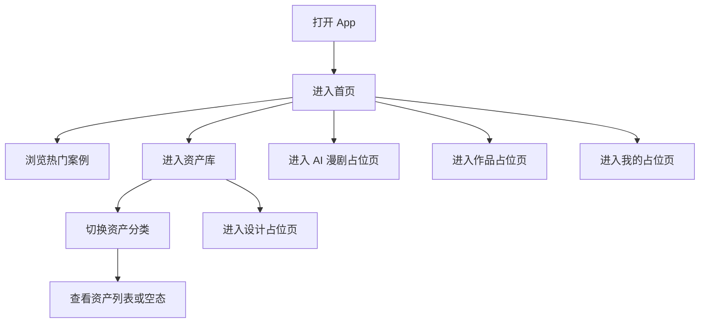
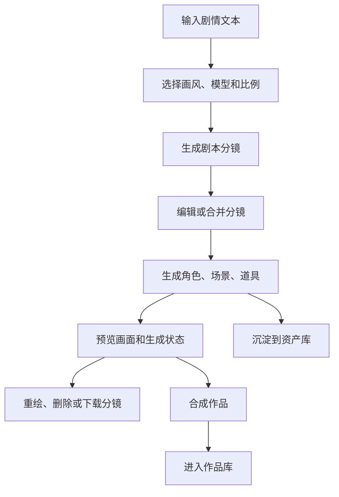
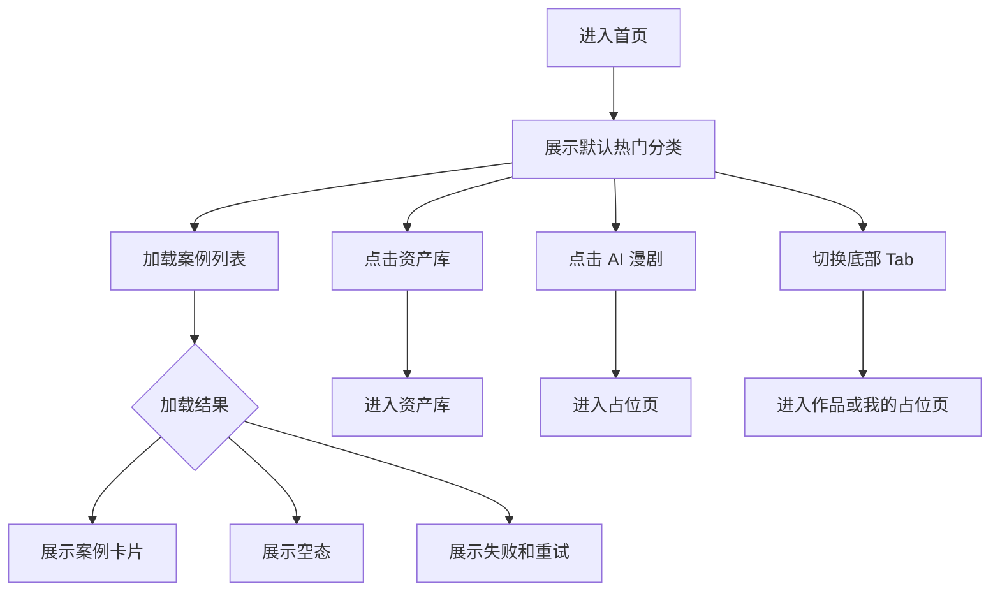
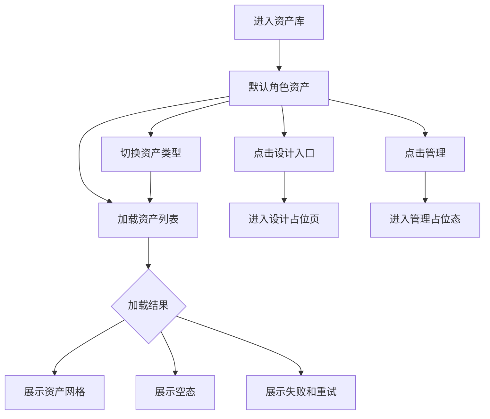
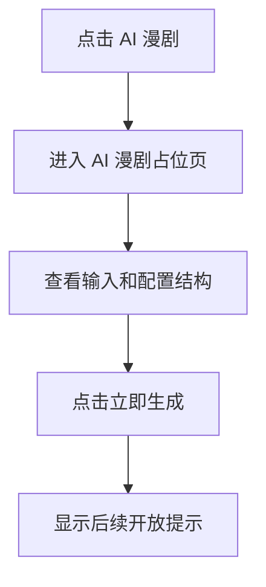
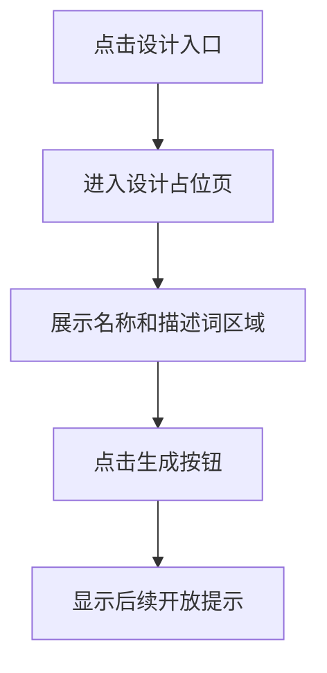
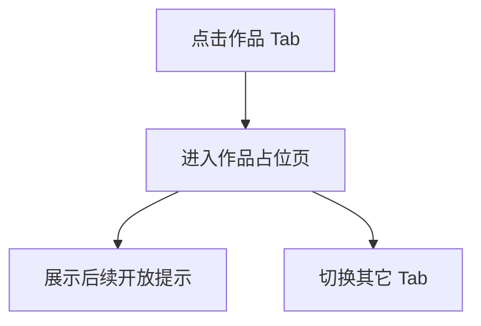
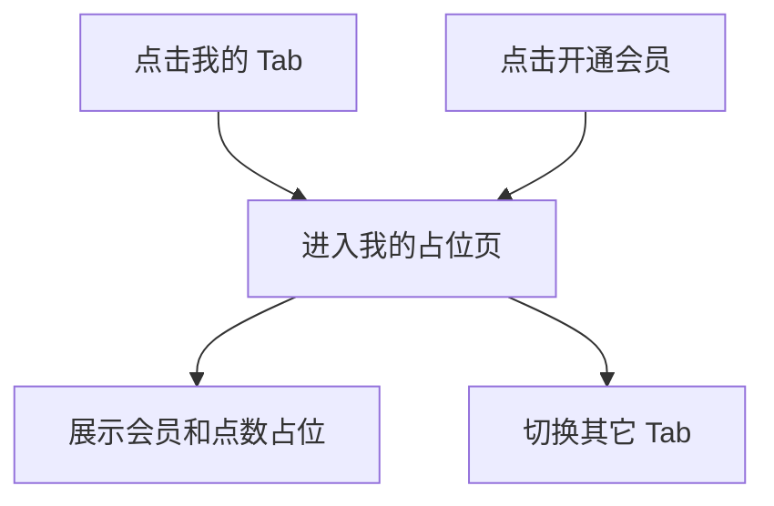
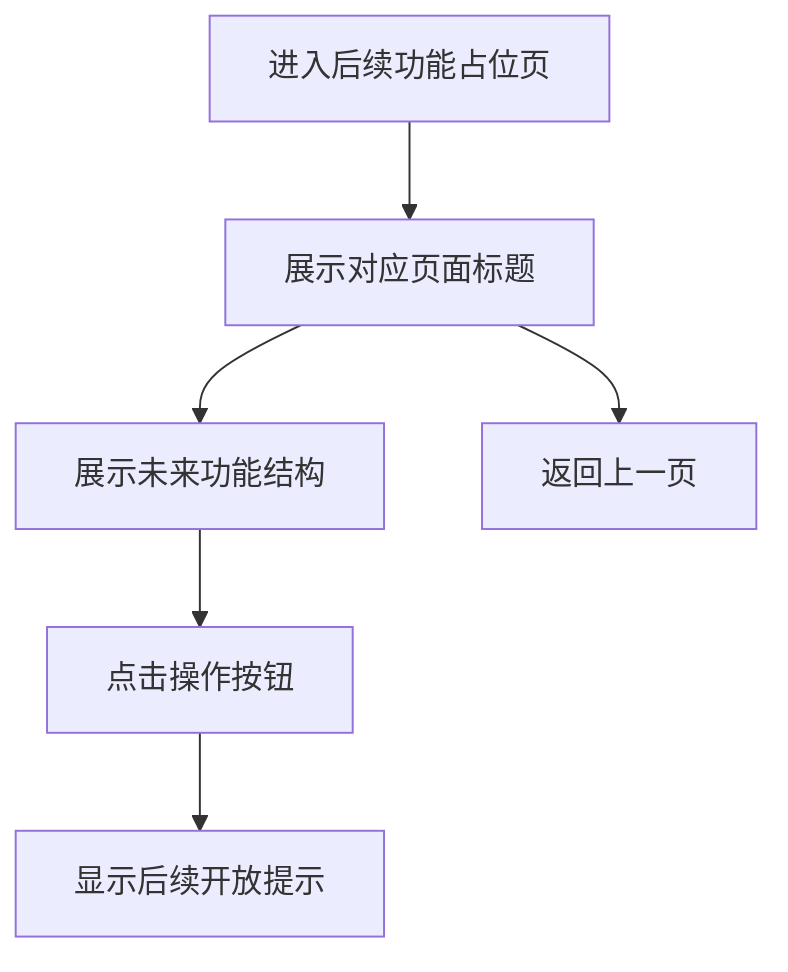

# 喵喵漫画产品需求文档（PRD）

> 当前版本：v0.1.0  
> 阶段：需求文档生成  
> 状态：待评审  
> 生成时间：2026-06-10 16:04  
> 输入来源：`01-需求/requirements-list.md`、Figma 文档 `漫剧`、用户确认“下一步”

---

## 1. 产品概述

喵喵漫画是一款移动端 AI 漫剧创作 App。产品面向短剧、小说、影视解说、漫剧内容创作者，帮助用户围绕文本剧情生成分镜、角色、场景、道具、预览画面和最终作品。

当前版本以“先可进入、可浏览、可管理资产”为目标，首期仅完整实现移动端首页与资产库。完整 AI 创作链路、生成、编辑、下载、作品管理、会员与点数等功能保留入口或占位页面，后续版本继续补齐。

工程层面：

- 前端使用 `/Users/soul/code/lxwx/make_drama`，该工程由其它项目复制而来，需要替换旧项目标识、文案、路由、资源和 `appCode`。
- 后端使用 `/Users/soul/code/lxwx/lxwx_service/lxwxservice`，需要新增喵喵漫画 App 级配置，并通过新的 `appCode` 隔离配置、案例、资产和作品数据。

---

## 2. 当前版本范围

### 2.1 本期必须实现

| 模块 | 范围 | 目标 |
|------|------|------|
| 首页 | 完整实现 | 用户进入 App 后可看到喵喵漫画首屏、功能入口、热门案例和底部导航 |
| 资产库 | 完整实现 | 用户可查看角色、场景、物品三类资产列表、空态和设计入口 |
| 占位路由 | 必须实现 | 后续功能入口不缺失，点击后进入统一风格占位页或占位弹窗 |
| App 配置 | 必须实现 | 前后端使用喵喵漫画专属 `appCode`，避免复用旧项目数据 |
| 基础状态 | 必须实现 | 页面具备加载、空态、失败、重试、占位提示 |

### 2.2 本期不做具体业务实现

| 功能 | 本期处理 |
|------|----------|
| AI 漫剧真实生成 | 只做占位页，不接真实模型生成 |
| 剧本分镜编辑与合并 | 只做占位页 |
| 角色、场景、道具真实生成 | 只做占位入口 |
| 视频预览、视频重绘、合成作品 | 只做占位页 |
| 下载分镜 | 只做占位页 |
| 删除分镜/视频 | 只做占位确认结构，不执行真实删除 |
| 作品库 | 底部 Tab 占位 |
| 我的/会员/点数 | 底部 Tab 和入口占位 |
| 支付、会员订阅、点数扣减 | 不做，保留字段和入口 |

### 2.3 本期成功标准

- App 启动后不出现旧项目名称、旧业务入口或旧 `appCode`。
- 首页和资产库在常见移动端尺寸下可正常滚动、切换和返回。
- 首页可进入 AI 漫剧占位页、资产库页面、作品占位页、我的占位页。
- 资产库可切换角色资产、场景资产、物品资产，并展示列表或空态。
- 所有 Figma 中已识别的后续功能均有入口、路由或占位，不出现点击无反馈。

---

## 3. 整体流程

### 3.1 当前版本主流程

当前版本以首页和资产库为核心。其它入口用于确认信息架构、页面路由和后续扩展位置，先不执行真实生成、编辑、下载或支付。

### 3.2 后续完整创作流程

后续版本需要围绕分镜、资产、任务、作品建立完整数据链路。本期只在路由和占位结构上预留这些节点。

---

## 4. 信息架构 / 页面结构

### 4.1 页面分层

| 层级 | 页面 / 能力 | 本期状态 |
|------|-------------|----------|
| 一级 Tab | 创作首页 | 完整实现 |
| 一级 Tab | 作品 | 占位 |
| 一级 Tab | 我的 | 占位 |
| 首页入口 | AI 漫剧 | 占位 |
| 首页入口 | 资产库 | 完整实现 |
| 资产库入口 | 角色设计 | 占位 |
| 资产库入口 | 场景设计 | 占位 |
| 资产库入口 | 物品设计 | 占位 |
| 创作链路 | 剧本分镜、设计师、角色设计、预览画面、视频重绘、下载分镜 | 占位 |
| 弹窗 | 删除确认、角色编辑 | 占位结构 |

### 4.2 Figma 参考映射

| Figma Frame | 节点 ID | 页面 / 功能 | 本期处理 |
|-------------|---------|-------------|----------|
| 首页 | `97:102` | 创作首页 | 完整实现 |
| 资产库 | `97:2345` | 资产库 | 完整实现 |
| AI 漫剧 | `97:377` | AI 漫剧生成 | 占位 |
| 剧本分镜 | `97:552` | 分镜列表与编辑 | 占位 |
| 设计师 | `97:671` | 角色/场景/道具设计结果 | 占位 |
| 角色设计 | `97:787` | 角色形象生成 | 占位 |
| 预览画面 | `97:991` | 视频生成预览 | 占位 |
| 删除 | `97:1176` | 删除确认 | 占位弹窗 |
| 下载分镜 | `97:1374` | 分镜下载 | 占位 |
| 角色 | `97:1674` | 资产选择/使用 | 占位 |
| 视频重绘 | `97:1989` | 视频重绘 | 占位 |
| 角色设计编辑弹窗 | `97:2105` | 角色编辑 | 占位弹窗 |

---

## 5. 页面级详细需求

### 5.1 首页

#### 页面定位

首页是用户进入喵喵漫画后的默认页面，负责展示核心创作入口、资产库入口、热门案例和一级底部导航。

#### 参考素材

- Figma Frame：`首页`
- 节点 ID：`97:102`
- 已识别文案：开通会员、AI漫剧、创作漫剧视频、资产库、热门案例、热门、短剧解说、漫剧解说、电影解说、电视剧解说、视频名称、创作、作品、我的。

#### 页面结构（从上到下）

1. 顶部状态/操作区：会员入口。
2. 核心功能区：AI 漫剧入口、资产库入口。
3. 热门案例标题。
4. 热门案例分类 Tab。
5. 案例瀑布/网格列表。
6. 底部导航：创作、作品、我的。

#### 区块说明

| 区块 | 内容 | 作用 | 交互 |
|------|------|------|------|
| 顶部会员入口 | 开通会员 | 保留付费入口 | 点击进入会员占位页或显示占位提示 |
| AI 漫剧入口 | AI漫剧、创作漫剧视频 | 引导用户开始创作 | 点击进入 AI 漫剧占位页 |
| 资产库入口 | 资产库 | 引导用户管理创作资产 | 点击进入资产库页面 |
| 热门案例标题 | 热门案例 | 告知下方内容区类型 | 无特殊交互 |
| 分类 Tab | 热门、短剧解说、漫剧解说、电影解说、电视剧解说 | 筛选案例 | 点击切换当前分类并刷新列表 |
| 案例卡片 | 封面、时长、标题 | 展示热门内容 | 点击进入案例详情占位或预览占位 |
| 底部导航 | 创作、作品、我的 | 一级页面切换 | 创作停留首页；作品/我的进入占位页 |

#### 主要功能

- 默认进入创作首页。
- 分类 Tab 可切换并保持选中状态。
- 案例列表支持加载、空态、失败、重试。
- 入口点击必须有反馈，不允许无响应。
- 页面文案、标题和占位提示必须使用喵喵漫画语境。

#### 交互流程图

#### 详细交互说明

- 用户进入 App 后默认选中底部 `创作`。
- 页面先展示基础骨架，再加载案例数据。
- 用户点击分类 Tab 时，当前 Tab 高亮，案例列表切换到对应分类。
- 如果接口或配置没有返回案例，显示空态，不隐藏分类区。
- 用户点击 `资产库` 后进入资产库真实页面。
- 用户点击 `AI漫剧`、`开通会员`、案例卡片、`作品`、`我的` 时，进入对应占位页或占位提示。

#### 关键状态 / 异常情况

| 状态 | 表现 | 处理 |
|------|------|------|
| 首次加载 | 骨架或 loading | 数据返回后展示列表/空态 |
| 无案例 | 空态文案 + 保留分类 Tab | 不阻塞页面使用 |
| 加载失败 | 错误提示 + 重试按钮 | 点击重试重新加载当前分类 |
| 旧项目数据 | 不得展示 | 通过 `appCode` 和本地文案替换规避 |
| 路由未实现 | 统一占位页 | 不出现点击无反应 |

#### 验收标准

- 首页视觉结构与 Figma 首页一致或接近。
- 所有主要入口可点击并有明确反馈。
- 案例分类可切换。
- 首页不出现旧项目名称、旧业务图标或旧 App 文案。
- 底部导航三项均可切换。

### 5.2 资产库

#### 页面定位

资产库用于管理用户在漫剧创作中使用的角色、场景、物品资产。本期实现分类切换、列表展示、空态、设计入口和管理入口占位。

#### 参考素材

- Figma Frame：`资产库`
- 节点 ID：`97:2345`
- 已识别文案：资产库、角色资产、场景资产、物品资产、管理、角色设计、场景设计、物品设计、角色名称、创作、作品、我的。

#### 页面结构（从上到下）

1. 顶部导航区：标题资产库，返回或页面导航能力按 App 现有规范处理。
2. 设计快捷入口：角色设计、场景设计、物品设计。
3. 资产分类 Tab：角色资产、场景资产、物品资产。
4. 管理入口。
5. 资产网格列表。
6. 底部导航：创作、作品、我的。

#### 区块说明

| 区块 | 内容 | 作用 | 交互 |
|------|------|------|------|
| 顶部标题 | 资产库 | 标识当前页面 | 返回/导航按工程规范处理 |
| 设计快捷入口 | 角色设计、场景设计、物品设计 | 创建新资产的入口 | 点击进入对应占位页 |
| 资产分类 Tab | 角色资产、场景资产、物品资产 | 按类型查看资产 | 点击切换并刷新列表 |
| 管理入口 | 管理 | 后续批量管理入口 | 本期进入管理占位态或提示 |
| 资产卡片 | 缩略图、名称 | 展示资产 | 点击进入资产详情/使用占位页 |
| 底部导航 | 创作、作品、我的 | 一级页面切换 | 同首页 |

#### 主要功能

- 默认进入角色资产分类。
- 支持角色资产、场景资产、物品资产三类切换。
- 每类资产都支持列表、空态、加载失败、重试。
- 设计入口必须存在，点击后进入对应占位页。
- 管理入口必须存在，点击后有占位反馈。

#### 交互流程图

#### 详细交互说明

- 用户从首页点击资产库入口进入本页。
- 页面默认选中 `角色资产`。
- 点击 `场景资产` 或 `物品资产` 后，列表切换到对应类型。
- 如果当前类型没有数据，显示空态和创建入口。
- 点击角色设计、场景设计、物品设计，进入占位页面，后续接入真实生成。
- 点击管理进入占位态，后续支持批量选择、删除、重命名等能力。

#### 关键状态 / 异常情况

| 状态 | 表现 | 处理 |
|------|------|------|
| 有资产 | 网格展示缩略图和名称 | 点击进入占位详情 |
| 无资产 | 分类空态 | 保留创建入口 |
| 加载中 | loading 或骨架 | 不阻塞 Tab 切换 |
| 加载失败 | 错误提示 + 重试 | 重试当前分类 |
| 图片加载失败 | 占位图 | 名称仍可见 |

#### 验收标准

- 资产库页面结构与 Figma 资产库一致或接近。
- 三类资产 Tab 可切换。
- 资产列表、空态、失败、重试状态完整。
- 角色设计、场景设计、物品设计入口存在并可进入占位页。
- 管理入口存在并有反馈。

### 5.3 AI 漫剧占位页

#### 页面定位

AI 漫剧页是后续完整创作链路入口。本期只保留页面结构和入口，不接真实生成。

#### 参考素材

- Figma Frame：`AI 漫剧`
- 节点 ID：`97:377`
- 已识别文案：AI 漫剧、请描述您的小说内容、清除、粘贴、选择画风、模型、视频比例、16:9、9:16、立即生成。

#### 页面结构（从上到下）

1. 标题：AI 漫剧。
2. 文本输入区占位。
3. 清除、粘贴操作占位。
4. 选择画风区。
5. 模型选择区。
6. 视频比例选择区。
7. 立即生成按钮。

#### 区块说明

本期所有输入、选择和生成操作均展示占位态。用户点击立即生成时，提示“该功能后续开放”或进入剧本分镜占位页，具体在技术方案阶段确定。

#### 主要功能

- 从首页 AI 漫剧入口进入。
- 展示未来创作结构。
- 不执行真实生成。

#### 交互流程图

#### 详细交互说明

- 输入框可不可输入由前端实现阶段决定，但不得调用真实生成接口。
- 清除、粘贴、模型、比例按钮都应有基础点击反馈或禁用说明。
- 页面需要保持喵喵漫画视觉风格。

#### 关键状态 / 异常情况

- 无网络时也可打开占位页。
- 点击生成不应产生计费、任务或后端写入。

#### 验收标准

- 首页可进入该页。
- 页面不存在旧项目文案。
- 点击生成有明确占位反馈。

### 5.4 设计入口占位页

#### 页面定位

设计入口承接资产库中的角色设计、场景设计、物品设计，以及后续设计师流程。本期以占位页形式保留。

#### 参考素材

- Figma Frame：`设计师`、`角色设计`、`角色设计编辑弹窗`
- 节点 ID：`97:671`、`97:787`、`97:2105`
- 已识别文案：设计师、角色设计、场景设计、道具设计、角色名称、场景名称、道具名称、新建形象、编辑、生成图片、全部生成、角色编辑、生成角色。

#### 页面结构（从上到下）

1. 标题：根据入口展示角色设计、场景设计或物品设计。
2. 资产预览占位。
3. 描述词/名称编辑占位。
4. 生成按钮占位。

#### 区块说明

本期不接入真实生成，只保留后续编辑和生成入口。角色编辑弹窗可以统一为占位弹窗或占位页面。

#### 主要功能

- 用户从资产库设计入口进入。
- 页面显示当前设计类型。
- 点击生成类按钮展示占位提示。

#### 交互流程图

#### 详细交互说明

- 角色设计、场景设计、物品设计可以复用同一占位模板，标题和文案按类型区分。
- 不产生真实资产，不扣点数。
- 后续版本再接入描述词编辑、批量生成和资产入库。

#### 关键状态 / 异常情况

- 从三类入口进入时标题必须正确。
- 返回后保留资产库原分类。

#### 验收标准

- 三类设计入口均可进入。
- 页面标题与入口类型一致。
- 生成按钮有明确占位反馈。

### 5.5 作品占位页

#### 页面定位

作品页用于后续展示用户生成的漫剧作品。本期作为底部 Tab 占位。

#### 参考素材

- 首页底部 Tab：作品。

#### 页面结构（从上到下）

1. 标题：作品。
2. 占位空态：提示作品功能后续开放。
3. 底部导航。

#### 区块说明

作品页暂不展示真实作品列表，不调用作品接口。

#### 主要功能

- 底部导航可进入。
- 可返回创作首页或我的页。

#### 交互流程图

#### 详细交互说明

- 点击作品 Tab 后高亮作品。
- 页面保留未来作品列表入口空间。

#### 关键状态 / 异常情况

- 不依赖网络。
- 不展示旧项目作品数据。

#### 验收标准

- 作品 Tab 可点击。
- 页面为空态占位，不报错。

### 5.6 我的占位页

#### 页面定位

我的页用于后续展示用户资料、会员、点数、设置等信息。本期作为底部 Tab 占位。

#### 参考素材

- 首页底部 Tab：我的。
- 首页会员入口：开通会员。

#### 页面结构（从上到下）

1. 标题：我的。
2. 用户信息占位。
3. 会员/点数占位。
4. 设置入口占位。
5. 底部导航。

#### 区块说明

我的页暂不接入登录、支付、会员或点数接口，只保留后续能力位置。

#### 主要功能

- 底部导航可进入。
- 首页会员入口可进入我的/会员占位。

#### 交互流程图

#### 详细交互说明

- 点击我的 Tab 后高亮我的。
- 点击开通会员可以进入我的页或会员占位弹窗，需在技术方案阶段确定。

#### 关键状态 / 异常情况

- 未登录也可展示占位页。
- 不触发支付。

#### 验收标准

- 我的 Tab 可点击。
- 会员入口有反馈。
- 不出现旧项目用户中心文案。

### 5.7 后续链路占位页集合

#### 页面定位

该集合承接剧本分镜、预览画面、下载分镜、视频重绘、删除确认等后续创作链路。本期只确保入口、路由和占位反馈完整。

#### 参考素材

- Figma Frame：`剧本分镜`、`预览画面`、`删除`、`下载分镜`、`视频重绘`、`角色`
- 节点 ID：`97:552`、`97:991`、`97:1176`、`97:1374`、`97:1989`、`97:1674`
- 已识别文案：剧本分镜、共计12个分镜、向上合并、向下合并、预览画面、视频生成中、画面描述词、合成作品、下载分镜、删除视频、视频重绘、全选、下载、生成视频。

#### 页面结构（从上到下）

1. 页面标题：按入口展示。
2. 核心内容占位：分镜列表、预览区域、描述词、资产引用等。
3. 操作按钮占位：生成、合成、下载、删除、重绘。
4. 状态提示：后续开放。

#### 区块说明

后续链路占位页可复用统一模板，但需要通过标题和说明区分具体功能，避免用户误认为当前功能已完成。

#### 主要功能

- 路由存在。
- 返回路径存在。
- 点击操作按钮有占位提示。
- 不调用真实生成、下载、删除、合成接口。

#### 交互流程图

#### 详细交互说明

- 剧本分镜占位需要展示分镜列表结构和生成按钮位置。
- 预览画面占位需要展示生成状态、画面描述词、角色/场景引用和合成作品按钮位置。
- 下载分镜占位需要展示分镜条目、全选和下载按钮位置。
- 视频重绘占位需要展示描述词、资产引用和生成视频按钮位置。
- 删除确认占位需要展示取消和确定，但确定不执行真实删除。

#### 关键状态 / 异常情况

- 任何占位操作不得产生后端写入。
- 删除确认不得删除本地或远端数据。
- 下载不得触发系统下载。

#### 验收标准

- 所有 Figma 后续页面均有对应入口或可达路由。
- 所有占位操作均有明确反馈。
- 不出现点击无响应或页面空白。

---

## 6. 数据与同步

### 6.1 App 级隔离

后端需要为喵喵漫画新增独立 App 配置，前端所有与业务相关的接口请求需携带或绑定新的 `appCode`。该 `appCode` 用于隔离：

- 首页热门案例。
- 资产库角色、场景、物品。
- 后续作品、生成任务、资源记录。
- 运营配置、价格/点数预留配置。

`appCode` 最终值待确认。候选值：`catcomic`、`miaomiao_comic`。

### 6.2 首页数据

首页案例数据建议字段：

| 字段 | 说明 |
|------|------|
| `id` | 案例 ID |
| `appCode` | App 标识 |
| `category` | 分类：热门、短剧解说、漫剧解说、电影解说、电视剧解说 |
| `title` | 视频名称 |
| `coverUrl` | 封面图 |
| `duration` | 视频时长 |
| `sort` | 排序 |
| `jumpType` | 跳转类型 |
| `jumpTarget` | 跳转目标，占位阶段可为空 |

首期数据来源在技术方案阶段确定，可选：

- 后端真实接口。
- 后端配置接口返回静态案例。
- 前端本地 mock 或空态。

### 6.3 资产库数据

资产库建议字段：

| 字段 | 说明 |
|------|------|
| `id` | 资产 ID |
| `appCode` | App 标识 |
| `userId` | 用户 ID，未接登录时可暂留 |
| `assetType` | `role`、`scene`、`item` |
| `name` | 资产名称 |
| `coverUrl` | 缩略图 |
| `prompt` | 描述词，后续使用 |
| `resourceUrl` | 资源地址，后续使用 |
| `status` | 生成状态，后续使用 |
| `createdAt` | 创建时间 |
| `updatedAt` | 更新时间 |

首期如果不做真实生成，资产库可以展示后端已有资产、配置资产、本地 mock 或空态；但接口和数据结构需为后续生成入库预留。

### 6.4 同步策略

- 首页和资产库均应按当前 `appCode` 获取数据。
- 资产库分类切换时按类型重新请求或从缓存中过滤。
- 网络失败时保留当前已有数据，并提供重试。
- 如果用户登录体系未接入，用户维度可在技术方案阶段选择临时匿名用户、测试用户或仅展示公共资产。

---

## 7. 核心业务规则

### 7.1 首页规则

- 默认选中热门分类。
- 分类切换只影响案例列表，不影响顶部入口。
- 案例为空时不隐藏热门案例区。
- 首页所有入口必须使用喵喵漫画命名与路由。

### 7.2 资产库规则

- 默认选中角色资产。
- 资产类型固定为角色、场景、物品三类。
- 管理入口本期只占位，不执行批量操作。
- 设计入口本期只占位，不执行真实生成。
- 资产列表不得混入其它 App 的资产。

### 7.3 占位功能规则

- 占位页必须可返回。
- 占位按钮必须有提示。
- 占位页不得调用真实生成、下载、删除、支付接口。
- 占位页不得产生点数扣减或订单。

### 7.4 AppCode 规则

- 前端不得沿用复制项目的旧 `appCode`。
- 后端所有喵喵漫画配置和数据需要绑定新 `appCode`。
- 后续 Web/Admin 如加入管理能力，也需要支持按 `appCode` 切换和维护喵喵漫画数据。

---

## 8. 前后端交互说明

### 8.1 建议接口清单

| 场景 | 方法 | 路径建议 | 说明 | 本期必要性 |
|------|------|----------|------|------------|
| App 配置 | GET | `/api/app/config` | 根据 `appCode` 获取 App 基础配置 | 必要 |
| 首页案例分类 | GET | `/api/comic/case/categories` | 获取热门案例分类 | 可选，可前端静态 |
| 首页案例列表 | GET | `/api/comic/cases` | 获取分类下案例列表 | 视数据源决定 |
| 资产列表 | GET | `/api/comic/assets` | 按资产类型获取资产 | 视数据源决定 |
| 资产详情 | GET | `/api/comic/assets/{id}` | 后续详情/使用 | 占位 |
| 生成任务 | POST | `/api/comic/generate` | 后续 AI 生成入口 | 占位 |
| 作品列表 | GET | `/api/comic/works` | 后续作品页 | 占位 |

实际路径需后续技术方案结合现有后端路由规范确定。

### 8.2 请求参数要求

| 参数 | 说明 |
|------|------|
| `appCode` | 喵喵漫画 App 标识 |
| `assetType` | 资产类型：`role`、`scene`、`item` |
| `category` | 首页案例分类 |
| `page` / `pageSize` | 列表分页，首期可选 |
| 登录 Token | 如现有工程要求鉴权，则沿用已有鉴权机制 |

### 8.3 前端处理要求

- 前端需要统一维护喵喵漫画 `appCode`。
- 接口失败时页面展示错误态，不闪退。
- 占位页不调用生成、下载、删除、支付接口。
- 旧项目 API、旧项目 Controller、旧项目页面命名需要在编码阶段清理或替换。

### 8.4 后端处理要求

- 新增喵喵漫画 App 配置。
- 新增或复用 App 配置表时，必须保证 `appCode` 唯一。
- 首页案例和资产数据都必须能按 `appCode` 查询。
- 后续生成链路预留任务状态、资源持久化、点数消耗字段。
- 接口注释、鉴权、安全策略需遵守后端工程规则。

---

## 9. 非功能要求

### 9.1 兼容性

- 支持常见 iOS 和 Android 移动端尺寸。
- 首页、资产库、占位页在小屏设备上不可出现文字严重遮挡、按钮不可点击或底部导航被遮挡。

### 9.2 性能

- 首页首屏入口应优先可见，案例列表可延迟加载。
- 资产库分类切换应有即时反馈。
- 图片加载失败需展示占位图，避免列表布局塌陷。

### 9.3 可维护性

- 首页、资产库、占位页应拆分清晰，避免把所有逻辑堆在一个页面。
- `appCode`、路由名、页面文案应集中管理，便于后续切换与检查。
- 占位页应复用统一组件，减少后续替换成本。

### 9.4 合规与安全

- 本期不接入支付，不产生真实扣费。
- 生成类按钮不应绕过占位直接调用第三方模型。
- 资产和案例接口需要遵守现有登录态、鉴权和数据隔离规则。

### 9.5 验证要求

- Flutter 代码阶段：格式化、静态分析、必要测试、`git diff --check`。
- Java 代码阶段：后端测试、接口契约检查、`git diff --check`。
- 当前 PRD 阶段不修改代码，仅生成文档。

---

## 10. 里程碑

| 里程碑 | 内容 | 输出 |
|--------|------|------|
| M1 需求确认 | 确认 PRD、`appCode`、首期数据源 | `requirements.md` 评审通过 |
| M2 需求检测 | 检查 PRD 完整性、冲突和待确认项 | `detection-feedback.md` |
| M3 设计计划 | 基于已有 Figma 输出页面设计计划 | `figma-design-plan.md` |
| M4 技术方案 | 明确前后端架构、接口、数据源和 App 配置 | `tech-plan.md` |
| M5 前后端计划 | 输出 Flutter/Java 技术文档和开发计划 | `flutter-tech.md`、`java-tech.md`、开发计划 |
| M6 编码实现 | 调整前端工程并新增后端 App 能力 | 首页、资产库、占位页、App 配置接口 |
| M7 联调验证 | 验证首页、资产库、AppCode 隔离和占位路由 | QA 记录 |

---

## 11. 待确认项

| 编号 | 待确认项 | 当前建议 | 影响 |
|------|----------|----------|------|
| Q1 | 最终 `appCode` | `catcomic` 或 `miaomiao_comic` 二选一 | 影响前后端配置、接口、数据隔离 |
| Q2 | App 包名 / Bundle ID | 后续技术方案阶段确定 | 影响构建、上架 |
| Q3 | 首页热门案例首期数据源 | 技术方案阶段选择后端接口、配置接口、本地 mock 或空态 | 影响后端范围和联调工作量 |
| Q4 | 资产库首期数据源 | 技术方案阶段选择后端真实资产、配置资产、本地 mock 或空态 | 影响后端表结构和接口 |
| Q5 | 首期是否接登录态 | 默认沿用现有工程登录态；若不接则展示公共/匿名数据 | 影响资产用户维度 |
| Q6 | 会员与点数是否展示真实余额 | 默认只占位不接真实支付/点数 | 影响后端计费和用户中心 |
| Q7 | Figma 设计计划阶段是否继续 | 当前已有 Figma，可继续输出设计计划 | 影响前端 UI 实现细节 |
| Q8 | `/Users/soul/code/lxwx/make_drama/AGENTS.md` 中旧路径如何处理 | 编码前确认或修正为当前工程 | 影响编码阶段规则加载 |

---

## 12. PRD 结论

喵喵漫画 v0.1.0 首期目标明确为：完成移动端首页与资产库，建立喵喵漫画 App 标识和数据隔离基础，同时为完整 AI 漫剧创作链路保留入口和占位页面。

PRD 生成后应进入“需求文档检测”阶段，检查范围、页面、数据、接口和待确认项是否一致。
