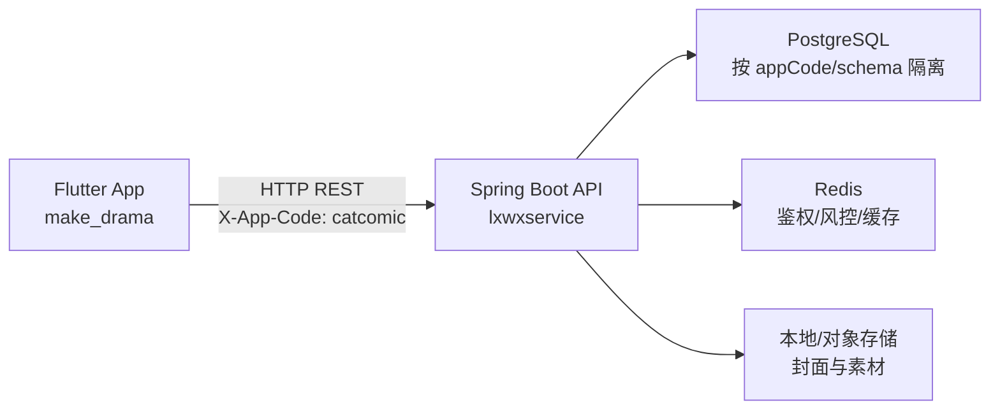

# 喵喵漫画 技术方案计划

> 版本：v0.1.2
> 创建日期：2026-06-10
> 关联需求文档：../01-需求/requirements.md
> 关联设计计划：../01-需求/figma-design-plan.md
> 本期边界：首页与资产库完整实现；其它 Figma 功能保留入口、路由和占位反馈。

---

## 1. 系统架构概述

### 1.1 整体架构

喵喵漫画沿用现有前后端分离架构：



本期不接真实 AI 生成、下载、删除、支付、会员扣点链路。前端只实现首页、资产库、统一占位页和占位弹窗；后端只补喵喵漫画 App 配置、首页案例数据和资产库轻量读取接口。

### 1.2 AppCode 策略

技术方案默认收口为：

| 项 | 值 | 说明 |
|----|----|------|
| App 名称 | `喵喵漫画` | 替换复制工程里的旧名称 |
| appCode | `catcomic` | 推荐最终值，短、低歧义、符合后端小写规则 |
| 请求头 | `X-App-Code: catcomic` | 前端现有 `AppConstants.appCodeHeader` 已是该请求头 |
| 后端路由配置 | `app.schema-routing.mappings.catcomic` | 新增 appCode 到 schema 的映射 |
| 数据隔离 | schema + `app_code` 双保险 | 现有后端已经按 schema routing 与 `app_code` 查询隔离 |

编码前若用户明确改用 `miaomiao_comic`，只影响常量、配置、代码化初始化数据和测试用例，不改变整体架构。

### 1.3 技术栈选型

| 层级 | 技术 | 版本 / 现状 | 选型理由 |
|------|------|-------------|----------|
| 前端 | Flutter | Dart SDK `^3.11.4`，工程 `/Users/soul/code/lxwx/make_drama` | 复用现有移动端工程与构建体系 |
| 路由 | `go_router` | `^17.2.3` | 工程已使用，适合补占位路由 |
| 状态管理 | GetX | `get ^4.7.3` | 工程已有 `GetxController` / Store 体系，避免引入新框架 |
| HTTP | Dio | `dio ^5.9.2` | 工程已有 `HttpService`，默认携带 `X-App-Code` |
| 本地存储 | GetStorage / Hive | 已接入 | 保存配置、登录态、缓存和轻量本地状态 |
| 后端 | Java + Spring Boot | Java 21 / Spring Boot 3.3.0 / Gradle | 复用现有后端 |
| ORM | MyBatis-Plus | `3.5.7` | 工程现有表实体、Mapper 和分页模式 |
| 数据库 | PostgreSQL | Flyway migration | 已有 schema routing 与 Flyway 多 schema 迁移 |
| 缓存/风控 | Redis | Spring Data Redis | 复用登录、短信、后续任务状态能力 |
| 鉴权 | JWT Bearer Token | 现有 Security | 本期首页可匿名，资产库兼容匿名/登录态 |
| API 文档 | springdoc-openapi | `2.6.0` | 继续使用现有 OpenAPI 输出 |

---

## 2. 数据库设计

### 2.1 现有可复用数据表

| 表 | 用途 | 本期处理 |
|----|------|----------|
| `app_configs` | App 级配置 JSON | 表结构复用；`catcomic` 配置数据不写在 SQL 迁移里，后续通过代码或后台维护 |
| `home_case_categories` | 首页案例分类 | `catcomic` 表结构在专属迁移创建；分类数据通过代码或后台添加 |
| `home_hot_cases` | 首页热门案例 | `catcomic` 表结构在专属迁移创建；案例数据通过代码或后台添加，无素材时允许返回空列表 |
| `home_case_operation_logs` | 首页案例后台操作日志 | 复用后台维护能力 |
| `tb_product` / 积分会员表 | 支付、会员、点数 | 本期不接真实支付；如现有页面引用，必须转为占位或隐藏真实购买入口 |

后端现有 Flyway 会对 `app.schema-routing.mappings` 中的每个 schema 执行迁移。新增 `catcomic` 后会自动创建对应 schema 并建表，但还需要新增 `catcomic` 专属表结构迁移，确保首页表和资产表存在。迁移脚本只允许创建表、修改表、索引、约束和注释，不在 SQL 中直接写入业务数据、JSON 配置或示例资产；这些数据后续通过代码、后台接口或运营导入添加。

### 2.2 新增资产库表

本期资产库需要独立轻量表，避免复用旧生成资源表造成字段语义混乱。

| 表 | 字段 | 说明 |
|----|------|------|
| `comic_assets` | `id` | 主键 |
|  | `app_code` | 固定为 `catcomic`，所有查询必带 |
|  | `user_id` | 可空；为空表示系统/示例资产，非空表示用户资产 |
|  | `asset_type` | `ROLE` / `SCENE` / `ITEM` |
|  | `asset_name` | 资产名称 |
|  | `cover_url` | 缩略图 |
|  | `description` | 简短描述，P0 可为空 |
|  | `source_type` | `SYSTEM` / `USER` / `GENERATED`，P0 主要使用 `SYSTEM` |
|  | `status` | `ACTIVE` / `DISABLED` / `DELETED` |
|  | `sort_order` | 列表排序 |
|  | `metadata_json` | 未来扩展角色设定、场景描述、道具参数 |
|  | `created_at` / `updated_at` / `deleted_at` | 审计字段 |

建议索引：

| 索引 | 字段 | 用途 |
|------|------|------|
| `idx_comic_assets_app_type_sort` | `(app_code, asset_type, status, sort_order, id)` | 资产库三类 Tab 列表 |
| `idx_comic_assets_user_app_type` | `(user_id, app_code, asset_type, created_at)` | 未来用户资产 |

### 2.3 未来预留表

以下表本期不建或只在后续生成链路技术方案中细化：

| 未来表 | 用途 | 本期处理 |
|--------|------|----------|
| `comic_generation_tasks` | AI 漫画 / 漫剧生成任务 | 占位路由，不写入 |
| `comic_shot_plans` | 剧本分镜与镜头文案 | 占位路由，不写入 |
| `comic_asset_generations` | 角色/场景/物品生成记录 | 占位路由，不写入 |
| `comic_works` | 合成作品 | 作品 Tab 占位，不读取旧作品 |

### 2.4 ER 图（文字描述）

- `app_configs.app_code` 与 `catcomic` 绑定一组 App 配置。
- `home_case_categories.app_code = catcomic` 下有多个首页分类。
- `home_hot_cases.app_code = catcomic`，并通过 `category_id` 归属到 `home_case_categories`。
- `comic_assets.app_code = catcomic`，按 `asset_type` 分为角色、场景、物品；`user_id` 为空时为系统示例资产，非空时为用户资产。
- 未来生成链路中，`comic_generation_tasks` 可关联 `comic_assets` 与 `comic_works`，但本期不产生该关系。

---

## 3. API 接口规划

### 3.1 接口列表

| 模块 | 方法 | 路径 | 鉴权 | 描述 |
|------|------|------|------|------|
| App 配置 | GET | `/api/config/app` | 可匿名 | 复用现有配置接口，返回协议、更新、预设等 App 配置 |
| 首页分类 | GET | `/api/config/home-case-categories` | 可匿名 | 现有接口；按 `X-App-Code=catcomic` 返回首页分类 |
| 首页案例 | GET | `/api/config/home-cases?categoryCode=hot` | 可匿名 | 现有接口；按分类返回热门案例 |
| 首页案例详情 | GET | `/api/config/home-cases/{caseId}` | 可匿名 | 案例卡片详情占位或预览占位 |
| 首页案例使用 | POST | `/api/config/home-cases/{caseId}/use` | 可匿名 | 现有统计接口；P0 可调用，也可前端仅跳占位 |
| 资产分类 | GET | `/api/comic/assets/tabs` | 可匿名 | 返回角色资产、场景资产、物品资产三类配置 |
| 资产列表 | GET | `/api/comic/assets?assetType=ROLE&page=1&pageSize=20` | 可匿名，兼容登录 | 返回资产列表；未登录只返回系统资产，登录后可合并用户资产 |
| 资产详情 | GET | `/api/comic/assets/{assetId}` | 可匿名，兼容登录 | 资产详情占位使用 |
| 占位动作 | 无 | 前端本地处理 | 无 | AI 生成、设计、下载、删除、重绘不调用后端 |

### 3.2 接口规范

- 所有用户端 `/api/**` 请求必须携带 `X-App-Code: catcomic`。
- 统一返回格式沿用后端 `ApiResponse<T>`：`{ code, message, data, traceId }`。
- 分页格式沿用 `PageResult<T>`：`{ items, page, pageSize, total, hasMore }`。
- 鉴权使用 `Authorization: Bearer <token>`；本期首页匿名可用，资产库匿名返回系统资产，登录后再扩展用户资产。
- 空数据返回空数组或 `PageResult.items=[]`，不使用业务异常表达空态。
- 图片 URL 允许相对路径，前端按现有 `HttpService.baseUrl` 解析为完整 URL。

### 3.3 错误码与状态

| 场景 | HTTP / 业务表现 | 前端处理 |
|------|-----------------|----------|
| 缺少 `X-App-Code` | 400 / `BAD_REQUEST` | 显示加载失败与重试 |
| 未配置 `catcomic` | 400 / `Unsupported X-App-Code` | 编码自测必须拦截 |
| 分类无数据 | 200 / 空数组 | 首页显示空态 |
| 资产无数据 | 200 / `items=[]` | 资产库显示空态和设计入口 |
| 服务异常 | 5xx / `SERVER_ERROR` | 显示错误态 + 重试 |

---

## 4. 前端模块划分（Flutter）

### 4.1 页面路由规划

| 路由 | 页面 | 本期状态 |
|------|------|----------|
| `/` | 主框架 / 创作首页 | 完整实现 |
| `/home` | 创作首页别名或主 Tab 内页 | 完整实现 |
| `/assets` | 资产库 | 完整实现 |
| `/placeholder/ai-comic` | AI 漫剧占位 | 占位 |
| `/placeholder/designer/:type` | 角色/场景/物品设计占位 | 占位 |
| `/placeholder/shot-plan` | 剧本分镜占位 | 占位 |
| `/placeholder/preview` | 预览画面占位 | 占位 |
| `/placeholder/download` | 下载分镜占位 | 占位 |
| `/placeholder/redraw` | 视频重绘占位 | 占位 |
| `/works` | 作品 Tab | 占位 |
| `/mine` | 我的 Tab / 会员入口 | 占位 |

现有工程已存在 `/creation/video`、`/home-cases/:id`、`/works/:id` 等旧项目路由。编码阶段需要判断哪些保留、哪些改为喵喵漫画占位，避免旧业务页面泄漏到新 App。

### 4.2 核心模块列表

| 模块 | 功能描述 | 优先级 |
|------|----------|--------|
| App 身份配置 | `AppConstants.appName=喵喵漫画`、`appCode=catcomic`、旧 URL Scheme 与文案清理 | P0 |
| 主题与 Token | 深色背景、卡片、Tab、按钮、空态、错误态、底部导航样式 | P0 |
| 路由与主框架 | GoRouter 路由、底部 Tab、统一占位页、返回策略 | P0 |
| 首页模块 | 顶部会员入口、AI 漫剧入口、资产库入口、热门分类、案例列表 | P0 |
| 资产库模块 | 三类设计入口、资产 Tab、资产网格、管理占位 | P0 |
| 占位模块 | AI 漫剧、设计、作品、我的、分镜、预览、下载、重绘、删除弹窗 | P0 |
| API 模块 | 首页复用现有 `HomeAPI`，新增 `ComicAssetAPI` | P0 |
| 数据模型 | `HomeCase` 复用，新增 `ComicAsset` / `ComicAssetType` | P0 |
| 状态组件 | Loading、空态、错误、重试、图片失败、Toast | P0 |

### 4.3 状态管理方案

- 首页使用 `HomeController` 或新建 `ComicHomeController`，维护分类、当前选中分类、案例列表、加载状态、错误状态。
- 资产库使用 `ComicAssetController`，维护 `assetType`、分页列表、加载状态、空态、错误和重试。
- 占位页不维护后端状态，只接收标题、说明、按钮文案和返回策略。
- 全局仍使用现有 `ConfigStore`、`UserStore`、`HttpService`，不新增状态管理框架。

### 4.4 设计约束引用

前端实现必须对齐 `figma-design-plan.md`：

- 首页覆盖默认、分类选中、加载、空态、错误、入口点击反馈。
- 资产库覆盖默认、三类 Tab、加载、空态、错误、图片失败、管理占位。
- 占位页保持统一模板，不出现空白页。
- 底部导航三项为创作、作品、我的；资产库可以保留底部导航或按设计保留主框架一致性。
- 所有文案必须使用喵喵漫画语境，不出现旧项目名称 `漫剧工坊`、`narrate` 或旧业务文案。

---

## 5. 后端模块划分（Java）

### 5.1 项目结构

后端继续使用当前包名与工程结构，不因新增 App 改根包名：

```text
src/main/java/com/lxwx/narrateservice/
├── common/
│   ├── config/                 # schema routing, security, redis
│   ├── context/                # AppContext / AppCodeFilter
│   └── response/               # ApiResponse / PageResult
├── app/narrate/
│   ├── config/                 # 现有 App 配置接口
│   ├── homecase/               # 现有首页案例接口，按 catcomic 运行数据复用
│   └── ...
└── app/comic/
    └── asset/
        ├── controller/
        ├── service/
        ├── entity/
        ├── repository/
        └── vo/
```

虽然目录可命名为 `app/comic`，公共能力仍由 `AppContext.appCode()` 识别真实 App，确保后续如果再复用模块不会和 `narrate` 写死耦合。

### 5.2 核心模块列表

| 模块 | 功能描述 | 优先级 |
|------|----------|--------|
| AppCode 接入 | `application.yml` 新增 `catcomic` 映射，前端请求头通过过滤器校验 | P0 |
| Catcomic 表结构迁移 | 为 `catcomic` 创建首页表、资产表、索引和约束；业务数据由代码或后台添加 | P0 |
| 首页案例 | 复用 `HomeCasePublicController` 和 `HomeCaseService` | P0 |
| 资产库 | 新增 `comic_assets` 表、实体、Mapper、Service、Controller | P0 |
| 安全配置 | 首页与资产库读取接口允许匿名，保留 AppCode 校验 | P0 |
| OpenAPI | 为新增资产接口补充描述，便于后续联调 | P1 |
| 未来生成 | 只保留设计边界，不新增真实生成接口 | P2 |

---

## 6. 开发任务拆分

### 6.1 前端任务（Flutter）

| 任务 | 描述 | 预估工作量 | 优先级 |
|------|------|------------|--------|
| T-F001 | 项目标识迁移：App 名称、`appCode=catcomic`、旧文案、旧入口、URL Scheme 基线清理 | 中 | 高 |
| T-F002 | 路由与主框架：底部导航创作/作品/我的，补资产库与占位路由 | 中 | 高 |
| T-F003 | 主题与通用组件：深色 Token、入口卡片、Tab、列表卡片、空态、错误态、Toast | 中 | 高 |
| T-F004 | 首页 UI：会员入口、AI 漫剧入口、资产库入口、热门案例区、底部导航 | 中 | 高 |
| T-F005 | 首页数据与状态：复用首页案例接口，分类切换、加载、空态、错误、重试、图片失败 | 中 | 高 |
| T-F006 | 资产库 UI：设计入口、三类资产 Tab、资产网格、管理入口、底部导航 | 中 | 高 |
| T-F007 | 资产库数据与状态：新增资产 API/model/controller，分页、空态、错误、重试 | 中 | 高 |
| T-F008 | 占位页集合：AI 漫剧、设计师、角色/场景/物品设计、分镜、预览、下载、重绘、作品、我的 | 中 | 高 |
| T-F009 | 占位弹窗：删除确认、角色编辑占位，确保不调用真实删除/生成 | 小 | 中 |
| T-F010 | 前端自测：常见移动尺寸、路由点击、旧文案扫描、接口失败回退 | 中 | 高 |

### 6.2 后端任务（Java）

| 任务 | 描述 | 预估工作量 | 优先级 |
|------|------|------------|--------|
| T-B001 | AppCode 接入：新增 `catcomic` schema-routing 映射、环境变量说明和启动校验 | 小 | 高 |
| T-B002 | Catcomic 表结构迁移：新增首页表、资产表、索引和约束；不在 SQL 里内置业务数据 | 中 | 高 |
| T-B003 | 首页接口联调：确认现有 `/api/config/home-case-categories`、`/api/config/home-cases` 对 `catcomic` 可用 | 小 | 高 |
| T-B004 | 资产库表结构：新增 `comic_assets` migration、实体、Mapper/Repository | 中 | 高 |
| T-B005 | 资产库读取接口：`/api/comic/assets/tabs`、`/api/comic/assets`、`/api/comic/assets/{id}` | 中 | 高 |
| T-B006 | 资产库数据入口与空态：示例资产通过代码或后台添加，同时保证空列表稳定返回 | 小 | 高 |
| T-B007 | 安全与隔离测试：缺失/错误 `X-App-Code`、跨 appCode 数据不可见、匿名读取可用 | 中 | 高 |
| T-B008 | OpenAPI 与联调说明：新增接口文档、错误码、示例响应 | 小 | 中 |

---

## 7. 开发阶段规划

| 阶段 | 前端任务 | 后端任务 | 里程碑 |
|------|----------|----------|--------|
| 第一阶段：App 骨架与 appCode | T-F001、T-F002、T-F003 | T-B001、T-B002 | App 启动后显示喵喵漫画，后端接受 `catcomic` |
| 第二阶段：首页闭环 | T-F004、T-F005 | T-B003 | 首页可加载分类/案例，失败与空态可用 |
| 第三阶段：资产库闭环 | T-F006、T-F007 | T-B004、T-B005、T-B006 | 资产库三类 Tab 可切换，列表/空态可用 |
| 第四阶段：占位与验收 | T-F008、T-F009、T-F010 | T-B007、T-B008 | 所有入口有反馈，不出现旧项目痕迹 |

具体人日、三点估计和日历排期在下一步 `6 工作时长评估` 输出。

---

## 8. 风险与应对

| 风险 | 影响 | 应对方案 |
|------|------|----------|
| `appCode` 尚未由用户显式最终确认 | 编码后改名会影响配置、代码化初始化数据和测试 | 本方案默认 `catcomic`；编码前若要改，先走小变更同步 |
| 前端工程由旧项目复制而来 | 旧页面、旧文案、旧路由可能泄漏 | T-F001 和 T-F010 必须包含 `narrate`、`漫剧工坊`、旧业务文案扫描 |
| `/Users/soul/code/lxwx/make_drama/AGENTS.md` 指向旧路径 `/Users/soul/code/lxwx/narrate` | Flutter 编码规则来源不一致 | 进入 Flutter 编码前先确认或修正 AGENTS，再加载 Flutter 编码索引 |
| Figma 没有命名样式和本地组件 | UI 落地容易分散 | 前端技术文档阶段沉淀 Flutter Token 和组件清单 |
| 新增 schema 后运营数据不足 | 首页/资产库全部空态，验收观感弱 | SQL 迁移不内置业务数据；如需首期内容，通过代码、后台接口或运营导入添加，同时保留空态 |
| 资产库登录态边界不明确 | 未登录用户是否看个人资产有歧义 | P0 先返回系统资产；登录用户资产在接口结构中预留 |
| 真实生成链路被误触发 | 可能扣点、创建任务或污染数据 | 占位页只本地 Toast，不接生成、下载、删除接口 |

---

## 9. 验收与验证要点

- 前端启动后 `AppConstants.appName` 为 `喵喵漫画`，`AppConstants.appCode` 为 `catcomic`。
- 所有用户端请求携带 `X-App-Code: catcomic`。
- 首页分类至少能返回固定分类；案例无数据时展示空态，不崩溃。
- 资产库角色、场景、物品三类 Tab 可切换；接口无数据时展示空态和设计入口。
- 作品、我的、AI 漫剧、设计、分镜、预览、下载、重绘、删除等入口均可达或有明确占位反馈。
- 扫描前端和后端新增范围，不出现旧应用名称、旧项目名称或错误 appCode。
- 后端测试覆盖 `catcomic` 支持、缺失 AppCode 拒绝、错误 AppCode 拒绝、资产列表空态。

---

## 10. 待确认项

| 编号 | 待确认项 | 当前方案默认值 | 影响 |
|------|----------|----------------|------|
| T1 | appCode 最终值 | `catcomic` | 前端常量、后端配置、代码化初始化数据、测试 |
| T2 | 首页案例是否需要首期示例数据 | 建议通过代码或后台添加 3-6 条；也允许空态 | 首页验收观感 |
| T3 | 资产库是否需要首期示例资产 | 建议角色/场景/物品各 2 条；也允许空态 | 资产库验收观感 |
| T4 | 会员入口跳转 | 跳到“我的/会员占位” | 首页点击流 |
| T5 | 新 schema 名称 | `catcomic` | 后端部署环境变量与 Flyway |
