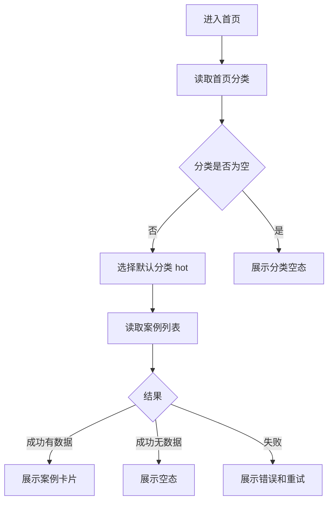
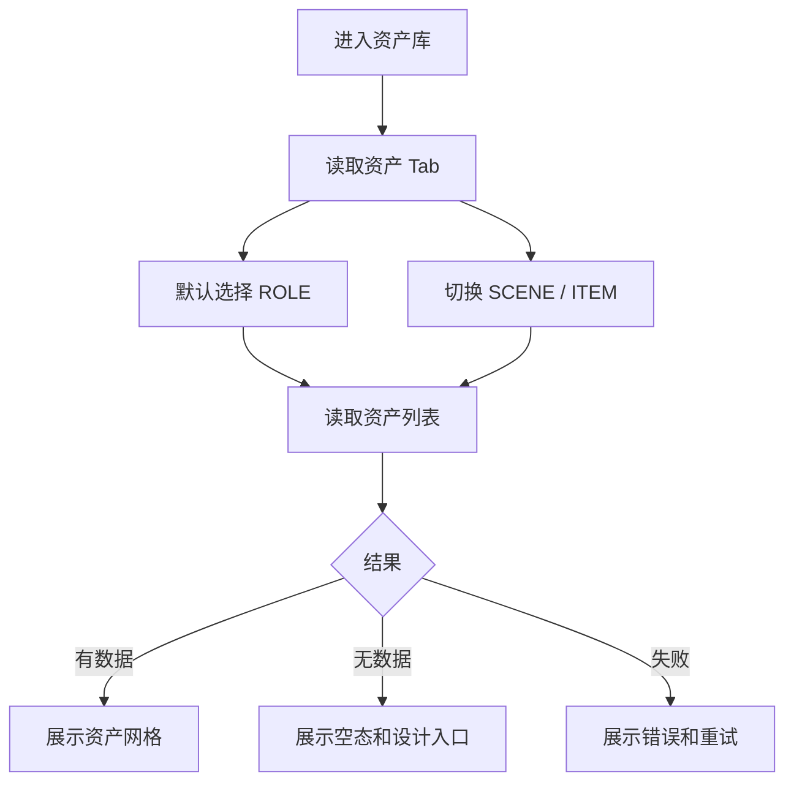

# 喵喵漫画 Flutter 总体开发计划

> 版本：v1.0
> 生成日期：2026-06-10
> 当前阶段：9 Flutter 总体开发计划
> 当前状态：done（已进入第 11 步 Flutter 模块开发文档）
> 关联前端技术文档：./flutter-tech.md
> 关联后端技术文档：../04-后端/java-tech.md
> 关联工时评估：../02-技术方案/effort-estimate.md
> 目标工程：`/Users/soul/code/lxwx/make_drama`

---

## 1. 文档用途

本文用于把 `flutter-tech.md` 中的前端技术口径拆成可执行、可恢复、可验收的 Flutter 总体开发计划。后续第 11 步会基于本文继续生成 `03-前端/开发计划/*.md` 模块开发文档；第 13 步 Flutter 编码必须按本文和模块文档顺序推进。

本阶段只生成计划，不修改 `/Users/soul/code/lxwx/make_drama` 代码。

---

## 2. 当前状态与恢复点

| 项 | 当前值 |
|----|--------|
| 当前项目 | `喵喵漫画` |
| 当前版本 | `v0.1.3` |
| 当前流程 | `9 Flutter 总体开发计划` |
| 当前恢复点 | `projects/喵喵漫画/03-前端/flutter-dev-plan.md` |
| 当前任务状态 | `done` |
| 前端工程 | `/Users/soul/code/lxwx/make_drama` |
| 后端工程 | `/Users/soul/code/lxwx/lxwx_service/lxwxservice` |
| App 名称 | `喵喵漫画` |
| appCode | `catcomic` |

暂停点：本文已由用户输入“继续下一步”视为确认；当前已进入第 11 步 Flutter 模块开发文档。

---

## 3. 状态枚举与更新规则

任务状态只使用以下枚举：

| 状态 | 含义 |
|------|------|
| `pending` | 未开始 |
| `in_progress` | 执行中 |
| `waiting_review` | 已完成当前文档或任务，等待用户确认 |
| `done` | 已确认完成 |
| `blocked` | 因缺失依赖或冲突无法继续 |
| `skipped` | 用户明确跳过 |

更新规则：

- 每个编码任务开始时，把对应任务改为 `in_progress`，并在 `workflow.md` 写入恢复点。
- 每个编码任务通过验证后，把对应任务改为 `done`。
- 发现需求、接口、设计或工程规则冲突时，先回写阻塞项，不直接改代码绕过。
- Flutter 编码阶段属于阻塞式阶段；用户未明确进入下一步前，持续停留在当前编码任务内推进、验证和回写。
- 涉及新增、修改、删除需求时，先走 `change-plan.md`，完成后归档到 `change-log.md`。

---

## 4. 总体开发策略

### 4.1 开发边界

| 范围 | 策略 |
|------|------|
| 完整实现 | 首页、资产库 |
| 占位实现 | 除首页、资产库和已确认复用的旧“我的”页外，原工程没有或不属于 P0 的入口统一空白页或 Toast |
| 不触发 | 真实生成、支付、会员扣点、作品下载、删除、下载、编辑、重绘 |
| 数据来源 | 首页走现有 `/api/config/home-case-*`；资产库走新增 `/api/comic/assets*` |
| 空态要求 | 接口无数据时稳定展示空态，不影响入口和页面浏览 |

### 4.2 技术路线

| 领域 | 口径 |
|------|------|
| 状态管理 | GetX Controller + Rx 状态 |
| 路由 | `go_router`，沿用 `lib/routes/index.dart` + `part 'name.dart'` + `part 'router.dart'` |
| 网络 | 复用 `HttpService`，所有请求携带 `X-App-Code: catcomic` |
| 存储 | GetStorage / Hive 只做轻量配置、登录态、mock 或短期状态 |
| 页面结构 | 延续 `pages/{feature}/index.dart + controller.dart + view.dart + widgets/` |
| UI | 复用 `CustomTheme.dark`、`CustomScaffold`、`AppStateBuilder`、`AppEmpty`、`AppError`、`AppLoading`、`CustomToast` |
| 依赖 | 不新增非必要依赖，不引入 Riverpod / BLoC / Drift |

### 4.3 工程前置处理

`/Users/soul/code/lxwx/make_drama/AGENTS.md` 当前仍写着旧路径 `/Users/soul/code/lxwx/narrate`。进入 Flutter 编码前必须先确认并修正该工程规则入口，后续编码以用户指定的 `/Users/soul/code/lxwx/make_drama` 为准。

---

## 5. 总体阶段划分

| 阶段 | 任务范围 | 期望工时 | 里程碑 | 状态 |
|------|----------|----------|--------|------|
| P1 App 身份与骨架 | T-F001、T-F002、T-F003 | 6.24 人天 | App 名称、appCode、主框架、路由和基础组件稳定 | pending |
| P2 首页闭环 | T-F004、T-F005 | 5.34 人天 | 首页 UI、分类、案例、空态、错误态可用 | pending |
| P3 资产库闭环 | T-F006、T-F007 | 5.66 人天 | 资产库三类 Tab、列表、分页、空态、错误态可用 | pending |
| P4 空白占位能力 | T-F008、T-F009 | 4.17 人天 | 除首页、资产库和旧“我的”页外的原工程缺失页面以空白页或 Toast 兜底，不触发真实动作 | pending |
| P5 自测与回归 | T-F010 | 2.08 人天 | 旧项目痕迹清理、路由冒烟、移动端尺寸检查 | pending |
| 合计 | T-F001~T-F010 | 23.50 人天 | Flutter P0 可联调 | pending |

里程碑参考 `effort-estimate.md`：

| 里程碑 | 目标日期区间 | Flutter 验收含义 |
|--------|--------------|------------------|
| Alpha | 2026-06-22 ~ 2026-06-24 | App 名称、appCode、首页/资产库框架可打开 |
| Beta | 2026-07-06 ~ 2026-07-09 | 首页、资产库、占位页、接口状态完整 |
| RC | 2026-07-15 ~ 2026-07-17 | 回归通过，无旧项目痕迹 |
| GA | 2026-07-27 ~ 2026-08-04 | 配合构建、上架、审核准备 |

---

## 6. 详细任务清单

### T-F001 项目标识迁移

| 项 | 内容 |
|----|------|
| 状态 | pending |
| 依赖 | 无 |
| 主要文件 | `pubspec.yaml`、`lib/main.dart`、`lib/global.dart`、`lib/utils/constants.dart`、平台显示名配置 |
| 目标 | App 名称改为 `喵喵漫画`，`appCode` 改为 `catcomic`，清理旧项目名称和旧业务入口 |
| 业务约束 | 不触发旧生成链路；旧支付、旧会员链路仅通过已确认完整复用的“我的”页二级入口暴露 |
| 验收 | 启动标题、请求头、常量、基础文案均为喵喵漫画口径 |

### T-F002 路由与主框架

| 项 | 内容 |
|----|------|
| 状态 | pending |
| 依赖 | T-F001 |
| 主要文件 | `lib/routes/index.dart`、`lib/routes/name.dart`、`lib/routes/router.dart`、`lib/pages/main/*` |
| 目标 | 注册资产库和统一占位页路由，底部导航保留创作、作品、我的 |
| 业务约束 | 首页 AI 漫剧入口不再进入旧 `/creation/video`；作品为占位；我的完整复用旧 `AccountPage` |
| 验收 | 首页和资产库入口按 Figma 可达；作品和其它非 P0 入口打开统一空白页或 Toast；我的展示旧账号页及二级入口 |

### T-F003 主题与通用组件

| 项 | 内容 |
|----|------|
| 状态 | pending |
| 依赖 | T-F001 |
| 主要文件 | `lib/theme.dart`、`lib/widgets/*`、必要 `lib/components/*` |
| 目标 | 沉淀喵喵漫画深色 Token、入口卡片、Tab、资产卡片、案例卡片、空态、错误态 |
| 业务约束 | Figma 没有命名样式，Flutter 侧先沉淀稳定 Token |
| 验收 | 首页和资产库能复用同一套卡片、Tab、状态组件 |

### T-F004 首页 UI

| 项 | 内容 |
|----|------|
| 状态 | pending |
| 依赖 | T-F002、T-F003 |
| 主要文件 | `lib/pages/home/index.dart`、`controller.dart`、`view.dart`、`widgets/*` |
| 目标 | 按 Figma 首页实现会员入口、AI 漫剧入口、资产库入口、热门案例、底部导航 |
| 业务约束 | 首页会员入口仍保持占位；我的页内部会员入口按旧 `AccountPage` 完整复用；案例点击进入占位或静态详情，不触发真实生成 |
| 验收 | 首页默认态、分类区、案例区、入口点击反馈完整 |

### T-F005 首页数据与状态

| 项 | 内容 |
|----|------|
| 状态 | pending |
| 依赖 | T-F004、后端 T-B003 |
| 主要文件 | `lib/apis/home.dart`、`lib/models/data/home_case.dart`、`lib/pages/home/controller.dart` |
| 目标 | 复用首页分类和案例接口，补加载、空态、错误、重试、图片失败 |
| 后端接口 | `GET /api/config/home-case-categories`、`GET /api/config/home-cases?categoryCode=hot` |
| 业务约束 | 接口无数据返回空态；不将空数据视为错误 |
| 验收 | 分类切换、列表刷新、失败重试和 mock fallback 可用 |

### T-F006 资产库 UI

| 项 | 内容 |
|----|------|
| 状态 | pending |
| 依赖 | T-F002、T-F003 |
| 主要文件 | `lib/pages/asset_library/index.dart`、`controller.dart`、`view.dart`、`widgets/*` |
| 目标 | 实现标题、角色/场景/物品设计入口、三类资产 Tab、资产网格、管理占位 |
| 业务约束 | 设计入口只进占位页；管理入口只提示或进管理占位，不执行删除 |
| 验收 | 角色、场景、物品三类 UI 可切换，图片失败有占位 |

### T-F007 资产库数据与状态

| 项 | 内容 |
|----|------|
| 状态 | pending |
| 依赖 | T-F006、后端 T-B005、T-B006 |
| 主要文件 | `lib/apis/comic_assets.dart`、`lib/models/data/comic_asset.dart`、`lib/pages/asset_library/controller.dart` |
| 目标 | 新增资产 API、模型、分页列表、详情可选、loading/empty/error/retry |
| 后端接口 | `GET /api/comic/assets/tabs`、`GET /api/comic/assets`、`GET /api/comic/assets/{assetId}` |
| 业务约束 | 匿名可看系统资产；登录态由后端决定是否合并用户资产；前端不本地伪造真实资产 |
| 验收 | 三类 Tab 均能请求并展示空态或数据；分页边界稳定 |

### T-F008 空白页集合

| 项 | 内容 |
|----|------|
| 状态 | pending |
| 依赖 | T-F002、T-F003 |
| 主要文件 | `lib/pages/blank_feature/index.dart`、`controller.dart`、`view.dart` |
| 目标 | 非首页、非资产库且原工程没有的页面先统一空白展示 |
| 业务约束 | 占位按钮只 Toast “后续开放”，不调用后端 |
| 验收 | 相关入口均有空白页或反馈，不按其它 Figma Frame 细化实现 |

### T-F009 弹窗入口降级

| 项 | 内容 |
|----|------|
| 状态 | pending |
| 依赖 | T-F008 |
| 主要文件 | `lib/pages/blank_feature/*`、必要时复用 `CustomToast` |
| 目标 | 删除、编辑、管理等非本期真实能力统一降级为空白页或 Toast |
| 业务约束 | 确定按钮不删除、不生成、不扣点 |
| 验收 | 不新增真实弹窗流程；相关入口不执行删除、编辑、生成或扣点 |

### T-F010 前端自测

| 项 | 内容 |
|----|------|
| 状态 | pending |
| 依赖 | T-F001~T-F009、后端 T-B003/T-B005 |
| 主要文件 | `test/`、手工冒烟记录、扫描脚本或命令 |
| 目标 | 旧文案扫描、路由点击、接口失败回退、常见移动尺寸检查 |
| 验收 | `dart format`、`flutter analyze` 通过；必要 `flutter test` 通过；无旧项目名称、旧 appCode、旧真实生成入口 |

---

## 7. 业务逻辑与接口约束

### 7.1 请求头与统一响应

所有用户端接口请求必须携带：

```text
X-App-Code: catcomic
Authorization: Bearer <token>   # 可选
```

后端统一响应：

```json
{
  "code": 200,
  "message": "成功",
  "data": {},
  "traceId": "trace-id"
}
```

分页响应：

```json
{
  "items": [],
  "page": 1,
  "pageSize": 20,
  "total": 0,
  "hasMore": false
}
```

### 7.2 首页业务流



接口：

| 场景 | 接口 | 前端处理 |
|------|------|----------|
| 分类 | `GET /api/config/home-case-categories` | 空数组展示空态，保留入口 |
| 案例 | `GET /api/config/home-cases?categoryCode={code}` | 列表/空态/错误重试 |
| 案例详情 | `GET /api/config/home-cases/{caseId}` | P0 可不强依赖，优先占位 |
| 使用案例 | `POST /api/config/home-cases/{caseId}/use` | P0 默认不调用 |

### 7.3 资产库业务流



接口：

| 场景 | 接口 | 前端处理 |
|------|------|----------|
| Tab | `GET /api/comic/assets/tabs` | 失败时回退本地三类 Tab |
| 列表 | `GET /api/comic/assets?assetType=ROLE&page=1&pageSize=20` | 展示分页、空态、错误重试 |
| 详情 | `GET /api/comic/assets/{assetId}` | P0 可选；详情入口可先占位 |

### 7.4 占位功能业务流

占位功能只走本地逻辑：

- 首页、资产库和旧“我的”页以外的入口：打开统一空白页或 Toast。
- 旧生成、设计、下载、删除、编辑链路：P0 不调用。
- 作品保持空白页面；我的完整复用旧 `AccountPage`，并保留其登录态、积分、VIP、邀请、反馈、设置、订单和充值等二级入口。

---

## 8. 模块开发文档列表

第 11 步 Flutter 模块开发文档建议按以下文件拆分：

| 顺序 | 模块文档 | 对应任务 | 产物 |
|------|----------|----------|------|
| 1 | `03-前端/开发计划/01-project-identity.md` | T-F001 | App 名称、appCode、旧文案清理计划 |
| 2 | `03-前端/开发计划/02-routing-shell.md` | T-F002 | 主框架、路由、底部导航计划 |
| 3 | `03-前端/开发计划/03-theme-components.md` | T-F003 | Token、通用组件、状态组件计划 |
| 4 | `03-前端/开发计划/04-home-ui.md` | T-F004 | 首页 UI 实现计划 |
| 5 | `03-前端/开发计划/05-home-data.md` | T-F005 | 首页 API、Controller、状态流计划 |
| 6 | `03-前端/开发计划/06-asset-library-ui.md` | T-F006 | 资产库 UI 实现计划 |
| 7 | `03-前端/开发计划/07-asset-library-data.md` | T-F007 | 资产 API、模型、Controller、分页计划 |
| 8 | `03-前端/开发计划/08-placeholder-pages.md` | T-F008 | 占位页集合计划 |
| 9 | `03-前端/开发计划/09-placeholder-dialogs.md` | T-F009 | 删除确认、角色编辑占位弹窗计划 |
| 10 | `03-前端/开发计划/10-frontend-self-test.md` | T-F010 | 自测、扫描、冒烟、回归计划 |

---

## 9. 编码约束

### 9.1 必须遵守

- 编码前先进入 `.cursor/rules/13-Flutter编码索引.mdc`，再按索引读取目标工程规则。
- 先修正或确认 `/Users/soul/code/lxwx/make_drama/AGENTS.md` 中旧路径问题。
- 所有接口请求统一走 `HttpService`，不得绕过统一请求头。
- `AppConstants.appName=喵喵漫画`，`AppConstants.appCode=catcomic`。
- 页面状态使用现有 `ViewState`、`AppStateBuilder` 或同等本地模式。
- 新增页面遵循 `index.dart + part` 或目标工程现有组织方式。
- Dart 文件修改后执行 `dart format`；Flutter 修改后执行 `flutter analyze`。

### 9.2 明确禁止

- P0 不调用真实 AI 生成、作品下载、删除、支付、会员扣点接口。
- 不把旧 `/creation/video`、旧作品详情、旧会员充值作为喵喵漫画 P0 主入口。
- 不新增 Riverpod、BLoC、Drift 或新的网络框架。
- 不在 View 中直接写复杂业务逻辑或请求拼装。
- 不把真实资产数据只存在本地；本地只能做 mock、空态或短期 UI 状态。

---

## 10. 验证计划

| 验证项 | 命令 / 方法 | 阶段 |
|--------|-------------|------|
| 格式化 | `dart format <changed dart files>` | 每个编码任务 |
| 静态检查 | `flutter analyze` | 每个阶段收口 |
| 单元/组件测试 | `flutter test` | 涉及 Controller、路由、API、Store 时 |
| 旧文案扫描 | 扫描旧应用名、`漫剧工坊`、`narrate` 等旧项目口径 | T-F001、T-F010 |
| 路由冒烟 | 首页、资产库、作品、我的、各占位入口点击 | T-F002 后持续 |
| 状态冒烟 | loading、empty、error、retry、图片失败 | 首页、资产库完成后 |
| 移动端尺寸 | 小屏、标准屏、长屏人工检查或截图 | T-F010 |

---

## 11. 执行记录

| 时间 | 动作 | 结果 |
|------|------|------|
| 2026-06-10 | 生成 Flutter 总体开发计划 | `03-前端/flutter-dev-plan.md` 已生成，等待用户确认 |

---

## 12. 待确认项

| 编号 | 待确认项 | 当前建议 |
|------|----------|----------|
| FDP-1 | 是否先修正 `make_drama/AGENTS.md` 旧路径 | 进入 Flutter 编码前修正 |
| FDP-2 | 是否需要先生成 Java 总体开发计划 | 建议下一步进入第 10 步，保证前后端计划对齐 |
| FDP-3 | 首期首页案例/资产是否需要真实示例内容 | 由代码或后台添加，前端必须保留空态 |
| FDP-4 | `/api/config/app` 是否需要新增 | P0 默认不依赖；如要聚合配置，在 Java 计划中补充 |
