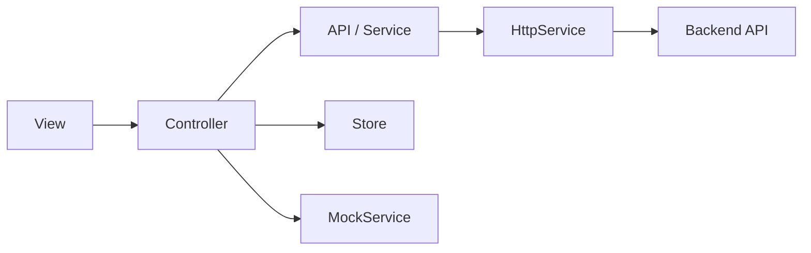

# 喵喵漫画 Flutter 技术文档

> 版本：v1.0
> 生成日期：2026-06-10
> 关联 PRD：../01-需求/requirements.md
> 关联 Figma 设计计划：../01-需求/figma-design-plan.md
> 关联技术方案：../02-技术方案/tech-plan.md
> 关联工时评估：../02-技术方案/effort-estimate.md
> 目标工程：`/Users/soul/code/lxwx/make_drama`

---

## 1. 当前 Flutter 最终技术路线

喵喵漫画前端沿用现有 Flutter 工程 `/Users/soul/code/lxwx/make_drama`，不重建工程，不引入新的状态管理或路由框架。

| 领域 | 最终口径 |
|------|----------|
| App 名称 | `喵喵漫画` |
| appCode | `catcomic` |
| UI 范围 | 首页、资产库完整实现；其它入口只做占位页/占位弹窗 |
| 技术栈 | Flutter + GetX + go_router + Dio + GetStorage/Hive + flutter_screenutil |
| 页面组织 | 延续现有 `pages/{feature}/index.dart + part` 组织方式 |
| 状态管理 | 页面状态用 GetX Controller，跨页面状态用 `store/` |
| 网络层 | 复用 `HttpService`，所有请求携带 `X-App-Code: catcomic` |
| 主题 | 复用并扩展 `CustomTheme.dark`，沉淀喵喵漫画深色 Token |
| 真实生成 | P0 不接 AI 生成、下载、删除、支付、扣点 |

---

## 2. 通用规则继承

本项目继承 `.cursor/rules/flutter/` 中的以下规则：

| 通用规则 | 当前项目采用方式 |
|----------|------------------|
| `01-项目初始化规则.mdc` | 不重新初始化工程，只吸收目录、`main/global/routes/services/store/utils/widgets` 骨架要求 |
| `02-项目结构目录.mdc` | 继续使用 `apis/components/models/pages/routes/services/store/utils/widgets` 分层 |
| `03-编码规范.mdc` | 使用 `snake_case` 文件名、`PascalCase` 类名、`index.dart + part` 聚合 |
| `04-导航规则.mdc` | 继续使用 `go_router`，路由名集中在 `RouteName` |
| `05-多语言支持.mdc` | 保留 `flutter_localizations` / `intl`，P0 先按中文单语言实现，文案后续可抽入 l10n |
| `06-第三方依赖参考.mdc` | 不新增非必要依赖；复用现有依赖 |
| `07-新功能开发.mdc` | 新增页面按 `index.dart/controller.dart/view.dart/widgets/dialog` 组织 |
| `08-UI处理任务.mdc` | UI 以 Figma 设计计划为准，必须覆盖 loading/empty/error/disabled |
| `09-大功能先规划再编码.mdc` | 进入编码前必须先完成 Flutter 总体开发计划与模块文档 |
| `10-编码工作流程.mdc` | 仅进入 Flutter 编码阶段后生效，本阶段不修改代码 |
| `11-测试规则.mdc` | QA 用例和自动化辅助规则后续在联调测试阶段细化 |

---

## 3. 当前项目结构与参考工程对齐点

### 3.1 现有工程事实

| 项 | 现状 |
|----|------|
| `pubspec.yaml` | 工程名仍为 `narrate`，版本 `1.0.1+101` |
| `main.dart` | 使用 `ScreenUtilInit`、`MaterialApp.router`、`CustomTheme.dark`、`CustomToast` |
| `global.dart` | `Global.init()` 初始化 Storage、Event、Mock、Http、User、Creation、Update 等服务 |
| `utils/constants.dart` | 当前 `appName=漫剧工坊`、`appCode=narrate`，编码阶段必须改为喵喵漫画口径 |
| `routes/` | 使用 `go_router`；路由集中在 `RouteName` 与 `CustomRouter.config` |
| `services/http.dart` | Dio 已默认设置 `X-App-Code` 请求头，并支持 Bearer Token |
| `widgets/` | 已有 `AppStateBuilder`、`AppEmpty`、`AppError`、`AppLoading`、`CustomScaffold`、`CustomToast` |
| `pages/main` | 当前底部导航为创作/作品/我的，符合 PRD 一级导航 |
| `pages/home` | 已有首页分类、案例加载、mock fallback、状态组件，需按喵喵漫画 Figma 重做视觉与入口 |

### 3.2 参考工程可复用点

- 保留 `lib/` 顶层分层，不大改目录。
- 保留 `index.dart + part / part of` 风格。
- 保留 `GetxController` 页面状态、`Rx` 响应式字段和 `Obx/GetBuilder`。
- 保留 `HttpService.get/post/delete` 与 `BaseResponse` 解析。
- 保留 `MockService` 支持首页、资产库在接口不可用时做本地空态或 mock。
- 保留 `AppStateBuilder` 统一 loading / empty / error / success。

### 3.3 必须清理的旧工程痕迹

| 位置 | 处理要求 |
|------|----------|
| `pubspec.yaml` | 工程名、支付 URL Scheme、描述按喵喵漫画调整；支付 P0 不启用但不能保留旧 scheme 语义 |
| `main.dart` | `MaterialApp.title` 改为 `喵喵漫画` |
| `global.dart` | `Global.appName` fallback 改为 `喵喵漫画` |
| `utils/constants.dart` | `appName=喵喵漫画`、`appCode=catcomic` |
| `pages/home` | 旧“创建项目/解说”口径改为 Figma 中 `AI漫剧`、`资产库`、`热门案例` |
| `pages/creation` | P0 不进入真实创作流程，入口改为 AI 漫剧占位 |
| `pages/works` / `pages/account` | P0 改为作品、我的占位，不读取旧作品或真实会员点数链路 |

---

## 4. 第三方依赖基线

### 4.1 保留依赖

| 依赖 | 用途 |
|------|------|
| `get` | GetX 状态与依赖注入 |
| `go_router` | 路由与页面跳转 |
| `dio` | HTTP 请求 |
| `get_storage` | 轻量本地存储 |
| `hive` / `hive_flutter` | 后续缓存与本地数据预留 |
| `package_info_plus` | App 版本信息 |
| `flutter_screenutil` | 375 x 812 设计稿适配 |
| `flutter_easyloading` | 可继续支撑全局 loading/toast 封装 |
| `intl` / `flutter_localizations` | 中文本地化与日期格式预留 |
| `image_picker` / `permission_handler` | P0 不主动接入生成链路，但保留给后续素材上传 |
| `video_player` / `video_thumbnail` / `video_compress` | P0 不接真实视频能力，暂不新增调用 |
| `webview_flutter` | 静态协议页可复用 |

### 4.2 P0 不新增依赖

本期不新增 AI SDK、支付 SDK、统计 SDK、地图、文件选择、复杂动画库。已有 `tobias`、阿里一键登录等依赖如暂不使用，不在 P0 页面主动触发。

---

## 5. 启动与全局初始化

启动链路保持现状：

```text
main.dart
  -> WidgetsFlutterBinding.ensureInitialized()
  -> SystemChrome.setSystemUIOverlayStyle(CustomTheme.systemStyle)
  -> Global.init()
  -> runApp(MyApp)
  -> ScreenUtilInit
  -> MaterialApp.router
```

编码阶段调整要求：

| 文件 | 调整 |
|------|------|
| `main.dart` | `MaterialApp.title` 使用 `AppConstants.appName` 或直接 `喵喵漫画` |
| `global.dart` | 保留 Storage、Mock、Http、User、Config 初始化；P0 可保留旧服务注册，但首页/资产库不得触发真实支付、生成 |
| `utils/constants.dart` | `appName`、`appCode` 必须优先修改 |
| `theme.dart` | 在现有深色主题基础上补充首页、资产库、占位页需要的颜色、圆角、字号常量 |

---

## 6. 状态管理与数据流

### 6.1 分层流向



### 6.2 Controller 规范

- 首页：保留或改造 `HomeController`，负责分类、案例、loading、empty、error、retry。
- 资产库：新增 `AssetLibraryController`，负责资产类型、列表、分页、loading、empty、error、retry。
- 占位页：可使用轻量无状态页面；如需要按钮反馈，使用通用方法触发 Toast。
- 不在 View 中直接写复杂业务逻辑。
- Controller 禁止依赖 `Get.context`，导航由 View 回调触发。

### 6.3 API 与模型

| 模块 | API | Model |
|------|-----|-------|
| 首页 | 复用 `HomeAPI.fetchCategories()`、`HomeAPI.fetchCases()` | 复用 `HomeCaseCategory`、`HomeCase` |
| 资产库 | 新增 `ComicAssetAPI.tabs()`、`ComicAssetAPI.list()`、`ComicAssetAPI.detail()` | 新增 `ComicAsset`、`ComicAssetType`、`ComicAssetTab` |
| 占位页 | 不调用后端 | 使用 `PlaceholderFeature` 或路由参数 |

### 6.4 状态枚举

继续复用现有 `ViewState` 与 `AppStateBuilder`，首页和资产库至少覆盖：

- `loading`
- `empty`
- `error`
- `success`
- 图片失败占位
- 按钮 disabled / placeholder feedback

---

## 7. 存储设计

| 存储 | 当前用途 | P0 使用方式 |
|------|----------|-------------|
| GetStorage | 登录态、配置、本地轻量状态 | 保留；可保存 mock 开关、协议确认、登录态 |
| Hive | 本地数据缓存预留 | P0 不强制新增 Hive box，避免为首页/资产库过度缓存 |
| ConfigStore | baseUrl、环境、mockEnabled | 保留；首页/资产库支持 mock fallback |
| UserStore | token、手机号、积分、VIP 状态 | P0 作品/我的/会员入口以占位为主，不触发真实支付 |

编码阶段不得把资产库真实数据只写本地存储；资产列表以 API 返回为准，本地只可做 mock 或短期 UI 状态。

---

## 8. 路由配置

### 8.1 路由规划

| RouteName | path | 页面 | 说明 |
|-----------|------|------|------|
| `main` | `/` | `MainPage` | 一级底部导航容器 |
| `assetLibrary` | `/assets` | `AssetLibraryPage` | 资产库完整页面 |
| `aiComicPlaceholder` | `/placeholder/ai-comic` | `FeaturePlaceholderPage` | AI 漫剧占位 |
| `designerPlaceholder` | `/placeholder/designer/:type` | `FeaturePlaceholderPage` | 角色/场景/物品设计占位 |
| `shotPlanPlaceholder` | `/placeholder/shot-plan` | `FeaturePlaceholderPage` | 剧本分镜占位 |
| `previewPlaceholder` | `/placeholder/preview` | `FeaturePlaceholderPage` | 预览画面占位 |
| `downloadPlaceholder` | `/placeholder/download` | `FeaturePlaceholderPage` | 下载分镜占位 |
| `redrawPlaceholder` | `/placeholder/redraw` | `FeaturePlaceholderPage` | 视频重绘占位 |
| `workPlaceholder` | `/works` 或 MainPage index 1 | `FeaturePlaceholderPage` | 作品占位 |
| `minePlaceholder` | `/mine` 或 MainPage index 2 | `FeaturePlaceholderPage` | 我的/会员占位 |

### 8.2 导航策略

- 首页 `AI漫剧` 入口跳转 `aiComicPlaceholder`，不进入旧 `/creation/video`。
- 首页 `资产库` 入口跳转 `assetLibrary`。
- 首页 `开通会员` 入口仍保持占位，不进入真实支付；我的页内部会员入口按旧 `AccountPage` 完整复用。
- 案例卡片 P0 可进入案例详情占位或复用详情页展示静态预览，但不得触发真实生成。
- 资产库设计入口分别跳转 `designerPlaceholder`，`type=role|scene|item`。
- 底部导航只保留创作、作品、我的三项；作品为占位，我的完整复用旧 `AccountPage`。

---

## 9. UI 基础规范

UI 以 `figma-design-plan.md` 为事实来源，现有 `CustomTheme` 深色调为基础。

### 9.1 Token 方向

| Token | 建议 |
|-------|------|
| 背景 | `CustomTheme.background`，页面顶部可使用 Figma 背景图或深色渐变资源 |
| 卡片 | `CustomTheme.surface` / `surfaceHigh`，资产卡片和案例卡片统一圆角 |
| 主色 | `CustomTheme.primary`，用于底部导航选中、主要按钮、会员入口 |
| 辅助色 | `CustomTheme.secondary`，用于标签、状态或次级强调 |
| 文本 | `textPrimary` / `textSecondary`，避免页面散落魔法色值 |
| 危险色 | `danger`，用于删除确认占位 |

### 9.2 适配

- 使用 `flutter_screenutil`，尺寸优先 `.w/.h/.sp/.r`。
- 页面按 375 x 812 设计稿适配。
- 禁止长文案挤压按钮；占位页说明保持短句。
- 首页和资产库必须在小屏下可滚动，底部导航不遮挡内容。

### 9.3 通用组件

优先复用：

- `CustomScaffold`
- `CustomToast`
- `AppStateBuilder`
- `AppEmpty`
- `AppError`
- `AppLoading`
- `AppButton`
- `AppConfirmDialog`

如果 Figma 所需样式明显不同，先扩展通用组件参数；只有局部特殊布局才放到页面 `widgets/`。

---

## 10. 页面实现摘要

### 10.1 首页

| 区块 | 实现口径 |
|------|----------|
| 顶部会员入口 | 展示 `开通会员`，点击进入我的/会员占位 |
| AI 漫剧入口 | 展示 `AI漫剧` 与 `创作漫剧视频`，点击进入 AI 漫剧占位 |
| 资产库入口 | 点击进入资产库完整页面 |
| 热门案例 | 复用首页分类与案例接口；支持分类切换 |
| 状态 | loading、empty、error、retry、图片失败 |
| 底部导航 | 创作选中；作品、我的进入占位 |

### 10.2 资产库

| 区块 | 实现口径 |
|------|----------|
| 顶部标题 | `资产库` |
| 设计入口 | 角色设计、场景设计、物品设计，均进入占位 |
| Tab | 角色资产、场景资产、物品资产 |
| 列表 | 网格展示缩略图和名称 |
| 管理入口 | 点击 Toast 或管理占位，不进入批量删除 |
| 状态 | loading、empty、error、retry、图片失败 |

### 10.3 占位页集合

统一模板覆盖：

- AI 漫剧
- 角色设计 / 场景设计 / 物品设计
- 剧本分镜
- 预览画面
- 下载分镜
- 视频重绘
- 作品
- 我的 / 会员

占位页主按钮只展示“后续开放”反馈，不调用后端。

### 10.4 占位弹窗

- 删除确认：取消关闭；确定展示占位提示，不删除。
- 角色编辑：展示编辑结构占位；生成按钮只提示后续开放。

---

## 11. 编码任务清单

| 任务 ID | 前端文件范围 | 技术要点 |
|---------|--------------|----------|
| T-F001 | `pubspec.yaml`、`main.dart`、`global.dart`、`utils/constants.dart`、平台显示名 | App 名称、appCode、URL Scheme、旧文案扫描 |
| T-F002 | `routes/`、`pages/main/` | 新增资产库和占位路由；底部导航保持三项 |
| T-F003 | `theme.dart`、`widgets/`、`components/` | 喵喵漫画 Token、入口卡片、Tab、状态组件适配 |
| T-F004 | `pages/home/` | 首页按 Figma 重做；入口改为 AI 漫剧/资产库 |
| T-F005 | `apis/home.dart`、`models/data/home_case.dart`、`pages/home/controller.dart` | 保留分类/案例数据流，补空态和错误态 |
| T-F006 | `pages/asset_library/` | 资产库 UI、设计入口、Tab、网格 |
| T-F007 | `apis/comic_assets.dart`、`models/data/comic_asset.dart`、`pages/asset_library/controller.dart` | 资产接口、分页、mock、状态 |
| T-F008 | `pages/feature_placeholder/` | 占位页模板与各入口参数 |
| T-F009 | `pages/feature_placeholder/dialog/` 或 `widgets/` | 删除确认、角色编辑占位弹窗 |
| T-F010 | `test/`、人工冒烟记录 | analyze、关键路由、移动端尺寸、旧文案扫描 |

---

## 12. 编码注意事项

- 编码前必须确认 `/Users/soul/code/lxwx/make_drama/AGENTS.md` 中旧路径 `/Users/soul/code/lxwx/narrate` 的处理方式；建议以用户指定的 `/Users/soul/code/lxwx/make_drama` 为准，并修正工程规则入口。
- 进入 Flutter 编码阶段前必须加载 `.cursor/rules/13-Flutter编码索引.mdc`，再按索引读取目标工程规则。
- P0 不触发真实登录、支付、会员、点数扣减、AI 生成、下载和删除。
- 旧 `/creation/video`、`/works/:id`、会员充值、点数充值等真实业务入口不得从 P0 首页露出。
- 所有用户端请求必须携带 `X-App-Code: catcomic`。
- 首页和资产库必须同时支持接口数据、空数据、接口失败、mock fallback。
- 不新增 Riverpod、BLoC、Drift 等新路线。
- 不把 Figma 的所有后续页面做成真实业务，只保留标题、结构和占位反馈。

---

## 13. Flutter 编码工作流程

进入第 13 步 Flutter 编码后，按以下顺序执行：

1. 读取 `workflow.md`、`flutter-tech.md`、`flutter-dev-plan.md`、当前模块开发文档。
2. 读取目标 Flutter 工程 AGENTS 与项目内 `.cursor/rules/`，确认规则路径。
3. 先做 T-F001 项目标识迁移，避免后续页面继续引用旧 appCode。
4. 再做 T-F002/T-F003 主框架、路由和通用组件。
5. 完成 T-F004/T-F005 首页闭环。
6. 完成 T-F006/T-F007 资产库闭环。
7. 完成 T-F008/T-F009 占位页和弹窗。
8. 执行 T-F010 自测、修复、回写流程状态。

每个编码任务结束后至少执行：

- `dart format` 相关 Dart 文件
- `flutter analyze`
- 涉及 Store / 路由 / API 时执行必要 `flutter test`
- `git diff --check`

---

## 14. 测试用例与自动化辅助规则

### 14.1 Flutter 侧测试重点

| 模块 | P0 用例 |
|------|---------|
| 启动 | App 名称、主题、首页默认进入正常 |
| AppCode | 请求头为 `X-App-Code: catcomic` |
| 首页 | 分类切换、案例列表、空态、错误重试、入口跳转 |
| 资产库 | 三类 Tab、资产列表、空态、错误重试、设计入口 |
| 占位页 | AI 漫剧、设计、作品、我的、分镜、预览、下载、重绘均可达 |
| 弹窗 | 删除确认和角色编辑占位不执行真实动作 |
| 回归 | 不出现旧应用名、旧 appCode、旧真实生成入口 |

### 14.2 自动化辅助

- 可用脚本扫描旧文案、旧 appCode、旧路由入口。
- 可用 Flutter widget test 覆盖 Controller 状态与路由名。
- 可用人工或后续自动化执行移动端尺寸冒烟：小屏、标准屏、长屏。
- Python 仅用于辅助执行固定冒烟、截图和结果记录，不替代测试用例。

---

## 15. 项目专属开发规则

### 15.1 继承规则

继承通用 Flutter 规则库的目录分层、GetX、go_router、Dio、ScreenUtil、状态组件、测试用例组织和编码回写要求。

### 15.2 裁剪规则

| 通用能力 | 裁剪方式 |
|----------|----------|
| 项目初始化 | 不重新建工程，只迁移现有 `make_drama` |
| 多语言 | P0 中文单语言实现，保留本地化基础设施 |
| 真实音视频/上传/下载 | P0 不触发，只保留后续依赖 |
| 支付/会员/点数 | P0 只保留占位入口，不触发支付 |
| AI 生成 | P0 不接真实生成接口 |

### 15.3 特化规则

- `catcomic` 是当前默认 appCode，任何接口、mock、日志和测试都按该值校验。
- 首页和资产库是唯一完整业务页面；其它功能不得偷偷做真实业务。
- 首页可复用现有 `HomeAPI`，资产库必须新增独立 `ComicAssetAPI` 和模型。
- Figma 无命名样式，Flutter 侧需要把稳定颜色、字号、圆角沉淀到 `theme.dart` 或通用组件。
- Main 底部导航最终文案固定为创作、作品、我的。

### 15.4 导航、编码、多语言、UI 最终执行口径

| 领域 | 执行口径 |
|------|----------|
| 导航 | `go_router` + `RouteName` 集中注册，不散写裸路径 |
| 编码规范 | `index.dart + part`，文件名 `snake_case`，类名 `PascalCase` |
| 多语言 | P0 中文单语言，避免大段文案散落；后续可迁移到 l10n |
| UI | 优先 `figma-design-plan.md`，其次现有工程深色主题 |
| 规划与编码 | 先生成 Flutter 总体开发计划和模块文档，再进入编码 |
| 测试 | 至少覆盖 P0 主流程、异常、空态、错误态和旧项目痕迹扫描 |

---

## 16. 待确认项

| 编号 | 待确认项 | 当前建议 |
|------|----------|----------|
| F1 | 是否修正 `/Users/soul/code/lxwx/make_drama/AGENTS.md` 中旧路径 | 编码前修正为 `make_drama` |
| F2 | appCode 是否最终确认 | 沿用 `catcomic` |
| F3 | 首页案例是否放示例数据 | 建议后端通过代码或后台添加 3~6 条；前端仍保留空态 |
| F4 | 资产库是否放示例资产 | 建议角色/场景/物品各 2 条；前端仍保留空态 |
| F5 | 是否需要设计师补 Figma Token | P0 可由 Flutter 侧沉淀，后续再回补 Figma |
