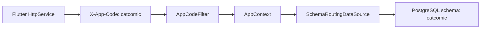
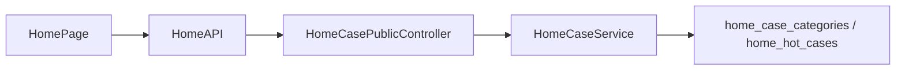
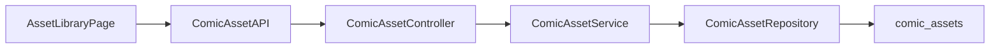

# 喵喵漫画 Java 总体开发计划

> 版本：v1.0
> 生成日期：2026-06-10
> 当前阶段：14 Java 编码
> 当前状态：done（后端 P0 代码已落地，按用户要求停在代码编写完成后，不进入 QA）
> 关联后端技术文档：./java-tech.md
> 关联前端技术文档：../03-前端/flutter-tech.md
> 关联 Flutter 总体计划：../03-前端/flutter-dev-plan.md
> 关联工时评估：../02-技术方案/effort-estimate.md
> 目标工程：`/Users/soul/code/lxwx/lxwx_service/lxwxservice`

---

## 1. 文档用途

本文用于把 `java-tech.md` 中的后端技术口径拆成可执行、可恢复、可验收的 Java 总体开发计划。后续第 12 步会基于本文继续生成 `04-后端/开发计划/*.md` 模块开发文档；第 14 步 Java 编码必须按本文和模块文档顺序推进。

本文已回写第 14 步 Java 编码结果；真实代码已落到 `/Users/soul/code/lxwx/lxwx_service/lxwxservice`。

---

## 2. 当前状态与恢复点

| 项 | 当前值 |
|----|--------|
| 当前项目 | `喵喵漫画` |
| 当前版本 | `v0.1.3` |
| 当前流程 | `14 Java 编码` |
| 当前恢复点 | `/Users/soul/code/lxwx/lxwx_service/lxwxservice` |
| 当前任务状态 | `done` |
| 后端工程 | `/Users/soul/code/lxwx/lxwx_service/lxwxservice` |
| 前端工程 | `/Users/soul/code/lxwx/make_drama` |
| App 名称 | `喵喵漫画` |
| appCode | `catcomic` |
| schema | 默认 `catcomic`，可由 `CATCOMIC_DB_SCHEMA` 覆盖 |

暂停点：Java 编码已完成；按用户要求停在代码编写完成后，不进入第 15 步联调与测试 QA。

---

## 3. 状态枚举与更新规则

任务状态只使用以下枚举：

| 状态 | 含义 |
|------|------|
| `pending` | 未开始 |
| `in_progress` | 执行中 |
| `waiting_review` | 已完成当前文档或任务，等待用户确认 |
| `done` | 已确认完成 |
| `blocked` | 因缺失依赖或冲突无法继续 |
| `skipped` | 用户明确跳过 |

更新规则：

- 每个编码任务开始时，把对应任务改为 `in_progress`，并在 `workflow.md` 写入恢复点。
- 每个编码任务通过验证后，把对应任务改为 `done`。
- 发现需求、接口、前端依赖或工程规则冲突时，先回写阻塞项，不直接改代码绕过。
- Java 编码阶段属于阻塞式阶段；用户未明确进入下一步前，持续停留在当前编码任务内推进、验证和回写。
- 涉及新增、修改、删除需求时，先走 `change-plan.md`，完成后归档到 `change-log.md`。

---

## 4. 总体开发策略

### 4.1 分层顺序

后端开发按以下顺序推进：

| 顺序 | 层级 | 目标 |
|------|------|------|
| 1 | 基础设施 | 新增 `catcomic` schema-routing 映射、测试映射和环境变量说明 |
| 2 | 鉴权与上下文 | 保持 `X-App-Code` 必填；资产读取匿名可用，登录态只扩展用户资产可见范围 |
| 3 | 数据库 | 新增 `catcomic` 专属迁移，创建首页表、资产表、索引、约束和注释 |
| 4 | 业务接口 | 复用首页接口；新增资产库 tabs/list/detail 三个读取接口 |
| 5 | 集成测试 | 覆盖 appCode、schema、空态、匿名、登录态和跨 App 隔离 |
| 6 | 部署与联调 | 补 OpenAPI/Javadoc、联调示例、环境变量和验证命令 |

### 4.2 P0 边界

| 范围 | 策略 |
|------|------|
| 完整实现 | `catcomic` AppCode 接入、首页接口可用、资产库读取接口 |
| 占位配合 | AI 漫剧、角色/场景/物品设计、分镜、预览、下载、重绘、作品、会员 |
| 不开放 | 真实 AI 生成、支付、会员扣点、作品生成、删除、下载 |
| 数据策略 | 表结构通过迁移创建；业务数据通过代码、后台接口、初始化服务或运营导入添加 |
| 空态要求 | 首页和资产库无业务数据时稳定返回空数组或空分页 |

### 4.3 工程口径

| 领域 | 口径 |
|------|------|
| 技术栈 | Java 21 + Spring Boot 3.3.0 + Gradle + MyBatis-Plus + PostgreSQL + Redis + JWT |
| 包名 | 保持 `com.lxwx.narrateservice` |
| 新增业务包 | `src/main/java/com/lxwx/narrateservice/app/comic/asset` |
| 迁移目录 | `src/main/resources/db/migration/catcomic` |
| 统一响应 | `ApiResponse<T>`，成功码 `200` |
| 分页响应 | `PageResult<T>` |
| 请求头 | `/api/**` 必须携带 `X-App-Code: catcomic` |
| 鉴权 | 资产读取允许匿名；登录态由 `@AuthenticationPrincipal CurrentUser` 可选注入 |
| 依赖 | 不新增非必要三方依赖 |

---

## 5. 总体阶段划分

| 阶段 | 任务范围 | 期望工时 | 里程碑 | 状态 |
|------|----------|----------|--------|------|
| P1 AppCode 与 schema 基线 | T-B001、T-B002 | 2.58 人天 | `catcomic` mapping、生效 schema 和表结构准备完成 | done |
| P2 首页接口联调 | T-B003 | 1.00 人天 | 首页分类和案例接口对 `catcomic` 可用，空态稳定 | done |
| P3 资产库基础模型 | T-B004 | 2.17 人天 | `comic_assets` 实体、Repository 和映射通过 | done |
| P4 资产库读取接口 | T-B005、T-B006 | 4.16 人天 | tabs/list/detail 可联调，空态和数据入口口径清晰 | done |
| P5 隔离测试与文档 | T-B007、T-B008 | 3.17 人天 | 安全隔离、OpenAPI、联调说明完成 | done |
| 合计 | T-B001~T-B008 | 13.08 人天 | Java P0 可联调 | done |

里程碑参考 `effort-estimate.md`：

| 里程碑 | 目标日期区间 | Java 验收含义 |
|--------|--------------|----------------|
| Alpha | 2026-06-22 ~ 2026-06-24 | 后端接受 `catcomic`，schema 和基础表可用 |
| Beta | 2026-07-06 ~ 2026-07-09 | 首页、资产库接口完整，前端可联调 |
| RC | 2026-07-15 ~ 2026-07-17 | 集成测试和隔离回归通过 |
| GA | 2026-07-27 ~ 2026-08-04 | 配合构建、上架和生产环境配置检查 |

---

## 6. 详细任务清单

### T-B001 AppCode 接入

| 项 | 内容 |
|----|------|
| 状态 | done |
| 依赖 | 无 |
| 主要文件 | `src/main/resources/application.yml`、`src/test/resources/application-test.yml` |
| 目标 | 新增 `catcomic: ${CATCOMIC_DB_SCHEMA:catcomic}` schema-routing 映射 |
| 业务约束 | `DEFAULT_APP_CODE` 保持现状，避免影响后台任务和旧回调默认行为 |
| 前端依赖 | `HttpService` 请求头 `X-App-Code: catcomic` 能通过后端过滤器 |
| 验收 | `X-App-Code: catcomic` 不再返回 unsupported；配置注释和环境变量口径清楚 |

### T-B002 Catcomic 表结构迁移

| 项 | 内容 |
|----|------|
| 状态 | done |
| 依赖 | T-B001 |
| 主要文件 | `src/main/resources/db/migration/catcomic/V14__catcomic_home_assets.sql` |
| 目标 | 创建 `home_case_categories`、`home_hot_cases`、`home_case_operation_logs`、`comic_assets` 和必要索引/约束/注释 |
| 业务约束 | 迁移脚本只做表结构变更，不直接写入首页分类、案例、资产、JSON 配置或其它业务数据；不执行删表或清空表操作 |
| 前端依赖 | 首页和资产库接口即使无业务数据，也能返回空数组或空分页 |
| 验收 | `catcomic` schema 具备首页表和资产表；`common` 与其它 App schema 不被扩大影响 |

### T-B003 首页接口联调

| 项 | 内容 |
|----|------|
| 状态 | done |
| 依赖 | T-B001、T-B002 |
| 主要文件 | `app/narrate/homecase/controller/*`、`app/narrate/homecase/service/*`、相关测试 |
| 目标 | 复用现有首页分类、案例接口，确认其在 `catcomic` schema 下可运行 |
| 后端接口 | `GET /api/config/home-case-categories`、`GET /api/config/home-cases?categoryCode=hot` |
| 业务约束 | 无分类或无案例时返回空数组，不用异常表达空态 |
| 前端依赖 | 对齐 Flutter T-F005 首页数据与状态 |
| 验收 | 带 `X-App-Code: catcomic` 请求首页接口稳定返回统一响应 |

### T-B004 资产实体与 Repository

| 项 | 内容 |
|----|------|
| 状态 | done |
| 依赖 | T-B002 |
| 主要文件 | `ComicAssetEntity.java`、`ComicAssetRepository.java` |
| 目标 | 建立 `comic_assets` 的实体映射和 MyBatis-Plus Repository |
| 业务约束 | 字段显式映射；`appCode`、`assetType`、`status`、`deletedAt` 是查询隔离关键字段 |
| 前端依赖 | 为 Flutter T-F007 的资产模型提供稳定字段 |
| 验收 | MyBatis 映射测试通过；字段命名和响应 VO 可转换 |

### T-B005 资产 Service

| 项 | 内容 |
|----|------|
| 状态 | done |
| 依赖 | T-B004 |
| 主要文件 | `ComicAssetService.java` |
| 目标 | 实现三类 Tab、分页列表、资产详情的业务逻辑 |
| 业务约束 | Service 读取 `AppContext.appCode()`；`assetType` 只允许 `ROLE`、`SCENE`、`ITEM`；匿名只看系统资产，登录用户可看系统资产和自己的资产 |
| 前端依赖 | 对齐 Flutter T-F007 资产库数据与状态 |
| 验收 | 类型校验、分页边界、空态、不可见资产返回均符合 `java-tech.md` |

### T-B006 资产 Controller / VO

| 项 | 内容 |
|----|------|
| 状态 | done |
| 依赖 | T-B005 |
| 主要文件 | `ComicAssetController.java`、`ComicAssetTabResponse.java`、`ComicAssetItemResponse.java`、`ComicAssetDetailResponse.java` |
| 目标 | 暴露 `/api/comic/assets/tabs`、`/api/comic/assets`、`/api/comic/assets/{assetId}` |
| 业务约束 | 只开放读取接口；不新增创建、编辑、删除、生成接口 |
| 前端依赖 | 对齐资产库 Tab、网格列表和详情占位 |
| 验收 | 三个接口返回 `ApiResponse`；分页接口返回 `PageResult`；Javadoc 和 OpenAPI 描述完整 |

### T-B007 安全与隔离测试

| 项 | 内容 |
|----|------|
| 状态 | done |
| 依赖 | T-B001~T-B006 |
| 主要文件 | `SchemaRoutingIntegrationTests`、`CommonRequestHeaderIntegrationTests`、`CatcomicAssetIntegrationTests` |
| 目标 | 覆盖缺请求头、错误 appCode、匿名读取、登录读取、跨 App 隔离、空态 |
| 业务约束 | 不允许 `catcomic` 读取其它 App 数据；Bearer token appCode 不一致时不扩展用户资产 |
| 前端依赖 | 保障 T-F005、T-F007 联调稳定 |
| 验收 | `./gradlew test` 通过，必要时 `./gradlew build` 通过 |

### T-B008 OpenAPI 与联调说明

| 项 | 内容 |
|----|------|
| 状态 | done |
| 依赖 | T-B005、T-B006、T-B007 |
| 主要文件 | Javadoc、OpenAPI 注解或接口说明、项目文档回写 |
| 目标 | 输出接口路径、请求参数、响应字段、错误码、空态策略和联调示例 |
| 业务约束 | 不承诺 P0 未实现的生成、支付、删除、下载能力 |
| 前端依赖 | 为 Flutter T-F005、T-F007 和 QA 阶段提供稳定契约 |
| 验收 | `/v3/api-docs` 能暴露新增接口；文档示例与真实接口一致 |

---

## 7. API 接口任务表

| 任务 ID | 接口 | 方法 | 路径 | 依赖表 | Service | 状态 |
|---------|------|------|------|--------|---------|------|
| T-B003 | 首页分类 | GET | `/api/config/home-case-categories` | `home_case_categories` | `HomeCaseService` | done |
| T-B003 | 首页案例列表 | GET | `/api/config/home-cases?categoryCode=hot` | `home_hot_cases`、`home_case_categories` | `HomeCaseService` | done |
| T-B003 | 首页案例详情 | GET | `/api/config/home-cases/{caseId}` | `home_hot_cases` | `HomeCaseService` | done |
| T-B003 | 首页案例使用统计 | POST | `/api/config/home-cases/{caseId}/use` | `home_hot_cases`、`home_case_operation_logs` | `HomeCaseService` | done |
| T-B006 | 资产 Tab | GET | `/api/comic/assets/tabs` | 无强依赖，可用静态枚举 | `ComicAssetService` | done |
| T-B006 | 资产列表 | GET | `/api/comic/assets` | `comic_assets` | `ComicAssetService` | done |
| T-B006 | 资产详情 | GET | `/api/comic/assets/{assetId}` | `comic_assets` | `ComicAssetService` | done |

P0 前端强依赖：

| 前端任务 | 后端任务 | 接口 |
|----------|----------|------|
| T-F005 首页数据与状态 | T-B003 | `/api/config/home-case-categories`、`/api/config/home-cases` |
| T-F007 资产库数据与状态 | T-B005、T-B006 | `/api/comic/assets/tabs`、`/api/comic/assets`、`/api/comic/assets/{assetId}` |

---

## 8. 数据流与业务约束

### 8.1 AppCode 与 schema



约束：

- `/api/**` 用户端接口必须经过 `AppCodeFilter`。
- `catcomic` 必须存在于 `app.schema-routing.mappings`。
- 数据库连接通过 schema routing 切到 `catcomic`，业务查询仍带 `app_code = AppContext.appCode()` 做二次隔离。

### 8.2 首页数据流



约束：

- 首页接口复用现有 Controller 和 Service。
- `catcomic` schema 的首页表结构必须存在。
- 无分类、无案例时返回空数组，前端展示空态。

### 8.3 资产库数据流



查询规则：

- `app_code = AppContext.appCode()`
- `asset_type = ROLE | SCENE | ITEM`
- `status = ACTIVE`
- `deleted_at IS NULL`
- 匿名用户：`user_id IS NULL`
- 登录用户：`user_id IS NULL OR user_id = currentUser.userId()`
- 排序：`sort_order ASC, created_at DESC, id DESC`

### 8.4 表结构与数据入口边界

迁移脚本只允许做结构变更：

- 创建表
- 修改表
- 创建索引、唯一约束、检查约束和注释

迁移脚本不得直接内置业务数据：

- 不直接写首页分类、示例案例、示例资产或运营配置
- 不直接写 `app_configs.config_value_json` 这类 JSON 配置内容
- 不直接改业务数据
- 不执行删表或清空表操作，除非用户后续明确提出并重新走变更评审

说明：这里限制的是表结构/迁移脚本；后端业务代码、后台管理接口、初始化服务、测试代码和运营导入流程可以在运行时写入数据。

---

## 9. 模块开发文档列表

第 12 步 Java 模块开发文档建议拆成以下文件：

| 文档 | 覆盖任务 | 状态 | 说明 |
|------|----------|------|------|
| `04-后端/开发计划/01-appcode-schema-routing.md` | T-B001 | done | `catcomic` mapping、环境变量、测试映射、启动校验 |
| `04-后端/开发计划/02-catcomic-migration.md` | T-B002、T-B004 | done | 首页表、资产表、实体、Repository、DDL 约束 |
| `04-后端/开发计划/03-home-api-integration.md` | T-B003 | done | 首页接口复用、空态、`catcomic` schema 联调 |
| `04-后端/开发计划/04-comic-assets-api.md` | T-B005、T-B006 | done | 资产 Service、Controller、VO、分页和可见性 |
| `04-后端/开发计划/05-security-isolation-tests.md` | T-B007 | done | 请求头、schema、匿名、登录、跨 App 隔离测试 |
| `04-后端/开发计划/06-openapi-integration-notes.md` | T-B008 | done | OpenAPI、Javadoc、联调示例、前端契约 |

---

## 10. 编码约束

- 进入 Java 编码阶段前，必须先读取 `/Users/soul/code/lxwx/lxwx_service/lxwxservice/AGENTS.md`。
- 进入 Java 编码阶段后，必须从 `.cursor/rules/14-Java编码索引.mdc` 进入，并按任务读取数据库、新接口、鉴权安全相关规则。
- 新增 public 类和 public 方法必须写中文 Javadoc。
- Controller 只处理参数、鉴权对象和统一响应，业务逻辑放 Service。
- Repository 使用 MyBatis-Plus 参数化查询，不拼接自由 SQL 字符串。
- 所有新增接口返回 `ApiResponse`；分页返回 `PageResult`。
- 资产接口只开放读取能力，不新增写接口。
- `assetType` 必须统一校验并转为 `ROLE`、`SCENE`、`ITEM`，不接受自由字符串。
- 查询必须同时考虑 schema routing 和 `app_code` 字段隔离。
- 首页与资产库接口允许匿名，但仍必须携带 `X-App-Code`。
- P0 不接真实 AI 生成、支付、会员扣点、作品下载、真实删除和真实视频重绘。
- SQL 迁移脚本只做结构变更，不直接内置业务数据、JSON 配置、示例案例或示例资产。
- SQL 迁移脚本不执行删表或清空表操作，除非后续用户明确提出并重新走变更评审。

---

## 11. 验证计划

### 11.1 编码后必跑命令

```bash
./gradlew test
./gradlew build
git diff --check
```

### 11.2 建议测试清单

| 范围 | 用例 |
|------|------|
| AppCode | 缺少 `X-App-Code` 返回 400；未知 appCode 返回 400；`catcomic` 可通过 |
| schema | `catcomic` schema 存在 `users`、`app_configs`、首页表和 `comic_assets` |
| 首页 | 分类接口空态稳定；案例列表空态稳定；详情不存在返回统一错误 |
| 资产 Tab | 返回 `ROLE`、`SCENE`、`ITEM` 三类配置 |
| 资产列表 | 匿名返回系统资产或空分页；分页边界稳定 |
| 资产详情 | 资产不存在、不可见、跨 App 均不泄漏数据 |
| 登录态 | 登录用户只看到系统资产和自己的资产 |
| OpenAPI | `/v3/api-docs` 暴露新增资产接口说明 |

### 11.3 本阶段验证

本阶段只生成文档，不运行后端测试。进入编码阶段并修改 Java 代码后必须执行上述验证。

---

## 12. 执行记录

| 时间 | 操作 | 结果 |
|------|------|------|
| 2026-06-10 19:23 | 基于 `java-tech.md`、`flutter-tech.md`、`flutter-dev-plan.md`、`tech-plan.md` 和 `effort-estimate.md` 生成 Java 总体开发计划 | `04-后端/java-dev-plan.md` 已输出，等待用户确认 |
| 2026-06-10 19:45 | 基于 Java 总体开发计划生成 6 份 Java 模块开发文档 | `04-后端/开发计划/*.md` 已输出，按用户要求不在文档评审处停留 |

---

## 13. 待确认项

| 编号 | 待确认项 | 当前默认 | 影响 |
|------|----------|----------|------|
| J1 | 是否需要 `/api/config/app` 聚合配置接口 | P0 默认不新增 | 若新增，会影响 T-B003/T-B008 和前端配置逻辑 |
| J2 | 首期首页案例和资产是否需要真实内容 | 默认可空态；内容通过代码或后台流程添加 | 影响验收观感和数据入口模块 |
| J3 | appCode 是否最终保持 `catcomic` | 默认保持 | 改名会影响配置、迁移目录、测试和前端常量 |
| J4 | 资产详情是否 P0 必接 | 默认可选，列表为强依赖 | 影响 T-B006 和 Flutter T-F007 |
