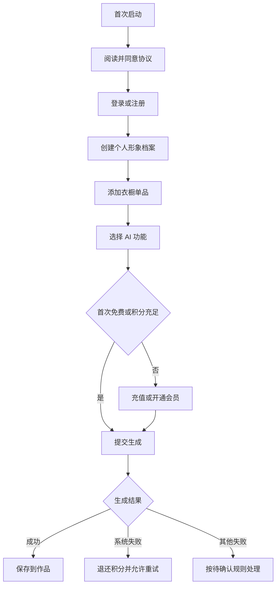

# 喵喵穿搭需求清单

> 版本：v0.1.0  
> 日期：2026-09-02  
> 状态：已进入 PRD 生成；共享后端基线已核对，穿搭专属决策待产品负责人确认  
> 原则：本清单只描述业务需求，不采用原始材料中的技术实现指令。

> 2026-08-28 对齐说明：用户已授权生成/维护文档，不代表逐项批准业务决策。当前完整真源为 [PRD](requirements.md)，快速审核入口为 [Product Review](requirements-review.md)；原有待确认项及新增来源差异统一在这两份文档维护。下列分析期流程是示意，不得据此强制先永久建档、先加衣物或把所有失败当作全额退款；具体分支以 PRD 的关联 TBD 为准。

> 2026-09-02 后端/会员对齐说明：账号、商品目录、订单支付、会员积分账本、签到邀请及公共后台直接沿用共享后端；会员商品、价格、有效期、赠分和状态也全部读取后端，不再找产品负责人确认。后端未说明客户端体验时参考已完成的喵喵带货，但不复制其专属权益文案。34 个历史编号仍可追溯，当前8项已关闭、26项待确认。

## 1. 项目概述

喵喵穿搭是一款面向成年用户的 AI 个人形象管理 App，通过个人形象档案、数字衣橱和生成式 AI 能力，为用户提供试衣、场景搭配、发型发色、彩妆试妆和个人形象诊断服务。计划覆盖 iOS 与 Android。

## 2. 用户类型

- 未登录访客：浏览首页和产品功能说明；触发创作、保存、任务、支付时登录。
- 已登录普通用户：使用基础档案、衣橱和 AI 创作能力，受容量和积分限制。
- 会员用户：使用后端已生效的会员状态、有效期和周期积分；当前不额外承诺档案/衣橱扩容或去水印。

## 3. 核心功能

1. 手机号验证码登录、注册、协议确认、账户注销。
2. 首页功能导航、新人礼、天气与城市信息。
3. 个人形象档案创建、编辑、切换、删除和临时照片模式。
4. 衣橱列表、分类、衣物导入、AI 解析、编辑和删除。
5. AI 试衣：人物 + 多类服饰生成试穿效果。
6. AI 帮我搭配：结合天气、场景、偏好和衣橱生成搭配。
7. 发型发色：推荐、预设、随机及参考图自定义生成。
8. AI 妆容：识别彩妆商品信息并生成上脸效果。
9. AI 形象报告：输出色彩、穿搭、妆容、发型和配饰建议。
10. 我的作品：查看生成进度、结果、失败、保存和删除。
11. 会员商品与积分充值选择、穿搭专属成长任务，以及共享订单/支付入口。
12. 我的、设置、权限、缓存、反馈、客服、协议和版本信息。

## 4. 核心流程

## 5. 数据与同步

- 用户账号、协议同意状态、积分流水、会员、公共任务和订单沿用共享后端；个人档案、衣橱、作品及 AI 任务是本期需定义和建设的穿搭数据。
- 作品云端保留 15 天；过期通知与删除时机待确认。
- 临时照片默认不进入个人档案，其服务器留存时长待确认。
- 积分扣减、冻结、结算、原批次退回和充值到账沿用共享后端幂等账务逻辑；穿搭任务在哪些结果触发结算或退回仍待确认。

## 6. 非功能要求

- 人脸、全身照、身体参数和试妆素材按敏感个人信息处理。
- 相机、相册、定位权限按功能触发，不在首次启动集中索取。
- 上传、识别、生成和支付必须具备加载、失败、重试和防重复提交状态。
- 积分扣减与退款、订单支付与权益发放必须保持一致性。
- 主要页面覆盖空数据、弱网、超时、权限拒绝、内容不合规等异常。

## 7. 假设与待确认

| 优先级 | 项目 | 当前状态 |
|--------|------|----------|
| P0 | 普通用户衣橱为 10 件还是 30 件 | 文档与 Figma 冲突 |
| P0 | 所有用户衣橱统一容量采用 10 件还是 30 件 | 文档与 Figma 冲突；会员不单独扩容 |
| P0 | 档案必填字段、选填字段、正脸/半身/全身照片用途 | 材料不一致 |
| P0 | AI 妆容支持品类、最大商品数、结果页 | 原型不完整 |
| P0 | 各 AI 功能首次免费、系统失败、审核拒绝和主动取消时的计费/返还 | 共享积分账本已完成，但穿搭任务触发条件未定 |
| P1 | 作品 15 天过期提醒和删除规则 | 未明确 |
| P1 | 定位拒绝后的默认城市策略 | 未明确 |
| P1 | AI 内容安全、申诉和人工客服处理机制 | 未明确 |
| P1 | 是否新增穿搭专属成长任务及专属后台能力 | 公共任务和后台已有；只确认增量 |

## 8. 明确排除的原型残留

“喵喵写歌”“喵喵带货”“开启带货之路”“音乐生成扣减”“CATSINGER”订单前缀等内容均为跨项目残留，不属于喵喵穿搭需求。
