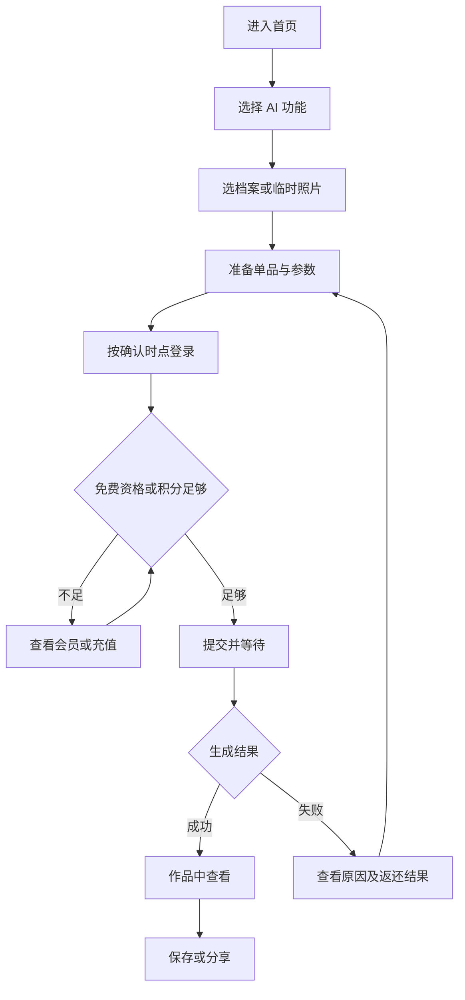

# 喵喵穿搭 Product Review

> 文档版本：v0.1.0-draft.5 · 产品版本：v0.1.0 · 更新日期：2026-09-29  
> 当前状态：waiting_review · 目标阅读：5～10 分钟  
> 完整需求真源：[requirements.md](requirements.md) · [来源索引](references/README.md)  
> 本文展示当前草案，不代表产品已批准。34个历史编号均保留：含统一衣橱容量在内9项已按后端现状关闭，25项穿搭产品决策待确认；正文 P0/P1 简写均对应末尾编号。Figma 本轮未连接，截图待导出。

## 1. 一句话版本

做一个 iOS/Android AI 形象助手：用户用档案或临时照片，完成试衣、场景搭配、发型发色、商品试妆、形象报告，再保存作品；衣橱、积分和会员支撑重复使用。商业规则和部分行为仍需你决定。

## 2. 本期范围

以下是当前范围草案，不是已批准的删减清单。

| 做 | 不做 / 尚未定 |
|----|---------------|
| 五项 AI、人物档案、数字衣橱 | 不做真实服装购买、库存、尺码保证 |
| 作品保存、分享、重新生成 | 原文不做结果局部编辑/批量多结果；出图数量待 P1-13 |
| 复用账号、商品、订单、支付、会员、积分、签到、邀请等共享后端；只新增确认后的穿搭专属成长任务 | 不重做共享后端，不在客户端硬编码会员商品/权益，不做社区、公开作品广场 |
| iOS、Android | 不做 Web 用户端；报告下载落地页另待确认 |
| 设置、反馈、客服入口 | 不做健康诊断或线下造型预约 |
| 运营配置所需能力 | 后台详细范围未定：Word包含完整后台，不能默认为无需建设（P1-12） |

## 3. 产品全景流程

登录可否延后到“生成”才触发待 P0-12；失败并非一律退款，取消也不等于退出 App（P0-09）。

## 4. 页面地图

当前按 **31 个逻辑页面/入口**审核：30 个 App 内页面与服务入口＋1 个外部下载页候选。不是 Figma 帧数或最终路由数；弹窗、城市选择、Tab、分步表单不另计。共用页已标出，客服形态和下载页范围仍待确认。

| 页面 | 用户来这里做什么 | 核心操作 | 去向 |
|------|------------------|----------|------|
| P01 启动 | 进入产品 | 启动/协议确认 | P03/P04 |
| P02 登录/注册（共用） | 建立账号 | 验证码/一键登录 | 返回原操作 |
| P03 协议阅读（共用） | 查看协议/隐私/说明 | 阅读后返回 | 原页 |
| P04 首页 | 选功能、查看形象天气 | 进入五项 AI/衣橱 | P05/P08/P11–17 |
| P05 档案列表 | 管理和切换人物 | 新增/切换/删除 | P06/P07/原功能 |
| P06 档案创建/编辑 | 维护人物资料 | 分步上传/填写/保存 | P07/原功能 |
| P07 档案详情 | 查看形象并开始使用 | 编辑/切换/去创作 | P06/P11–16 |
| P08 衣橱 | 管理可用单品 | 筛选/添加/删除 | P09/P10/原功能 |
| P09 衣物导入/处理 | 把照片变成单品 | 拍照/相册/AI解析 | P10/P08/原功能 |
| P10 单品编辑 | 校正识别结果 | 改名称/分类/风格/季节 | P08/原功能 |
| P11 AI试衣 | 预览服装上身 | 选人物与单品/生成 | P19/P18 |
| P12 帮我搭配 | 按天气场景配衣服 | 选场景/偏好/指定单品 | P19/P18 |
| P13 发型发色 | 尝试发型发色 | 选预设/随机/参考图 | P19/P18 |
| P14 AI妆容 | 预览彩妆上脸 | 上传商品/确认信息/生成 | P19/P18 |
| P15 形象报告入口 | 了解测试价值 | 开始测试 | P16 |
| P16 形象报告测试 | 提供报告条件 | 分步填写/返回/提交 | P17/P18 |
| P17 形象报告详情 | 阅读与传播建议 | 保存/分享/重测 | P16/P31 |
| P18 作品列表 | 查看任务与历史结果 | 分类/打开/重试/删除 | P17/P19/原功能 |
| P19 通用图片结果（共用） | 查看四类 AI 图片 | 保存/返回修改/重试 | P11–14/P18 |
| P20 我的 | 查看账号资产 | 会员/积分/任务/服务 | P21–30 |
| P21 会员中心 | 选择会员权益 | 查看套餐/购买 | P27/P20 |
| P22 积分充值 | 购买生成额度 | 选充值包/支付 | P27/P23 |
| P23 积分明细 | 核对资产变化 | 查看收入/消耗/退还/过期 | 原页 |
| P24 任务中心 | 签到或邀请赚积分 | 签到/任务/邀请分享 | 原页/P23 |
| P25 订单列表 | 查找购买记录 | 选择订单 | P26 |
| P26 订单详情 | 核对支付与到账 | 查询/联系客服 | P27/P30 |
| P27 支付结果（共用） | 知道付款是否完成 | 查原单/返回/求助 | P26/P20/原功能 |
| P28 设置 | 管理权限与账号 | 权限/缓存/更新/退出/注销 | P03/P29/P30 |
| P29 意见反馈 | 提交问题 | 描述/截图/提交 | 原页 |
| P30 客服入口 | 寻求帮助 | 联系/关联问题 | 原页/外部服务 |
| P31 下载落地页（外部候选） | 从报告分享安装App | 按设备选择渠道 | 应用商店 |

## 5. 逐页面功能 Checklist

每行只核对产品行为；详细布局与验收留在 PRD。

| 页面 | 要确认的用户行为 |
|------|------------------|
| P01 启动 | □ 协议前置与拒绝后的去向待 P0-18；不集中索取相机/相册权限。 |
| P02 登录/注册（共用） | □ 同意协议才提交；登录取消保留草稿，游客边界与18岁确认待 P0-12/18。 |
| P03 协议阅读（共用） | □ 不替用户默认勾选；共用阅读页，不重复计算各协议为页面。 |
| P04 首页 | □ 无档案可建档或临时上传；定位拒绝可选城市，天气规则见 P1-06。 |
| P05 档案列表 | □ 当前不设置会员专属档案扩容；会员到期不影响档案，删除不伤旧作品见 P0-14。 |
| P06 档案创建/编辑 | □ 必填字段和照片类型待 P0-05/06；新建后是否自动切换见 P1-14。 |
| P07 档案详情 | □ 展示本人填写资料；不由照片猜精确数值，缺必要照片先补充。 |
| P08 衣橱 | □ 当前后端统一100件上限（P0-01 已关闭）；会员身份不另行扩容或触发到期降级。 |
| P09 衣物导入/处理 | □ 普通导入免费、AI解析5分/原图为材料值；单图拆件与多图批量分开确认。 |
| P10 单品编辑 | □ 保存不另收费；分类与互斥见 P1-05，不能把保存失败显示成成功。 |
| P11 AI试衣 | □ 不强制永久建档；同位置数量与1张输出待 P1-13，失败费用见 P0-09。 |
| P12 帮我搭配 | □ 指定单品不可被擅换；空衣橱虚拟补齐与默认优先衣橱待 P1-15。 |
| P13 发型发色 | □ 推荐/自定义是同页模式；参考色与预设色是否互斥待 P1-16。 |
| P14 AI妆容 | □ 每商品3图和跨品类组合有原文依据，尚待 P0-07；结果设计未补齐。 |
| P15 形象报告入口 | □ 说明建议仅供形象参考，不是健康诊断。 |
| P16 形象报告测试 | □ 回上一步保留输入；照片、三围、生活状态待 P0-05/06、P1-07。 |
| P17 形象报告详情 | □ 不按会员身份增删水印；品牌二维码和分享隐私白名单待 P0-17。 |
| P18 作品列表 | □ 离开App后仍可回来查任务；15天起算、通知和删除关系需确认。 |
| P19 通用图片结果（共用） | □ 试衣/搭配/发型/妆容共用逻辑结果页，报告另页；客户端按后端作品资源原样保存，不做会员去水印。 |
| P20 我的 | □ 未登录先登录；余额、权益和过期状态能解释；会员卡不承诺后端未定义权益，不显示临时商品价格。 |
| P21 会员中心 | □ 参考喵喵带货：后端套餐有加载/空态/失败重试；仅展示所选商品返回的有效期与周期积分，缺字段不补造；购买前勾选会员协议，支付成功刷新资料。 |
| P22 积分充值 | □ 只展示后端当前可售积分商品；购买到账、永久/会员积分批次及流水直接沿用共享后端。 |
| P23 积分明细 | □ 余额、冻结额、来源、到期与退回按共享后端返回，不在客户端另定口径。 |
| P24 任务中心 | □ 签到和邀请沿用共享后端；只确认是否新增穿搭专属成长任务（P0-16）。 |
| P25 订单列表 | □ 状态、分页、取消和软删除沿用共享后端，不新增产品决策。 |
| P26 订单详情 | □ 支付成功未到账按原单查询/同步，不诱导再次购买。 |
| P27 支付结果（共用） | □ 沿用共享后端幂等订单、渠道查询及回调发权益；超时不等于失败。 |
| P28 设置 | □ 清缓存不删云端资产；注销和账号校验沿用共享后端，穿搭素材清理另见 P0-10。 |
| P29 意见反馈 | □ 失败保留输入；提示截图可能含个人信息，客服处理范围待 P1-12。 |
| P30 客服入口 | □ 独立聊天、网页或联系方式尚未定，不宣称已完成客服设计。 |
| P31 下载落地页（外部候选） | □ Word要求二维码下载页；本期纳入与否待 P0-17，渠道待 P1-10。 |

## 6. 核心业务规则

下表同时区分“共享后端既有行为”和“穿搭候选规则”。用户已明确要求公共业务以后端为准；只有穿搭候选仍需回答。

| 领域 | 当前定义 |
|------|----------|
| 共享后端范围 | `catoutfit` 已接入账号隔离、商品、订单、支付、积分、会员、签到、邀请、反馈、资源和审核平台能力；当前没有穿搭专属 Java 包或迁移 |
| 会员 | 商品和值完全读取后端；空列表显示空态。页面参考喵喵带货的加载、重试、协议、支付和资料刷新流程，不复制其专属权益 |
| 支付与订单 | 订单金额/商品快照、幂等创建、原单查询、渠道回调和一次性权益发放直接沿用后端，不再列为产品决策 |
| 积分账务 | 新用户、充值、签到等永久积分与会员周期积分分批记账；优先使用先到期批次，冻结/结算/退回均幂等，退回原批次且不延长原到期时间 |
| AI 计费 | 五功能各首次免费，后续20积分/次；默认1张/份。资格消费与重试见 P0-11、P1-13 |
| 图片解析 | 衣物AI解析5积分/原图，首次AI免费不免解析费；普通导入免费；彩妆识别不另收5分（原文） |
| 失败/重做 | 原文：系统失败返还、原参数重试免费；改参数为新任务；成功不满意不自动退。其他失败/取消待 P0-09 |
| 档案与衣橱 | 后端会员权益当前不包含档案/衣橱扩容；当前档案统一5个、衣橱统一100件（P0-01 已关闭）；会员到期不删除或降级资产 |
| 搭配来源 | 原文优先衣橱、可用虚拟单品补齐；标记来源、不入库、无购买链接，待 P1-15 |
| 作品 | 原文从成功起15天、不发完成/到期系统通知、页内显示剩余天数；主动删除不可恢复、不退积分 |
| 下载 | 后端会员权益当前没有去水印字段；客户端按后端作品资源原样保存，不因会员身份加/去水印；报告品牌/二维码见 P0-17 |
| 签到/邀请 | 奖励与展示读取服务端配置；签到按自然日幂等发永久积分。邀请关系仅可绑定一次且须在首次会员付款前；现后端不发注册积分，按会员首单返佣逻辑处理 |
| 成长任务 | 共享后端没有“完善档案/首件衣物/首次试衣”完成判定；是否新增及奖励值待 P0-16 |
| 权限/草稿 | 拍照上传保存时按需授权；原文游客草稿本机短期保留、取消登录不清空，具体时限未定 |

## 7. ⚠️ 必须人工确认的产品决策

| 决策 | 当前定义 | 为什么需要确认 |
|------|----------|----------------|
| 免费/失败 P0-09/11 | 原文成功才消耗；系统、输入、审核失败规则不同 | “所有失败都退”是旧稿过度概括 |
| 登录/年龄 P0-12/18 | 游客可先准备与提前登录口径不一；原文有18岁确认 | 影响首用转化和准入 |
| 照片/试妆 P0-05/06/07 | 照片类型冲突；原文已支持多品类试妆 | 不能因原型缺页就缩减能力 |
| 数据/分享 P0-10/14/17、P1-01 | 原文有15天及删除关系；具体清理与公开字段未定 | 避免误删旧作或暴露个人信息 |
| 成长任务 P0-16 | 共享任务中心只有签到和邀请进度，没有穿搭三项完成判定 | 决定是否新增穿搭后端事件和奖励 |
| 范围 P1-12、P0-17 | 公共后台已存在；穿搭档案/衣橱/作品等专属运营能力及报告下载页仍未定。范围排除属 **⚠️ 推导规则，尚未明确确认** | “公共能力完成”不能替代穿搭专属范围选择 |
| 默认值 P0-05/09/17、P1-02/07/14 | 三围选填、取消阶段、分享不含原图、3天提醒、生活状态多选、新档案自动切换：**⚠️ 推导规则，尚未明确确认** | 这些是AI补充，不是你的既有决定 |

后端已完成的公共规则及统一100件衣橱容量按用户指令直接采用，不再重复提问；原文中的其他穿搭专属条款仍只算“材料有记载”。缺失的商品字段、照片、留存等值不会自动补默认。

## 8. 异常与边界行为

| 场景 | 当前行为 | 是否需要确认 |
|------|----------|----------------|
| 拒绝定位/天气失败 | 原文可手动选城、天气失败不阻断搭配 | 是，P1-06 |
| 输入不合格仍强行提交 | 原文可能不返还；旧稿统一退款有冲突 | 是，P0-09 |
| 用户选中商品后价格变化 | 创建订单时以后端当前商品为准并固化金额/权益快照；已发布商品关键价值不可原地改写 | 否，沿用共享后端 |
| 退回积分的原批次已经到期 | 后端仍退回原来源批次且不延长到期时间，因此不会变成新的可用永久积分 | 否，沿用共享后端 |
| 分享报告 | 品牌二维码有来源；照片/围度是否公开未定 | 是，P0-17 |
| 登录取消/上传失败 | 草稿保留、不等于已提交生成；保存时限未定 | 是，P1-08 |

## 9. 用真实场景反向 Review

| 真实场景 | 当前产品行为 | 请确认 |
|----------|--------------|--------|
| 首次免费试衣失败，用户再次点生成 | 原文系统失败后仍可免费；旧稿资格消费表述不一致 | 是否按成功才消耗？P0-11 |
| 用户衣橱一件衣服也没有，却点“搭配” | 原文可用虚拟单品补齐；旧稿提示先添加 | 是否允许直接搭配？P1-15 |
| 会员到期后再打开档案和衣橱 | 后端只更新会员状态并结束后续会员周期积分；不删除、不锁定、不按会员身份降级穿搭资产 | 无需确认，沿用后端会员逻辑 |
| 用户生成中想取消并退出App | 原文退出不停止生成；主动取消及费用未定 | 是否提供取消，哪些阶段可退？P0-09 |
| 已扣款，但支付页超时，用户再次点击 | 后端按幂等键、原单查询、渠道同步和回调恢复，不重复发权益 | 无需确认，沿用共享后端 |
| 用户删除某个人物档案，再点旧试衣作品 | 原文旧作品保留，素材清理期限仍待定 | 是否保留旧作可下载？P0-14 |
| 生成后第16天才想下载作品 | 原文云端已过期；之前已存本地的不受云端过期影响 | 是否从成功起算且不发系统通知？P1-01/02 |
| 口红图片识别不出品类，用户愿意手填 | 当前未明确允许手填继续或必须重传 | 选哪种恢复方式？P0-07 |

## 10. 状态变化速查

以下同时列出后端既有状态和穿搭草案；标明待确认的部分仍未批准。

| 对象 | 正常路径 | 失败或恢复路径 |
|------|----------|----------------|
| AI作品 | 提交→等待/生成→成功→保存/分享→15天到期 | 系统失败→权益返还→重试；其他失败/取消待 P0-09 |
| 支付 | 待支付→处理中→已支付→权益到账 | 页面超时→查原单；已付款未到账→查询/客服，不再付一笔 |
| 会员 | 无会员→购买后有效→续期或过期 | 商品、有效期、赠分与状态均以后端为准；过期不改变穿搭资产 |
| 积分 | 永久/会员批次获得→可用→冻结→结算或退回→会员批次到期 | 后端按原批次幂等退回且不延长到期；穿搭在何种失败下调用退回见 P0-09 |
| 删除 | 选择删除→二次确认→不可恢复 | 删除失败恢复显示；删作品是否退费按 P0-14 |

## 11. 已确认 / 待确认

### 已确认

| 决策 | 最终定义 | 确认日期与依据 / 适用版本 |
|------|----------|--------------------------|
| 公共业务基线 | 已完成公共业务以后端现状为准 | 2026-09-02 用户确认；draft.5 |
| TBD-P0-02 已关闭 | 会员形态/档位取后端商品，页面流程参考喵喵带货 | 用户确认＋后端/完成 App |
| TBD-P0-03 已关闭 | 商品价格、有效期、到账值和赠分取后端；为空显示空态 | 用户确认＋后端商品目录 |
| TBD-P0-04 已关闭 | 支付、订单、查询、回调和发权益复用后端 | 用户确认＋后端实现/测试 |
| TBD-P0-08 已关闭 | 不设会员去水印；作品资源原样保存，报告二维码见 P0-17 | 用户确认＋会员接口 |
| TBD-P0-13 已关闭 | 到期只改会员状态/周期积分，不影响穿搭资产 | 用户确认＋会员服务 |
| TBD-P0-15 已关闭 | 积分批次、消耗、冻结、结算、退回和过期沿用后端 | 用户确认＋积分服务 |
| TBD-P1-03 已关闭 | 不设置会员专属档案数量 | 用户确认＋会员接口 |
| TBD-P1-04 已关闭 | 会员不单独扩容衣橱；所有用户统一100件 | 用户确认＋会员接口及衣橱服务 |
| TBD-P0-01 已关闭 | 后端对所有用户统一执行100件衣橱容量，无会员扩容 | 用户已明确已完成业务以后端为准＋后端常量及衣橱服务；2026-09-29 |

### 待确认

以下只保留穿搭当前产品行为。可按编号回答“沿用原文”或给出替代值；公共账号、会员、商品、支付、积分等无需重复回答。重要事项未关闭前不进入技术方案/编码。

| ID | 请产品负责人直接回答 | 优先级 |
|----|----------------------|--------|
| TBD-P0-05 | 档案和报告各哪些字段必填，三围是否选填？ | 重要，阻断推进 |
| TBD-P0-06 | 五项功能分别用正脸、半身还是全身照？已有档案可否直接复用？ | 重要，阻断推进 |
| TBD-P0-07 | 试妆是否支持不同品类组合、同品类最多 1 件、每件最多 3 图？识别失败能否手填继续？ | 重要，阻断推进 |
| TBD-P0-09 | 穿搭任务遇到系统失败、忽略输入警告、审核拒绝时分别是否返还？是否允许主动取消，允许到哪个阶段、怎样计费？ | 重要，阻断推进 |
| TBD-P0-10 | 未提交/已提交临时照片各保留多久？删除请求多久完成？ | 重要，阻断推进 |
| TBD-P0-11 | 是否沿用五功能免费资格独立，成功才消耗、系统失败后可再次免费？ | 重要，阻断推进 |
| TBD-P0-12 | `catoutfit` 服务端游客账号当前未开启；是否仍允许未登录用户仅在本机上传、裁剪、选参数，点击生成或保存衣橱时再登录？ | 重要，阻断推进 |
| TBD-P0-14 | 是否沿用删档案/单品不影响旧作品，删作品不删档案/单品且不退积分？ | 重要，阻断推进 |
| TBD-P0-16 | 本期是否新增“完善档案、上传首件衣物、首次 AI 试衣”三项穿搭专属成长任务？若新增，每项奖励多少积分？ | 重要，阻断推进 |
| TBD-P0-17 | 报告分享是否展示人物照片和身体参数？品牌二维码及下载落地页是否纳入本期？ | 重要，阻断推进 |
| TBD-P0-18 | 注册是否必须确认已满 18 岁？不同意协议时可否仅浏览首页？ | 重要，阻断推进 |
| TBD-P1-01 | 作品是否从生成成功起计算 15 天？ | 设计前确认 |
| TBD-P1-02 | 是否沿用不发完成/到期系统通知、作品页显示剩余天数？是否再加到期前 3 天提醒？ | 设计前确认 |
| TBD-P1-05 | 衣物分类采用哪套字典？连衣裙与上/下装互斥是否沿用？ | 设计前确认 |
| TBD-P1-06 | 天气展示到市还是区、多久刷新？失败是否仍允许搭配？ | 设计前确认 |
| TBD-P1-07 | 报告生活状态单选还是多选，是否选填？ | 设计前确认 |
| TBD-P1-08 | 草稿在本机保留多久？退出、登录取消后是否保留且不同步其他设备？ | 重要，阻断推进 |
| TBD-P1-09 | 缓存默认上限是 500MB 还是 1/2/5/10GB 中某值？ | 设计前确认 |
| TBD-P1-10 | Android 首发哪些应用市场，是否包含 Google Play？ | 设计前确认 |
| TBD-P1-11 | 首版是否做深色模式？需支持哪些字体缩放与读屏能力？ | 设计前确认 |
| TBD-P1-12 | 除共享后台已有的账号、商品、订单、积分、审核和配置外，本期需新增哪些穿搭专属后台能力：档案/衣橱查询、作品审核、AI任务补偿、穿搭配置、客服关联？ | 重要，阻断推进 |
| TBD-P1-13 | 是否沿用一图拆多件、AI解析按原图5分、每位置最多1件、每次1张/份？是否支持多原图批量上传？ | 重要，阻断推进 |
| TBD-P1-14 | 新增第二个档案是否自动切换？是否仅首个自动设为当前？ | 设计前确认 |
| TBD-P1-15 | 空衣橱是否允许 AI 虚拟单品补齐？是否默认优先衣橱，并标明虚拟单品无购买链接？ | 重要，阻断推进 |
| TBD-P1-16 | 自定义发型是否同时沿用参考发色且禁选预设颜色？推荐模式是否默认保持原发色？ | 重要，阻断推进 |
