# 喵喵穿搭产品需求文档（PRD）

> 文档版本：v0.1.0-draft.5  
> 产品版本：v0.1.0  
> 编制日期：2026-08-25  
> 更新日期：2026-09-29  
> 当前状态：waiting_review  
> 当前真源：本文档  
> 快速审核入口：[Product Review](requirements-review.md)  
> 输入材料：老板产品文档 V1.1、Figma Channel `beo7uxnz`、共享后端 `catoutfit` 现状  
> 适用终端：iOS、Android

---

## 1. 产品概述

### 1.1 产品定位

喵喵穿搭是一款面向成年用户的 AI 个人形象管理 App。用户可以建立个人形象档案和数字衣橱，通过 AI 获得试衣效果、场景穿搭、发型发色、彩妆上脸效果和个人形象诊断建议，并将生成结果保存或分享。

### 1.2 用户问题

- 购买服装前难以判断真实上身效果。
- 已有衣物较多，但缺少基于场景和天气的组合建议。
- 更换发型、发色或彩妆前试错成本高。
- 普通用户缺少结构化、可执行的个人形象建议。
- 服装图片、人物照片和生成结果分散，无法统一管理。

### 1.3 产品目标

1. 让用户在较低操作成本下建立可复用的个人形象档案。
2. 让用户将现实衣物沉淀为可搜索、可组合的数字衣橱。
3. 为试衣、搭配、妆发和形象诊断提供统一的 AI 创作流程。
4. 通过首次免费、任务积分、会员和积分充值形成可解释的商业闭环。
5. 对人物照片、身体参数、订单和积分等敏感数据提供可控、可追溯的处理机制。

### 1.4 目标用户

| 用户类型 | 典型需求 | 权限边界 |
|----------|----------|----------|
| 未登录访客 | 了解功能、浏览首页 | 不允许提交 AI 创作、保存、支付和参与任务 |
| 已登录普通用户 | 建档、管理有限衣橱、使用积分创作 | 受档案数、衣橱容量、积分和下载权益限制 |
| 会员用户 | 使用后端已生效的会员状态和周期积分 | 商品、有效期和赠分以后端为准；后端未返回的档案/衣橱扩容、去水印等权益不由客户端补造 |

### 1.5 产品原则

- AI 结果是形象参考，不承诺商品真实尺寸、医疗或专业诊断结论。
- 计费前向用户展示本次消耗；原文定义系统失败返还，输入/审核失败及取消的具体处理见 TBD-P0-09，不能统一承诺全退。
- 临时照片与个人档案照片分开处理，默认不自动沉淀。
- 原型中的临时价格、跨项目文案和互相冲突的配置不能作为开发常量。
- 敏感权限在用户触发相应功能时申请，并提供拒绝后的替代路径。

### 1.6 术语

| 术语 | 定义 |
|------|------|
| 个人形象档案 | 由人物照片和个人属性组成、可被多项 AI 功能复用的资料集合 |
| 临时照片 | 仅用于本次生成、不主动保存到个人档案的照片 |
| 衣橱单品 | 用户上传、拍摄或经 AI 解析后保存的服装、鞋包、帽饰记录 |
| AI 作品 | AI 搭配、试衣、妆容、发型发色或形象报告的生成结果 |
| 积分 | App 内用于 AI 创作和衣物解析的虚拟额度，全文不得与“金币”混用 |
| 首次免费 | 五项功能各自的免费生成资格；按提交还是成功消耗须关闭 TBD-P0-11，不能把“成功提交”等同“成功生成” |

## 2. 当前版本范围

### 2.1 本版本包含

| 优先级 | 模块 | 范围 |
|--------|------|------|
| P0 | 账号与协议 | 复用共享后端的手机号验证码/一键登录、退出、注销；补充穿搭协议与准入体验 |
| P0 | 个人形象档案 | 创建、编辑、切换、删除、档案/临时照片选择 |
| P0 | 我的衣橱 | 单品导入、AI 解析、分类、编辑、删除、容量限制 |
| P0 | AI 试衣 | 人物与多类单品组合生成、重试、保存 |
| P0 | AI 帮我搭配 | 天气、场景、偏好、指定单品驱动生成 |
| P0 | 发型发色 | 推荐、预设、随机和参考图自定义 |
| P0 | AI 妆容 | 商品图片识别、信息补充、上脸生成 |
| P0 | AI 形象报告 | 信息采集、生成、保存、分享、重测 |
| P0 | 我的作品 | 分类、生成状态、失败重试、保存、删除、15 天保留 |
| P0 | 积分与支付 | 复用共享后端余额、流水、订单、支付、冻结/扣减/退还；配置穿搭计费项和商品 |
| P1 | 会员 | 复用共享后端当前可售商品、会员状态、有效期和周期赠分；商品为空时展示空态，不硬编码套餐或额外穿搭权益 |
| P1 | 任务 | 复用共享后端签到与邀请；穿搭专属成长任务待确认 |
| P1 | 我的与设置 | 订单、反馈、客服、权限、缓存、版本、协议 |

### 2.2 本版本不包含

> 本节是当前范围草案，不是用户逐项批准的排除清单；尤其后台范围由 TBD-P1-12 确认，不得据此删去原始文档要求。

- 真实服装尺码推荐、库存、下单和电商交易。
- 社区动态、关注、评论、公开作品广场。
- 专业医疗、美容或身体健康诊断。
- 线下门店预约、造型师服务。
- Web 端用户产品。
- 重复建设共享后端已经完成的账号、商品、订单、支付、积分、会员、签到、邀请、反馈、资源和审核能力。
- 穿搭专属运营后台的详细功能设计；本期是否建设档案、衣橱、作品与任务补偿等能力见 TBD-P1-12。

### 2.3 来源优先级与冲突处理

1. 本 PRD 是研发和验收的当前真源。
2. 用户于 2026-09-02 明确：共享后端已经完成的公共业务以现有后端逻辑为准，不再重复作为产品决策；该授权只覆盖已实现公共能力，不替代穿搭专属业务选择。
3. 共享后端为 `/Users/soul/code/lxwx/lxwx_service/lxwxservice`，App Code `catoutfit`。当前已复用 `core` 与 `app/growth`，尚无 `app/catoutfit` Java 包或 `db/migration/catoutfit` 专属迁移。
4. Figma 用于确认页面结构、流程和状态；老板文档用于补足穿搭业务规则。二者冲突时标记 `TBD`，由产品负责人确认后回写。
5. Figma 中“喵喵写歌”“喵喵带货”“音乐生成”“CATSINGER”等内容视为无效残留。
6. “后端现状”“原始材料有记载”“材料冲突”“AI 推导”和“用户明确确认”分别记录。除第 11.1 节已按用户指令关闭的公共业务外，生成文档或实施计划不等于批准其余业务默认值。
7. 本文是完整的待评审需求真源，不是已批准开发基线。所有图表、正文和验收项涉及第 11 章未决事项时，均受对应未确认状态约束；不能只读取肯定句而跳过关联决策。
8. 2026-08-28 已重新核对原始 Word；Figma 本轮未连接，引用来自 2026-08-25 提取记录，未验证此后设计变化。当前 12 组页面参考图均待导出，不能宣称设计稿已嵌入或正式检测通过。
9. 2026-09-02 只读核对共享后端 `dev@661eca6b338b` 及当前工作树，并通过 Schema 路由、商品目录、积分计费、任务中心相关测试；后端工作树原有修改未被本轮改动。详细证据见 `references/README.md`。
10. 用户随后明确“会员相关问题不用找我确定，按照现在后端逻辑来”。据此，会员商品和状态全部动态读取后端；当前会员权益未返回档案/衣橱扩容或去水印字段，客户端不得自行补齐这些特权。
11. 后端只定义数据而未说明客户端体验时，参考已完成的 `/Users/soul/code/lxwx/catseller`：复用会员页加载/空态/错误重试、协议确认、支付完成后刷新用户资料及开通/续费展示流程；不得复制喵喵带货专属权益文案或视觉素材。

### 2.4 首版成功指标

指标具体目标值在数据方案阶段确定，本版本至少埋点支持：

- 档案创建开始率、完成率和失败原因。
- 衣橱首件添加率、AI 解析成功率。
- 五类 AI 功能的开始率、提交率、成功率、平均生成时长。
- 首次免费使用率、积分不足转化率、支付成功率。
- 作品保存率、分享率和 15 天内回访率。
- 权限拒绝率、上传失败率、生成失败退款成功率。

## 3. 整体流程

### 3.1 首次使用主流程

> 登录节点是待评审示意（TBD-P0-12/18）；原文允许游客先准备再于生成时登录，不得将此图解读为所有功能入口都先登录。

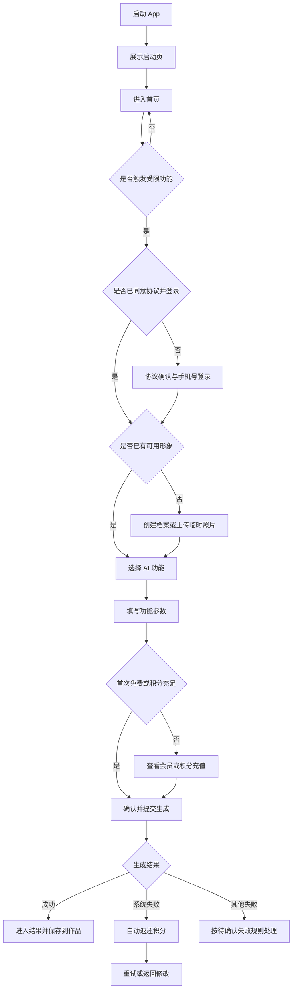

### 3.2 AI 创作与积分流程

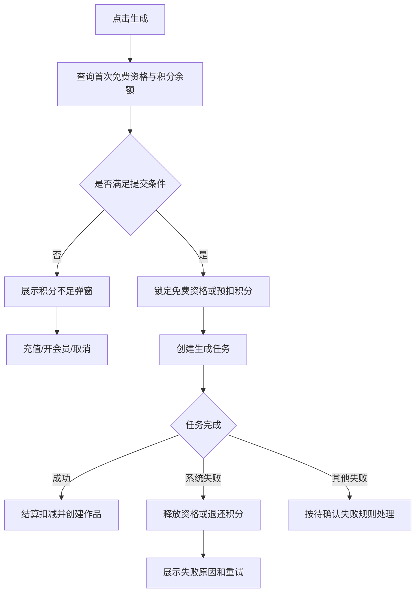

规则说明：

- 首次免费资格应按“账号 + 功能类型”判断，最终以服务端为准。
- 用户连续点击不得创建多个重复任务或多次扣减。
- 失败退款必须生成独立积分流水，并与原扣减记录关联。
- 首次免费是按提交还是按成功消耗，当前建议按“任务成功”消耗资格，待确认。

> 来源校正（TBD-P0-11、TBD-P0-09）：Word §4.2 与验收项明确“成功核销、系统失败返还后仍可免费”。图中的失败返还按系统失败理解，输入错误、审核拒绝、主动取消不得直接套用同一退款结论；详见第 11 章。

### 3.3 支付与权益到账流程

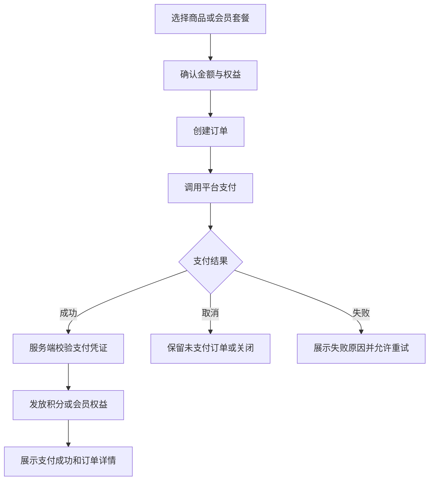

## 4. 信息架构 / 页面结构

### 4.1 页面树

```text
喵喵穿搭
├── 启动与账号
│   ├── 启动页
│   ├── 登录/注册
│   └── 用户协议与隐私政策
├── 首页
│   ├── 城市与天气
│   ├── 新人礼
│   └── AI 功能入口
├── 个人形象档案
│   ├── 档案列表
│   ├── 创建/编辑档案
│   └── 档案详情
├── 衣橱
│   ├── 衣物列表
│   ├── 导入与 AI 解析
│   └── 单品编辑
├── AI 创作
│   ├── AI 试衣
│   ├── 帮我搭配
│   ├── 发型发色
│   ├── AI 妆容
│   └── AI 形象报告
├── 作品
│   ├── 作品列表
│   └── 作品结果
└── 我的
    ├── 会员中心
    ├── 积分中心/充值/明细
    ├── 任务中心/签到/邀请
    ├── 订单
    ├── 反馈与客服
    └── 设置/权限/缓存/注销
```

### 4.2 底部导航

| 导航 | 默认内容 | 登录要求 |
|------|----------|----------|
| 首页 | 天气、档案提示、AI 功能入口 | 浏览不要求；创作时要求 |
| 衣橱 | 衣物分类、列表、添加入口 | 要求登录 |
| 作品 | AI 作品分类与状态 | 要求登录 |
| 我的 | 账户、会员、积分、任务、设置 | 部分内容要求登录 |

### 4.3 通用路由约束

- 需要人物输入的功能统一复用“选择档案 / 新建档案 / 临时相册 / 临时拍摄”。
- 需要衣物输入的功能统一复用“衣橱 / AI 解析 / 相册 / 拍摄”。
- 登录完成后返回用户触发登录前的原操作，不强制回首页。
- 支付、协议和权限弹窗关闭后返回原上下文，不丢失已填参数。

### 4.4 Review 逻辑页面索引

本轮为审核建立 31 个逻辑页面/入口：30 个 App 内逻辑页面与服务入口，以及 1 个外部下载页候选。该数量不是实际路由或 Figma Frame 数；客服形态、下载页范围仍待确认。弹窗、城市选择、Tab、建档/测试步骤不重复计数；登录/注册、协议阅读、四类图片结果和支付结果明确共用。具体用户操作见 [Product Review](requirements-review.md) §4–5。

| ID | 逻辑页面/入口 | 对应完整需求 |
|----|---------------|--------------|
| P01 | 启动 | §5.1 |
| P02 | 登录/注册（共用） | §5.1 |
| P03 | 协议阅读（共用） | §5.1/5.12 |
| P04 | 首页 | §5.2 |
| P05 | 档案列表 | §5.3 |
| P06 | 档案创建/编辑 | §5.3 |
| P07 | 档案详情 | §5.3 |
| P08 | 衣橱 | §5.4 |
| P09 | 衣物导入/处理 | §5.4 |
| P10 | 单品编辑 | §5.4 |
| P11 | AI试衣 | §5.5 |
| P12 | 帮我搭配 | §5.6 |
| P13 | 发型发色 | §5.7 |
| P14 | AI妆容 | §5.8 |
| P15 | 形象报告入口 | §5.9 |
| P16 | 形象报告测试 | §5.9 |
| P17 | 形象报告详情 | §5.9 |
| P18 | 作品列表 | §5.10 |
| P19 | 通用图片结果（共用） | §5.5–5.8/5.10 |
| P20 | 我的 | §5.11 |
| P21 | 会员中心 | §5.11 |
| P22 | 积分充值 | §5.11 |
| P23 | 积分明细 | §5.11 |
| P24 | 任务中心 | §5.11 |
| P25 | 订单列表 | §5.11 |
| P26 | 订单详情 | §5.11 |
| P27 | 支付结果（共用） | §3.3/5.11 |
| P28 | 设置 | §5.12 |
| P29 | 意见反馈 | §5.12 |
| P30 | 客服入口 | §5.12 |
| P31 | 下载落地页（外部候选） | §5.9/Word§12.3 |

## 5. 页面级详细需求

### 5.1 启动页、登录/注册与协议页

> 待决策：TBD-P0-12、TBD-P0-18。Word 允许游客先上传和填写，生成/保存衣橱等动作才要求登录；还要求注册确认已满 18 岁。原型与本节草案的首次协议/登录时点尚未统一，不得把浏览功能页等同提交生成。

#### 页面定位

承接首次启动、账号身份建立和合规授权。登录不是浏览首页的前置条件，但必须是创作、保存、任务和支付的前置条件。

#### 参考素材

- Figma：`1:7848` 至 `1:9500` 附近的启动、登录、注册、协议页面；注册节点 `1:17828`、`1:17882`。
- 老板产品文档：登录、草稿恢复、用户协议和隐私要求。

#### 页面结构（从上到下）

1. 品牌区：Logo、产品名“喵喵穿搭”、副标题“你的 AI 形象顾问”。
2. 手机号输入区：区号、手机号输入、格式提示。
3. 验证码区：验证码输入、获取按钮、倒计时、错误提示。
4. 主操作：立即登录/注册或一键登录。
5. 协议区：勾选框、《用户协议》《隐私政策》入口。
6. 合规弹窗：未勾选时说明同意范围和拒绝影响。

#### 区块说明

| 区块 | 内容与作用 | 交互与反馈 |
|------|------------|------------|
| 手机号 | 建立账号身份 | 输入非法时就地提示，不提交请求 |
| 验证码 | 校验手机号归属 | 获取后进入倒计时；失败可再次获取 |
| 协议 | 记录用户主动同意 | 未勾选点击登录时弹出确认，不默认勾选 |
| 主按钮 | 提交登录或注册 | 防重复点击，展示加载、成功、失败 |

#### 主要功能

- 手机号验证码注册与登录合并处理。
- 一键登录可用时展示，不可用时回退到验证码。
- 记录协议版本、同意时间和同意方式。
- 登录成功后恢复原操作上下文。
- 支持退出和注销；注销需二次确认并说明影响。

#### 交互流程图

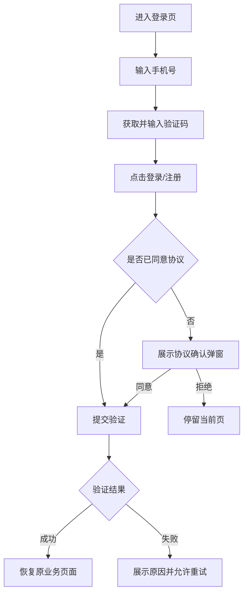

#### 详细交互说明

- 获取验证码前校验手机号格式；成功后按钮显示剩余秒数。
- 验证码错误、过期、频率限制和网络失败使用不同提示。
- 未同意协议时，弹窗只描述喵喵穿搭，不出现其他产品名。
- 注销成功后清除本地账号数据并回到未登录状态；云端删除范围按隐私政策执行。

#### 关键状态 / 异常情况

- 手机号为空或格式错误。
- 验证码发送中、倒计时、发送失败、次数受限。
- 验证码错误或过期。
- 一键登录不可用。
- 协议未同意。
- 网络异常、服务异常、账号已注销或受限。

#### 验收标准

- 未勾选协议时不能完成登录，且不允许默认勾选。
- 同一按钮连续点击只产生一次有效登录请求。
- 登录成功能返回原操作页面并保留已填的非敏感参数。
- 所有协议文案中不得出现“喵喵写歌”“喵喵带货”等其他产品名。

### 5.2 首页

#### 页面定位

首页是核心功能分发页，向用户展示当前形象、城市天气、AI 搭配建议和各类形象工具入口。

#### 参考素材

- Figma：`1:12107`、`1:12229` 至 `1:12996`。

#### 页面结构（从上到下）

1. 当前形象卡：未建档时提示创建；已建档时展示当前档案。
2. 城市天气区：当前城市、天气、温度和切换入口。
3. AI 帮我搭配主卡：场景、温度、开始搭配按钮。
4. AI 形象工具：AI 试衣、AI 妆容。
5. 形象管理：发型发色、AI 形象报告、我的衣橱。
6. 新人礼弹窗：首次体验、任务和邀请权益。
7. 底部导航：首页、衣橱、作品、我的。

#### 区块说明

| 区块 | 内容与作用 | 交互与反馈 |
|------|------------|------------|
| 形象卡 | 建档提示或当前档案 | 点击进入档案列表/详情 |
| 天气区 | 为搭配提供上下文 | 首次使用时申请定位；拒绝后可手动选城市 |
| 搭配主卡 | 快速进入搭配 | 携带当前档案、城市和天气进入参数页 |
| 工具宫格 | 分发 AI 功能 | 缺少人物时选择档案/临时照片；未登录何时拦截由 TBD-P0-12 确认 |
| 新人礼 | 解释免费资格和积分获取 | 同一活动按配置控制展示频次 |

#### 主要功能

- 展示当前档案状态和快捷创建入口。
- 获取天气；无定位时允许手动选城市。
- 分发五类 AI 功能和衣橱管理。
- 展示新人礼和活动入口。

#### 交互流程图

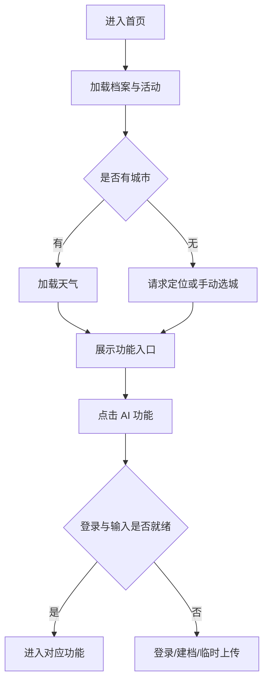

#### 详细交互说明

- “获取天气”不是系统权限名称；系统只申请定位权限，天气通过网络数据获取。
- 定位拒绝、不可用或无结果时显示“手动选择城市”，不能永久卡在 `--℃`。
- 新人礼“稍后领取”后按运营配置再次展示，不阻塞首页使用。
- 首页功能命名统一为“AI 形象报告”，不与“穿搭测评”混用。

#### 关键状态 / 异常情况

- 未登录、未建档、档案加载失败。
- 定位未授权、城市未知、天气超时或无数据。
- 新人活动已领取、已过期或加载失败。
- 功能暂不可用或维护中。

#### 验收标准

- 定位被拒绝后用户仍可手动选择城市并进入搭配。
- 未建档用户点击需要人物的功能时能选择建档或临时上传。
- 首页入口名称与作品分类、计费功能名称保持一致。
- 页面不得出现不可解释的 `--℃` 死状态。

### 5.3 个人形象档案列表、创建与详情

#### 页面定位

沉淀可被多个 AI 功能复用的人物照片和个人属性，并支持为不同人物创建独立档案。

#### 参考素材

- Figma：`1:2128` 至 `1:4185` 的建档、上传、详情和列表状态。
- 老板产品文档：档案数量、基础字段和照片用途。

#### 页面结构（从上到下）

1. 档案列表：当前档案标识、档案卡、添加入口、删除入口。
2. 步骤一正脸照：示例、拍摄要求、上传/拍摄、进度与重试。
3. 步骤二全身照：示例、站姿要求、上传/拍摄、进度与重试。
4. 步骤三基本信息：名称、年龄、性别、身高、体重、身形、肤色。
5. 扩展信息：肩围、胸围、腰围、臀围、尺码、臂围等。
6. 档案详情：照片、基础参数、编辑、切换、开始 AI 功能。

#### 区块说明

| 区块 | 内容与作用 | 交互与反馈 |
|------|------------|------------|
| 照片示例 | 解释合格/不合格照片 | 点击可查看大图说明 |
| 上传区 | 相册或拍摄人物照片 | 显示上传、检测、成功、失败、替换、删除 |
| 基础信息 | 支撑 AI 效果与报告 | 明确必填标识、单位、范围和错误提示 |
| 扩展信息 | 提升报告和搭配准确度 | 当前草案按选填；⚠️ 推导规则，尚未明确确认（TBD-P0-05，原文报告三围为选填不代表所有档案字段都相同） |
| 档案列表 | 管理多人物档案 | 当前档案可切换，删除前二次确认 |

#### 主要功能

- 创建、编辑、切换、删除个人形象档案。
- 支持相机和相册；上传后进行清晰度、遮挡和完整性检测。
- 支持 AI 功能中直接新建档案或仅上传临时照片。
- 档案数量不因会员身份变化；当前后端统一上限为5个。

#### 交互流程图

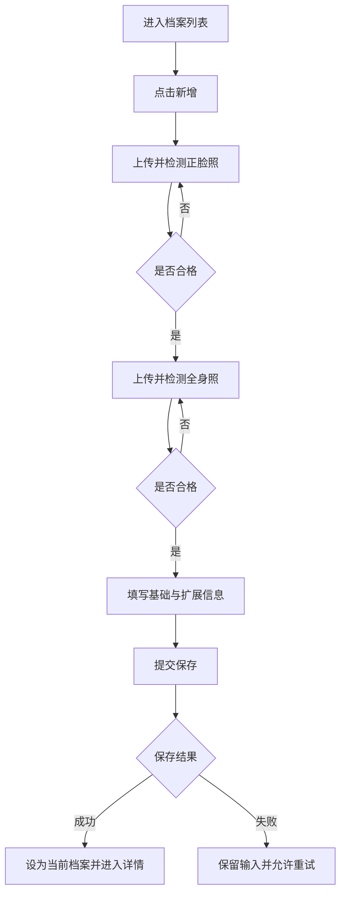

#### 详细交互说明

- 正脸照要求：正面、五官清晰、完整额头与脸部轮廓、无遮挡、光线均匀、避免重度美颜。
- 全身照要求：正面站立、全身完整入镜、手臂与躯干适当分离、双腿不交叉、衣着相对合身、背景简单。
- 身高、体重和围度必须带单位，支持合理范围校验；不得用示例值 `180` 作为默认真实值。
- 用户退出建档时提示是否放弃；本地草稿是否保留待确认。
- 删除当前档案后，如仍有其他档案，提示选择新的当前档案。
- 建档流程图的“设为当前”只有首个档案获原文明确支持；其他新档案自动切换属于 ⚠️ 推导规则，尚未明确确认（TBD-P1-14）。
- 会员到期只影响后端会员状态和周期积分，不改变档案的查看、切换、编辑或删除能力；删除档案是否影响旧作品见 TBD-P0-14。

#### 关键状态 / 异常情况

- 无档案、达到档案数量上限。
- 权限拒绝、上传中、检测中、检测不合格、网络失败。
- 保存失败、档案被删除、切换失败。
- 临时照片与保存到档案两种模式。

#### 验收标准

- 未通过照片检测时不能进入依赖该照片的生成步骤，并给出可执行的重拍原因。
- 建档失败后已填写字段不丢失。
- 临时照片不出现在档案列表。
- 必填、选填字段在页面和服务端校验一致。
- 档案数量由服务端配置，不在客户端写死。

### 5.4 我的衣橱、导入与单品编辑

#### 页面定位

将现实服装、鞋包和配饰转为结构化数字单品，为试衣和自动搭配提供输入。

#### 参考素材

- Figma：衣橱和衣物处理节点 `1:4300` 至 `1:7800`，处理清单 `1:17935`、`1:17973`、`1:18011`。

#### 页面结构（从上到下）

1. 标题与容量：衣物总数、普通/会员容量提示。
2. 分类栏：全部、上装、下装、连衣裙/长款、外套、鞋、帽、套装、包、配饰。
3. 单品网格：缩略图、名称、处理状态。
4. 添加入口：AI 解析、拍照、相册。
5. 处理清单：颜色材质分析、轮廓识别、标签生成进度。
6. 单品编辑：图片、名称、分类、风格、季节、保存、删除。

#### 区块说明

| 区块 | 内容与作用 | 交互与反馈 |
|------|------------|------------|
| 容量 | 告知可用额度 | 达上限时引导删除或查看会员，不允许继续创建 |
| 分类栏 | 快速筛选 | 展示各分类数量，空分类显示空状态 |
| 添加方式 | 创建单品 | AI 解析明确显示 5 积分；普通导入不扣积分 |
| 处理清单 | 展示异步处理 | 每件单品显示进度、成功、失败和重试 |
| 编辑表单 | 修正识别结果 | 保存后更新衣橱和后续 AI 选择器 |

#### 主要功能

- 支持相册、拍照和 AI 解析三种导入方式。
- AI 解析去除杂乱背景，分析颜色、材质、轮廓并生成标签。
- 用户确认或修改分类、风格、季节和名称后保存。
- 支持批次处理清单，但首版是否支持一次多件上传待确认。
- 区分“一张图拆成多件衣物”和“一次上传多张原图”：Word §7 已要求前者并按原图计费，后者上限仍待确认（TBD-P1-13）。
- 单品可被试衣、搭配指定选择器复用。

#### 交互流程图

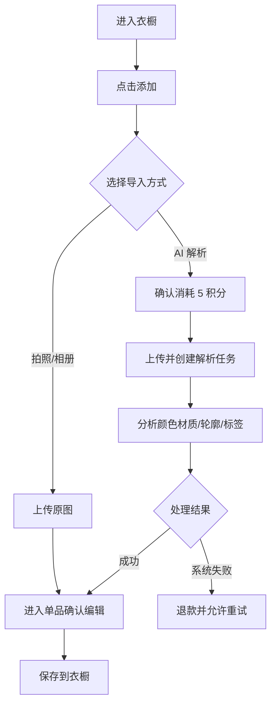

#### 详细交互说明

- AI 解析提交前展示费用；系统失败返还，其他失败的适用边界与 AI 创作一起确认（TBD-P0-09）。
- 普通拍照/相册导入允许用户自行裁剪和编辑标签，不消耗积分。
- 风格候选：通勤、极简、街头、甜酷、甜美、复古、运动、晚宴、度假、学院等；应由配置管理。
- 季节候选：春秋、夏、冬、秋冬、四季等；正式字典需统一。
- 删除单品前提示其不会删除历史作品，但可能影响未完成的搭配草稿。
- 衣橱使用后端统一100件容量，不因会员身份扩容（TBD-P0-01 已按后端现状关闭）。会员到期不删除、锁定或降级已有衣橱资产。

#### 关键状态 / 异常情况

- 空衣橱、空分类、达到容量上限。
- 上传失败、解析中、解析失败、退款中。
- 图片内容不合规、非服装图片、识别结果不完整。
- 保存失败、删除确认、并发修改。

#### 验收标准

- 普通导入不扣积分；AI 解析仅成功创建任务后进行预扣或锁定。
- 解析发生系统失败后积分恢复，并可在积分明细中追溯；输入/审核失败按 TBD-P0-09 确认后的规则验收。
- 分类名称在衣橱、试衣、搭配和作品中保持一致。
- 达到容量上限时不能出现“保存成功但列表缺失”。
- 文案统一使用“衣橱”，不得出现“衣厨”。

### 5.5 AI 试衣页与试衣结果页

#### 页面定位

将当前人物形象与用户选择的服装、鞋包和配饰组合，生成可预览的虚拟试穿效果。

#### 参考素材

- Figma：`1:13162` 至 `1:15150`。

#### 页面结构（从上到下）

1. 标题与试穿记录入口。
2. 当前人物形象和“更换形象”。
3. 单品类型选择：上装、下装、鞋、包、帽、饰品。
4. 已选单品预览与添加入口。
5. 费用按钮：首次免费或“生成试衣效果 · 20 积分”。
6. 生成状态：等待、生成中、失败、重试。
7. 结果页：效果图、AI 生成标识、单品清单、保存、返回修改、删除。

#### 区块说明

| 区块 | 内容与作用 | 交互与反馈 |
|------|------------|------------|
| 人物形象 | 试衣主体 | 可切换档案或临时上传全身照 |
| 单品选择 | 构成试穿组合 | 从衣橱、AI 解析、拍照、相册导入 |
| 费用按钮 | 提交生成 | 展示免费资格或 20 积分；提交前二次校验余额 |
| 结果 | 查看和保存 | 成功进入作品；系统失败退还积分并支持重试，其他见 TBD-P0-09 |

#### 主要功能

- 复用个人档案或临时全身照。
- 支持多类单品组合；同一类型最大数量待 AI 能力确认。
- 来源补充：Word §7.4 定义同位置最多 1 件、连衣裙与普通上下装互斥；是否沿用及单次出图数量由 TBD-P1-05、TBD-P1-13 确认。
- 首次免费，之后每次 20 积分。
- 查看历史试穿记录、保存图片、返回修改和重新生成。

#### 交互流程图

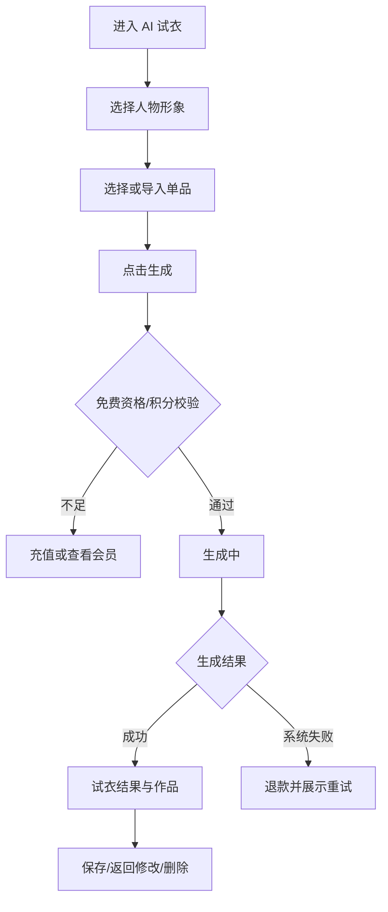

#### 详细交互说明

- 没有档案时弹出“新建个人档案 / 上传临时照片 / 拍摄临时照片”。
- 余额不足弹窗展示当前积分、还需积分、充值和会员入口。
- “暂不生产”统一改为“暂不生成”。
- 生成结果必须标注 AI 生成；客户端下载后端作品资源原样，不根据会员身份自行加水印或去水印。
- 返回修改应恢复人物和单品选择，不重复扣费。

#### 关键状态 / 异常情况

- 无人物、无单品、单品组合不支持。
- 积分不足、会员权益加载失败。
- 排队、生成中、超时、失败、退款未完成。
- 保存失败、本地存储权限不足、作品已过期。

#### 验收标准

- 未选人物或必要单品时生成按钮不可提交，并提示缺少项。
- 同一任务只扣减一次；系统失败返还，其他失败按 TBD-P0-09 确认后的规则验收。
- 返回修改保留本次输入，重新提交才产生新的计费判断。
- 成功结果在作品列表的“AI 试衣”分类可见。

### 5.6 AI 帮我搭配页与搭配结果页

#### 页面定位

结合人物、城市天气、场景、穿着诉求、补充说明和衣橱单品，生成完整搭配方案。

#### 参考素材

- Figma：`1:15507` 至 `1:16142`，结果复用试衣间节点 `1:17778`。

#### 页面结构（从上到下）

1. 当前人物和更换形象。
2. 城市天气：地区、天气、温度、体感、降雨概率、切换城市。
3. 场景：通勤、旅行、面试、运动、约会、正式、自定义。
4. 感觉/约束：精致、不露腿、显瘦、防晒、舒适、自定义，可多选。
5. 其他要求：选填，最多 50 字。
6. 指定单品：选填；不指定时从衣橱自动选择。
7. 费用与生成按钮。
8. 结果页：效果图、单品清单、保存、返回修改。

#### 区块说明

| 区块 | 内容与作用 | 交互与反馈 |
|------|------------|------------|
| 天气 | 提供环境条件 | 可定位或手动选城；加载失败可继续但明确无天气数据 |
| 场景 | 定义穿着目的 | 单选；自定义最多 20 字 |
| 感觉 | 定义风格和约束 | 多选；互斥规则待定义 |
| 指定单品 | 控制衣橱输入 | 按品类选择；不指定时系统自动选 |
| 生成 | 提交搭配任务 | 首次免费，后续 20 积分 |

#### 主要功能

- 支持定位城市和省市区手动选择。
- 场景单选、感觉多选、自定义文本。
- 支持指定一个或多个衣橱单品。
- 生成搭配效果和所用单品清单。

#### 交互流程图

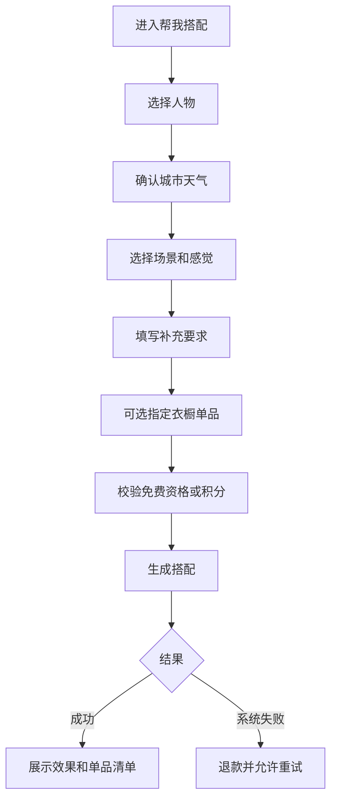

#### 详细交互说明

- 天气数据展示更新时间，避免用户误认为是实时数据。
- 定位拒绝后直接提供手动选城，不重复强制弹窗。
- “感觉”可多选；选择互相矛盾的标签时提示调整或由产品定义兼容策略。
- 衣橱为空的路径存在来源差异：Word §10.2/10.3 明确允许 AI 虚拟单品补齐、不入衣橱、不占容量、无购买链接，并区分“我的衣橱/本次指定/AI推荐”。旧稿“先添加单品”的限制未获确认；是否沿用原文见 TBD-P1-15，不在本轮擅自选定。

#### 关键状态 / 异常情况

- 定位拒绝、天气不可用、城市列表加载失败。
- 衣橱为空、指定单品已删除、单品组合冲突。
- 文本超长或包含不合规内容。
- 生成排队、失败、退款。

#### 验收标准

- 用户可在无定位权限情况下手动选城并完成生成。
- 场景自定义最多 20 字，其他要求最多 50 字。
- 未指定单品时，系统选择的单品必须在结果清单中可追溯。
- 生成成功后作品进入“帮我搭配”分类。

### 5.7 发型发色页

#### 页面定位

基于人物半身/正脸形象生成预设或自定义发型发色效果。

#### 参考素材

- Figma：`1:15203`、`1:15355`、`1:16289` 至 `1:16791`。

#### 页面结构（从上到下）

1. 人物形象预览、重新上传。
2. 推荐发型 / 自定义发型标签。
3. 女 / 男样式切换。
4. 发型预设列表与随机发型。
5. 发色预设列表与随机发色。
6. 自定义参考图上传区。
7. 免费或 20 积分生成按钮。
8. 生成状态和结果操作。

#### 区块说明

| 区块 | 内容与作用 | 交互与反馈 |
|------|------------|------------|
| 人物 | 发型生成主体 | 选择档案或上传临时半身照 |
| 推荐发型 | 快速选择预设 | 女/男仅作为样式筛选，不替代档案性别 |
| 发色 | 选择颜色 | 预设、随机；颜色名称与色卡一致 |
| 自定义 | 使用参考图 | 上传、检测、失败重试 |
| 结果 | 查看新发型 | 保存、重新生成、返回修改 |

#### 主要功能

- 女士和男士发型预设。
- 预设/随机发型和发色组合。
- 上传参考图生成自定义效果。
- 首次免费，后续 20 积分。

#### 交互流程图

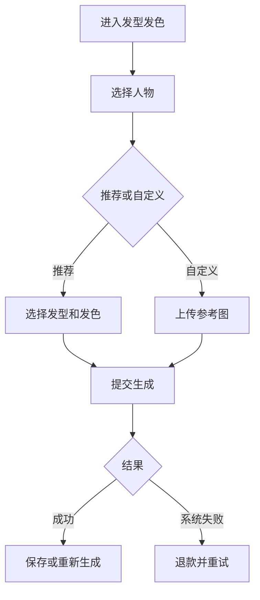

#### 详细交互说明

- 未上传人物时显示明确的半身/正脸照片要求。
- 自定义参考图应提示版权和内容合规责任。
- 预设发型和发色字典由后台配置，不能只依赖客户端版本。
- 所有费用文案统一为“生成发型发色效果”，不得出现“试衣效果”。
- Word §11 要求推荐模式有“保持原发色”，自定义参考同时提取发型和发色并禁选预设发色；原稿未覆盖的切换行为通过 TBD-P1-16 确认，不默认两套输入可叠加。

#### 关键状态 / 异常情况

- 无人物、参考图不合格、上传失败。
- 发型或发色资源下架。
- 生成失败、超时和退款。

#### 验收标准

- 推荐与自定义两种模式均能形成完整提交链路。
- 切换模式时已选择内容按产品策略保留或提示清空，不得静默丢失。
- 成功结果进入作品的“发型发色”分类。
- 页面不出现“生成试衣效果”文案。

### 5.8 AI 妆容页与试妆结果页

#### 页面定位

识别彩妆商品图片和补充信息，将商品颜色与质地模拟到用户面部，输出试妆参考效果。

#### 参考素材

- Figma：`1:16970` 至 `1:17699`。

#### 页面结构（从上到下）

1. 人物形象：档案或临时半身照。
2. 商品主图上传：拍照或相册。
3. 补充图片：膏体、色盘、试色效果，最多 3 张（含主图或补充图的计数口径待确认）。
4. 商品信息：品类、品牌、色号、色系、质地，识别后可编辑。
5. 上传建议说明。
6. 免费或 20 积分生成按钮。
7. 上传/识别/生成状态。
8. 结果页：试妆效果、商品信息、保存、返回修改、重新生成。

#### 区块说明

| 区块 | 内容与作用 | 交互与反馈 |
|------|------------|------------|
| 人物 | 试妆主体 | 选择档案或临时照片 |
| 商品图片 | 识别商品与颜色质地 | 上传、预览、删除、重试；最多 3 张 |
| 商品信息 | 修正识别结果 | 字段选填，但品类至少应有可用值 |
| 费用按钮 | 提交生成 | 首次免费，后续 20 积分 |
| 结果 | 展示上脸模拟 | 标注 AI 效果仅供参考 |

#### 主要功能

- 自动识别商品品类、颜色和质地。
- 用户补充品牌、色号、色系、质地。
- 生成商品上脸效果，系统失败退还积分；输入/审核失败见 TBD-P0-09。
- 支持保存、返回修改、重新生成。

#### 交互流程图

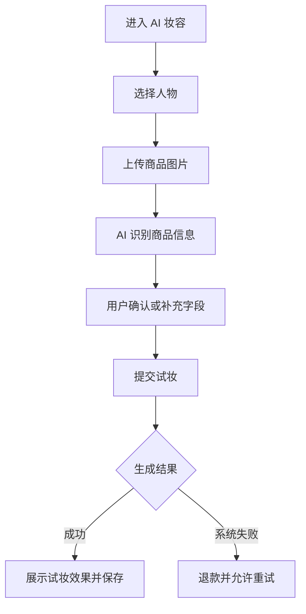

#### 详细交互说明

- 上传前提示图片应清晰展示膏体、色盘或试色效果。
- 识别结果只是建议，用户可编辑；修改后以用户确认值作为本次输入。
- Word §13 已定义唇、眉、眼影、眼线、睫毛、腮红及底妆/修饰等品类，并支持跨品类组合、同品类最多 1 件、每商品最多 3 图；商品识别不另收衣物解析的 5 积分。
- 旧稿把多商品组合写成“未定义、不进入验收”不准确。TBD-P0-07 确认是否沿用上述原文范围；不得因 Figma 缺少结果页而自动删减需求。识别失败能否手填继续仍缺明确规则。
- 文案统一为“生成试妆效果”，不得出现“生成试衣效果”。

#### 关键状态 / 异常情况

- 商品图缺失、超过数量、非彩妆商品、内容不合规。
- 识别失败但允许用户手填后继续，或强制重传的策略待确认。
- 人脸不可用、上传失败、生成失败、退款。
- 结果页原型尚不完整。

#### 验收标准

- 用户能查看、删除和重传每张商品图片。
- 商品识别失败时有明确恢复路径，不停留在无限加载。
- 提交前必须至少具备人物照片、商品图片和可用商品品类。
- 成功结果进入作品的“AI 妆容”分类。
- 结果页、支持品类和多商品规则未确认前，本模块不得标记设计完成。

### 5.9 AI 形象报告测试与报告详情页

#### 页面定位

采集人物照片、身体信息、生活场景和理想形象，生成个人色彩、穿搭、妆发和配饰建议。

#### 参考素材

- Figma：`1:9532`、`1:9622`、`1:9824` 至 `1:12060`。

#### 页面结构（从上到下）

1. 能力说明：DNA 风格诊断、色彩诊断、穿搭、妆容、发型建议。
2. 人物照片：正脸照片要求、档案/临时上传。
3. 必要信息：身高、体重、年龄。
4. 身形：苹果、梨形、直筒、倒三角、沙漏。
5. 三围信息：肩、胸、腰、臀；是否必填待确认。
6. 生活状态：通勤、演讲、艺术社交、商务酒会、休闲小聚等。
7. 理想形象：自由描述，最多 50 字。
8. 费用与提交：首次免费，后续 20 积分。
9. 报告详情：色彩概况、适配/慎选颜色、搭配公式、穿搭、妆容、发型发色、配饰、关键建议、避免方向、总结。
10. 结果操作：保存图片、分享、重新测试。

#### 区块说明

| 区块 | 内容与作用 | 交互与反馈 |
|------|------------|------------|
| 照片 | 提供面部和形象特征 | 文案必须明确是正脸、半身还是全身，不能互相矛盾 |
| 身体信息 | 辅助身形与比例建议 | 单位、范围和选填状态明确 |
| 生活状态 | 约束建议场景 | 单选还是多选待确认，首版建议多选 |
| 理想形象 | 获取主观目标 | 最多 50 字，进行内容安全校验 |
| 报告 | 结构化展示建议 | 每个结论需可读、可保存，不做健康诊断 |

#### 主要功能

- 多步骤测试，支持上一步和下一步。
- 保存步骤输入，避免网络失败后全部丢失。
- 生成结构化个人形象报告。
- 保存长图、系统分享、重新测试。

#### 交互流程图

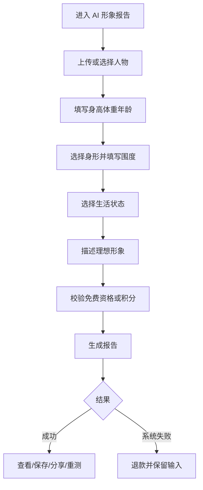

#### 详细交互说明

- Figma 页面标题写“上传全身照”但要求描述为正脸照，正式设计必须拆清各照片用途。
- 步骤间切换保留数据；退出时可提示保存测试草稿，草稿策略待确认。
- 报告页必须显示“仅供个人形象优化参考”。
- 保存图片需支持长图或分段图片；具体格式在设计计划中确认。
- “分享不默认包含用户原始照片和身体参数”为 ⚠️ 推导规则，尚未明确确认（TBD-P0-17）；展示白名单需人工选择，当前不可将该建议视为批准。
- Word §12.3 要求报告长图/分享图保留品牌二维码并通往按设备分流的下载页；是否纳入本期见 TBD-P0-17，该品牌信息不作为会员去水印权益。

#### 关键状态 / 异常情况

- 信息不完整、数值越界、照片检测失败。
- 报告生成中、超时、失败、退款。
- 部分报告模块缺失、分享失败、保存失败。

#### 验收标准

- 每一步都能返回且不丢失已填信息。
- 报告至少包含色彩、穿搭、妆容、发型发色、配饰和总结六类结果。
- 系统失败保留测试输入并退还积分；其他失败按 TBD-P0-09 确认后的规则处理。
- 分享内容不泄露未选择公开的围度、手机号等信息。
- 报告不得宣称医疗、健康或绝对审美结论。

### 5.10 我的作品与通用结果页

#### 页面定位

统一承载 AI 生成任务和结果，让用户查看进度、分类浏览、保存、重试和删除。

#### 参考素材

- Figma：`1:14311` 至 `1:15150`、`1:17778`。

#### 页面结构（从上到下）

1. 标题与保留提示：“作品仅保存 15 天”。
2. 分类：全部、帮我搭配、AI 试衣、AI 妆容、发型发色、形象报告。
3. 作品网格：缩略图、类型、时间、状态。
4. 空状态：功能入口和引导文案。
5. 生成中卡片：进度或阶段说明。
6. 失败卡片：原因、重新生成/重新上传。
7. 删除确认：不可恢复提示。
8. 结果页：效果图、AI 标识、输入摘要、保存、分享、返回修改。

#### 区块说明

| 区块 | 内容与作用 | 交互与反馈 |
|------|------------|------------|
| 分类 | 过滤作品类型 | 类型字典与首页功能一致 |
| 作品卡 | 展示任务和结果 | 点击成功卡进详情；失败卡可重试 |
| 过期提示 | 告知云端保留期 | 展示到期时间；提醒策略待确认 |
| 删除 | 主动清理作品 | 二次确认，成功后列表即时更新 |

#### 主要功能

- 拉取并按类型筛选作品。
- 展示等待、生成中、成功、失败、过期状态。
- 保存图片到本地、系统分享、删除。
- 从失败任务恢复输入并重试。

#### 交互流程图

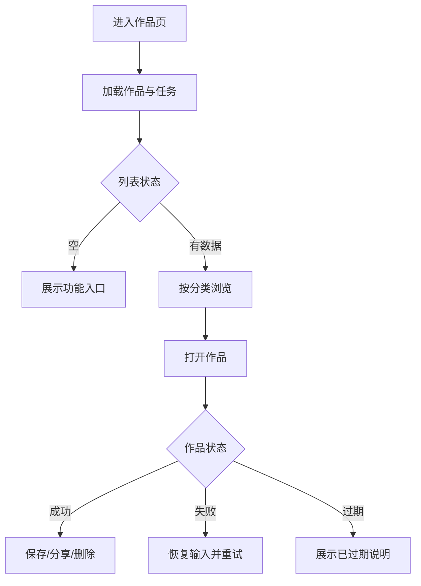

#### 详细交互说明

- Word §14.3 已明确从生成成功起保存 15 天，旧稿“起算点未定义”不准确；TBD-P1-01 确认是否沿用，不同时使用创建与完成两种口径。
- Word 不发送完成/到期系统通知，作品页显示剩余天数；到期前 3 天提醒是 ⚠️ 推导规则，尚未明确确认（TBD-P1-02）。
- 删除成功后不可恢复；删除失败需恢复卡片并提示。
- Word §14.3 还定义主动删作品不返还积分、不删档案和衣橱；TBD-P0-14 确认后统一使用该行为。
- 下载前申请相册写入权限；拒绝后提供再次授权说明或系统分享替代。
- 客户端按后端返回的作品资源原样保存，不按会员身份加/去水印或改变清晰度。
- 空状态统一写“还没有作品”，不得出现“还没有衣物”。

#### 关键状态 / 异常情况

- 空列表、加载失败、分页失败。
- 生成中、失败、退款中、已过期。
- 保存权限拒绝、本地空间不足、分享失败。
- 删除失败、作品已在其他设备删除。

#### 验收标准

- 六类作品筛选结果准确，分类命名一致。
- 生成任务状态在重新进入页面后能够恢复，不依赖前台常驻。
- 删除操作有二次确认且不会误删其他作品。
- 用户能看到作品到期信息。
- 作品过期、用户主动删除和账户注销三种状态可区分。

### 5.11 我的、会员、积分、任务与订单

#### 页面定位

集中承载账户状态、会员权益、积分资产、任务奖励、订单和服务入口。

#### 参考素材

- Figma：我的、会员、充值、积分明细、订单、任务和签到相关节点 `1:6000` 至 `1:9500`。

#### 页面结构（从上到下）

1. 用户信息：头像、昵称、登录状态。
2. 会员卡：未开通、有效、即将到期、已过期。
3. 积分卡：当前余额、充值、明细。
4. 任务入口：共享签到、共享邀请，以及待确认的穿搭专属成长任务。
5. 订单与服务：订单、反馈、客服。
6. 设置入口。
7. 会员中心：套餐、价格、周期积分、权益、支付方式。
8. 积分充值：商品列表、价格、支付说明。
9. 积分明细：收入、支出、退款和来源。
10. 任务中心：签到日历、每日/成长任务、邀请进度。
11. 订单详情：订单号、商品、金额、渠道、状态、时间。

#### 区块说明

| 区块 | 内容与作用 | 交互与反馈 |
|------|------------|------------|
| 会员卡 | 展示身份和权益 | 点击进入套餐或会员详情 |
| 积分卡 | 展示虚拟额度 | 余额来自服务端；点击进入充值/明细 |
| 任务 | 提供免费积分来源 | 展示条件、奖励、进度、领取状态 |
| 订单 | 查询支付记录 | 区分待支付、成功、失败、取消、退款 |
| 支付商品 | 购买积分或会员 | 商品、价格和权益由服务端配置 |

#### 主要功能

- 查看会员状态、套餐和权益并发起购买。
- 查看积分余额、充值和完整流水。
- 使用共享后端每日签到与邀请；如产品确认，再增加穿搭专属成长任务奖励。
- 查询订单详情和支付结果。
- 支付失败重试，支付成功后自动到账。

#### 交互流程图

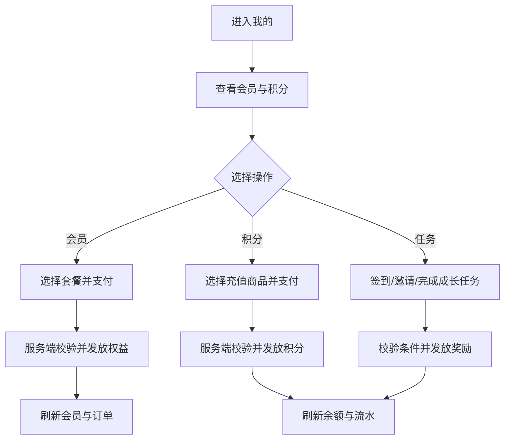

#### 详细交互说明

- 会员商品和积分商品只展示后端当前可售列表返回的最终金额、到账权益、有效期和购买形态；随包兜底清单为空时展示“暂无可购买商品”，不得使用 Word/Figma 临时值补造商品。
- 会员页参考喵喵带货的完成链路：加载套餐；空列表显示暂无可购；加载失败保留重试；购买前确认会员协议；支付成功后重新获取用户资料并更新“立即开通/去续费”和到期时间。
- 只复用上述通用流程。喵喵带货的商品分析、高阶模型、配音等权益文案与素材属于其专属业务，不得进入喵喵穿搭。
- iOS、微信、支付宝等渠道接入、订单状态、原单查询、幂等回调和权益发放沿用共享后端，不在本文另起一套业务规则（TBD-P0-04 已关闭）。
- 签到按共享后端自然日、服务端配置和幂等发放执行；不把 Word 的 10/20/20/20/30/30/50 写死到客户端。
- 邀请沿用共享后端：关系只绑定一次且须在首次会员付款前完成，不发“注册即得10积分”，当前收益逻辑来自好友首笔会员实付。
- 成长任务候选“完善档案、上传首件衣物、首次 AI 试衣”没有穿搭专属后端完成判定；是否新增及奖励值见 TBD-P0-16。
- 积分流水文案使用真实业务类型，不得出现“音乐生成扣减”。
- 订单号不得使用 `CATSINGER` 前缀；共享后端已为 `catoutfit` 配置 `05` 前缀，无需产品确认。

#### 关键状态 / 异常情况

- 未登录、会员过期、权益加载失败。
- 商品下架、价格变化、支付取消/失败/重复回调。
- 支付成功但页面未及时刷新。
- 任务未完成、已领取、重复领取、邀请无效。
- 积分到账延迟、流水分页失败。

#### 验收标准

- 商品价格和权益以服务端返回为准，客户端不写死原型数值。
- 同一支付凭证只能发放一次权益。
- 会员、充值、任务和退款产生的积分均有独立、可追溯流水。
- 支付页超时必须查询原单，不能将超时直接当失败或引导重复购买。
- “积分”和“金币”不得混用。
- 会员套餐冲突未确认前不得提交支付相关开发验收。

### 5.12 设置、权限、反馈、客服与协议

#### 页面定位

提供账户和 App 管理能力，集中展示权限状态、缓存、协议、算法信息、版本、反馈、客服和账号操作。

#### 参考素材

- Figma：设置、权限、反馈、客服、版本和注销相关页面。

#### 页面结构（从上到下）

1. 权限设置：相机、相册、定位、通知（如使用）。
2. 隐私与合规：隐私政策、用户协议、算法备案/说明。
3. 存储：缓存占用、缓存上限、清理缓存。
4. 版本：当前版本、检查更新。
5. 帮助：意见反馈、在线客服/客服联系方式。
6. 账号：退出登录、注销账号。

#### 区块说明

| 区块 | 内容与作用 | 交互与反馈 |
|------|------------|------------|
| 权限 | 查看当前授权状态 | 点击跳转系统设置或触发说明，不伪造系统权限 |
| 缓存 | 控制本地空间 | 支持查看、清理和设置上限；不删除云端作品 |
| 协议 | 合规信息入口 | 展示当前有效版本和更新时间 |
| 反馈客服 | 解决使用问题 | 支持问题描述、必要截图和联系方式 |
| 账号 | 退出或注销 | 注销二次确认并说明数据处理 |

#### 主要功能

- 查看权限状态和打开系统设置。
- 设置缓存上限、清理缓存。
- 查看协议、隐私和算法说明。
- 检查版本更新。
- 提交反馈、联系客服。
- 退出登录和注销账号。

#### 交互流程图

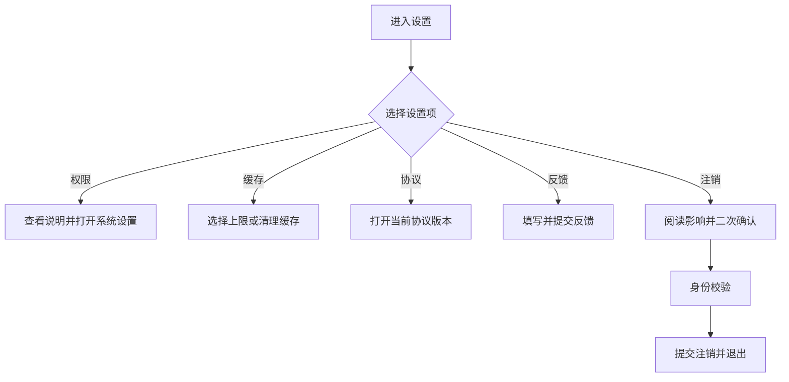

#### 详细交互说明

- 缓存上限候选 1GB、2GB、5GB、10GB；500MB 默认值与候选值冲突，最终值待确认。
- 清理缓存不删除账号数据、云端作品、衣橱和积分流水。
- 反馈上传截图前提示可能包含个人信息。
- 注销流程说明会员、未消费积分、云端作品和订单记录的处理方式。

#### 关键状态 / 异常情况

- 权限永久拒绝、系统设置跳转失败。
- 缓存计算中、清理失败、本地空间异常。
- 已是最新版本、发现新版本、强制更新。
- 反馈提交失败、客服不可用。
- 注销校验失败或存在处理中的支付。

#### 验收标准

- 权限状态与操作系统实际状态一致。
- 清理缓存后账号、衣橱、积分和云端作品不丢失。
- 注销前明确展示不可逆影响并完成二次身份校验。
- 协议页不存在跨产品文案。

## 6. 数据与同步

### 6.1 核心数据对象

| 数据对象 | 关键字段 | 数据归属 | 同步与生命周期 |
|----------|----------|----------|----------------|
| 用户 | 用户 ID、手机号脱敏值、昵称、头像、状态 | 账号 | 登录后多端同步；注销按政策处理 |
| 协议同意记录 | 协议类型、版本、时间、渠道、操作 | 账号 | 服务端长期留痕，不允许客户端覆盖 |
| 个人形象档案 | 档案 ID、名称、照片引用、年龄/性别/身高/体重/身形/肤色/围度 | 账号 | 多端同步；删除与作品是否解耦待确认 |
| 临时人物素材 | 素材 ID、用途、创建时间、任务 ID | 单次任务 | Word 定义短期清理、入任务最长随作品 15 天；具体时限见 TBD-P0-10 |
| 衣橱单品 | 单品 ID、图片、名称、分类、颜色、材质、风格、季节、标签、状态 | 账号 | 多端同步；删除不追溯删除历史作品 |
| AI 任务 | 任务 ID、类型、输入摘要、状态、进度、费用、错误原因 | 账号 | 跨端可恢复；状态以服务端为准 |
| 作品 | 作品 ID、任务 ID、类型、结果资源、到期时间、状态 | 账号 | 云端保留 15 天；本地保存不受云端过期影响 |
| 积分账户 | 余额、冻结额、更新时间 | 共享后端现有 | `catoutfit` schema 隔离，服务端权威，不接受客户端直接修改 |
| 积分流水 | 批次类型、数量、来源、到期、冻结/结算/退回 | 共享后端现有 | 永久与会员积分分批记账，按原批次幂等处理 |
| 会员权益 | 后端商品快照、开始/结束时间、状态、周期积分 | 共享后端现有 | 支付校验后发放，过期自动更新；当前无档案/衣橱扩容或去水印权益字段 |
| 订单 | 订单 ID、商品快照、金额、渠道、状态、支付凭证摘要 | 共享后端现有 | 服务端校验、幂等创建与回调，防重复发放 |
| 任务进度 | 签到记录、邀请进度；穿搭成长任务待定 | 共享＋专属候选 | 共享签到幂等；专属任务是否新增见 P0-16 |

### 6.2 同步规则

- 登录后从服务端恢复档案、衣橱、任务、作品、积分、会员和订单。
- 本地缓存只用于提升读取速度，服务端状态是资产和任务的最终依据。
- 同一账号多端同时编辑档案或单品时，服务端需要返回版本冲突，不允许静默覆盖。
- AI 任务在 App 被杀死或切换设备后仍可在作品页恢复状态。
- 作品资源需要返回明确到期时间，客户端不得自行估算。
- 积分余额变化后同步刷新余额和流水；网络中断时不得先显示永久到账。

### 6.3 删除与保留

| 操作 | 预期行为 |
|------|----------|
| 删除档案 | Word 明确历史作品保留；是否沿用见 TBD-P0-14，原人物素材清理时限见 TBD-P0-10 |
| 删除衣橱单品 | Word 明确历史作品保留；是否沿用见 TBD-P0-14 |
| 删除作品 | 云端标记删除并停止展示；不可恢复 |
| 作品到期 | 按服务端到期时间不可访问；是否提前提醒待确认 |
| 清理缓存 | 仅清理本地可再下载文件，不删除云端业务数据 |
| 注销账号 | 按隐私政策删除或匿名化业务数据；法定留存的订单记录除外 |

## 7. 核心业务规则

### 7.1 登录与访问控制

- 首页允许未登录浏览仍受 TBD-P0-18 约束。
- 共享后端短信/一键登录、退出和注销直接复用；`catoutfit` 服务端游客账号当前未开启。
- 未登录用户是否可在本机先准备照片和参数见 TBD-P0-12；提交 AI、保存云端资产、任务、积分和支付均要求正式登录态。
- 登录拦截完成后返回原页面和原操作上下文。

### 7.2 档案规则

- 后端会员权益不含档案扩容；本期不设置会员专属档案数量，所有登录用户使用同一档案能力。
- 正脸照、半身照、全身照的必填关系必须在待确认项关闭后执行。
- 扩展围度选填及非报告功能不拦截为当前草案；⚠️ 推导规则，尚未明确确认（TBD-P0-05），需区分报告辅助字段与档案必填。
- 临时照片不占档案数量。

### 7.3 衣橱规则

- 当前后端对所有用户统一执行100件衣橱上限，`TBD-P0-01` 已按用户“已完成业务以后端为准”的指示关闭；原 Word 10 件和 Figma 提取 30 件仅作为历史材料差异保留。
- 后端会员权益当前不包含衣橱扩容；不宣称会员无限，也不设置隐藏会员阈值。
- 普通相册/拍照导入不扣积分；AI 解析候选为 5 积分/原图。
- 分类、风格、季节字典由服务端配置并提供稳定编码。

### 7.4 AI 功能计费规则

| 功能 | 首次资格 | 后续费用 | 系统失败处理 |
|------|----------|----------|----------|
| AI 试衣 | 首次免费 | 20 积分/次 | 自动退还 |
| AI 帮我搭配 | 首次免费 | 20 积分/次 | 自动退还 |
| 发型发色 | 首次免费 | 20 积分/次 | 自动退还 |
| AI 妆容 | 首次免费 | 20 积分/次 | 自动退还 |
| AI 形象报告 | 首次免费 | 20 积分/次 | 自动退还 |
| 衣物 AI 解析 | 无首次免费描述 | 5 积分/张 | 自动退还 |

- 费用值应由服务端配置；表中为当前材料候选值。
- 计费基于唯一任务 ID，重复请求不得重复扣减。
- 表中“自动退还”针对系统失败。Word §8.2/8.3 已区分系统失败、用户忽略输入警告、审核失败和成功但不满意；是否沿用及主动取消边界见 TBD-P0-09，不能宣称所有失败一律退还。
- “不可取消阶段”本身尚未定义；⚠️ 推导规则，尚未明确确认（TBD-P0-09），本轮不新增取消按钮或锁定其收费规则。
- Word 明确首次免费只免 20 积分生成费，衣物 AI 解析 5 积分另计；原参数系统失败重试免费，改素材/参数为新任务，免费资格消费节点见 TBD-P0-11。

### 7.5 积分获取规则

- 积分公共账务直接以后端为准（TBD-P0-15 已关闭）：新用户默认 30 永久积分；充值、签到和公共发放使用永久积分批次；会员商品可发会员周期积分。
- 可用积分按会员积分到期时间优先、永久积分最后的顺序消耗；生成扣费支持冻结、确认、解冻及已扣减退回，并按业务 ID 幂等。
- 退回保持原积分批次和原到期时间，不额外延长；已到期会员批次不会因退回变成永久可用积分。
- 签到奖励读取服务端配置，按 Asia/Shanghai 自然日、连续天数和 7 天循环计算；重复签到不重复发放。
- 邀请只建立唯一关系并进入会员首单返佣逻辑，当前不发注册积分；客户端不得仅根据任务中心展示文案自行加分。
- 成长任务候选为完善档案、首件衣物、首次 AI 试衣；共享后端尚无这些穿搭事件，是否新增及奖励值见 TBD-P0-16。

### 7.6 会员与支付规则

- 商品、订单、支付、会员和积分账务复用共享后端；不重新设计订单状态、渠道回调或权益发放。
- 会员和积分商品不在客户端定义：页面完全采用后端当前可售商品列表中的购买形态、价格、有效天数和到账权益；列表为空时只展示空态。
- 会员状态接口当前返回有效状态、到期时间和空权益扩展；因此本期不增加会员专属档案数量、衣橱容量或去水印权益。后端将来新增权益字段后，须先更新 PRD/Review 再接入。
- 客户端状态参考喵喵带货：套餐加载失败可重试；提交前必须同意会员服务协议；支付处理中提示稍后查订单，取消不激活权益，支付成功后刷新用户资料；已开通显示到期时间和续费入口。
- 客户端展示商品前实时获取服务端商品；创建订单时固化商品名称、金额和权益快照，已发布商品关键价值不原地改写。
- 支付成功必须经服务端或平台凭证校验后发放；创建、回调、主动查询和页面恢复均沿用现有幂等逻辑（TBD-P0-04 已关闭）。

### 7.7 作品规则

- AI 成功结果自动进入作品列表。
- 云端作品保留 15 天；Word 明确成功起算且不发完成/到期系统通知，TBD-P1-01、TBD-P1-02 确认是否沿用。
- 用户主动删除后不可恢复。
- 客户端保存后端作品资源原样，不按会员身份二次处理水印或清晰度；报告品牌二维码是否纳入见 TBD-P0-17。

### 7.8 权限与隐私规则

- 相机：拍摄人物或商品时申请。
- 相册读取：选择图片时申请；相册写入：保存作品时申请。
- 定位：需要本地天气时申请；拒绝后支持手动选城。
- 不存在“天气权限”，天气是网络服务数据。
- 收集人物照片和身体信息前说明用途、处理方式、保存期限和删除路径。
- 分享报告和作品的隐私最小化方向保留；具体照片/字段白名单为 ⚠️ 推导规则，尚未明确确认（TBD-P0-17），不得未经确认公开手机号、精确围度等非必要信息。

### 7.9 内容安全规则

- 上传人物、衣物、商品和参考图需要内容安全检查。
- 对未成年人、色情、暴力、侵权或不适当内容的处理标准需合规评审。
- AI 生成失败提示不能暴露内部模型、提示词、密钥或供应商敏感信息。
- 用户应能区分“系统失败”“素材不合格”“内容不支持”和“积分不足”。

## 8. 前后端交互说明

> 已完成的账号、商品、订单、支付、积分、会员、签到、邀请、反馈、资源与审核交互复用共享后端现有契约；本节只补充穿搭专属业务边界，不另造一套公共状态或接口。

### 8.1 交互清单

| 业务 | 客户端提交 | 服务端返回 | 关键约束 |
|------|------------|------------|----------|
| 登录 | 手机号、验证码或一键登录凭证 | 登录态、用户摘要 | 复用共享后端；协议/18岁前置由客户端产品流程处理 |
| 首页 | 城市或坐标、客户端版本 | 天气、活动、功能开关、费用摘要 | 定位最小化、支持手动城市 |
| 档案列表 | 分页/状态 | 档案摘要、当前档案、额度 | 多端一致 |
| 创建档案 | 图片资源引用、基础/扩展字段 | 档案 ID、校验结果 | 防重复提交、敏感数据保护 |
| 照片检测 | 图片资源引用、用途 | 合格状态、问题类型、建议 | 不返回内部模型细节 |
| 衣橱列表 | 分类、分页 | 单品列表、数量、容量 | 分类稳定编码 |
| 衣物解析 | 原图引用、任务幂等键 | 任务 ID、费用、状态 | 5 积分候选、系统失败返还；其他见 TBD-P0-09 |
| AI 创作提交 | 功能类型、人物、参数、单品、幂等键 | 任务 ID、费用、预计状态 | 首次免费与积分服务端判定 |
| AI 任务查询 | 任务 ID | 状态、进度、结果、错误、退款状态 | 支持轮询/推送，跨端恢复 |
| 作品列表 | 类型、状态、分页 | 作品、任务状态、到期时间 | 15 天到期由服务端给出 |
| 保存/分享 | 作品 ID、目标规格 | 可访问资源、权限/水印信息 | 权益校验、防越权 |
| 积分账户 | 无或分页参数 | 余额、冻结额、流水 | 服务端权威 |
| 会员商品 | 渠道、地区、客户端版本 | 可售套餐、价格、权益、续费说明 | 不使用客户端写死价格 |
| 支付下单 | 商品 ID、渠道、幂等键 | 订单 ID、支付参数 | 金额服务端计算 |
| 支付确认 | 订单 ID、平台凭证摘要 | 最终状态、到账权益 | 校验凭证、幂等发放 |
| 任务中心 | 无 | 签到状态、服务端规则、邀请进度 | 复用共享后端；穿搭成长任务待 P0-16 |
| 签到 | 当前登录态 | 奖励积分、连续天数、最新余额 | 服务端自然日唯一，同日重复不重复发放 |

### 8.2 通用状态约定

- 所有异步任务至少包含：`pending`、`processing`、`succeeded`、`failed`、`expired`、`cancelled`（如支持取消）。
- 共享支付订单状态沿用后端：`pending`、`paid`、`failed`、`cancelled`、`closed`、`expired`；退款/权益冲正按既有账务记录处理，不新增客户端自定义状态。
- 作品至少包含：`generating`、`available`、`failed`、`expired`、`deleted`。
- 客户端不得用本地百分比冒充真实服务端进度；无真实进度时使用阶段文案。

### 8.3 错误反馈原则

- 返回稳定业务错误类型，让客户端分别展示：登录失效、参数缺失、素材不合格、余额不足、商品下架、内容不支持、任务超时、系统繁忙。
- 所有可恢复错误给出明确下一步：重试、替换素材、充值、重新登录或联系客服。
- 失败退款进行中时展示“退款处理中”，到账后刷新余额和流水。

### 8.4 幂等与一致性

- 共享后端下单使用客户端幂等键，支付回调、积分冻结/结算/退还和签到使用各自既有业务唯一键；客户端不得另造重复账务。
- 穿搭 AI 提交需要稳定任务唯一键；客户端超时重试时复用原任务/订单，不创建重复资产变化。
- 页面展示的余额、会员和订单状态以服务端最终结果为准。

## 9. 非功能要求

### 9.1 性能与体验

- 普通页面在正常网络下应快速展示骨架或缓存数据，避免长时间白屏。
- 图片上传支持压缩、进度和失败重试；压缩不得明显破坏 AI 所需细节。
- AI 生成时间较长时展示真实阶段或排队状态，并允许用户离开页面后在作品页查看。
- 列表支持分页或增量加载，避免一次加载全部作品和衣物原图。
- 具体响应时间、成功率和超时阈值在技术方案与 SLA 中确定。

### 9.2 安全与隐私

- 传输使用安全加密通道，服务端资源访问进行身份和权限校验。
- 人物原图、身体参数和商品图不得写入普通日志。
- 本地敏感缓存加密或使用系统安全存储；退出/注销按策略清理。
- 图片访问地址应具备有效期或权限控制，不能长期公开访问。
- 管理和客服人员访问敏感数据需要最小权限和审计记录。

### 9.3 可靠性

- AI、支付和积分采用可恢复的服务端任务状态。
- 网络断开、App 退后台或被系统终止后，重新进入可恢复任务。
- 第三方 AI 或支付服务异常不能导致重复扣费或重复发放。
- 关键资产变化需要监控和告警：支付成功未到账、失败未退款、余额异常。

### 9.4 兼容性

- 支持范围内的 iOS、Android 版本和机型在技术方案阶段明确。
- 适配刘海屏、圆角屏、系统字体缩放和深浅色策略（是否支持深色模式待确认）。
- 相机、相册、定位和系统分享在目标系统版本上使用平台推荐能力。

### 9.5 可访问性

- 关键按钮、表单和图片操作提供可读标签。
- 错误不能只用颜色表达，需要文字或图标说明。
- 文字与背景保持足够对比；关键点击区域满足移动端易操作尺寸。
- 生成中、成功、失败状态对辅助技术可识别。

### 9.6 可运营与可观测

- AI 费用、商品、会员权益、任务奖励、分类字典、活动和功能开关支持服务端配置。
- 记录关键漏斗事件和错误类型，但不记录原始敏感图片或完整身体参数。
- 支持按任务 ID、订单 ID、积分流水 ID 排查问题。
- 客服可查询用户授权后的订单与任务状态，但不能默认查看用户原始图片。

## 10. 里程碑

| 里程碑 | 目标 | 退出条件 | 状态 |
|--------|------|----------|------|
| M1 需求确认 | 关闭 P0 冲突并完成 PRD 检测 | `requirements.md` 检测 PASS | 进行中 |
| M2 设计闭环 | 补齐页面、结果、异常和设计计划 | Figma 设计计划完成，关键页面无缺失 | 待开始 |
| M3 技术方案 | 确定架构、AI、支付、数据、安全方案与工时 | 技术方案和工时获得确认 | 待开始 |
| M4 开发完成 | iOS/Android 与后端按模块完成 | 前后端计划任务完成，关键单测通过 | 待开始 |
| M5 联调验收 | 完成主流程、异常、支付和资产一致性测试 | P0/P1 缺陷关闭，QA 验收通过 | 待开始 |
| M6 上架发布 | 完成隐私合规、构建、商店审核和监控 | 商店上线且关键监控正常 | 待开始 |

## 11. 已确认 / 待确认

> 34个历史编号全部保留。用户于2026-09-02明确公共及会员业务以后端为准，2026-09-29 据已实现统一100件容量关闭 P0-01；P0-01/02/03/04/08/13/15、P1-03/04 共9项关闭，余下25项围绕穿搭当前产品行为。后端实现存在不等于其他穿搭专属功能已经建设。

### 11.1 已确认的公共业务基线

| ID / 决策 | 最终定义 | 确认依据与状态 |
|-----------|----------|----------------|
| 公共业务基线 | `catoutfit` 复用共享后端的账号、商品、订单、支付、积分、会员、签到、邀请、反馈、资源、审核与通用后台；不重复建设或请产品负责人复核内部逻辑 | 2026-09-02 用户明确指令；已确认 |
| TBD-P0-02 | 会员购买形态和档位只以后端当前可售商品为准；客户端不定义月/季/年、永久或续订方案 | 用户明确会员问题按后端；已关闭 |
| TBD-P0-03 | 会员和积分商品的价格、有效期、到账值、周期赠分只展示后端返回；商品为空时展示空态 | 用户本轮确认＋后端商品目录；已关闭 |
| TBD-P0-04 | 支付渠道能力、订单状态、幂等、原单查询、回调和权益发放沿用共享后端 | 后端实现与相关测试；已关闭 |
| TBD-P0-08 | 后端当前未提供穿搭去水印会员权益；客户端按作品资源原样保存，报告品牌二维码另见 P0-17 | 用户本轮确认＋会员接口当前权益返回；已关闭 |
| TBD-P0-13 | 会员到期只改变会员状态并结束后续周期积分，不删除、锁定或降级档案、衣橱和旧作品 | 用户本轮确认＋会员服务当前行为；已关闭 |
| TBD-P0-15 | 永久/会员积分批次、先到期优先、冻结/结算/原批次退回、到期处理均沿用共享后端；退回不额外延长原到期时间 | `PointsService` 当前行为；已关闭 |
| TBD-P1-03 | 后端会员权益不含档案扩容；本期不设置会员专属档案数量，所有用户使用同一档案能力 | 用户本轮确认＋会员接口当前权益返回；已关闭 |
| TBD-P1-04 | 后端会员权益不含衣橱扩容；会员不享有单独容量，所有用户统一100件 | 用户确认＋会员接口及衣橱服务当前行为；已关闭 |
| TBD-P0-01 | 所有用户统一100件衣橱容量；无会员扩容 | 用户明确已完成业务以后端为准＋`CatoutfitApp.WARDROBE_CAPACITY=100`及衣橱服务；2026-09-29 已关闭 |

### 11.2 P0：重要产品决策

| ID | 请产品负责人直接回答 | 当前材料与差异 | 确认状态 |
|----|----------------------|----------------|----------|
| TBD-P0-05 | 档案和报告各哪些字段必填，三围是否选填？ | Word §6.2/12.1 与 Figma 字段不同；原 PRD 的“扩展围度默认选填”尚未单独确认。 **⚠️ 推导规则，尚未明确确认**。 | 推导；待确认 |
| TBD-P0-06 | 五项功能分别用正脸、半身还是全身照？已有档案可否直接复用？ | Word：试衣/搭配/报告全身、发型正脸；Figma 发型/妆容半身、报告正脸要求，存在差异。 | 材料冲突；待确认 |
| TBD-P0-07 | 试妆是否支持不同品类组合、同品类最多 1 件、每件最多 3 图？识别失败能否手填继续？ | Word §13 已定义多品类和每商品 3 图；旧 PRD 将多商品排除验收、认为规则未定义，未获批准；Figma 结果页仍不完整。 | 材料与PRD差异；待确认 |
| TBD-P0-09 | 穿搭任务遇到系统失败、忽略输入警告、审核拒绝时分别是否返还？是否允许主动取消，允许到哪个阶段、怎样计费？ | 共享积分服务已能幂等冻结/结算/退回，但何种穿搭结果触发哪种账务动作仍须定义。Word 仅明确系统失败返还。 | 穿搭专属决策；待确认 |
| TBD-P0-10 | 未提交/已提交临时照片各保留多久？删除请求多久完成？ | Word §20.2：短期清理、入任务最长随作品 15 天；“短期”和删除执行时限未具体化。 | 部分已记载；待确认 |
| TBD-P0-11 | 是否沿用五功能免费资格独立，成功才消耗、系统失败后可再次免费？ | Word §4.2 与验收段 P0753 明确；旧 PRD 同时出现“成功提交”和“生成成功”，本轮标记待选择，不假称无来源。 | 材料与PRD差异；待确认 |
| TBD-P0-12 | `catoutfit` 服务端游客账号当前未开启；是否仍允许未登录用户仅在本机上传、裁剪、选参数，点击生成或保存衣橱时再登录？ | Word §3.3/24.3 明确支持本机准备并保留草稿；该模式无需新增服务端游客账号，但客户端入口仍须确认。 | 穿搭专属决策；待确认 |
| TBD-P0-14 | 是否沿用删档案/单品不影响旧作品，删作品不删档案/单品且不退积分？ | Word §6.1、段 P0391 与 §14.3 明确；素材引用实际清理按 P0-10 确定。 | 材料有记载；待确认 |
| TBD-P0-16 | 本期是否新增“完善档案、上传首件衣物、首次 AI 试衣”三项穿搭专属成长任务？若新增，每项奖励多少积分？ | 共享任务中心已提供签到与邀请进度，但没有三项穿搭事件；Word 的签到/注册奖励口径不再覆盖后端现状。 | 穿搭专属范围；待确认 |
| TBD-P0-17 | 报告分享是否展示人物照片和身体参数？品牌二维码及下载落地页是否纳入本期？ | Word §12.3 要求品牌二维码和按设备下载；旧 PRD 补充“默认不含原始照片/身体参数”，具体展示白名单未确认。 **⚠️ 推导规则，尚未明确确认**。 | 推导；待确认 |
| TBD-P0-18 | 注册是否必须确认已满 18 岁？不同意协议时可否仅浏览首页？ | Word §3.2/3.4 要求18岁确认、启动协议；Figma 提取及旧 PRD 允许先浏览，首次协议边界未统一。 | 材料冲突；待确认 |

### 11.3 P1：设计与行为边界决策

| ID | 请产品负责人直接回答 | 当前材料与差异 | 确认状态 |
|----|----------------------|----------------|----------|
| TBD-P1-01 | 作品是否从生成成功起计算 15 天？ | Word §14.3 已明确，原 PRD 将起算点写成未定义；需确认是否沿用。 | 材料有记载；待确认 |
| TBD-P1-02 | 是否沿用不发完成/到期系统通知、作品页显示剩余天数？是否再加到期前 3 天提醒？ | Word §14.3 已有前两项；3 天提醒是旧 PRD 建议，不是原文规则。 **⚠️ 推导规则，尚未明确确认**。 | 推导；待确认 |
| TBD-P1-05 | 衣物分类采用哪套字典？连衣裙与上/下装互斥是否沿用？ | Word §7.4 有明确分类和同位置最多 1 件；Figma 有长款、整套等不同名称。 | 材料冲突；待确认 |
| TBD-P1-06 | 天气展示到市还是区、多久刷新？失败是否仍允许搭配？ | Word §10.1 已说明失败不阻断；刷新频率和展示粒度待定。 | 部分已记载；待确认 |
| TBD-P1-07 | 报告生活状态单选还是多选，是否选填？ | Word §12.1 为选填辅助；Figma 多步骤选择，旧 PRD 建议多选并限数量。 **⚠️ 推导规则，尚未明确确认**。 | 推导；待确认 |
| TBD-P1-08 | 草稿在本机保留多久？退出、登录取消后是否保留且不同步其他设备？ | Word §3.3 有本机短期保留、取消不清空；具体天数未给出。 | 部分已记载；待确认 |
| TBD-P1-09 | 缓存默认上限是 500MB 还是 1/2/5/10GB 中某值？ | Figma 提取的默认值与可选值未统一。 | 材料冲突；待确认 |
| TBD-P1-10 | Android 首发哪些应用市场，是否包含 Google Play？ | iOS/Android 已在材料中；具体分发渠道未定。 | 待决策；待确认 |
| TBD-P1-11 | 首版是否做深色模式？需支持哪些字体缩放与读屏能力？ | 旧 PRD 只列方向，无具体范围。 | 待决策；待确认 |
| TBD-P1-12 | 除共享后台已有的账号、商品、订单、积分、审核和配置外，本期需新增哪些穿搭专属后台能力：档案/衣橱查询、作品审核、AI任务补偿、穿搭配置、客服关联？ | Word §17/18 包含完整后台；共享后端无 `app/catoutfit` 专属业务，不能把公共后台误当作穿搭运营闭环。 | 穿搭专属范围；待确认 |
| TBD-P1-13 | 是否沿用一图拆多件、AI解析按原图5分、每位置最多1件、每次1张/份？是否支持多原图批量上传？ | Word §7/附录A 已定义前四项；一次多原图的上限仍缺失。 | 部分已记载；待确认 |
| TBD-P1-14 | 新增第二个档案是否自动切换？是否仅首个自动设为当前？ | Word §6.1 只要求首个自动设为当前；旧 PRD 的所有新建均切换为当前属于补充推导。 **⚠️ 推导规则，尚未明确确认**。 | 推导；待确认 |
| TBD-P1-15 | 空衣橱是否允许 AI 虚拟单品补齐？是否默认优先衣橱，并标明虚拟单品无购买链接？ | Word §10.2/10.3 明确允许；旧 PRD 提示先添加单品且未覆盖该行为。 | 材料与PRD差异；待确认 |
| TBD-P1-16 | 自定义发型是否同时沿用参考发色且禁选预设颜色？推荐模式是否默认保持原发色？ | Word §11.1/11.2 明确，旧 PRD 缺少模式互斥与默认色说明。 | 材料有记载；待确认 |

### 11.4 需要清理的原型内容

- “喵喵写歌”“喵喵带货”“开启你的带货之路”“扫码下载喵喵带货”。
- “音乐生成扣减”、`PO-CATSINGER-*`。
- “金币”改为“积分”。
- “衣厨”改为“衣橱”，“暂不生产”改为“暂不生成”。
- 发型发色、AI 妆容中的“生成试衣效果”改为各自真实功能名称。
- 作品空状态“还没有衣物”改为“还没有作品”。
- AI 形象报告中“上传全身照”与正脸拍摄要求的矛盾文案。

---

## 评审结论记录

| 日期 | 评审人 | 结论 | 备注 |
|------|--------|------|------|
| 待填写 | 待填写 | 待评审 | P0 待确认项关闭后进入需求文档检测 |
