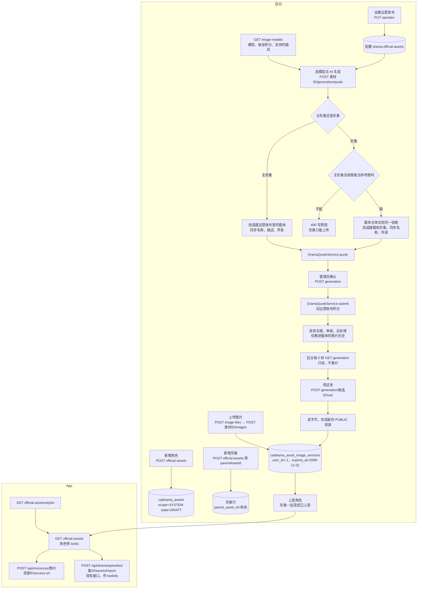

状态：待执行

# 喵喵漫剧官方资产库 · 后端开发计划

> 两份计划之一（后端、后台各一份），各自做完再联调。**第 5 节是两端共用的唯一接口约定**，后台计划《喵喵漫剧官方资产库-开发计划-后台》（在 `开发计划/待执行/3-工作树-后台/`）引用这里。
> 依据：产品需求 `/Users/soul/work/MakeCodePlanWord/projects/灵犀万象后端与后台/当前产品文档/喵喵漫剧官方资产库-产品需求.md`（2026-11-24 确认，2026-11-25 加角色多形象并确认）；后台设计稿 `/Users/soul/work/MakeCodePlanWord/projects/灵犀万象后端与后台/design-assets/官方资产库/` A-01～A-06。
> 写于 2026-11-24（洛杉矶时间），同日对着代码审核过一遍；2026-11-25 加多形象、模型选择，修正场景环境声；同日第二次审核又改了 8 处（见文末“审核记录”）；同日又加场景衍生图（**第 11 节，批次 B9**，B1～B8 执行以后加的）。
> 下面写到的类、方法、行号都是读代码读到的；执行时如果类或方法对不上，按第 0.2 节停下来报告（行号差几行不算）。

## 0. 前提

- **本次全部在工作树里做，不碰原工程**：
  - 原工程（只读）：git 仓库 `/Users/soul/code/lxwx/lxwx_service`（分支 `dev`），代码在子目录 `lxwxservice`。用户正在原工程里开发，**不在原工程里改文件、不切分支、不提交、不合并**。
  - 工作树：`/Users/soul/code/lxwx/worktrees/lxwx_service-official-assets`，分支 `feature/catdrama-official-assets`，由 W0 建（见 0.3）。
  - 下文的“工程”指工作树里的 `/Users/soul/code/lxwx/worktrees/lxwx_service-official-assets/lxwxservice`（`B` = 它下面的 `src/main/java/com/lxwx/narrateservice`）。
  - 本地数据库用副本 `lxwx_service_official_assets`，端口用 8081，不和原工程的库、端口混用（见 0.3）。
- 只影响喵喵漫剧（`catdrama` schema）。
- 本次要读的规则：工程里的 `AGENTS.md`、`.cursor/rules/` 下的编码流程、项目结构、编码规范、校验与失败处理、模块与接口（一个接口不超过 7 个方法）、开发计划规则（执行前读）。
- 原工程里没提交的改动（写计划时有 `DramaPromptService.java` 等）不会带到工作树，不要去动，也不要照着补。
- **不改动范围**：
  - 漫剧的生图流程（报价、扣费、生成、审核、后处理）一行不改，只被调用；
  - 现有 App 接口的路径、参数、返回字段；
  - 导入接口和导入逻辑；
  - `DramaAssetService`、`DramaAssetLookService`、`UserService`、`PointsService` 等现有 Service 的代码；
  - 现有表的约束；
  - 其他 App。

### 0.1 读代码得到的现状（计划的依据）

**数据库**

| 事实 | 位置 |
|---|---|
| 素材表 SYSTEM 行要求 `user_id`、`project_id` 为空；`PUBLISHED` 时必须有 `published_at`；`name` 1～20 字、`description` ≤500 字 | `db/migration/catdrama/V4.17__catdrama_foundation.sql` 第 129–164 行 |
| 形象就是素材表的一行，用 `parent_asset_id` 指向主体；只有两层，道具没有形象 | `V5.6__catdrama_asset_looks.sql` |
| 图片表 `user_id` 是 `NOT NULL`，没有外键、没有取值检查；成功的图必须有 `resource_id`、`succeeded_at`、`expires_at`；有唯一约束 `(asset_id, source_version_id)`；`source_version_id` 外键指向图片表自己 | V4.17 第 190–214 行 |
| 图片表的行只有 `DramaDataPurgeService` 按 `project_id` 删；运营账号的个人图片行（`project_id` 空）不会被删，官方图片的 `source_version_id` 指向它们不会挡住任何清理 | `DramaDataPurgeService` 第 192 行 |
| 用户表 `users.id` 是 `BIGSERIAL`，只会是正数；每个用户属于一个 App（`users.app_code`） | `db/migration/common/V1.1__common_schema.sql` |
| 资源引用表 `catdrama_resource_refs.user_id` 可以为空，`ref_type` 只能是 `ASSET_VERSION` 等 4 种 | V4.17 第 393–406 行 |
| 漫剧最新迁移是 V5.6 | `db/migration/catdrama/` |

**读写素材与图片**

| 事实 | 位置 |
|---|---|
| Java 里按图片 `user_id` 查的地方都传真实用户 ID；SYSTEM 素材读图不加用户条件（`imageFilter`） | `DramaAssetService` 第 2444 行等 |
| SYSTEM 素材的图按公开资源读：只看 `access_scope = PUBLIC`、就绪、png/jpeg/webp、≤10MB，**不看资源类型** | `DramaAssetService.image` 第 2282–2303 行；`DramaResourceReferenceService.image` 第 88–126 行 |
| `library_asset_id` 只在 `DramaAssetLibraryService` 里对 PROJECT 素材用，不出现在 App 返回里 | `DramaAssetLibraryService` 第 189–284 行 |
| 资产库列表 `GET /api/drama/assets?scope=SYSTEM`：SYSTEM 只返回 `PUBLISHED` 且 `published_at <= 现在` 的；按主体分组时，形象也按同样条件查 | `DramaAssetService.list` 第 510–560 行、`visible` 第 2425 行 |
| 素材详情给主体带全部没删的形象，不看形象的状态 | `DramaAssetService.detail` 第 644 行 |
| 图片历史 `DramaAssetService.history` 返回素材的全部图片记录（包括生成中、失败的），素材过期会报错；每条有 `state`、`failureMessage`、`media` | `DramaAssetService` 第 1903 行；`DramaAssetResponse.ImageVersion` 第 102–127 行 |
| **图片记录在提交生成时就建好**（`GENERATING`），之后 `PROCESSING`（审核、处理）→ `SUCCEEDED`；也可能 `REJECTED`（审核没过）、`FAILED`；过了 30 天读出来是 `EXPIRED` | `DramaAssetService` 第 330–373 行；表约束 `ck_catdrama_image_state` |
| **个人素材生成成功时，素材的到期时间会延到这张图的到期时间**（成功 + 30 天）；应用（`apply`）一张图不延期 | `DramaAssetLibraryService` 第 196–200 行；`DramaAssetService.apply` 第 2000–2046 行 |

**形象**

| 事实 | 位置 |
|---|---|
| `DramaAssetLookService.create` 只能给本人的 PERSONAL / PROJECT 主体加形象（`owned`），所以官方形象要由新代码自己写行；给运营账号的个人素材加形象可以直接调它；新形象的到期时间抄主体当时的 | `DramaAssetLookService` 第 100–190、311 行 |
| 形象名称规则：`DramaAssetAliasRules.normalizeLookName`（1～10 字）、`checkLookNameFree(主体, 形象ID或null, 名称)`（同一主体下不重名，“主名·形象名”不超过 20 字），不看用户和范围，SYSTEM 也能用；**只排除已删除的，过期的形象照样占着名字**；改主体名称时 `checkLooksFitName(主体, 新名称)` | `DramaAssetAliasRules` 第 101–160 行 |
| 改个人形象的名称和外观：`DramaAssetService.edit`，`Edit` 有 7 个字段 `(版本, name, description, 要改的字段名集合, soundProfile, aliases, lookName)`；形象改名用 `lookName`，不收 `name` | `DramaAssetRequest.Edit` 第 105–111 行 |
| 形象出图时，主体当前应用的图固定当第一张参考图；这张图的资源必须**属于出图的用户**、类型 `drama/asset-images`、访问范围 `OWNER`、来源是平台生成或用户直传。官方的公开图不满足 | `DramaReferenceImageService.executionParamsWithAnchor` 第 107–135 行 |
| 主体没有可用的图时，形象报价返回阻塞“请先生成「X」的主图” | `DramaQuoteService` 第 802–810 行 |
| 出图提示词用素材的名称（形象是“主名·形象名”）和描述 | `DramaQuoteService` 第 855–876 行 |
| 个人素材上传图 `DramaAssetService.upload` 只收用户直传（`DIRECT_OSS_UPLOAD`）的资源，后端没法把官方图塞给运营账号当主图 | `DramaAssetService` 第 1921 行；`DramaResourceReferenceService.verifyOwnedAssetUpload` 第 271 行 |
| 应用个人素材的一张历史图：`DramaAssetService.apply(用户, 素材, 图片ID, 幂等键, new Apply(版本))`，要求素材没过期、这张图成功可读 | `DramaAssetService` 第 2000 行 |

**导入和视频生成**

| 事实 | 位置 |
|---|---|
| App 导入 SYSTEM 素材：主体要 `PUBLISHED` 且 `published_at <= 现在`、没有父素材、源图片 `expires_at` 不为空且未到期；导入后新建作品图片行，`expires_at` 抄源图片 | `DramaAssetService.importEpisode()` 第 742 行起、`createEpisodeBinding` |
| 导入请求有 `lookIds`：**不传或 `null` = 主体下全部形象都带上（包括没图的）**，`[]` = 一个都不带，传了就只带这些；都必须是来源主体下的形象 | `DramaAssetRequest.Import` 第 53–64 行；`DramaAssetService` 第 758、886–893 行 |
| 导入形象时查的是同范围、没删的形象（`libraryLooks`，不看形象状态）；形象有可用的当前图（成功、没到期）就固定一份图片版本，没有就只复制资料 | `DramaAssetService` 第 1051–1160 行 |
| 导入时登记作品引用 `retainProjectImage` 不检查资源归属 | `DramaResourceReferenceService` 第 373 行 |
| 视频生成取输入图地址用 `ResourceAccessUrlService.accessUrl`，`PUBLIC` 资源谁都能取 | `DramaVideoGenerationService` 第 169 行 |

结论：官方图片只要是 `PUBLIC`、有 OSS 对象、格式和大小符合，导入（主体和形象）和视频生成都不用改代码。

**资源存储**

| 事实 | 位置 |
|---|---|
| 漫剧 App 下，`acceptClientUpload` 不能指定访问范围，没有所有者时默认 `INTERNAL`（App 读不到）；`storeBytes` 可以在 `ResourceStoreCommand` 里明确写 `PUBLIC` | `ResourceServiceImpl.accessScope()` 第 1825 行、`storeBytes` 第 328 行 |
| 生成图的保存写法：`ResourceStoreCommand("drama/asset-images", 扩展名, 类型, 元数据, null, "OSS_WITH_TEMP_LOCAL", 文件名, 前缀, 用户ID, "OWNER").withTracePolicy(AIGC_PRODUCED).withMarkingActor(AiArtifactActor.user(用户ID))` | `DramaImageProcessService` 第 73 行 |
| 校验真实图片格式：`DramaDirectUploadValidator.inspect(bytes, contentType)`（png/jpeg/webp、≤10MB、按内容识别） | `DramaDirectUploadValidator` |
| 读一张私有图片的字节：`accessUrl(资源ID, new CurrentUser(所有者ID, "catdrama"))` 换签名地址，再 `ResourceDownloader.download(地址, 10MB)` | `DramaReferenceImageService` 第 53、161 行 |
| 签名地址 12 小时有效 | `ResourceAccessUrlService` 第 25 行 |
| 资源过期清理只处理 `drama/asset-images`、`drama/shot-videos` | `DramaRetentionService` 第 32 行 |
| 漫剧接口返回图片只给资源 ID，App 再调 `POST /api/resources/{resourceId}/access-url` 换地址；这个接口不用登录就能取公开资源 | `ResourceClientUrlService.responseUrl`；`ResourceController` 第 201 行；`SecurityConfig` 第 76 行 |

**生图、模型、配置、用户**

| 事实 | 位置 |
|---|---|
| 生图报价：`DramaQuoteService.quote(userId, QuoteCreate)` **每调一次就存一条报价**；`QuoteCreate(kind, mode, targets, productionSettings, imageModel, imageSettings, autoApplyAssetResult)`；`imageModel` 是 `ModelSelection(providerCode, modelCode, contractVersion)`，不传用当前默认；`imageSettings` 用 `new ImageSettings(styleCode)`；`Target` 用 `new Target("ASSET", 素材ID, 版本)` | `GenerationRequest.QuoteCreate` 第 25 行；`DramaQuoteResponse` 第 28–41 行 |
| **报价会检查画风在不在所选模型支持的画风里**，不在就直接报错（`CATDRAMA_CAPABILITY_UNAVAILABLE`），不是 `canSubmit=false` | `DramaQuoteService` 第 713–760 行 |
| 提交：`submit(userId, key, new Submit(quoteId, inputHash, true, List.of()))` 冻结积分并建任务 | `DramaQuoteService` 第 147–178 行 |
| 报价要求素材描述不为空（≤500 字）；不能提交时不抛错，返回 `canSubmit=false` 和每项的 `blockers` | `DramaQuoteService` 第 759 行；`DramaQuoteResponse` |
| 图片模型列表：`DramaConfigService.runtime().imageModels()`，每项 `providerCode`、`modelCode`、`contractVersion`、`displayName`、`available`、`unitPrice.points`（每张积分）、`disabledReason`、`styles`（这个模型支持的画风，每项有 `code`、`enabled`）；**第一项就是默认模型** | `DramaConfigService` 第 79、180–195 行；`DramaModelCapability`；`DramaUnitPrice` |
| 新建个人素材 `DramaAssetService.create(userId, key, new Create(kind, name, description, null, soundProfile))`，`key` 匹配 `[A-Za-z0-9-]{16,64}`；个人素材不查重名 | `DramaAssetService` 第 1748 行 |
| 声音：角色是声线，场景是环境声，道具没有（`DramaSoundProfile.forKind`） | `DramaSoundProfile` |
| 画风列表：`DramaStyleCatalogService.publicStyles()`，每项有 `code`、`name`、`categoryCode`、`category`、`previewUrl`、`sortOrder` | `DramaStyleCatalogService` 第 71 行 |
| 按 key 存取配置：`AppConfigService.detail(key)`、`upsert(key, json, status)` | `core/config/service/AppConfigService.java` |
| **查用户**：`UserService.requireActiveUser(userId)` 只读，检查用户是当前 App 的、状态正常，返回 `UserEntity`（有 `nickname`、`phone`）；不满足抛 **401**“账号不可用”。`UserService.profile(userId)` 查不到也抛 401，而且会顺手给用户建当前 App 的资料和积分账户，**不能用来做校验** | `UserService` 第 172–181、255–266 行 |
| 积分余额 `PointsService.account(userId)` 是写事务（会刷新账户合计），只适合偶尔调，不适合轮询 | `PointsService` 第 88–91 行 |
| 后台前端遇到 401 会回到登录页 | `lxwx_admin` 现有请求处理 |
| `/api/drama/**` 默认要登录；匿名可访问的 GET 在 `SecurityConfig` 第 77–81 行逐个列出 | `framework/security/SecurityConfig.java` |
| 后台漫剧接口前缀 `/api/admin/catdrama`；后台请求头带当前 App 的 `X-App-Code` | `AdminDramaWorkController` 第 17 行；`lxwx_admin` `api_client.dart` 第 3554 行 |
| 画风管理的权限 `song_config`；后台 Controller 先 `permissions.requirePermission(admin, "song_config")` | `DramaImageStyleAdminController` |

### 0.2 B0 执行前核对（不改代码，结论写进“执行记录”）

| 编号 | 核对什么 | 计划的假设 | 不成立时 |
|---|---|---|---|
| C1 | `db/migration/catdrama/` 最新版本号 | 仍是 V5.6，本次用 V5.7 | 用下一个空号 |
| C2 | `storeBytes` 用 `PUBLIC` + `OSS_WITH_TEMP_LOCAL` 在漫剧下保存后，资源的 `access_scope`、`oss_object_key`、`status` | 分别是 `PUBLIC`、有值、就绪 | 停下来报告，不改资源模块 |
| C3 | 复制生成图时照抄 `AIGC_PRODUCED` 溯源设置，`storeBytes` 对已经带过标识的图片会不会报错或重复加标识 | 不会 | 报告现象，由用户决定 |
| C4 | 后台请求带 `X-App-Code: catdrama` 时，`DramaConfigService.runtime()`、`DramaAssetLookService.create`、`UserService.requireActiveUser` 里的 App 检查能通过 | 能 | 停下来报告 |
| C5 | `CATDRAMA_CAPABILITY_UNAVAILABLE` 等报价报错返回的 HTTP 状态 | 不是 401 | 是 401 就停下来报告 |
| C6 | 漫剧图片生成的结果是后端自己去取，还是第三方回调到固定地址（比如 8080 上的原工程） | 后端自己去取，或回调地址可配 | 回调到原工程且改不了：停下来报告，联调生成时由用户安排 |

### 0.3 W0 建工作树和本地环境（最先做，B0 之前）

写计划时核对过：原工程 `dev` 分支最新提交 `a7fa0c13` 已经包含本计划依赖的形象、`lookIds` 代码（提交 `82dd624e`），可以直接从当前提交建工作树。

1. 记录原工程现状，写进执行记录，不做任何改动：
   ```bash
   git -C /Users/soul/code/lxwx/lxwx_service rev-parse --abbrev-ref HEAD
   git -C /Users/soul/code/lxwx/lxwx_service rev-parse HEAD
   git -C /Users/soul/code/lxwx/lxwx_service status --short
   ```
2. 建工作树（从原工程当前提交开一个新分支）：
   ```bash
   mkdir -p /Users/soul/code/lxwx/worktrees
   git -C /Users/soul/code/lxwx/lxwx_service worktree add -b feature/catdrama-official-assets /Users/soul/code/lxwx/worktrees/lxwx_service-official-assets HEAD
   ```
3. 复制不在 git 里、但干活要用的本地文件（`.gitignore` 忽略了它们，工作树里没有），从原工程 `lxwxservice/` 复制到工作树 `lxwxservice/` 同样的位置：
   - `AGENTS.md`、`CLAUDE.md`（规则入口）；
   - `config/`（本机配置，**里面有密钥：只复制，不打开、不打印、不提交**）；
   - `docs/`（接口清单生成脚本 `docs/module-interfaces/generate.py` 等）。
   复制了哪些写进执行记录。
4. 复制一份本地数据库给工作树用（数据库在 docker 容器 `lxwx-postgres` 里）：
   ```bash
   docker exec lxwx-postgres createdb -U postgres lxwx_service_official_assets
   docker exec lxwx-postgres sh -c "pg_dump -U postgres lxwx_service | psql -q -U postgres lxwx_service_official_assets"
   ```
   **原因**：原工程在用 `lxwx_service` 库开发。本次的迁移 V5.7 如果跑进原库，原工程之后自己再加一个 V5.7 就会起不来。
   **复制完、第一次启动工作树后端之前**：在副本库里查各 App 的任务表有没有没结束的任务（漫剧是 `catdrama` schema 里的任务表，状态不是成功、失败、取消这类终态的）。有就列出来、停下来报告，先不启动——否则工作树后端会把这些从原库复制过来的任务再跑一遍，重复调用付费接口。
5. 工作树的后端一律这样启动（端口、数据库、Redis 库都和原工程分开，两边可以同时开）：
   ```bash
   cd /Users/soul/code/lxwx/worktrees/lxwx_service-official-assets/lxwxservice
   SPRING_DATASOURCE_URL=jdbc:postgresql://localhost:5432/lxwx_service_official_assets \
   SERVER_PORT=8081 \
   SPRING_DATA_REDIS_DATABASE=1 \
   ./gradlew bootRun
   ```
   跑测试如果要连库，也带上同样的 `SPRING_DATASOURCE_URL`。
6. 验收：
   - [ ] `git worktree list` 里有新工作树，分支 `feature/catdrama-official-assets`；原工程分支、`git status` 和第 1 步记录的一样。
   - [ ] 工作树 `./gradlew compileJava` 通过；按第 5 步启动成功，`http://localhost:8081` 能访问。
- 任何一步做不到（比如数据库复制失败、启动失败）：停下来报告，不改用原库、不改用 8080。

## 1. 需求

- R1 后台能新增、编辑、上架、下架、删除官方素材（角色 / 场景 / 道具），每条必须有画风。
- R2 官方图片两种来源：后台上传；用官方运营账号 AI 生成后挑一张用。
- R3 AI 生成全部走现有个人素材生图流程，扣运营账号积分，生成记录在运营账号下；可以选模型。
- R4 官方图片是独立的公开文件，记在固定的官方编号 -1 名下、不过期；运营账号或它的个人素材被删、过期都不影响已经用上的官方图。
- R5 运营账号在后台设置，存在配置里，不加表；账号后来被删或冻结，后台要能看出来，不能把管理员踢回登录页。
- R6 **角色可以有多个形象**（主形象 + 衍生形象）：新增、改名、改外观特征、删除；每个形象有自己的图（上传或 AI 生成）；形象跟着角色上下架。
- R7 形象 AI 生成拿主形象的图当参考图。主形象的当前图必须是运营账号 AI 生成、还没过期的那张，否则形象只能上传。
- R8 App 新增两个只读接口：官方素材列表（角色带有图的形象）、有官方素材的画风列表；导入沿用现有接口（用 `lookIds` 选形象）。接口说明写进仓库文档，App 端照着能接。
- R9 下架、删除、编辑、换图都只影响之后的导入。
- R10 每次后台操作写一行服务日志，不建表。
- R11 权限沿用 `song_config`。

## 2. 流程图



错误分支（各接口统一）：参数不对 400 写明哪个字段；素材不存在或已删除 404；没有权限 403；不能生成时 400 写原因；报价本身不能提交时不报错，返回原因。**后台接口任何情况都不返回 401**（401 只表示管理员登录过期）。

## 3. 改动总览（先看这一节就知道改了什么）

### 3.1 新增的对外接口

| 接口 | 谁用 | 说明 |
|---|---|---|
| `GET /api/drama/official-assets` | App | 已上架官方素材列表，角色带有图的形象；不用登录 |
| `GET /api/drama/official-assets/styles` | App | 有已上架官方素材的画风列表；不用登录 |
| `GET /api/admin/catdrama/official-assets` | 后台 | 列表（只列角色 / 场景 / 道具本身，不列形象） |
| `GET /api/admin/catdrama/official-assets/{assetId}` | 后台 | 详情（含用过的图；角色带形象列表） |
| `POST /api/admin/catdrama/official-assets` | 后台 | 新增素材；带 `parentAssetId` 就是给角色新增形象 |
| `PATCH /api/admin/catdrama/official-assets/{assetId}` | 后台 | 编辑资料（形象只能改名称、外观特征） |
| `POST /api/admin/catdrama/official-assets/{assetId}/publish` | 后台 | 上架（连同形象） |
| `POST /api/admin/catdrama/official-assets/{assetId}/unpublish` | 后台 | 下架（连同形象） |
| `DELETE /api/admin/catdrama/official-assets/{assetId}` | 后台 | 删除素材（角色连同形象）或删除一个形象 |
| `POST /api/admin/catdrama/official-assets/image-files` | 后台 | 上传图片文件（multipart） |
| `POST /api/admin/catdrama/official-assets/{assetId}/images` | 后台 | 把上传的文件设为当前图 |
| `POST /api/admin/catdrama/official-assets/{assetId}/images/{imageVersionId}/apply` | 后台 | 换回用过的图 |
| `GET /api/admin/catdrama/official-assets/image-models` | 后台 | 可选的图片模型、每张积分、支持的画风 |
| `GET /api/admin/catdrama/official-assets/{assetId}/generation` | 后台 | 生成面板：不能生成的原因、进行中的任务、生成结果（只读，可轮询） |
| `POST /api/admin/catdrama/official-assets/{assetId}/generation/quote` | 后台 | 报价：选的模型这次要扣多少积分、能不能生成 |
| `POST /api/admin/catdrama/official-assets/{assetId}/generation` | 后台 | 确认报价，生成一张（扣运营账号积分） |
| `POST /api/admin/catdrama/official-assets/{assetId}/generation/{candidateVersionId}/use` | 后台 | 用这张生成结果 |
| `GET /api/admin/catdrama/official-assets/operator` | 后台 | 查运营账号 |
| `PUT /api/admin/catdrama/official-assets/operator` | 后台 | 设置运营账号 |

- 路径里的 `{assetId}` 写成 `{assetId:\d+}`，避免和 `operator`、`image-files`、`image-models` 混淆。
- **形象也是一条官方素材，有自己的 `assetId`**：详情、编辑、删除、图片、生成这些接口传形象的 ID 就是对这个形象操作，不另开形象接口。

### 3.2 现有接口

全部不变。App 导入用现有 `POST /api/drama/episodes/{episodeId}/assets/import`（选形象用现有的 `lookIds`），换图片地址用现有 `POST /api/resources/{resourceId}/access-url`。现有 `GET /api/drama/assets?scope=SYSTEM` 之后会返回上架的官方素材和它们的形象，字段不变。

### 3.3 模块外和现有类的改动（都要先知道）

1. `framework/security/SecurityConfig.java`（**framework 模块**）：在第 77–81 行匿名 GET 列表里加两项 `"/api/drama/official-assets"`、`"/api/drama/official-assets/styles"`。不加的话这两个接口要登录。
2. `core/resource/domain/ResourceTypes.java`（**core 模块**）：新增常量 `DRAMA_OFFICIAL_ASSET_IMAGES = "drama/official-asset-images"`。
3. `app/catdrama/resource/service/DramaResourceReferenceService.java`（resource 模块，**模块外 Service**）：新增一个方法 `retainOfficialAssetVersion(long versionId, long resourceId, LocalDateTime now)`。不改现有方法。
4. `app/catdrama/asset/entity/DramaAssetEntity.java`：加字段 `styleCode`；`libraryAssetId` 的注释加一句“官方素材：运营账号里用来生成图的那条个人素材（形象对应运营账号里的个人形象）”。
5. `app/catdrama/asset/entity/DramaImageVersionEntity.java`：只改 `userId` 注释，加一句“官方素材的图片固定为 -1”。
6. 只调用、不修改：
   - 素材：`DramaAssetService.create / edit / apply / history / detail`、`DramaAssetLookService.create`、`DramaAssetAliasRules.normalizeLookName / checkLookNameFree / checkLooksFitName / normalize`、`DramaSoundProfile.forKind`；
   - 生图：`DramaQuoteService.quote / submit`、`DramaConfigService.runtime`；
   - 资源：`ResourceAccessUrlService.accessUrl`、`ResourceDownloader.download`、`DramaDirectUploadValidator.inspect`、`IResourceService.storeBytes`；
   - 用户和积分（**core 模块**）：`UserService.requireActiveUser`、`PointsService.account`；
   - 其他：`DramaStyleCatalogService.publicStyles`、`AppConfigService.detail / upsert`。

### 3.4 数据库

新增迁移 `V5.7__catdrama_official_assets.sql`（版本号以 C1 为准），只加一个字段：

```sql
-- 官方素材的画风编码，取自配置 drama.image-styles；个人和作品素材为空，官方形象也为空（用所属角色的）
ALTER TABLE catdrama_assets ADD COLUMN style_code VARCHAR(64);
COMMENT ON COLUMN catdrama_assets.style_code IS '官方素材的画风编码（drama.image-styles 里的 code）；个人、作品素材和官方形象为空';
```

为什么要加：App 要按画风筛选，后台生成要按画风出图，现有字段里没有能放它的。形象不用新字段，用现有的 `parent_asset_id`。

**官方图片的 `user_id`**：固定写 `-1`（常量 `DramaOfficialAssetImageService.OFFICIAL_IMAGE_OWNER_ID = -1L`），不改表约束。
- 能用的原因：这一列没有外键、没有取值检查；用户 ID 只会是正数；现有代码按 `user_id` 查图片时都传真实用户 ID，查不到 -1 的行；SYSTEM 素材读图本来就不看 `user_id`。
- 不用管理员 ID：管理员表的编号也从 1 开始，写进去会被当成 App 用户 1 号的图。
- 不用运营账号 ID：运营账号可以换、可以被删。

**官方图片的 `expires_at`**：写 `2099-12-31 00:00:00`。现有导入要求源图片有到期时间且没到期，这样不用改导入。

**生成载体放在哪**：官方素材行（包括形象行）的 `library_asset_id`。这个字段现有代码只对作品素材用，App 返回里也没有它。

### 3.5 新增的代码文件

| 文件（相对 `B`） | 做什么 | 公开方法数 |
|---|---|---|
| `app/catdrama/asset/service/DramaOfficialAssetService.java` | 官方素材和形象的资料、上下架、删除 | 7 |
| `app/catdrama/asset/service/DramaOfficialAssetImageService.java` | 上传、设当前图、换回；放常量 `OFFICIAL_IMAGE_OWNER_ID` | 3 |
| `app/catdrama/asset/service/DramaOfficialAssetGenerationService.java` | 模型列表、生成面板、报价、生成、用这张 | 5 |
| `app/catdrama/asset/service/DramaOfficialAssetCarrierService.java` | 运营账号里的载体：查、准备（新建 / 同步 / 对齐主图）、不能生成的原因 | 3 |
| `app/catdrama/asset/service/DramaOfficialAssetOperatorService.java` | 运营账号设置与读取 | 3 |
| `app/catdrama/asset/service/DramaOfficialAssetQueryService.java` | App 只读查询 | 2 |
| `app/catdrama/asset/dto/DramaOfficialAssetRequest.java` | 请求体（Create、Edit、AddImage、Quote、Generate、Operator） | — |
| `app/catdrama/asset/vo/DramaOfficialAssetView.java` | 后台素材视图（主体和形象共用） | — |
| `app/catdrama/asset/vo/DramaOfficialAssetGenerationView.java` | 后台生成面板视图 | — |
| `app/catdrama/asset/vo/DramaOfficialAssetQuoteView.java` | 后台报价视图 | — |
| `app/catdrama/asset/vo/DramaOfficialAssetImageModel.java` | 后台模型选项 | — |
| `app/catdrama/asset/vo/DramaOfficialAssetOperatorView.java` | 运营账号视图 | — |
| `app/catdrama/asset/vo/DramaOfficialAssetImageFile.java` | 上传结果 | — |
| `app/catdrama/asset/vo/DramaOfficialAssetItem.java` | App 列表项（含 `looks`） | — |
| `app/catdrama/asset/vo/DramaOfficialAssetStyle.java` | App 画风项 | — |
| `app/catdrama/asset/controller/DramaOfficialAssetController.java` | App 两个接口 | 2 |
| `admin/catdrama/controller/AdminDramaOfficialAssetController.java` | 后台资料、上下架、删除 | 7 |
| `admin/catdrama/controller/AdminDramaOfficialAssetImageController.java` | 后台上传与换图 | 3 |
| `admin/catdrama/controller/AdminDramaOfficialAssetGenerationController.java` | 后台模型、生成 | 5 |
| `admin/catdrama/controller/AdminDramaOfficialAssetOperatorController.java` | 后台运营账号 | 2 |

- 后台 Controller 先 `permissions.requirePermission(admin, "song_config")`，再调 app 模块的 Service。
- 业务规则都在 app 模块的 Service 里；Controller 不读库、不写规则。
- 操作日志：每个改数据的 Service 方法最后用类自己的 logger 写一行 `log.info`，消息以 `[CatdramaOfficialAsset]` 开头（和现有 `[CatdramaMedia]` 写法一样），内容“管理员 {用户名} {动作} 素材 {assetId} {名称}”。不打印描述全文。
- 不写防御性代码：不加 CAS 版本号、不做重复提交保护（AI 生成除外，它扣积分，用现有 `Idempotency-Key`）。

## 4. 数据怎么存

| 东西 | 存在哪 | 写法 |
|---|---|---|
| 官方素材（主体） | `catdrama_assets` | `scope=SYSTEM`、`user_id/project_id/expires_at` 空、`source_type='OFFICIAL'`、`state` 为 `DRAFT`（未上架）/ `PUBLISHED`（已上架）/ `DELETED`、`style_code` 必填、`parent_asset_id` 空、`aliases` 只有角色有、`action_receipts` 为 `{}` |
| 官方形象 | `catdrama_assets` | 同上，另外：`kind='ROLE'`、`parent_asset_id` = 所属角色、`name` = 形象名称（1～10 字）、`description` = 外观特征、`style_code` 空、`sound_profile` 空、`aliases` 为 `[]`；**`state`、`published_at` 跟所属角色一样**（角色上架、下架、删除时一起改；新增形象时抄角色当时的值） |
| 生成载体 | 官方行的 `library_asset_id` | 主体：指向运营账号的一条个人素材；形象：指向运营账号那条个人素材下的一个个人形象。载体不能用了就新建再写回（规则见 B5、B6） |
| 官方图片 | `catdrama_asset_image_versions` | `user_id=-1`、`asset_id` = 官方素材或形象、`project_id` 空、`state='SUCCEEDED'`、`succeeded_at` = 现在、`expires_at='2099-12-31 00:00:00'`；上传的 `source_type='OFFICIAL_UPLOAD'`、`source_version_id` 空；用生成结果的 `source_type='OFFICIAL_GENERATION'`、`source_version_id` = 载体那张图的 ID，`input_snapshot`、`actual_provider`、`actual_model` 从载体那张抄过来 |
| 官方图片文件 | 资源台账 | `storeBytes` 保存：类型 `drama/official-asset-images`、存储 `OSS_WITH_TEMP_LOCAL`、对象前缀 `official/drama-assets/{官方素材ID}`、所有者空、访问范围 `PUBLIC`。过期清理不处理这个类型 |
| 资源引用 | `catdrama_resource_refs` | `retainOfficialAssetVersion` 写：`ref_type='ASSET_VERSION'`、`ref_id` = 官方图片 ID、`user_id` 空、`protect_until_at='2099-12-31'`；并调 `resources.useBusinessRetention(resourceId)` |
| 运营账号 | 配置 `drama.official-assets` | `{"operatorUserId":"10086"}` |

- 同一张生成结果用两次：表上有唯一约束 `(asset_id, source_version_id)`，第二次直接找到已有那张、设为当前图，不重复复制文件。
- 当前图：`applied_image_version_id` 指向官方图片；每次改资料、换图、上下架 `revision + 1`、`updated_at` = 现在。改形象时，所属角色的 `updated_at` 也更新（列表按它排序）。
- 载体会出现在运营账号自己的 App 资产库里。运营账号只给官方资产库用，不要在 App 里删改这些素材（删了后台会自动新建，但已经用上的主形象图就不能再给形象当参考图了）。

## 5. 接口约定（两端唯一约定）

统一：
- 外层沿用 `ApiResponse<T>`；ID 一律十进制字符串；时间用 UTC ISO-8601（和现有漫剧素材接口一样）。
- 后台接口都要 `X-App-Code: catdrama` 和管理员登录；App 接口要 `X-App-Code: catdrama`。
- 错误文案是给人看的中文，后台原文显示。后台接口不返回 401（只有管理员登录过期才是 401）。
- 后台视图里的 `url` 是后端直接给的临时地址（12 小时有效；官方图 `accessUrl(资源ID, null)`；运营账号的生成图 `accessUrl(资源ID, new CurrentUser(运营账号ID, "catdrama"))`），后台直接显示，不用再换。

### 5.1 后台素材视图 `DramaOfficialAssetView`

主体（角色、场景、道具）和形象用同一个视图。

```json
{
  "assetId": "1890000000000000001",
  "parentAssetId": null,
  "kind": "ROLE",
  "name": "都市女医生",
  "description": "高精度 3D 半写实国漫女性角色设定图……",
  "styleCode": "3d-semi-real",
  "styleName": "3D 半写实国漫",
  "soundProfile": { "…": "和个人素材一样" },
  "aliases": ["女医生", "江医生"],
  "state": "PUBLISHED",
  "publishedAt": "2026-11-24T18:15:00Z",
  "updatedAt": "2026-11-24T19:02:00Z",
  "currentImage": {
    "imageVersionId": "1890000000000000101",
    "url": "https://…（临时地址）",
    "sourceType": "OFFICIAL_GENERATION",
    "createdAt": "2026-11-24T18:05:00Z"
  },
  "lookCount": 2,
  "looks": [],
  "images": []
}
```

- `parentAssetId`：主体为 `null`；形象是所属角色的 ID。
- `kind`：`ROLE` 角色 / `SCENE` 场景 / `PROP` 道具（形象固定 `ROLE`）。
- `name`：主体是名称；形象是形象名称。
- `description`：主体是提示词（就是素材描述）；形象是外观特征。
- `styleCode`、`styleName`、`soundProfile`、`aliases`：只有主体有；形象固定 `null`、`null`、`null`、`[]`（用所属角色的）。`styleName` 按 `publicStyles()` 翻译，画风后来被删了返回 `null`，后台显示“画风已删除”。
- `soundProfile`：角色是音色，场景是环境声，道具固定 `null`；格式和个人素材一样。
- `state`：`DRAFT` 未上架 / `PUBLISHED` 已上架（删除的不返回）。形象和所属角色一样。
- `currentImage`：还没有图时为 `null`。
- `lookCount`：角色的衍生形象数量（不含主形象）；场景、道具、形象为 `0`。后台列表显示“{lookCount + 1} 个形象”。
- `looks`：只在**角色详情**返回，全部没删的衍生形象（每项是同样的视图，但不带 `looks`、`images`），按创建先后；其他情况为 `[]`。
- `images`：只在详情接口返回，这条素材（或这个形象）用过的全部官方图，新的在前；列表和 `looks` 里固定 `[]`。

### 5.2 后台资料、上下架、删除

| 接口 | 请求 | 返回 | 规则与错误 |
|---|---|---|---|
| `GET /official-assets` | 参数：`kind`、`state`（`DRAFT`/`PUBLISHED`，不传是全部）、`styleCode`、`keyword`（名称或别名包含）、`page`（默认 1）、`pageSize`（默认 20，最大 100） | `PageResult<DramaOfficialAssetView>`，只有主体，按 `updatedAt` 倒序 | 参数值不对 400 |
| `GET /official-assets/{assetId}` | — | `DramaOfficialAssetView`（含 `images`；角色含 `looks`） | 不存在或已删除 404“官方素材不存在或已删除” |
| `POST /official-assets` | 新增主体：`{"kind","name","description","styleCode","soundProfile","aliases"}`；新增形象：`{"parentAssetId","name","description"}` | `DramaOfficialAssetView` | 见下 |
| `PATCH /official-assets/{assetId}` | 主体：`name`、`description`、`styleCode`、`soundProfile`、`aliases`；形象：`name`、`description`。字段不传就不改 | `DramaOfficialAssetView` | 同上；形象带 `styleCode`、`soundProfile`、`aliases` 400“形象的画风、音色、别名在主形象上改” |
| `POST /official-assets/{assetId}/publish` | — | `DramaOfficialAssetView` | 主体没有当前图 400“还没有图片，不能上架”；画风已删除 400“画风已删除，先重新选择画风”；形象 400“形象跟着角色上架、下架”；已上架直接返回 |
| `POST /official-assets/{assetId}/unpublish` | — | `DramaOfficialAssetView` | 形象 400 同上；未上架直接返回 |
| `DELETE /official-assets/{assetId}` | — | `null` | 主体：连同它的形象一起删；形象：只删这个形象。已删除的再删直接成功 |

新增 / 编辑的规则：

| 字段 | 主体 | 形象 |
|---|---|---|
| `kind` | 必填，`ROLE`/`SCENE`/`PROP`，之后不能改 | 不传（固定 `ROLE`） |
| `parentAssetId` | 不传 | 必填，必须是没删的官方**角色**主体；否则 400“只能给官方角色新增形象” |
| `name` | 1～20 字；同 `kind` 的官方主体不能重名，400“已有同名的官方角色”（场景、道具同理）；角色改名时 `checkLooksFitName` 检查形象全名 | `normalizeLookName` + `checkLookNameFree(角色, 形象ID或null, 名称)`，错误原文返回 |
| `description` | 0～500 字（空也能保存，AI 生成前要填） | 新增时必填 1～500 字；编辑时 0～500 字（清空也能保存，清空后不能 AI 生成） |
| `styleCode` | 必填，必须在 `publicStyles()` 里，否则 400“画风不存在” | 不传 |
| `soundProfile` | 角色、场景按 `DramaSoundProfile.forKind` 校验；道具带了 400 | 不传 |
| `aliases` | 只有角色，按 `DramaAssetAliasRules.normalize` 校验；场景、道具带了 400 | 不传 |

新增形象时 `state`、`published_at` 抄所属角色当时的值。

### 5.3 后台上传与换图

`{assetId}` 可以是主体，也可以是形象。

| 接口 | 请求 | 返回 | 规则与错误 |
|---|---|---|---|
| `POST /official-assets/image-files` | multipart，字段名 `file` | `{"resourceId","url","contentType","sizeBytes"}` | 用 `DramaDirectUploadValidator.inspect` 检查真实格式：只收 png/jpeg/webp、≤10MB，原文返回它的错误 |
| `POST /official-assets/{assetId}/images` | `{"resourceId"}` | `DramaOfficialAssetView`（详情，新图已是当前图） | 资源不是 `drama/official-asset-images` 类型 400 |
| `POST /official-assets/{assetId}/images/{imageVersionId}/apply` | — | `DramaOfficialAssetView`（详情） | 图片不属于这条素材 404 |

### 5.4 后台模型与生成

`{assetId}` 可以是主体，也可以是形象。

**`GET /official-assets/image-models`**：

```json
[
  { "providerCode": "volcengine", "modelCode": "seedream-5-0-pro", "contractVersion": "v1",
    "name": "一般模型", "points": 8, "available": true, "disabledReason": null,
    "styleCodes": ["3d-semi-real", "guofeng-ink"] }
]
```

- 取自 `DramaConfigService.runtime().imageModels()`，顺序不变，**第一项是默认模型**；`name` = `displayName`，`points` = `unitPrice.points`（每张积分），`styleCodes` = `styles` 里 `enabled` 的 `code`。
- 后台用 `styleCodes` 把不支持当前画风的模型置灰（报价会检查画风在不在模型支持的里面，不在直接报错）。
- 后台页面打开时读一次，不轮询。

**`GET /official-assets/{assetId}/generation`**（生成面板，只读，可以每 5 秒调）：

```json
{
  "blockedReason": null,
  "activeJob": { "jobId": "1890000000000000301", "state": "RUNNING" },
  "candidates": [
    {
      "candidateVersionId": "1890000000000000202",
      "state": "GENERATING",
      "url": null,
      "failureMessage": null,
      "createdAt": "2026-11-24T18:20:00Z",
      "used": false
    },
    {
      "candidateVersionId": "1890000000000000201",
      "state": "SUCCEEDED",
      "url": "https://…（临时地址）",
      "failureMessage": null,
      "createdAt": "2026-11-24T18:05:00Z",
      "used": true
    }
  ]
}
```

- **不返回运营账号余额**：`PointsService.account` 是写事务，不能每 5 秒调。余额在运营账号接口和报价里给。
- `blockedReason`：现在不能 AI 生成的原因（见下表），能生成为 `null`。后台有值就把按钮置灰、显示原文。
- `activeJob`：载体当前正在跑的图片任务（`DramaAssetService.detail(运营账号, 载体, true).activeJob()`），没有为 `null`；`state` 沿用现有任务状态值。还没有载体时为 `null`。
- `candidates`：载体的图片历史（`DramaAssetService.history(运营账号, 载体, 1, 20)`），新的在前，最多 20 条；还没有载体时为空数组。
  - `state` 原样给：`GENERATING` 生成中 / `PROCESSING` 审核处理中 / `SUCCEEDED` 成功 / `REJECTED` 审核没通过 / `FAILED` 失败 / `EXPIRED` 过期（成功超过 30 天）。
  - `url` 只有 `SUCCEEDED` 有；`failureMessage` 是现有图片记录里给用户看的原因（`REJECTED`、`FAILED` 时有）。
  - `used` = 这张已经复制成这条官方素材的图片。
  - 提交生成后，图片记录马上就是 `GENERATING`，后台据此显示“生成中”，不用另外拼。
- **轮询什么时候停**：`activeJob` 为空，并且 `candidates` 里没有 `GENERATING`、`PROCESSING` 的。生成任务结束后还有审核处理那一段（`PROCESSING`），只看 `activeJob` 会停早。

不能生成的原因（按顺序判断，取第一条）：

| 情况 | 适用 | `blockedReason` |
|---|---|---|
| 没设运营账号 | 都适用 | 还没有设置官方运营账号，先到列表页顶部设置 |
| 运营账号被删或冻结（`requireActiveUser` 不通过） | 都适用 | 官方运营账号已不可用（被删除或冻结），先到列表页顶部更换 |
| 画风已删除（主体的、或形象所属角色的 `styleCode` 不在 `publicStyles()` 里） | 都适用 | 画风已删除，先重新选择画风 |
| 描述为空 | 主体 | 提示词为空，填写后才能生成 |
| 外观特征为空 | 形象 | 外观特征为空，填写后才能生成 |
| 主形象没有当前图 | 形象 | 主形象还没有当前图，先给主形象出图 |
| 主形象当前图是上传的（`OFFICIAL_UPLOAD`） | 形象 | 主形象的当前图是上传的，不能当参考图。要 AI 生成形象，先用 AI 生成主形象并点“用这张”；也可以直接上传形象图 |
| 主形象当前图是生成的，但它的来源图不在当前载体里、或已经不能用（运营账号换过、载体被删、生成超过 30 天到期） | 形象 | 主形象的当前图已经不能当参考图（生成超过 30 天，或换过运营账号）。要 AI 生成形象，先给主形象重新 AI 生成并点“用这张”；也可以直接上传形象图 |

**`POST /official-assets/{assetId}/generation/quote`**：

- 请求：`{"imageModel": {"providerCode","modelCode","contractVersion"}}`，值来自 `image-models`。
- 返回 `DramaOfficialAssetQuoteView`：

```json
{
  "quoteId": "1890000000000000401",
  "inputHash": "64位十六进制",
  "points": 8,
  "pointsBalance": 1200,
  "canSubmit": true,
  "blockedReason": null,
  "modelName": "一般模型",
  "styleName": "3D 半写实国漫",
  "expiresAt": "2026-11-24T18:20:00Z"
}
```

- 不能生成（上表任何一条）：400，文案就是上表原文。**先判断上表，再调报价**（运营账号不可用时调报价会出 401）。
- 报价本身不能提交（积分不够、模型暂不可用等）：不报错，`canSubmit=false`，`blockedReason` = 第一条 `blockers[].message`。
- 报价报错（比如模型不支持这个画风）：原文返回给后台（C5 确认不是 401）。
- 取自现有报价返回：`quoteId`=`id`、`inputHash`、`points`=`totalPoints`、`canSubmit`、`expiresAt`；`pointsBalance` 来自 `PointsService.account(运营账号)`；`styleName` 是主体（形象取所属角色）的画风名。
- 只在管理员点“AI 生成”时调一次，不轮询（报价每调一次会存一条记录）。

**`POST /official-assets/{assetId}/generation`**：头 `Idempotency-Key`（`[A-Za-z0-9-]{16,64}`）；体 `{"quoteId","inputHash"}`；返回生成面板。报价过期、内容变了、积分不够：原样返回现有提交接口的错误文案。

**`POST /official-assets/{assetId}/generation/{candidateVersionId}/use`**：返回 `DramaOfficialAssetView`（详情，这张已是当前图）。不是这条素材当前载体的图，或不是 `SUCCEEDED`：400“这张生成结果不能用”。

### 5.5 后台运营账号

| 接口 | 请求 | 返回 | 规则与错误 |
|---|---|---|---|
| `GET /official-assets/operator` | — | `{"userId","nickname","phoneTail","pointsBalance","available"}`；没设置时全为 `null`、`available=false`；设置了但账号被删或冻结：只有 `userId`，其余 `null`，`available=false` | 不报错 |
| `PUT /official-assets/operator` | `{"userId":"10086"}` | 同上（`available=true`） | 不是喵喵漫剧的用户、不存在、被冻结：400“喵喵漫剧里没有这个用户，或账号不可用” |

## 6. 分批

| 批次 | 交付什么 | 涉及文件 | 前置 | 验收要点 |
|---|---|---|---|---|
| W0 | 工作树、本地文件、数据库副本 | 见 0.3 | 无 | 见 0.3 验收 |
| B0 | 核对结论 | 只读 | W0 | C1～C6 有结论 |
| B1 | 数据库、实体、常量、引用方法、匿名放行 | 迁移文件、`DramaAssetEntity`、`DramaImageVersionEntity`（注释）、`ResourceTypes`、`DramaResourceReferenceService.retainOfficialAssetVersion`、`SecurityConfig` | B0 | 迁移只在副本库执行成功；现有漫剧测试不受影响 |
| B2 | 运营账号 | `DramaOfficialAssetOperatorService`、`AdminDramaOfficialAssetOperatorController`、视图与请求体 | B1 | 见 B2 验收 |
| B3 | 资料、形象、上下架、删除 | `DramaOfficialAssetService`、`AdminDramaOfficialAssetController` | B1 | 见 B3 验收 |
| B4 | 上传与换图 | `DramaOfficialAssetImageService`、`AdminDramaOfficialAssetImageController` | B3 | 见 B4 验收 |
| B5 | 模型列表、主体 AI 生成 | `DramaOfficialAssetGenerationService`、`DramaOfficialAssetCarrierService`、`AdminDramaOfficialAssetGenerationController` | B2、B4 | 见 B5 验收 |
| B6 | 形象 AI 生成 | 同 B5 两个 Service 里形象的分支 | B5 | 见 B6 验收 |
| B7 | App 接口 | `DramaOfficialAssetQueryService`、`DramaOfficialAssetController`、`DramaOfficialAssetItem`、`DramaOfficialAssetStyle` | B3 | 见 B7 验收 |
| B8 | 测试、接入文档、接口清单 | 测试类；仓库 `docs/接口说明/喵喵漫剧官方资产库-App接入.md`（新建，内容 = 第 7 节）；`docs/module-interfaces` 重新生成 | B7 | 测试通过；文档写好 |
| B9 | 场景衍生图（2026-11-25 加） | 见第 11 节 | B7，并且第 11.1 节的前置做完 | 见 11.3 |

### B1 数据库与引用方法

- 验收：工作树后端按 0.3 第 5 步启动后，副本库 `lxwx_service_official_assets` 的 `catdrama.flyway_schema_history` 有 5.7；**原库 `lxwx_service` 没有 5.7**。

```java
// app/catdrama/resource/service/DramaResourceReferenceService.java（新增方法，不改其他方法）
/** 官方图片的资源引用：不属于任何用户，保护到 2099-12-31；同一图片重复调用不重复登记。 */
public void retainOfficialAssetVersion(long versionId, long resourceId, LocalDateTime now) {
    // 1. lockResources(List.of(resourceId))
    // 2. resources.useBusinessRetention(resourceId)
    // 3. 已有 ref_type=ASSET_VERSION、ref_id=versionId 的引用就返回；没有就插入（user_id 空，protect_until_at=2099-12-31）
}
```

### B2 运营账号

```java
// app/catdrama/asset/service/DramaOfficialAssetOperatorService.java
/** 官方运营账号：后台 AI 生成官方图时用它扣积分、记生成记录。只存用户ID，放在配置 drama.official-assets。 */
public DramaOfficialAssetOperatorView getOperator() { ... }
public DramaOfficialAssetOperatorView saveOperator(String adminName, String userId) { ... }
/** 能用的运营账号ID；没设置、或账号被删 / 冻结都返回 null。 */
public Long findOperatorUserId() { ... }
```

- 查用户一律用 `UserService.requireActiveUser(userId)`：它会检查是不是喵喵漫剧的用户、状态是否正常。它不通过时抛的是 401，**在本 Service 里接住**：`saveOperator` 转成 400“喵喵漫剧里没有这个用户，或账号不可用”；`getOperator` 返回 `available=false`；`findOperatorUserId` 返回 `null`。
- **不用 `UserService.profile`**：它查不到也是 401，而且会给别的 App 的用户建漫剧资料和积分账户。
- 昵称、手机号取 `requireActiveUser` 返回的 `UserEntity`；手机号只返回后四位，没有手机号（游客）为 `null`。
- 余额 `PointsService.account(userId).availablePoints()`，只在 `getOperator`、`saveOperator` 里调。
- 验收：
  - [ ] 设置存在的喵喵漫剧用户：返回昵称、尾号、余额，`available=true`。
  - [ ] 设置不存在的 ID、别的 App 的用户 ID：400，文案对；**HTTP 不是 401**；别的 App 用户没有被建漫剧资料和积分账户。
  - [ ] 把已设置的运营账号在库里改成冻结：`GET operator` 返回 `available=false`，不报错。

### B3 资料、形象、上下架、删除

```java
// app/catdrama/asset/service/DramaOfficialAssetService.java
public PageResult<DramaOfficialAssetView> listOfficialAssets(String kind, String state, String styleCode, String keyword, long page, long pageSize) { ... }
public DramaOfficialAssetView getOfficialAsset(long assetId) { ... }       // 带 images；角色带 looks
/** 新增官方主体；带 parentAssetId 时是给官方角色新增一个形象。 */
public DramaOfficialAssetView createOfficialAsset(String adminName, DramaOfficialAssetRequest.Create input) { ... }
/** 编辑主体或形象的资料；形象只能改名称和外观特征。 */
public DramaOfficialAssetView editOfficialAsset(String adminName, long assetId, DramaOfficialAssetRequest.Edit input) { ... }
/** 上架主体，它的形象一起上架。 */
public DramaOfficialAssetView publishOfficialAsset(String adminName, long assetId) { ... }
/** 下架主体，它的形象一起下架。 */
public DramaOfficialAssetView unpublishOfficialAsset(String adminName, long assetId) { ... }
/** 删除主体（连同形象）或删除一个形象。 */
public void deleteOfficialAsset(String adminName, long assetId) { ... }
```

- 校验复用现有规则，不另写一套：名称 1～20 字、描述 ≤500 字按 Unicode 字符数算；声音 `DramaSoundProfile.forKind`；别名 `DramaAssetAliasRules.normalize`；形象名称 `normalizeLookName`、`checkLookNameFree`；角色改名 `checkLooksFitName`。
- 画风校验：`styleCode` 必须在 `DramaStyleCatalogService.publicStyles()` 里。
- 主体重名：同 `kind`、`scope=SYSTEM`、`parent_asset_id` 空、`deleted_at` 空、名称相同。
- 列表 `keyword`：`name LIKE %kw%` 或别名里有包含它的（`EXISTS (SELECT 1 FROM jsonb_array_elements_text(aliases) a WHERE a LIKE %kw%)`）；只查 `parent_asset_id IS NULL`；`lookCount` 用一条按 `parent_asset_id` 分组计数的查询算出本页的。
- 上架：要求有当前图、画风还在；主体 `state='PUBLISHED'`、`published_at` = 现在；同一事务里把它没删的形象改成同样的 `state`、`published_at`。
- 下架：主体和形象 `state='DRAFT'`，`published_at` 不清。
- 删除主体：主体和形象 `state='DELETED'`、`deleted_at` = 现在。删除形象：只改这一行。
- 改形象：所属角色的 `updated_at` 也更新。
- 验收：
  - [ ] 新增三种类型各一条；重名、画风不存在、道具带声音、场景带别名各返回 400 且文案对；**场景带环境声能保存**。
  - [ ] 给角色新增形象“婚纱”；同名再加一次 400；给场景、道具、形象加形象 400；形象带画风 400；新增形象不填外观特征 400，编辑时清空能保存。
  - [ ] 角色改名改到“主名·婚纱”超过 20 字时 400。
  - [ ] 未上架的在 App 现有接口 `GET /api/drama/assets?scope=SYSTEM` 查不到；上架后角色和形象都查得到（按主体分组时形象在角色下面）；下架后又都查不到。
  - [ ] 把画风从风格管理里停用后上架：400“画风已删除，先重新选择画风”。
  - [ ] 已上架的角色新增形象：形象直接是已上架。
  - [ ] 删除形象后角色详情 `looks` 里没有它；删除角色后形象也是 `DELETED`。

### B4 上传与换图

```java
// app/catdrama/asset/service/DramaOfficialAssetImageService.java
/** 官方图片固定记在这个编号名下：用户ID只会是正数，负数不会和真实用户撞；不用管理员ID和运营账号ID，见计划 3.4。 */
public static final long OFFICIAL_IMAGE_OWNER_ID = -1L;
/** 后台上传一张官方图片文件：检查真实格式后存成公开资源，类型 drama/official-asset-images，不经过审核。 */
public DramaOfficialAssetImageFile uploadOfficialImageFile(MultipartFile file) { ... }
/** 把上传好的文件加为这条官方素材（或形象）的一张图并设为当前图。 */
public DramaOfficialAssetView addUploadedImageToOfficialAsset(String adminName, long assetId, String resourceId) { ... }
/** 换回这条官方素材（或形象）用过的一张图。 */
public DramaOfficialAssetView applyOfficialImage(String adminName, long assetId, long imageVersionId) { ... }
```

- 上传：读文件字节 → `DramaDirectUploadValidator.inspect(bytes, contentType)` → `storeBytes(bytes, new ResourceStoreCommand(DRAMA_OFFICIAL_ASSET_IMAGES, 扩展名, 类型, 元数据, null, "OSS_WITH_TEMP_LOCAL", 原文件名, "official/drama-assets/upload", null, "PUBLIC"))`。**不用 `acceptClientUpload`**：它在漫剧下会把没有所有者的资源存成 `INTERNAL`，App 读不到。
- 加图：资源必须是 `drama/official-asset-images`；写图片行（第 4 节，`user_id = OFFICIAL_IMAGE_OWNER_ID`）；调 `retainOfficialAssetVersion`；设 `applied_image_version_id`；同一事务。
- 验收：
  - [ ] 上传 png、jpg、webp 各一张成功；gif、11MB、改了扩展名的假图片都 400。
  - [ ] 上传后的资源 `access_scope = PUBLIC`、`owner_user_id` 空、有 `oss_object_key`（C2）。
  - [ ] 主体和形象各加图后，详情 `currentImage` 是新图，有两张时能换回旧的。
  - [ ] 图片行 `user_id` 为 -1、`expires_at` 为 2099-12-31；资源引用表有对应一行。

### B5 模型列表、主体 AI 生成

```java
// app/catdrama/asset/service/DramaOfficialAssetGenerationService.java
/** 后台可选的图片模型、每张积分、支持的画风，第一项是默认。 */
public List<DramaOfficialAssetImageModel> listImageModels() { ... }
/** 生成面板：不能生成的原因、进行中的任务、生成结果。只读，不报价，不查余额。 */
public DramaOfficialAssetGenerationView getOfficialAssetGeneration(long assetId) { ... }
/** 准备载体并按选的模型报价：返回这次要扣多少积分、能不能生成。 */
public DramaOfficialAssetQuoteView quoteOfficialAssetGeneration(long assetId, DramaOfficialAssetRequest.Quote input) { ... }
/** 确认报价，用运营账号生成一张图，扣运营账号积分。 */
public DramaOfficialAssetGenerationView generateOfficialAssetImage(String adminName, long assetId, String idempotencyKey, String quoteId, String inputHash) { ... }
/** 把一张生成结果复制成官方图片并设为当前图。 */
public DramaOfficialAssetView useGeneratedImageForOfficialAsset(String adminName, long assetId, long candidateVersionId) { ... }

// app/catdrama/asset/service/DramaOfficialAssetCarrierService.java
/** 当前还能用的载体ID（只读，不新建）；没有返回 null。生成面板用。 */
public Long findCarrier(DramaAssetEntity official, long operatorId) { ... }
/** 报价前准备载体：没有就新建，资料和官方不一样就同步；形象还要先让载体主体用上主形象那张图。返回载体ID。 */
public long prepareCarrier(DramaAssetEntity official, long operatorId) { ... }
/** 现在不能 AI 生成的原因（5.4 的表），能生成返回 null。 */
public String blockedReason(DramaAssetEntity official) { ... }
```

- `blockedReason` 里的运营账号两条用 `DramaOfficialAssetOperatorService`：没设置看配置；设置了但 `findOperatorUserId()` 是 `null` 就是“已不可用”。
- 生成面板里运营账号不能用时，`activeJob` 为 `null`、`candidates` 为空数组，不去读载体。

**主体的载体**：官方主体 `library_asset_id` 指向的素材，要求 `user_id = 运营账号`、`scope='PERSONAL'`、`parent_asset_id` 空、没删除、没到期。（个人素材每次生成成功会延期到这张图的到期时间，所以载体一直能用到最近一张生成图过期。）

`quoteOfficialAssetGeneration`（主体）：
1. `blockedReason` 不为空就抛 400，文案原文。
2. `prepareCarrier`：
   - 找不到能用的载体：`DramaAssetService.create(运营账号, UUID.randomUUID().toString(), new Create(kind, name, description, null, soundProfile))` 新建，把新 ID 写回 `library_asset_id`。
   - 载体的名称、描述、声音和官方不一样：`DramaAssetService.edit(运营账号, 载体, new Edit(载体版本, name, description, 变了的字段名集合, soundProfile))`。
3. 报价：`DramaQuoteService.quote(运营账号, new QuoteCreate("IMAGE", "SINGLE", List.of(new Target("ASSET", 载体ID, 载体最新版本)), null, new ModelSelection(…请求里的…), new ImageSettings(styleCode), false))`，转成报价视图。

`generateOfficialAssetImage`：先判断 `blockedReason`（不为空 400），再 `DramaQuoteService.submit(运营账号, idempotencyKey, new Submit(quoteId, inputHash, true, List.of()))`，写日志，返回生成面板。报价的内容、价格、有效期都由现有 `submit` 校验，这里不再自己判断。

`useGeneratedImageForOfficialAsset`（主体和形象一样）：
1. 候选图必须属于当前载体（`asset_id = 载体`、`user_id = 运营账号`、`state='SUCCEEDED'`、没到期、有 `resource_id`）。
2. 已经用过（`(官方ID, 候选ID)` 已有图片行）：直接设为当前图返回。
3. 事务外：`accessUrl(候选资源ID, new CurrentUser(运营账号, "catdrama"))` 换地址 → `ResourceDownloader.download(地址, 10MB)` 读字节 → `inspect` 检查 → `storeBytes` 存成新的公开资源（同 B4 的命令，前缀 `official/drama-assets/{官方ID}`，加 `.withTracePolicy(AIGC_PRODUCED).withMarkingActor(AiArtifactActor.user(运营账号))`，C3）。
4. 事务内：写图片行（`OFFICIAL_GENERATION`，抄 `input_snapshot`、`actual_provider`、`actual_model`）→ `retainOfficialAssetVersion` → 设为当前图。

验收：
- [ ] 模型列表和 App 的 `runtime().imageModels()` 一致，第一项是默认，`points`、`styleCodes` 对。
- [ ] 没设运营账号、运营账号被冻结、画风已删除、提示词为空：面板 `blockedReason` 是 5.4 表里的原文，报价 400 同样文案，**都不是 401**。
- [ ] 面板接口连调 10 次，报价表（`catdrama_generation_quotes`）没有新增记录，积分账户没有被写。
- [ ] 选非默认模型报价：报价视图 `modelName`、`points` 是这个模型的；选一个不支持当前画风的模型报价，返回的是报价原文错误，不是 401。
- [ ] 确认后扣一次积分；运营账号的任务列表（现有 `GET /api/drama/jobs`，以运营账号身份）能看到这条任务。
- [ ] 提交后马上读面板：`candidates` 第一条是 `GENERATING`；之后经过 `PROCESSING` 变成 `SUCCEEDED`。
- [ ] “用这张”后官方图片是新的公开资源，和载体那张 `resource_id` 不同，图片行 `user_id` 为 -1。
- [ ] 同一张用两次，只有一条官方图片行。
- [ ] 把载体的 `deleted_at` 设上再报价：自动新建载体，`library_asset_id` 变了；之前用上的官方图片照常可读。
- [ ] 积分不够：报价 `canSubmit=false`，原因是现有的积分不足文案。
- [ ] 同一个 `Idempotency-Key` 提交两次只扣一次。

### B6 形象 AI 生成

**形象的载体**：官方形象 `library_asset_id` 指向的个人形象，要求 `user_id = 运营账号`、`scope='PERSONAL'`、没删除、没到期，并且 `parent_asset_id` = **所属官方角色当前的主体载体**。

**主形象的图能不能当参考图**（`blockedReason` 里形象那几条）：官方角色的当前图 `source_type='OFFICIAL_GENERATION'`，它的 `source_version_id` 是当前主体载体（`findCarrier`）的一张图，这张图 `state='SUCCEEDED'`、`expires_at` 没到。三条都满足才能生成。

`prepareCarrier`（形象）：
1. 角色的主体载体资料照 B5 第 2 步同步一次（不新建；能走到这里说明它能用）。
2. 主体载体当前应用的图不是主形象的来源图时：`DramaAssetService.apply(运营账号, 主体载体, 来源图ID, UUID.randomUUID().toString(), new Apply(主体载体版本))`。这样现有形象出图会拿这张图当第一张参考图。
3. 找不到能用的形象载体：
   - 如果原来的形象载体还挂在当前主体载体下、只是过期了：先把它这一行标成删除（`state='DELETED'`、`deleted_at` = 现在）。**原因**：`checkLookNameFree` 只排除已删除的，不删它新建同名形象会报“已经有叫‘婚纱’的形象”。它过期时它的图也都过期了（个人素材的到期时间不早于它最新一张图），不会丢能用的东西。
   - 再 `DramaAssetLookService.create(运营账号, 主体载体, UUID.randomUUID().toString(), new DramaAssetLookRequest.Create(形象名称, 外观特征, List.of()))` 新建，把返回的新形象 ID 写回官方形象的 `library_asset_id`。
4. 形象载体的名称、外观和官方不一样：`DramaAssetService.edit(运营账号, 形象载体, new Edit(版本, null, 外观特征, 变了的字段名集合, null, null, 形象名称))`（字段名用 `description`、`lookName`）。
5. 报价同 B5 第 3 步，目标是形象载体，`ImageSettings` 用所属角色的 `styleCode`。

生成、用这张和主体一样（B5）。

验收：
- [ ] 主形象没有图、主形象是上传的图、外观特征清空：形象面板 `blockedReason` 分别是 5.4 表里的原文，报价 400；形象仍能上传图片。
- [ ] 主形象 AI 生成并“用这张”后，给形象“婚纱”报价成功；运营账号里多了一个挂在主体载体下的个人形象“婚纱”。
- [ ] 主形象先后用过两张生成图 A、B，换回 A 后给形象报价：主体载体当前应用的图变成 A（对齐成功）。
- [ ] 形象生成一次（只提交一次）并“用这张”：图出现在官方形象下，长相和主形象一致（人工看），图片行 `user_id` 为 -1。
- [ ] 把形象载体的 `expires_at` 改成过去时间，再给“婚纱”报价：旧载体变成 `DELETED`，新建了同名载体，报价成功（只到报价，不提交）。
- [ ] 把主体载体的 `deleted_at` 设上：形象面板显示“已经不能当参考图”那一条；主形象报价时新建载体，主形象重新生成并“用这张”后，形象又能报价（只到报价，不提交）。

### B7 App 接口

```java
// app/catdrama/asset/service/DramaOfficialAssetQueryService.java
/** App 浏览已上架的官方素材，角色带有图的形象，可按类型、画风、名称筛选。 */
public PageResult<DramaOfficialAssetItem> listPublishedOfficialAssets(String kind, String styleCode, String keyword, long page, long pageSize) { ... }
/** App 筛选用：有已上架官方素材的画风，带数量。 */
public List<DramaOfficialAssetStyle> listOfficialAssetStyles() { ... }
```

- 已上架的条件和现有 `DramaAssetService.visible("SYSTEM", …)` 一样（`PUBLISHED`、`published_at <= 现在`、没删除），再加 `parent_asset_id IS NULL`，在 SQL 里筛，分页和总数按这个条件算。
- 本页角色的形象一次查出：`parent_asset_id IN (本页角色)`、没删除、`applied_image_version_id` 不为空，按创建先后。
- `imageVersionId`、`imageResourceId` 取当前图；不在这里换地址。
- `SecurityConfig` 已在 B1 放行，Controller 不要求登录。
- 验收：
  - [ ] 未上架、已删除的查不到；按 `kind`、`styleCode`、`keyword` 筛选正确；`total` 和实际条数一致；形象不单独出现在列表里。
  - [ ] 角色 `looks` 只有有图的形象；没图的形象不出现。
  - [ ] 不带登录调两个接口都成功；不带登录调 `POST /api/resources/{imageResourceId}/access-url` 能拿到地址并打开图片（主体和形象各一张）。
  - [ ] 画风列表只有有素材的画风，数量对。
  - [ ] 用列表里的值调现有导入接口：`lookIds` 传一个形象，作品里有主形象和这个形象，图片都对；传 `[]` 只有主形象（这一步只验后端，联调时再走完整流程）。

### B8 测试与文档

- [ ] 新增测试覆盖 B1～B7 的验收项；`./gradlew test --tests '*Official*'` 通过；漫剧素材、形象、导入相关现有测试全部通过。
- [ ] 新建 `docs/接口说明/喵喵漫剧官方资产库-App接入.md`，内容就是第 7 节，例子换成本机真实返回。
- [ ] `/v3/api-docs` 里 App 两个接口的参数、字段都有中文说明。
- [ ] `python3 docs/module-interfaces/generate.py` 重新生成。
- [ ] `docs/` 不在 git 里（被 `.gitignore` 忽略），合并时 git 带不回去：把本次在工作树 `docs/` 下新增、改过的文件列成清单，写进执行记录，合并时照清单复制回原工程。
- [ ] `git diff --check`；核对没有改到第 0 节“不改动范围”里的东西（特别是 `DramaAssetService`、`DramaAssetLookService`、`DramaQuoteService`、`UserService`、`PointsService` 没有改动）。

## 7. App 接入说明（App 端照这个接）

所有请求带 `X-App-Code: catdrama`。

**第 1 步：拿画风，做筛选标签**（不用登录）

```
GET /api/drama/official-assets/styles
```

返回有官方素材的画风：`styleCode`、`styleName`、`previewUrl`（可直接显示）、`assetCount`。

**第 2 步：拿官方素材列表**（不用登录）

```
GET /api/drama/official-assets?kind=ROLE&styleCode=3d-semi-real&page=1&pageSize=20
```

- `kind`：`ROLE` 角色 / `SCENE` 场景 / `PROP` 道具，不传是全部。
- `styleCode`：第 1 步拿到的，不传是全部画风。
- `keyword`：按名称搜。
- 每条的 `assetId`、`imageVersionId`、`kind` 留着导入用。
- 角色的 `looks` 是它的衍生形象（换装、换发型等）；场景的 `looks` 是它的衍生图（同一个场所的其他地方、其他角度）。每个有 `lookId`、`lookName`、图片。可以让用户在导入前勾选要带上哪些。

**第 3 步：显示图片**（不用登录，现有接口）

```
POST /api/resources/{imageResourceId}/access-url
```

返回 `accessUrl`（图片地址）和到期时间，过期了再调一次。主图和形象图都这样取，和 App 里其他漫剧图片的取法一样。

**第 4 步：导入到作品的某一集**（需要登录，现有接口）

```
POST /api/drama/episodes/{episodeId}/assets/import
Idempotency-Key: <每次点“导入”生成一个新的，16～64 位字母数字或短横线；网络失败重试时用同一个>

{
  "expectedEpisodeRevision": 12,
  "sourceAssetId": "<列表里的 assetId>",
  "sourceImageVersionId": "<列表里的 imageVersionId>",
  "kind": "<列表里的 kind>",
  "lookIds": ["<用户勾选的 lookId>"]
}
```

- `expectedEpisodeRevision`：这一集当前的版本号，从剧集详情里取（和导入个人素材一样）。
- `lookIds`：**导入官方角色、场景时一定要传**（2026-11-25 场景也加了衍生图）。传用户勾选的 `lookId`；一个都不带传 `[]`。不传的话，后台还没出图的形象 / 衍生图也会被带进作品。道具不用传。
- 返回导入后的这一集素材（和导入个人素材的返回一样），来源 `sourceType` 是 `SYSTEM_IMPORT`；带上的形象挂在导入的角色下面，衍生图挂在导入的场景下面（作品里叫子场景）。
- 导入的官方场景在作品里是普通场景：主场景和衍生图在片段里都能用（主图不是俯视图）。
- 免费，不扣积分。导入后这条素材就是用户作品里的素材，用户可以照常改描述、重新生成，不影响官方的。
- 官方素材下架或删除后再导入会失败（返回现有的“素材不存在”提示）；已经导入的不受影响。

## 8. 联调

后端做完后，联调场景和规则见《喵喵漫剧官方资产库-开发计划-后台》第 6 节。联调时后端用工作树按 0.3 第 5 步启动（`http://localhost:8081`，副本库），后台登录页的接口地址填 `http://localhost:8081`。联调前把以下真实返回贴进执行记录，给后台对字段：列表一页、角色详情（带形象）、形象详情、模型列表、生成面板（生成中、审核处理中、有结果、形象不能生成四种）、报价（能提交、不能提交两种）、运营账号（正常、不可用两种）、App 列表（带形象）、App 画风列表；B9 做完再补场景详情（带衍生图）、衍生图详情、衍生图不能生成的面板、App 列表（场景带衍生图）。

**B8（以及 B9）做完、真实返回贴好后**：按 0.3 第 5 步把后端跑在 8081，停下来报告“可以联调”，等用户安排。联调时只修属于后端的问题，修完重启 8081；属于后台的问题记下来交给后台，不改后台工作树。

## 9. 失败处理

- B0 核对与计划不符、计划写的类或方法不存在：停下来报告，不自己换方案。
- 需要改 `DramaAssetService`、`DramaAssetLookService`、`DramaQuoteService`、`UserService`、`PointsService`、导入、过期清理、资源模块的现有逻辑，或需要改表约束、加表、加索引、改现有接口：停下来说明，等用户决定。
- 有积分的生成（B5、B6 验收、联调）每个场景只提交一次，失败不自动重试，记下原因由用户决定。
- 编译、测试这类范围内的问题自己修；同一问题最多修 3 次，修不好写进问题清单（现象、证据、三次各做了什么），继续后面的批次，最后统一报告。
- 发现要改原工程才能继续：停下来说明，不去改原工程。

## 10. 做完以后：提交到工作树分支，停下来等用户安排合并

**联调全部通过后**（后台计划第 6 节，包括删掉假数据后的整体复测）：

1. 在工作树的 `feature/catdrama-official-assets` 分支上提交本次改动。只提交本次的文件；`config/`、`AGENTS.md`、`CLAUDE.md`、`docs/` 本来就被忽略，不要强制加进去。提交信息照仓库习惯，例如 `【喵喵漫剧】feat:官方资产库——后台管理官方角色 / 场景 / 道具和角色形象，App 只读列表与画风`。
2. **停下来**，写报告给用户：分支名、提交号、改动文件清单、迁移版本号、W0 复制的本地文件、B8 的 `docs/` 文件清单、副本库名。
3. **不合并、不删工作树、不删副本库、不动原工程**。原工程可能正在开发，要等用户把原工程提交好、说“可以合并了”，再按《喵喵漫剧官方资产库-合并回原工程》做。

**合并回原工程**：步骤已经挪到 `开发计划/待执行/4-合并回原工程/喵喵漫剧官方资产库-合并回原工程.md`（2026-11-25），和另一端的合并排在一起，先合后端、再合后台。本计划不做合并。

计划文件的位置：代码做完、联调通过、停在第 2 步时，这份计划从 `开发计划/待执行/2-工作树-后端/` 移到 `开发计划/待检验/2-工作树-后端/`；合并清理完移到 `开发计划/已执行/2-工作树-后端/`。

## 11. 补充：场景衍生图（2026-11-25 加，批次 B9）

用户 2026-11-25 确认：**场景和角色一样是“主图 + 子图”**——角色是主形象 + 衍生形象，场景是主场景 + 衍生图（同一个场所的其他地方、其他角度，照主场景的样子出）。主场景就是普通场景图，有衍生图也不出俯视图；只有剧本建出来的场景才出俯视图。产品需求见第 3 节第 3 条、5.5、Y15～Y16。

数据上衍生图和形象一样，是挂在主场景下的一行（`parent_asset_id`），作品里叫“子场景”。**不加表、不加字段、不加接口**，只是把第 5 节里“只有角色”的规则放宽到场景。

### 11.1 前置：先把原工程的俯视图改动合进工作树

- **依赖**：原工程按 `开发计划/待执行/1-原工程-后端/` 下的《喵喵漫剧场景俯视图只认剧本-开发计划-后端》改完并提交。没提交之前不做 B9。
  - 原因：现有代码（`f30ad04d`、`dff65887`）里，场景下面只要挂着子场景，主图就按俯视总图出、片段里不用主图。不改的话，运营账号的主场景载体下面一挂上衍生图载体，官方主场景出的就是俯视图；用户导入后，片段里也不用主场景。
  - 这个改动不在本工作树里做：改的是原工程正在开发的代码，放这里改合并时一定冲突。
- 用户告诉提交号以后，把原工程的 `dev` 合进工作树分支（只动工作树，不动原工程）：
  ```bash
  git -C /Users/soul/code/lxwx/worktrees/lxwx_service-official-assets merge --no-ff dev
  ```
  - **分支上还没有自己的提交时**（B1～B8 按用户决定先不提交），改用 `git -C /Users/soul/code/lxwx/worktrees/lxwx_service-official-assets merge --ff-only dev`：只是快进，不产生提交。工作树里没提交的改动和 `dev` 改的文件不重叠，git 会带着它们一起走；如果 git 说本地改动会被覆盖，停下来报告，**不要 stash、不要 reset、不要 checkout 掉改动**。
  - 有冲突：停下来，把冲突文件列给用户，不自己挑哪边。
  - `dev` 里如果新加了 `catdrama` 的 V5.7 或更大版本的迁移：停下来报告（副本库已经执行过本次的 V5.7，不能自己改号）。
  - 合完：`./gradlew compileJava`；按 0.3 第 5 步重启 8081；副本库 flyway 正常。结果写进执行记录。
- 一起合进来的还有 `dff65887`（生图任务允许不带场景视角）。执行记录里的停止点“真实 AI 生成被工作树基线挡住”（报价 `-560002`「任务变量缺失或存在未声明变量」）就是它修的。合完先给角色主体报价一次（只到报价，不提交），确认解开了，再继续 B5、B6 剩下的有积分验证和 B9。
- 合 `dev` 的时机听用户的：用户想先解开角色的 AI 生成验证，可以现在先合一次（多的是 `dff65887` 等已提交的改动），俯视图改动提交后再合一次。

### 11.2 规则（只列和前面不同的地方）

| 位置 | 原来 | 改成 |
|---|---|---|
| 5.2 `POST /official-assets` 带 `parentAssetId` | 必须是没删的官方**角色**主体，否则 400“只能给官方角色新增形象” | 可以是官方**角色或场景**主体；是道具、是衍生形象 / 衍生图本身、不存在：400“只能给官方角色、场景新增衍生形象 / 衍生图”。场景衍生图 `kind='SCENE'`，其余写法同第 4 节“官方形象”：`name` = 衍生图名称（1～10 字，`normalizeLookName` + `checkLookNameFree`）、`description` = 描述（新增必填、编辑可清空）、`style_code` 和 `sound_profile` 空、`aliases` 为 `[]`、`state` 和 `published_at` 抄场景 |
| 5.2 名称 | 角色改名时 `checkLooksFitName` | 角色、场景改名都检查（“主名·衍生图名”不超过 20 字） |
| 5.2 `PATCH` 衍生图带 `styleCode` / `soundProfile` / `aliases` | 400“形象的画风、音色、别名在主形象上改” | 场景衍生图：400“衍生图的画风、环境声在主场景上改”（角色的文案不变） |
| 5.2 `publish` / `unpublish` 传衍生图 | 400“形象跟着角色上架、下架” | 场景衍生图：400“衍生图跟着场景上架、下架” |
| 5.2 `DELETE` 场景 | — | 场景连同衍生图一起删（和角色一样） |
| 5.1 视图 | 形象固定 `kind=ROLE`；`lookCount`、`looks` 只有角色有 | 衍生图的 `kind` 和所属主体一样（`SCENE`）；场景的 `lookCount` = 衍生图数量，场景详情也返回 `looks` |
| 5.4 `blockedReason`（场景衍生图） | 形象那几条用“主形象”“外观特征” | 判断条件和形象一样，文案换成：描述为空 →“描述为空，填写后才能生成”；主场景没有当前图 →“主场景还没有当前图，先给主场景出图”；当前图是上传的 →“主场景的当前图是上传的，不能当参考图。要 AI 生成衍生图，先用 AI 生成主场景并点“用这张”；也可以直接上传衍生图”；来源图已经不能用 →“主场景的当前图已经不能当参考图（生成超过 30 天，或换过运营账号）。要 AI 生成衍生图，先给主场景重新 AI 生成并点“用这张”；也可以直接上传衍生图” |
| B5、B6 载体 | 角色：主体载体 + 个人形象载体 | 场景一样：主场景载体是运营账号的一条个人场景，衍生图载体是挂在它下面的个人子场景（`DramaAssetLookService.create` 本来就允许场景）。对齐主图、过期先标删除再重建、同步名称和描述，都照 B6 |
| B7 App 列表 | 本页**角色**的形象一次查出 | 本页**角色和场景**的衍生形象 / 衍生图一次查出（`parent_asset_id IN (本页角色和场景)`、没删、有当前图） |
| 第 7 节 App 说明 | 只有角色要传 `lookIds` | 已改成角色、场景都要传；B8 写的仓库文档 `docs/接口说明/喵喵漫剧官方资产库-App接入.md` 跟着改 |

**接口变化**：
- 对外接口：路径、字段都不变。`POST /official-assets` 的 `parentAssetId` 允许传场景；后台视图、App 列表里场景也有 `looks`、`lookCount`。
- 内部接口：不新增、不改名方法，各类方法数不变。
- 模块外 Service：本节没有（俯视图的改动在原工程做，见 11.1）。

### 11.3 B9 怎么做、怎么验收

- 改的都是本次新增的文件：`DramaOfficialAssetService`（新增、编辑、上下架、删除）、`DramaOfficialAssetCarrierService`（场景载体、`blockedReason` 文案）、`DramaOfficialAssetGenerationService`、`DramaOfficialAssetQueryService`，视图类只改注释。
- 先在这几个文件里搜写死 `"ROLE"` 的判断，逐个改成“角色或场景”，改了哪些写进执行记录。不碰现有类。

验收（不扣积分的放测试；有积分的每个场景只提交一次，失败不重试，记下原因由用户决定）：
- [ ] 给场景新增衍生图“厨房”成功；同名再加 400；给道具、给衍生图加 400；衍生图带画风、环境声 400，文案是 11.2 的；不填描述 400；场景改名到“主名·厨房”超过 20 字 400。
- [ ] 场景详情 `looks` 里有“厨房”、`lookCount = 1`，列表里场景的 `lookCount` 对；上架场景后“厨房”也是已上架；删除场景后“厨房”也是 `DELETED`。
- [ ] 主场景没图、是上传的图、“厨房”描述清空：“厨房”的面板 `blockedReason` 分别是 11.2 的文案，报价 400；“厨房”仍能上传图片。
- [ ] **主场景出的是普通场景图**：运营账号的主场景载体下面已经挂着衍生图载体时，给主场景报价，报价快照里没有 `sceneView`，描述里没有“【各子场景】”（只到报价就能看）。
- [ ] 主场景 AI 生成并“用这张”（只提交一次）后，“厨房”报价成功；“厨房”生成（只提交一次）并“用这张”：图出现在官方衍生图下，风格、陈设和主场景一致（人工看），图片行 `user_id = -1`。
- [ ] App 列表里场景带 `looks`，只有有图的衍生图；用现有导入接口、`lookIds` 传“厨房”：作品里有主场景和“厨房”，图都对。（作品里主场景能不能进片段，由《场景俯视图只认剧本》的 V3 测试覆盖，这里不跑真实的剧本分析。）
- [ ] 角色的衍生形象用例照旧通过（B3、B6、B7 的验收重跑一遍）。
- [ ] 第 8 节要补的真实返回贴进执行记录。

## 已知限制（这一版不处理）

- 形象 AI 生成要拿主形象的图当参考图，而参考图必须是运营账号自己名下、还没到期的图（`DramaReferenceImageService` 第 125–131 行）。所以主形象是上传的图，或主形象的图生成超过 30 天（运营账号那边到期），形象就只能上传，或给主形象重新 AI 生成（长相会变）。要去掉这个限制得改资源模块或参考图规则，这次不做。场景衍生图一样（2026-11-25 加）。
- 官方形象改名后，运营账号里的载体形象在下次报价时才同步名称；如果两个形象互换名字，同步时可能报“已经有叫‘X’的形象”，这时先给另一个形象报价一次再试。很少见，不单独处理。

## 审核记录

**2026-11-24** 对着代码审核后改了这些：

1. 上传改用 `storeBytes`：`acceptClientUpload` 在漫剧下会把没有所有者的资源存成 `INTERNAL`，App 读不到官方图。
2. 报价从轮询里拿出来，单独一个接口：现有报价每调一次就存一条记录，不能每 5 秒调。
3. App 不返回 `imageUrl`，改成 `imageResourceId`：和 App 里其他漫剧图片的取法一致。
4. 两个 App 接口要在 `SecurityConfig` 放行。
5. 生成载体放 `library_asset_id`：不用改 `DramaAssetService`。
6. 补上“描述不能为空才能生成”。
7. 原来的执行前核对大部分已经查清，写进 0.1；剩下的执行时确认。

**2026-11-25** 按用户确认的多形象规则和设计稿 A-01～A-06 改了这些：

1. **加角色多形象**：形象也是一条官方素材，接口不另开，`POST official-assets` 带 `parentAssetId` 就是新增形象，详情、编辑、删除、图片、生成都按 `assetId` 通用；形象的状态跟着角色走（B3）；App 列表角色带 `looks`，导入用现有 `lookIds`（第 7 节）。
2. **形象 AI 生成**：运营账号里建对应的个人形象当载体（`DramaAssetLookService.create`），报价前让载体主体用上主形象那张图，现有形象出图就会拿它当参考图（B6）；不能生成时按 5.4 的表给原因。
3. **发现导入的坑**：`lookIds` 不传会把没图的形象也带进作品，第 7 节写明 App 一定要传。
4. **加模型选择**：新增 `GET image-models`，报价带 `imageModel`。
5. **修正场景声音**：场景有环境声，只有道具没有声音。
6. **拆 Service 和 Controller**：图片和生成分开（3 + 5 个方法），载体逻辑单独一个类，都不超过 7 个方法。
7. **形象的外观特征**：新增时必填，编辑时可以清空（清空后不能 AI 生成），和设计稿 A-06 ③ 一致。
8. **已知限制**：主形象的图生成超过 30 天后，形象不能再 AI 生成。

**2026-11-25 第二次审核**（用户要求再审一遍）对着代码又改了这些：

1. **运营账号校验会把管理员踢回登录页**：原来写用 `UserService.profile` 校验，它查不到用户抛 401，后台遇到 401 会回登录页；而且它会给别的 App 的用户建漫剧资料和积分账户。改用 `UserService.requireActiveUser`（检查 App 和状态、只读），它的 401 在运营账号 Service 里接住转成 400（B2）。
2. **运营账号后来被删或冻结**：原来没考虑。运营账号接口加 `available`；生成原因加一条“官方运营账号已不可用”；先判断再报价，不让报价里查用户出 401。
3. **生成面板去掉余额**：`PointsService.account` 是写事务，面板每 5 秒轮询会一直写库。
4. **生成结果的状态写全**：图片记录提交时就建好（`GENERATING`），还有 `PROCESSING`、`REJECTED`（审核没过）、`EXPIRED`；原来只写了成功、失败，后台还用 `activeJob` 另拼“生成中”，会重复。轮询停止条件改成“没有进行中的任务，也没有生成中、审核处理中的结果”，否则生成任务结束、审核还没完时就停了。
5. **形象载体过期后重建会撞名**：`checkLookNameFree` 只排除已删除的形象。比如第 1 天生成“婚纱”、第 20 天主形象重新生成、第 35 天再生成“婚纱”，会报“已经有叫‘婚纱’的形象”。改成先把过期的旧载体标成删除再新建（B6 第 3 步）。
6. **模型不支持画风会直接报错**：报价会检查画风在不在模型支持的列表里。模型列表加 `styleCodes`，后台把不支持的模型置灰。
7. **画风被删除**：报价同样会报错。不能生成的原因加一条，上架也要求画风还在。
8. **日志写法**：logger 名不用中文，改成类自己的 logger、消息前缀 `[CatdramaOfficialAsset]`，和现有写法一致。

**2026-11-25 改成在工作树里做**（用户确认）：原工程正在开发，本次全部在 `/Users/soul/code/lxwx/worktrees/` 下的工作树里做（0.3 W0）；用数据库副本和 8081 端口，不影响原工程；联调通过后只提交到工作树分支，合并回原工程等用户安排（第 10 节）。

**2026-11-25 加场景衍生图**（用户确认，B1～B8 执行以后加的）：
1. 用户发现场景没有子图。决定场景和角色一样是“主图 + 子图”（主场景 + 衍生图），主场景就是普通场景图，只有剧本建出来的场景才出俯视图。新增第 11 节、批次 B9；第 7 节 App 说明改成角色、场景都要传 `lookIds`。
2. 现有“有子场景就出俯视总图、片段不用主图”的规则（原工程 `f30ad04d`、`dff65887`）要改成只对剧本建的场景生效。这部分改的是原工程正在开发的代码，单独写成《喵喵漫剧场景俯视图只认剧本-开发计划-后端》，在原工程做；本计划 B9 等它提交后把 `dev` 合进工作树再做（11.1）。
3. 第 8 节补一句：做完、真实返回贴好后停下来报告“可以联调”，等用户安排；联调时只修后端的问题。

**2026-11-25 开发计划分子文件夹**（用户确认）：本计划放到 `开发计划/待执行/2-工作树-后端/`；第 10 节“用户说可以合并以后”的步骤挪到 `4-合并回原工程/喵喵漫剧官方资产库-合并回原工程.md`。

## 执行记录

### W0 工作树与本地环境（2026-11-25 执行）

**1. 原工程现状（只读，未改动）**
- 分支：`dev`
- HEAD：`a7fa0c1361ef5e7e23d1d2daeb01f46497c30d0b`（即 `a7fa0c13`，已含形象、`lookIds` 代码）
- `git status --short`：原工程有未提交改动（`DramaAssetProjectService.java`、`DramaPromptService.java`、`DramaQuoteService.java`、`ai-prompts-short.json`、`CatdramaDramaTypePromptTests.java` 等，均 M；另有 `.DS_Store`、两个 `Claude outputs/` 文件、`DramaQuoteSubScenesTests.java` 未跟踪）。这些**不带入工作树**（工作树从 HEAD 提交建），未动。

**2. 工作树**
- 已建：`/Users/soul/code/lxwx/worktrees/lxwx_service-official-assets`，分支 `feature/catdrama-official-assets`，基于 `a7fa0c13`。
- `git worktree list` 确认：原工程仍在 `dev`，工作树在新分支。

**3. 复制的本地文件（.gitignore 忽略、工作树里原本没有）**
- `AGENTS.md`、`CLAUDE.md`、`config/`（含密钥，仅复制未打开/打印）、`docs/`（合并复制，补齐 194 个文件含 `docs/module-interfaces/generate.py`）。
- 复制后工作树 `git status --short` 为空，4 项均被 `.gitignore` 忽略，不会进分支。

**4. 数据库副本**
- 已建 `lxwx_service_official_assets` 并从 `lxwx_service` 用 `pg_dump | psql` 复制成功（exit 0）。

**4′. 第一次启动前的未结束任务核查 → 命中停止条件，未启动后端**

- 关键结论：本功能直接相关的漫剧业务任务表 **`catdrama.catdrama_jobs` / `catdrama_job_runs` 全部为终态**（SUCCEEDED/FAILED/PARTIAL_FAILED），无在跑/排队的生图任务。
- 但按计划“状态不是成功、失败、取消这类终态”的定义，副本库里仍存在非终态任务，列出如下：

| 表 | 非终态 | 数量 | 时间范围 |
|---|---|---|---|
| `platform.ai_worker_tasks`（owner=catdrama） | OUTPUT_READY (video 158 / text 22 / image 15)、CANCEL_REQUESTED (video 2) | 197 | 2026-11-15 ~ 2026-11-23 |
| `platform.ai_worker_tasks`（owner=catseller） | OUTPUT_READY (image) | 1 | 2026-11-15 |
| `catdrama.catdrama_analysis_runs` | CANDIDATE 2 / STALE 2 | 4 | 2026-11-18 ~ 2026-11-24 |
| `catseller.catseller_generation_tasks` | WAITING_USER | 5 | 2026-10-15 ~ 2026-11-12 |

- `platform.ai_worker_tasks` 由 `worker` 模块（自建 GPU 集群任务队列：`node_id`/`target_gpu_id`/`lease_token_hash`/`generation_slot_held`）驱动。`OUTPUT_READY` 表示产物已在节点生成、等业务层拉取（付费/算力消耗已发生）；`CANCEL_REQUESTED` 为待处理取消。
- 其余 `content_moderation_tasks` / `invite_outbox_tasks` 等均为终态（仅 catsinger 审核 33 条 APPROVED）。
- **按用户指令与计划 0.3 第 4 步：发现未结束任务即停下来报告、先不启动。已停止并报告。**
- **用户 2026-11-25 决定：直接按现状启动**（接受这些非终态任务的风险，照常启动工作树后端）。

**5.&6. 启动与验收（通过）**
- `./gradlew compileJava` BUILD SUCCESSFUL（仅 deprecation 警告）。
- 按 0.3 第 5 步启动成功：Tomcat on 8081，`Started ServerApplication`；`GET /actuator/health` → 200，`GET /` → 404（无根映射，正常）；8081 在监听（java pid 一直在跑）。
- 副本库 `catdrama.flyway_schema_history` 最新 5.6；原库 `lxwx_service` 仍 5.6（未动）。确认 C1：本次用 **V5.7**。
- `git worktree list` 确认原工程仍 `dev`、工作树在 `feature/catdrama-official-assets`。

### B0 执行前核对（C1–C6，只读；结论：全部成立，无需停下换方案）

| 编号 | 结论 | 证据 |
|---|---|---|
| C1 | 成立。副本/原库 catdrama 最新均 5.6，本次用 **V5.7** | `catdrama.flyway_schema_history` |
| C2 | 成立（范围判定层）。`accessScope()` 对 catdrama 走 `normalize(explicitScope, default)`，`ResourceAccessScopes.normalize("PUBLIC",…)` 原样返回 `PUBLIC`；`ResourceStoreCommand` 10 参构造 + `withTracePolicy`/`withMarkingActor` 均在。**注意**：catdrama 的 PUBLIC 资源 `oss_public_url` 存空串（`ResourceServiceImpl:880/1431`），App 通过 `POST /api/resources/{id}/access-url` 换签读取（PUBLIC 免登录），与计划一致。`oss_object_key`、`status=READY` 的具体值在 **B4 上传后用 SQL 核验**（`OSS_WITH_TEMP_LOCAL`，同 `DramaImageProcessService:73`） | `ResourceServiceImpl.accessScope():1825-1849`、`isCatdramaPrivateResource():2106`、`ResourceAccessScopes.normalize:33` |
| C3 | 成立（预期不报错、不重复）。复制生成图再 `storeBytes(...AIGC_PRODUCED)` 时，`ResourceTraceService.prepare` 每次用**全新 traceId(UUID)**、`AigcFileMetadataService.markAndVerify` 对图片是 `Files.copy`+**覆盖** `AIGC` 元数据字段再回读校验，无“已标识则报错”的判断，无唯一键冲突。失败只会抛 `AI_ARTIFACT_MARKING_PENDING`（回读校验兜底）。**B5 复制真实生成图时实测确认**，若抛该错按 C3 报告 | `ResourceTraceService:63-99`、`AigcFileMetadataService.markAndVerify:69-103` |
| C4 | 成立。`AppCodeFilter:87` 从 `X-App-Code` 写 `AppContext.setAppCode`（含 `/api/admin/**`）；`UserService.requireActiveUser:172-181` 校验 `user.app_code==当前App` 且 ACTIVE；现有 `AdminDrama*Controller` 已在 `X-App-Code: catdrama` 下调用 app 模块漫剧 Service，模式成立。`DramaConfigService.runtime()`、`DramaAssetLookService.create` 均在 catdrama 上下文下工作 | `AppCodeFilter:35,73-89`、`UserService:172-181` |
| C5 | 成立（不是 401）。`GlobalExceptionHandler.statusFor` 对 `CATDRAMA_CAPABILITY_UNAVAILABLE/-560013`、`CATDRAMA_CONTENT_INCOMPLETE/-560002` 等无专门分支 → `default → HTTP 400`。报价画风不匹配是 `throw BizException(CAPABILITY_UNAVAILABLE)`（非 `canSubmit=false`），HTTP 400 body `-560013`。**附带发现**：`UNAUTHORIZED` 也走 default → **HTTP 400**（body 逻辑码 `-401`），与计划 §0.1“抛 401”措辞略有出入（是 HTTP 400 携带逻辑码 -401），但计划设计本就在运营账号 Service 里 catch `requireActiveUser` 转成干净 400，不受影响 | `GlobalExceptionHandler.statusFor:97-127`、`DramaQuoteService:759-761,762-765`、`ErrorCode:11,20,26,34` |
| C6 | 成立（后端自己去取）。漫剧图片生成为**轮询拉取**：`DramaJobWorker` `@Scheduled` 轮询 + `DramaImageGenerationService` 调 `ai.queryImage(...)` GET 拉结果；无图片回调，Doubao/Seedream 不注册回调地址（仅天谱乐音乐有可配 `callbackUrl` 且仅作收件 ACK）。第二个实例跑副本库会复用 `providerTaskId` 查询、靠 DB 租约 CAS 防重复，**不产生新的付费调用**。无回调到 8080 原工程 | `DramaJobWorker.java:74-89`、`DramaImageGenerationService.java:329-335`、`DoubaoAsyncImageHttpClient.java:54-58`、`TianpuyueCallbackController` |

B0 结论：六项核对全部成立，C2/C3 的运行时具体值分别在 B4/B5 实测确认。继续执行 B1。

### B1 数据库与引用方法（执行中）

**迁移冻结门禁核对（规则 05 §二，只读）**：原工程 `.local/prod/records/release-history.md` 最新正式包为 **4.0.0（2026-09-09）**，全文**无 catdrama 条目**——喵喵漫剧从未上正式环境，V4.17～V5.6 均未在正式服执行，不是冻结历史。`build.gradle` version `5.0.0`（主版本 5），catdrama 现有迁移到 `V5.6`，common 到 `V5.1`，combined 内 **V5.7 空闲且唯一**。

**为何新增 V5.7 而不是改现有文件**：V5.6/V4.17 已在本地/dev/副本库执行并记录了 flyway 校验和，原地改动会导致 Flyway 校验和不一致、启动失败，需 `repair`/重建（无授权，计划也禁止）；且合并回正在开发的原工程会破坏其已执行历史。新结构变更（`catdrama_assets.style_code`）按常规追加 V5.7，既符合规则“已执行文件不原地改”的实质，也与计划一致。

**数据库改动（规则 05 §三披露）**：
- 新增迁移 `src/main/resources/db/migration/catdrama/V5.7__catdrama_official_assets.sql`（追加，非改现有）。
- 影响表/字段：`catdrama_assets` 新增可空列 `style_code VARCHAR(64)` + 列注释。无索引、无约束、无数据回填/删除。
- 执行：部署后由 Flyway 自动执行；本次仅在**副本库** `lxwx_service_official_assets` 执行，原库 `lxwx_service` 不执行。
- 不影响存量订单/用户/权益/积分/支付。

**B1 完成（已验证）**：改动 6 个文件（5 改 1 新）：
- 新增 `V5.7__catdrama_official_assets.sql`（加 `catdrama_assets.style_code` + 注释）。
- `DramaAssetEntity`：加 `styleCode` 字段；`libraryAssetId` 注释补“官方素材=运营账号里生成图的个人素材（形象对应个人形象）”。
- `DramaImageVersionEntity`：`userId` 注释补“官方素材固定 -1”。
- `ResourceTypes`：加常量 `DRAMA_OFFICIAL_ASSET_IMAGES="drama/official-asset-images"`（未动 `VALID_PATTERN`——该正则只被客户端直传 DTO 用，官方图走服务端 storeBytes，不走直传；也刻意不进过期清理类型）。
- `DramaResourceReferenceService`：新增 `retainOfficialAssetVersion(versionId, resourceId, now)`（锁资源→useBusinessRetention→按 versionId 幂等登记 ASSET_VERSION、user_id 空、protect_until=2099-12-31），未改任何现有方法。
- `SecurityConfig`：匿名 GET 列表加 `/api/drama/official-assets`、`/api/drama/official-assets/styles`。
- 验证：`compileJava` 通过；重启后副本库 catdrama→v5.7（success）、`style_code` varchar(64) 可空 + 注释落库；**原库仍 5.6、无该列**；`actuator/health` 200；`git diff --check` 干净；worktree 仅这 6 个文件变更。

### B2 运营账号（完成，待 B8 行为验收）

新增 4 个文件：
- `app/catdrama/asset/vo/DramaOfficialAssetOperatorView.java`（record：userId/nickname/phoneTail/pointsBalance/available）。
- `app/catdrama/asset/dto/DramaOfficialAssetRequest.java`（含 `Operator` record，后续批次往里加 Create/Edit/...）。
- `app/catdrama/asset/service/DramaOfficialAssetOperatorService.java`（3 方法 getOperator / saveOperator / findOperatorUserId）。存配置 `drama.official-assets`={"operatorUserId":"..."}；查用户用 `requireActiveUser`，**接住它的 401 转 400/available=false**，不用 `profile`；余额只在 get/save 调 `PointsService.account`，`findOperatorUserId` 不查余额。
- `admin/catdrama/controller/AdminDramaOfficialAssetOperatorController.java`（GET/PUT `/operator`，`song_config` 权限）。
- 验证：`compileJava` 通过；重启后 Spring 上下文正常、`actuator/health` 200；`GET /api/admin/catdrama/official-assets/operator`（带 X-App-Code、无 token）→ **401（Spring Security 后台登录门，非 404，路由已注册）**。
- **行为验收（设置存在用户/不存在/别的App用户 400 非 401/冻结 available=false、别的 App 用户未被建漫剧资料）放到 B8 集成测试**（需 catdrama 专用 PG 夹具 + 后台鉴权，沿用现有 `CatdramaCreationTestSupport` 与 `ensureAdminUser` 模式）。

### 测试夹具（B8 用，W0 之后搭）
- 本机 catdrama 集成测试需专用 PG（夹具 `CatdramaCreationTestSupport.OwnedDatabase` 要求 `CATDRAMA_TEST_POSTGRES_URL=jdbc:postgresql://127.0.0.1:<port>/catdrama_test`、data_directory 含 `/.test/catdrama-tests/pg-`）。已用 PG18 新建并启动集群：数据目录 `worktrees/lxwx_service-official-assets/lxwxservice/.test/catdrama-tests/pg-official-assets`，端口 **55570**，superuser `catdrama_test`、trust、空密码，库 `catdrama_test`。
- 验证：PG 夹具测试（`CatdramaProjectCreateTests`）**Spring 上下文能在该集群加载**（跑到业务断言阶段）。H2 路线的 `CatdramaConfigTests` 因 platform V4.20 `TIMESTAMPTZ` 在 H2 失败——这是基线环境问题（[[catdrama-analysis-integration-tests-preexisting-fail]]），与本次改动无关；官方资产库测试走 PG 夹具，绕开。
- `CatdramaProjectCreateTests` 的 `test_activation`/ACTIVE-NONE 断言失败是基线既有（本次未动 episodes/projects）。

### B3 资料、形象、上下架、删除（完成，待 B8 行为验收）
- 新增 3 个文件 + 扩展 1 个：`DramaOfficialAssetView`、`DramaOfficialAssetService`（7 方法）、`AdminDramaOfficialAssetController`（7 方法）；`DramaOfficialAssetRequest` 加 `Create`/`Edit`。
- 官方行由本 Service 直接写 `catdrama_assets`（scope=SYSTEM、source_type=OFFICIAL）；校验复用 `DramaAssetAliasRules`（别名/形象名/全名≤20）、`DramaSoundProfile.read+forKind`（道具带声音 400、场景可带环境声）、`DramaStyleCatalogService.publicStyles`（画风存在/已删除）。核对过 `catdrama_assets` 约束：无 source_type/state 的 CHECK，`OFFICIAL`/`DRAFT`/`PUBLISHED`/`DELETED` 均合法；SYSTEM 要求 user_id/project_id 空（已满足）。
- 形象：kind=ROLE、parent_asset_id=角色、state/published_at 抄角色；上下架/删除连同形象；改形象更新角色 updatedAt。不加 CAS/幂等（非钱）。
- 验证：`compileJava` 通过（修了一处漏写的 `now()` 助手）。行为验收放 B8。

### B4 上传与换图（完成，待 B8 行为验收）
- 新增 `DramaOfficialAssetImageService`（3 方法 + 包内复用助手 `recordOfficialImage`）、`AdminDramaOfficialAssetImageController`（3）、`DramaOfficialAssetImageFile` VO；`DramaOfficialAssetRequest` 加 `AddImage`。`DramaOfficialAssetService.requireOfficial` 改包内可见供复用。
- 常量 `OFFICIAL_IMAGE_OWNER_ID=-1L`；官方图 `expires_at=2099-12-31`。上传走 `storeBytes(PUBLIC, OSS_WITH_TEMP_LOCAL, 前缀 official/drama-assets/upload)`（不用 acceptClientUpload；上传图非 AIGC，不打标）；`inspect` 校验真实格式。加图：校验资源类型=drama/official-asset-images→写图片行(user_id=-1、SUCCEEDED、OFFICIAL_UPLOAD)→`retainOfficialAssetVersion`→设当前图，同一事务。换图校验版本属于本素材且为官方 SUCCEEDED。
- 核对过 `catdrama_asset_image_versions`：无 source_type CHECK，SUCCEEDED 需 resource_id/succeeded_at/expires_at（已设），uq(asset_id, source_version_id) 对上传 source_version_id=null 允许多条。
- 验证：`compileJava` 通过；重启后端 Spring 上下文正常、health 200，后台三路由注册（无 token→401 后台登录门）。C2 的 `access_scope=PUBLIC`/`oss_object_key`/READY 与 user_id=-1 等具体值放 B8 用例 + SQL 核验。

### B5 模型列表、主体 AI 生成 + B6 形象 AI 生成（代码完成，AI 行为待单次联调）
- 新增 `DramaOfficialAssetCarrierService`（3 方法 findCarrier/prepareCarrier/blockedReason，**主体与形象一并实现**）、`DramaOfficialAssetGenerationService`（5 方法 listImageModels/getOfficialAssetGeneration/quoteOfficialAssetGeneration/generateOfficialAssetImage/useGeneratedImageForOfficialAsset，主体形象通用）、`AdminDramaOfficialAssetGenerationController`（5）；VO `DramaOfficialAssetImageModel`/`DramaOfficialAssetGenerationView`/`DramaOfficialAssetQuoteView`；`DramaOfficialAssetRequest` 加 `Model`/`Quote`/`Generate`；`DramaOfficialAssetOperatorService` 加 `configuredOperatorUserId()`（第 4 个公开方法，只读配置，用于区分“没设置”vs“被删/冻结”，仍 ≤7）。
- 调用现有：`DramaConfigService.runtime().imageModels()`（第一项默认）、`DramaQuoteService.quote/submit`、`DramaAssetService.create/edit/detail/apply`、`DramaAssetLookService.create`、`PointsService.account`（只在报价查余额，面板不查）。
- 载体：主体 library_asset_id→运营账号 PERSONAL 个人素材；形象→主体载体下个人形象。`prepareCarrier` @Transactional：没有就建、资料不一致就同步；形象还先 `apply` 主形象来源图到主体载体（现有形象出图拿它当第一参考图），过期旧形象载体先标删除再重建（避 checkLookNameFree 撞名）。
- `blockedReason` 实现 5.4 全表（运营账号未设/不可用、画风删除、提示词/外观空、主形象无图/上传图/来源图不可用）。
- 用这张：事务外 `accessUrl(运营账号)`→`download`→`inspect`→`storeBytes`(PUBLIC + `AIGC_PRODUCED` + `markingActor(运营账号)`)；事务内（`DramaOfficialAssetImageService.saveGeneratedOfficialImage`，跨 Bean 保证 @Transactional 生效）写 OFFICIAL_GENERATION 行（抄 input_snapshot/provider/model、source_version_id=候选）+ 登记引用 + 设当前图；已用过（uq(asset_id,source_version_id)）直接设当前图不重复复制。修了一处自调用 @Transactional 失效的坑。
- 核对过 `catdrama_asset_image_versions` 无 source_type CHECK，`OFFICIAL_GENERATION` 合法。
- 验证：`compileJava` 通过（修 `activeJob.state()` 枚举转字符串）；重启 Spring 上下文正常（generation→image→officialAssets→carrier 无循环依赖）、health 200、路由注册。
- **有积分的真实生成（主体 + 形象各一次“只提交一次、失败不重试”）与“用这张”放到联调/集中验证阶段用运营账号在 8081 实跑**；面板/报价不扣费部分放 B8。

### 联调前集中 live 验证（8081 + 副本库，真机）
用临时种入副本库的超级管理员 `admin`（bcrypt，仅副本库）+ 运营账号 catdrama 用户 6（余额 100030）实跑：
- **B2**：设运营账号 user 6→available=true、余额 100030；设不存在 ID→**HTTP 400、code -400、文案对、非 401**（关键 401 规避成立）。
- **B3**：建 ROLE（styleName“3D言情”解析、DRAFT、别名保留）；重名→“已有同名的官方角色”；PROP 带声音→400；SCENE 带别名→“只有角色能设置别名”；SCENE 带环境声→200；加形象“婚纱”→200；同名形象→400；形象带 styleCode→400；无图上架→“还没有图片，不能上架”。
- **B4/C2**：上传 1x1 PNG→resourceId 919、真实 OSS 签名 url；DB：`drama/official-asset-images`、`access_scope=PUBLIC`、owner 空、有 oss_object_key（C2 成立，status=LOCAL_RETAINED 属可读态）；加图后图片行 `user_id=-1、OFFICIAL_UPLOAD、SUCCEEDED、expires 2099-12-31`、资源引用 `ASSET_VERSION、user_id 空、protect 2099`；上架→PUBLISHED。
- **B7**：App 匿名 `GET official-assets?kind=ROLE`→显示该角色、imageVersionId/imageResourceId=919、`looks=[]`（无图“婚纱”被排除）；`GET styles`→mm_style_001“3D言情”assetCount=1 带 previewUrl；`POST /api/resources/919/access-url` 匿名→200；缺 X-App-Code→400。
- **B5 模型列表**：3 个模型，默认 `biglongxia/gpt-image-2.5/...`（2 积分，58 画风）。
- **生成面板 blockedReason**：主体（有图、运营账号可用、画风在、描述非空）→null 可生成；形象“婚纱”（主形象当前图是上传的）→“主形象的当前图是上传的，不能当参考图…”（5.4 文案对）。

### ⚠️ 停止点：真实 AI 生成被工作树基线挡住（未提交、无扣费，待用户决定）
- 现象：对主体（个人载体，运营账号 user 6）报价 `POST .../generation/quote`（默认模型）返回 **`-560002「任务变量缺失或存在未声明变量」`**。载体已由 `prepareCarrier` 正常建好（library_asset_id 写回）；**报价阶段就失败、未 submit、运营账号积分仍 100030、未建生图任务**。
- 定位：报价走现有 `DramaQuoteService.quote`(kind=IMAGE)→`DramaImageGenerationService`/`DramaPromptService.request`（`DramaPromptService.java:147`：模板 `promptVariables` 的键与上下文 record 组件不一致）。载体是**普通个人素材**，与用户自己在资产库给个人素材出图是同一条路径——即工作树**已提交快照**里“给独立个人素材出图”这条链当前就是坏的。
- 根因：会话开始时原工程的 `git status` 显示 `DramaPromptService.java`、`DramaQuoteService.java`、`ai-prompts-short.json` **都有未提交改动**（提示词变量重构进行中）；工作树基于已提交的 `a7fa0c13`，不含这些修复。计划 §0 明确“原工程未提交改动不带进工作树、不要照着补”，§9 红线禁止我改 `DramaQuoteService`/`DramaPromptService`。
- 结论：**本功能代码与非 AI 全链路已 live 验证通过**；真实 AI 生成（B5/B6 的扣费提交、用这张、C3 复制打标）**被工作树基线的提示词变量问题挡住，非本次改动引起，修复在用户未提交的提示词工作里，不能照抄**。按指令 #4 + §9 停下来报告，不自行换方案、不提交生成。
- 用户 2026-11-25 决定：**先把非 AI 部分做完，先不提交**。真实 AI 生成留到提示词修复进入基线后的联调阶段单次实跑。

### B8 测试与文档（非 AI 部分完成）
- **集成测试**：新增 `src/test/java/.../CatdramaOfficialAssetTests.java`，基于 catdrama 专用 PG 夹具（`CatdramaCreationTestSupport`，MockBean 去真实 AI）。`./gradlew test --tests '*Official*'` **4 用例全过**：B2（设有效用户 available=true、不存在→HTTP 400 code -400 非 401、冻结→available=false）、B3（建角色/场景/道具/形象、重名/道具带声/场景带别名/画风不存在/同名形象/形象带画风→400、场景环境声可存）、B3+B7（挂图上架→App 查得到、无图形象不进 looks、画风列表含该画风、下架后查不到）、App 缺 X-App-Code→400 / 匿名→200。现有 catdrama asset/look 单元测试回归通过。
- 真实付费 AI 生成的用例不在集成测试里（MockBean 无真实出图）；留联调单次实跑。
- **文档**：新建 `docs/接口说明/喵喵漫剧官方资产库-App接入.md`（内容=第 7 节，样例换成本机真实返回）。
- **接口清单**：`python3 docs/module-interfaces/generate.py` 已重新生成（catdrama.md/admin.md 已含 OfficialAsset）。
- **OpenAPI**：`/v3/api-docs` 已含全部 14 条 official-assets 路径（后台 12 + App 2），带中文 `@Operation`/`@Schema`/JavaDoc。
- **docs/ 合并清单**（docs 多被 .gitignore，合并时按此复制回原工程）：新增 `docs/接口说明/喵喵漫剧官方资产库-App接入.md`；重生成 `docs/module-interfaces/catdrama.md`、`docs/module-interfaces/admin.md`（及 generate.py 汇总）。
- **不改动范围核对**：`git diff --check` 干净；`DramaAssetService`/`DramaAssetLookService`/`DramaQuoteService`/`UserService`/`PointsService` 均 **UNCHANGED**；工作树改动=5 个既有文件（实体 2、`ResourceTypes`、`DramaResourceReferenceService` 新增方法、`SecurityConfig` 放行）+ 19 个新文件 + V5.7 迁移。

### 当前状态（未提交，等用户安排）
- 代码 B1–B7 完成并编译/启动通过；非 AI 全链路 live + 集成测试验证通过。
- **未提交**（按用户决定）。真实 AI 生成（B5/B6）待用户的提示词修复进入工作树基线后，联调阶段按“每个场景只提交一次、失败不重试”实跑，再按第 10 节提交到 `feature/catdrama-official-assets` 并停下等合并。
- 遗留本机资源（副本库可弃）：8081 工作树后端仍在跑；测试 PG 集群 `.test/catdrama-tests/pg-official-assets`（55570）仍在跑；副本库里种了超级管理员 `admin`、运营账号=user 6、若干验证用官方素材与 1 个 OSS 测试图（resourceId 919）。

### 合 dev + 解开 AI 报价（2026-11-25，§11.1）
- `git -C .../worktrees/lxwx_service-official-assets merge --ff-only dev`：从 `a7fa0c13` 快进到 **`dff65887`**，Fast-forward 6 文件（`DramaAssetProjectService`、`DramaPromptService`、`DramaQuoteService`、`ai-prompts-short.json`、`CatdramaDramaTypePromptTests`、新 `DramaQuoteSubScenesTests`），**无冲突、不产生提交**；我的未提交改动（5 改 + 全部新文件 + V5.7）原样保留。合并前核对：dev 改的 6 文件与我的 5 个 B1 文件**无重叠**、dev **未加** catdrama V5.7+ 迁移。
- `compileJava` 通过；按 0.3 第 5 步重启 8081，catdrama flyway “up to date”（仍 5.7，无新迁移）、health 200；`./gradlew test --tests '*Official*'` 仍 4 用例全过。
- **`-560002` 已解开**（`dff65887`「生图任务允许不带场景视角」所修）：给角色主体报价 → **HTTP 200**，quoteId、points 2、canSubmit=true、模型 “GPT Image 2.5”、画风 “3D言情”。只报价未提交，运营账号余额仍 100030。
- 形象“婚纱”报价 → HTTP 400、文案“主形象的当前图是上传的，不能当参考图…”（**不是 -560002**，是 5.4 的 blockedReason，因主形象当前图是上传图）；要真正给形象报价成功，需先给主形象 AI 生成并“用这张”——放到联调 J4/J5。只报价未提交。

### 第 8 节 联调真实返回（已可取的，联调前贴）
> 生成面板“有结果/审核处理中”、报价“不能提交”、运营账号“不可用”、形象/衍生图“带图详情”这几项要等 J4/J5 真实生成后补；B9（场景衍生图）相关样例等 B9 做完补。

- **模型列表** `GET image-models`：`[{providerCode:"biglongxia",modelCode:"gpt-image-2.5",contractVersion:"biglongxia-gpt-image-2.5-local-20261105",name:"GPT Image 2.5",points:2,available:true,disabledReason:null,styleCodes:["mm_style_001"...58个]}, ...]`（第一项默认）。
- **后台列表一页** `GET /official-assets?page=1&pageSize=3`：`{items:[{assetId:"2125520074694250497",parentAssetId:null,kind:"ROLE",name:"验证女医生A",styleCode:"mm_style_001",styleName:"3D言情",soundProfile:null,aliases:["江医生"],state:"PUBLISHED",publishedAt:...,currentImage:{imageVersionId:"2125520349152727041",url:"https://lxwx-music.oss...signed...",sourceType:"OFFICIAL_UPLOAD",...},lookCount:1,looks:[],images:[]}],page:1,pageSize:3,total:1,hasMore:false}`。
- **角色详情（带形象）** `GET /official-assets/{roleId}`：同上且 `looks` 含“婚纱”（currentImage=null，无图）、`images` 含当前上传图、`lookCount:1`。
- **形象详情** `GET /official-assets/{lookId}`：`{assetId:"2125520075533111298",parentAssetId:"2125520074694250497",kind:"ROLE",name:"婚纱",description:"白色婚纱长裙",styleCode:null,styleName:null,soundProfile:null,aliases:[],state:"PUBLISHED",currentImage:null,lookCount:0,looks:[],images:[]}`。
- **生成面板（主体可生成）** `GET /{roleId}/generation`：`{blockedReason:null,activeJob:null,candidates:[]}`。
- **生成面板（形象不能生成）** `GET /{lookId}/generation`：`{blockedReason:"主形象的当前图是上传的，不能当参考图…",activeJob:null,candidates:[]}`。
- **报价（能提交）**：`{quoteId:"2125533118367334401",inputHash:"d5888ded...",points:2,pointsBalance:100030,canSubmit:true,blockedReason:null,modelName:"GPT Image 2.5",styleName:"3D言情",expiresAt:...}`。
- **运营账号（正常）** `GET /operator`：`{userId:"6",nickname:null,phoneTail:null,pointsBalance:100030,available:true}`。
- **App 列表（匿名）** `GET /api/drama/official-assets?kind=ROLE`：`{items:[{assetId:"2125520074694250497",kind:"ROLE",name:"验证女医生A",styleCode:"mm_style_001",styleName:"3D言情",aliases:["江医生"],imageVersionId:"2125520349152727041",imageResourceId:"919",looks:[]}],total:1}`（无图形象不出现）。
- **App 画风列表（匿名）** `GET /api/drama/official-assets/styles`：`[{styleCode:"mm_style_001",styleName:"3D言情",previewUrl:"https://lxwx-music.oss...",assetCount:1}]`。

### ✅ 可以联调（B1～B8）
- 后端代码 B1–B8 完成；合入 dev `dff65887` 后编译/启动/`*Official*` 测试通过；`-560002` 解开、主体报价 200。
- 工作树后端跑在 `http://localhost:8081`（副本库 `lxwx_service_official_assets`）；后台登录页接口地址填 `http://localhost:8081`。
- 真实 AI 生成（含 C3 复制打标、user_id=-1、同一张用两次只一条行）放到联调 **J4/J5** 由后台页面各提交一次，之后我从副本库核对未验项。
- **B9（场景衍生图）未做**：等原工程《场景俯视图只认剧本》提交、用户给提交号后再合一次 dev 才做（§11.1）。
- 仍**未提交**到分支（第 10 节：联调全部通过后再提交，停下等合并）。

### J4/J5 真实 AI 生成（2026-11-25，用户让我自己跑；每场景只提交一次、失败不重试、真实扣分）
- **J4 主体**：角色报价→submit（Idempotency-Key，1 次）→任务 `QUEUED→GENERATING→PROCESSING→SUCCEEDED`（真实 biglongxia gpt-image-2.5，约 40s）→“用这张”。核对：官方图片行新增 `OFFICIAL_GENERATION, user_id=-1, source_version_id=载体候选, resource 921, SUCCEEDED, expires 2099`；资源 921=`drama/official-asset-images, PUBLIC, owner 空`（C3 打标无报错）；与载体那张 resource 不同；运营账号余额 100030→100028（扣 2）。**同一候选再“用这张”一次→HTTP 200、仍只 1 条 OFFICIAL_GENERATION 行、面板 used=true**（幂等）。
- **J5 形象**：主形象变 AI 图后，形象面板 `blockedReason=null`；报价成功（运营账号主体载体下新建了个人形象载体 `library_asset_id` 已写回，B6 对齐主图成立）→submit（1 次）→`SUCCEEDED`→“用这张”。核对：形象官方图片行 `OFFICIAL_GENERATION, user_id=-1, source_version_id=候选, resource 923`；余额 100028→100026（扣 2）。
- 结论：**B5、B6 的有积分验收全部通过**（用这张=新公开资源 user_id=-1；C3 打标无报错；同一张用两次只一条行；扣费每场景一次）。

### B9 场景衍生图（2026-11-25，§11）
- **再合一次 dev**：`merge --ff-only dev`：`dff65887 → **3d7b8a72**`（《场景俯视图只认剧本》），Fast-forward 7 文件（analysis/DramaAssetProjectService/DramaQuoteService/CatdramaPromptContext/测试），**无冲突、不产生提交**；与我的文件无重叠、无新 catdrama 迁移；我的未提交改动全保留。`compileJava` 通过、重启 8081、catdrama flyway up to date、health 200、`*Official*` 回归过。
- **代码**：只改本次新增文件里写死 `"ROLE"` 的判断，放宽到“角色或场景”，不碰现有类：
  - `DramaOfficialAssetService`：`createLook`（父可为 ROLE/SCENE、衍生 kind=父kind、描述必填文案按场景切、拒绝 kind/画风/声/别名）、`editLook`（场景衍生图拒绝文案“衍生图的画风、环境声在主场景上改”）、`detailView`/`lookCounts`（ROLE 或 SCENE 主体带 looks/lookCount）、`requireSubject`（场景衍生图上下架文案“衍生图跟着场景上架、下架”）。
  - `DramaOfficialAssetCarrierService.blockedReason`：场景衍生图文案换“主场景/描述/衍生图”。
  - `DramaOfficialAssetQueryService`：App 列表本页 ROLE+SCENE 主体的衍生一次查出。
  - `DramaOfficialAssetGenerationService`/载体逻辑：无 ROLE 写死，`DramaAssetLookService.create` 本就允许场景，场景载体自动走通。
  - `docs/接口说明/...App接入.md`：lookIds 改成“角色、场景都要传”。
- **非 AI live 验收（8081，均通过）**：建 SCENE（带环境声）→衍生图“厨房”(kind=SCENE)；dup 厨房 400、衍生图带画风/环境声 400、不填描述 400（“请填写衍生图的描述”）、给衍生图加衍生 400（“只能给官方角色、场景新增衍生形象 / 衍生图”）、PATCH 厨房带环境声 400（“衍生图的画风、环境声在主场景上改”）、场景改名到全名 21 字 400（“形象全名…超过 20 字”）；场景详情 `lookCount=1、looks=[厨房]`；厨房面板 blockedReason“主场景还没有当前图…”/“主场景的当前图是上传的…”（场景文案）；上传图上架场景→厨房也 PUBLISHED；App `kind=SCENE` 列表场景带 `looks=[厨房]`（只有有图的）；删除场景→场景+厨房都 DELETED。`*Official*` 回归仍过。
- **有积分的场景 AI 生成（主场景出普通场景图/报价快照无 sceneView、衍生图 AI 生成并用这张）放到联调 J12**，不单独提交。
- **§8 B9 真实返回**（留在副本库供联调；scene id 2125545415374589953 / 厨房 2125545415458476033）：
  - 场景详情（带衍生图）：`{kind:"SCENE",styleCode:"mm_style_001",styleName:"3D言情",soundProfile:{description:"室内环境声"},state:"PUBLISHED",currentImage:{...OFFICIAL_UPLOAD},lookCount:1,looks:[{...厨房,currentImage:{...}}],images:[...]}`。
  - 衍生图详情：`{assetId:...,parentAssetId:<场景>,kind:"SCENE",name:"厨房",description:"开放式厨房，中岛台",styleCode:null,styleName:null,soundProfile:null,aliases:[],state:"PUBLISHED",currentImage:{...},lookCount:0,looks:[],images:[...]}`。
  - 衍生图不能生成面板：`{blockedReason:"主场景的当前图是上传的，不能当参考图。要 AI 生成衍生图，先用 AI 生成主场景并点“用这张”；也可以直接上传衍生图",activeJob:null,candidates:[]}`。
  - App 列表（场景带衍生图，匿名）：`{items:[{assetId:...,kind:"SCENE",name:"官方客厅",styleCode:"mm_style_001",styleName:"3D言情",aliases:[],imageVersionId:...,imageResourceId:"926",looks:[{lookId:...,lookName:"厨房",imageVersionId:...,imageResourceId:"927"}]}],total:1}`。

### ✅ 可以联调（B9）
- B9 代码完成；合入 dev `3d7b8a72` 后编译/启动/`*Official*` 回归通过；场景衍生图非 AI 全链路 live 验证通过。
- 工作树后端跑在 `http://localhost:8081`（副本库），已含 B1–B9。场景的真实 AI 生成（主场景普通图 + 衍生图）放到联调 **J12**。
- 仍**未提交**（第 10 节：联调全部通过后再提交，停下等合并）。
