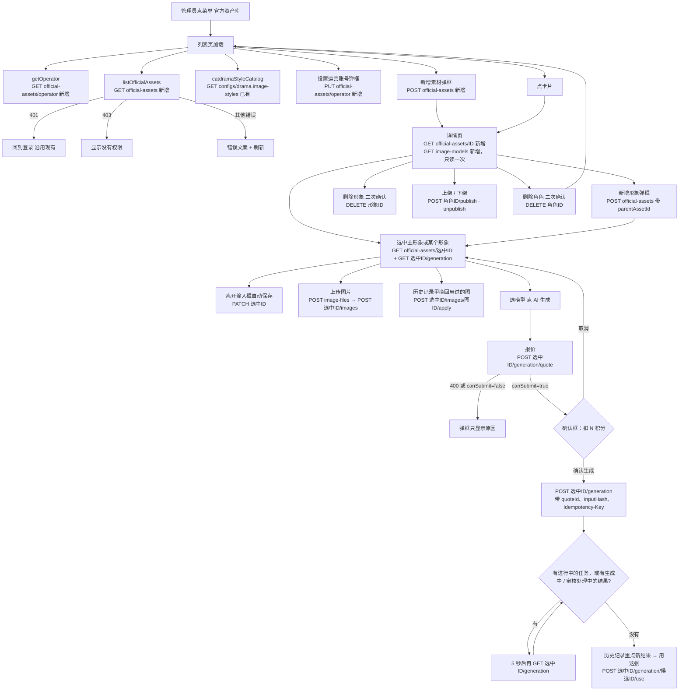

状态：待执行

# 喵喵漫剧官方资产库 · 后台开发计划

> 两份计划之一。接口和字段以《喵喵漫剧官方资产库-开发计划-后端》（在 `开发计划/待执行/2-工作树-后端/`）第 5 节为准，本计划只写后台页面怎么做，**不改后端**。
> 依据：产品需求 `/Users/soul/work/MakeCodePlanWord/projects/灵犀万象后端与后台/当前产品文档/喵喵漫剧官方资产库-产品需求.md`（2026-11-24 确认，2026-11-25 加角色多形象并确认）；设计稿 `/Users/soul/work/MakeCodePlanWord/projects/灵犀万象后端与后台/design-assets/官方资产库/` 下 A-01～A-06 共 6 张图。
> 写于 2026-11-24（洛杉矶时间）；2026-11-25 按设计稿重写：编辑从抽屉改成详情页，加多形象、模型选择、自动保存；同日第二次审核按后端计划的修正同步（见文末“审核记录”）；同日又加场景衍生图（**第 9 节，批次 A7**，A0～A6 执行以后加的）。

## 0. 前提

- **本次全部在工作树里做，不碰原工程**：
  - 原工程（只读）：`/Users/soul/code/lxwx/lxwx_admin`（Flutter，分支 `main`）。用户正在原工程里开发，**不在原工程里改文件、不切分支、不提交、不合并**。
  - 工作树：`/Users/soul/code/lxwx/worktrees/lxwx_admin-official-assets`，分支 `feature/catdrama-official-assets`，由 W0 建（见 0.3）。下文的“工程”和文件路径都指工作树。
  - 另一端：后端也在工作树里做（`/Users/soul/code/lxwx/worktrees/lxwx_service-official-assets/lxwxservice`，联调时跑在 `http://localhost:8081`），本计划不改它。
- 入口：左侧菜单“喵喵漫剧 → 官方资产库”，放在“风格管理”后面。
- 要读的规则：工程里的 `AGENTS.md`、`.cursor/rules/00-编码工作流程.mdc`、`02-项目结构目录.mdc`、`03-编码规范.mdc`、`04-后台管理UI规则.mdc`、`05-接口与鉴权规则.mdc`、`06-开发计划.mdc`。
- 原工程里没提交的改动（写计划时有 GPU 任务的 `lib/models/gpu_task.dart`、`lib/pages/common/gpu_task_page.dart`、`test/gpu_task_model_test.dart`）不会带到工作树，不要去动，也不要照着补。
- 不改动范围：其他页面（包括“风格管理”“作品管理”“积分管理”“GPU 任务”）、权限码、登录与鉴权。
- 先用假数据把页面做完，后端完成后联调，联调通过后删掉假数据和相关代码。
- 页面照设计稿做；设计稿里的红框、红色编号和说明框是标注，不做进页面。

### 0.1 读代码得到的现状

| 事实 | 位置 |
|---|---|
| 菜单项、页面标题、所属 App 分组、权限都在 `shell_page.dart` 里登记：`AdminSection.catdramaStyles` 标题“风格管理”、权限 `{'song_config'}` | `lib/pages/shell_page.dart` 第 285、785、821、909–912、1001 行 |
| 页面跳到别的菜单：`WorksPage(repository: …, onNavigate: _selectSection)` 的写法 | `shell_page.dart` 第 258–261 行 |
| “积分管理”是 `AdminSection.points`，页面不接收初始用户 ID | `shell_page.dart` 第 208 行；`lib/pages/common/points_page.dart` |
| 列表和详情在同一个页面里切换（不 `Navigator.push`）的写法 | `lib/pages/app/catdrama/works_page.dart` 第 52、165–171 行 |
| 请求头带当前 App 的 `X-App-Code`；漫剧作品管理的方法在 `appCode != 'catdrama'` 时直接报错 | `lib/core/api_client.dart` 第 59、3554 行 |
| **假数据的现成做法**：`lib/fake_data/gpu_task_fake.dart` 放假数据和假 Repository，开关 `gpuTaskFakeDataEnabled`，只在 `shell_page.dart` 创建页面的地方用三元判断接入 | `lib/fake_data/`、`shell_page.dart` |
| `05` 规则对假数据的要求：只用接口文档里的样例；集中一个目录、一个开关；不写进页面和 Repository 业务代码；联调后连开关一起删 | `.cursor/rules/05-接口与鉴权规则.mdc` 第 32–38 行 |
| `04` 规则：高风险操作必须二次确认 | `.cursor/rules/04-后台管理UI规则.mdc` 第 34 行 |
| 带货“个人形象管理”页：`FilePicker.pickFiles` 选图上传、`showDialog` 弹框、`Timer` 轮询、幂等键 `'admin-persona-$action-${DateTime.now().microsecondsSinceEpoch}'` | `lib/pages/app/catseller/personas_page.dart` 第 33、404–487、950、1359 行 |
| 依赖里已有 `dio`、`file_picker`，不用新增依赖 | `pubspec.yaml` |
| 请求头带 `Idempotency-Key` 的写法 | `lib/core/api_client.dart` 第 761、880 行 |
| 漫剧画风列表：`catdramaStyleCatalog()` 调 `GET /api/admin/configs/drama.image-styles`，按分类分组，每个画风有 `enabled` | `lib/core/api_client.dart` 第 2154 行；画风模型第 80–100 行 |
| 请求返回 401 时回到登录页（所以后端约定后台接口除了登录过期都不返回 401） | 现有请求处理 |

### 0.2 A0 执行前核对（不改代码，结论写进“执行记录”）

| 编号 | 核对什么 | 计划的假设 | 不成立时 |
|---|---|---|---|
| K1 | `04` 规则对弹框、表单错误、自动保存提示的规定 | 删除、生成都用现有确认框二次确认；表单错误显示在输入框下面 | 按规则 |
| K2 | 后台有没有现成的音色（声音描述）、别名输入控件 | 没有就用简单控件：音色多行文本、别名用标签加“＋ 添加别名” | 照实际，写进执行记录 |

### 0.3 W0 建工作树（最先做，A0 之前）

1. 记录原工程现状，写进执行记录，不做任何改动：
   ```bash
   git -C /Users/soul/code/lxwx/lxwx_admin rev-parse --abbrev-ref HEAD
   git -C /Users/soul/code/lxwx/lxwx_admin rev-parse HEAD
   git -C /Users/soul/code/lxwx/lxwx_admin status --short
   ```
2. 建工作树（从原工程当前提交开一个新分支）：
   ```bash
   mkdir -p /Users/soul/code/lxwx/worktrees
   git -C /Users/soul/code/lxwx/lxwx_admin worktree add -b feature/catdrama-official-assets /Users/soul/code/lxwx/worktrees/lxwx_admin-official-assets HEAD
   ```
3. 复制不在 git 里、但干活要用的本地文件：原工程的 `AGENTS.md`（被 `.gitignore` 忽略）复制到工作树根目录。复制了哪些写进执行记录。
4. 在工作树里 `flutter pub get`，再 `flutter analyze` 一次，记下现有的提示数，之后只看本次新增的。
5. 跑网页版时用和原工程不同的端口（例如 `flutter run -d chrome --web-port 8091`），原工程开着也不冲突。
6. 验收：
   - [ ] `git worktree list` 里有新工作树，分支 `feature/catdrama-official-assets`；原工程分支、`git status` 和第 1 步记录的一样。
   - [ ] 工作树能跑起来，登录页能打开。
- 任何一步做不到：停下来报告，不改用原工程。

## 1. 需求

- R1 菜单“官方资产库”，权限 `song_config`。
- R2 列表页顶部运营账号栏：用户 ID、昵称、手机号后四位、积分余额；“更换账号”“去加积分”；没设置、账号不可用时各有提示。（A-01 ①）
- R3 列表：角色 / 场景 / 道具页签（带数量）、状态、画风、名称或别名搜索、“＋ 新增素材”；卡片网格（主形象当前图、状态、名称、别名和形象数、画风、更新时间），按更新时间倒序，每页 20 条。（A-01）
- R4 新增素材弹框：类型、名称、画风、提示词、别名和音色（只有角色）/ 环境声（只有场景）。创建后进详情。（A-04 ①）
- R5 详情页：标题（名称可改）、类型、状态、上架 / 下架、删除；别名行（只有角色）；大图；历史记录；右侧资料；模型和“AI 生成”；上传图片。改资料离开输入框自动保存。（A-02）
- R6 角色多形象：右侧“全部造型”一列，“＋ 新增形象”、主形象、衍生形象；点哪个就切到哪个；衍生形象可改名称和外观特征、删除。画风、音色在形象上只读。（A-02 ⑧、A-05、A-06）
- R7 历史记录：当前选中形象自己的，上传的图和 AI 生成结果放一起，新的在前。标签：当前图 / 未使用 / 用过 / 生成中 / 失败 / 未通过审核。点一张先在大图预览，再“用这张”（生成结果）或“换回这张”（用过的图）。（A-02 ③④、A-03 ③）
- R8 AI 生成两步：选模型 → 点“AI 生成” → 报价 → 确认框（扣多少、余额多少）→ 确认后生成；不能生成时只显示原因。按钮置灰的情况照后端 `blockedReason` 原文显示；不支持当前画风的模型置灰。（A-03、A-06 ③④）
- R9 有生成中或审核处理中的结果时每 5 秒刷新生成面板（只读接口），都结束了就停；**报价接口不轮询**。
- R10 上架 / 下架 / 删除；删除二次确认。主形象没有当前图、画风已删除时“上架”置灰。（A-02 ①、A-04 ③）
- R11 运营账号弹框：输入用户 ID 保存，找不到用户时输入框下面红字提示；弹框里显示当前账号。（A-04 ②）
- R12 所有错误把后端文案原样显示。
- R13 场景衍生图：场景详情也有右侧一列“全部衍生图”，能新增、改名、改描述、删除衍生图，衍生图的图片和 AI 生成和形象一样（2026-11-25 加，见第 9 节）。

## 2. 流程图



## 3. 界面与状态

### 3.1 列表页（A-01）

| 区域 | 状态 | 展示 |
|---|---|---|
| 运营账号栏 | 没设置（`userId` 为空） | “还没有设置官方运营账号，AI 生成要用它扣积分” + “设置账号” |
| 运营账号栏 | 正常（`available=true`） | “官方运营账号 10086 · 昵称 · 尾号 0000 · 积分 1,200” + “更换账号” + “去加积分” |
| 运营账号栏 | 不可用（`userId` 有值、`available=false`） | 橙字“官方运营账号 10086 已不可用（被删除或冻结），AI 生成用不了” + “更换账号” |
| 运营账号栏 | 点“去加积分” | 调 `onNavigate(AdminSection.points)` 跳到积分管理（积分管理不收初始用户 ID，管理员自己搜运营账号 ID） |
| 页签 | — | “角色 12 / 场景 5 / 道具 8”：页面加载时对三个类型各调一次 `listOfficialAssets(kind, page: 1, pageSize: 1)` 取 `total`，不受状态、画风、搜索影响；新增、删除后重取 |
| 列表 | 加载中 / 失败 / 无权限 | 沿用后台现有样式 |
| 列表 | 一条都没有 | “还没有官方素材，点右上角新增” |
| 列表 | 筛选后没有 | “没有符合条件的素材” + “清空筛选” |
| 卡片 | 有图 | 主形象当前图；左上状态（已上架绿 / 未上架灰） |
| 卡片 | 没图 | 灰色占位 + “无图片”（没图不能上架，所以一定是未上架） |
| 卡片 | 角色 | 第二行“别名：女医生、江医生 · {lookCount + 1} 个形象”；`lookCount > 0` 时形象数用主色；没别名写“—” |
| 卡片 | 场景、道具 | 第二行只有别名（场景、道具没有别名，写“—”）；不显示形象数 |
| 卡片 | `styleName` 为空 | 画风位置显示“画风已删除”（橙色） |

- 从详情回到列表时重新读一次运营账号（生成扣了积分，余额要更新）。
- 列表不显示生成进度（要看进详情）。

### 3.2 详情页（A-02 主形象、A-05 衍生形象）

布局（照设计稿）：左边大图 + 历史记录；中间右侧资料和生成；最右“全部造型”一列（只有角色有，场景、道具没有这一列）。顶部面包屑“喵喵漫剧 / 官方资产库 / 素材详情”，返回按钮回到列表（保留原来的筛选和页码）。

| 区域 | 状态 | 展示 |
|---|---|---|
| 标题 | — | 名称（点击变输入框，回车或离开保存）、类型、状态标签、“上架于 … · 更新于 …” |
| 标题右侧按钮 | 未上架 | “上架”；主形象没有当前图时置灰并提示“还没有图片，不能上架”；画风已删除时置灰并提示“画风已删除，先重新选择画风” |
| 标题右侧按钮 | 已上架 | “下架”（不弹确认，直接下架） |
| 标题右侧按钮 | — | “删除角色”（场景、道具写“删除素材”），二次确认（A-04 ③） |
| 别名行 | 角色 | 标签 + ×、“＋ 添加别名”，旁边灰字“属于角色本身，全部形象共用”；改动后整组 PATCH `aliases` |
| 大图 | 有当前图 | 左上紫色标签“{形象名} · 当前图”；右下“上传 / AI 生成 · 时间” |
| 大图 | 选中的是衍生形象 | 图上方固定一行说明“形象按主形象出图：主形象的当前图会作为第一张参考图，长相保持一致” |
| 大图 | 正在预览历史里的另一张 | 左上标签“预览 · 未使用”或“预览 · 用过”；图下方“正在预览：…（还不是当前图）”+“回到当前图”+“用这张”（生成结果）/“换回这张”（用过的图） |
| 大图 | 没图 | 灰色占位“还没有图片，上传或 AI 生成一张” |
| 上传 | — | 大图下方“上传图片”按钮；选中衍生形象时旁边灰字“也可以直接上传这个形象的图” |
| 右侧（主形象） | 角色 | 形象名称（固定“主形象”，只读）、画风（下拉）、音色、提示词 |
| 右侧（主体） | 场景 / 道具 | 没有形象名称；画风、环境声（只有场景）、提示词 |
| 右侧（衍生形象） | — | 形象名称（可改，x/10）、“画风 / 音色（全部形象共用，在主形象里改）”只读一行、参考图（主形象当前图缩略图，灰字“固定是主形象的当前图，不能移除；保证长相一致”）、外观特征（x/500） |
| 画风下拉 | — | 只列 `enabled` 的画风，按分类分组；当前画风已被删除时下拉显示橙字“画风已删除，请重新选择” |
| 生成区 | 能生成 | 模型下拉“{name} · {points} 积分 / 张”+“AI 生成”+ 灰字“用官方运营账号扣积分 · 点了先报价，确认后才扣” |
| 生成区 | 面板 `blockedReason` 有值 | “AI 生成”置灰，下面橙字显示原因原文（A-03 ④、A-06 ③） |
| 生成区 | 正在报价 | 按钮“报价中”并置灰 |
| 生成区 | 生成中（`activeJob` 不为空，或有 `GENERATING`/`PROCESSING` 的结果） | 按钮“生成中…”并置灰，下面灰字“完成后自动刷新历史记录” |
| 模型下拉 | 某个模型 `available=false` | 这一项置灰，后面写 `disabledReason` |
| 模型下拉 | 某个模型的 `styleCodes` 不含当前画风（形象看所属角色的画风） | 这一项置灰，后面写“不支持{画风名}” |
| 模型下拉 | 默认选中 | 第一个能选的（`available=true` 且支持当前画风）；一个都不能选时“AI 生成”置灰，下面写“当前画风没有可用的模型” |
| 全部造型 | — | 顶部“＋ 新增形象”；第一个主形象（缩略图左上“主”标）；下面衍生形象按创建先后，没图的显示“未出图”；选中的紫框 + 紫字 |
| 全部造型 | 鼠标移到衍生形象上 | 右上出现 ×，点了删除确认（A-06 ②）；主形象没有 × |
| 自动保存 | 保存中 / 失败 | 输入框右下角小字“保存中…”；失败时输入框下面红字显示后端原文，输入内容保留 |

### 3.3 历史记录（A-02 ④）

当前选中形象（主形象或某个衍生形象）自己的。由生成面板 `candidates` 和详情 `images` 合成，按时间新的在前：

| 来源 | 条件 | 标签 | 点了 |
|---|---|---|---|
| `candidates` | `state` 是 `GENERATING` 或 `PROCESSING` | 进度圈“生成中…” | 不可点 |
| `candidates` | `state=SUCCEEDED` 且 `used=false` | 橙框“新 · 未使用” | 大图预览，“用这张” → `useGeneratedImage` |
| `candidates` | `state=FAILED` | 灰底“失败”，下面写 `failureMessage` | 不可点 |
| `candidates` | `state=REJECTED` | 灰底“未通过审核”，下面写 `failureMessage` | 不可点 |
| `candidates` | `state=EXPIRED`，或 `used=true` | 不显示（过期的不能用；用过的已经在 `images` 里） | — |
| `images` | 是 `currentImage` | 紫框“当前图” | 回到当前图 |
| `images` | 其他 | 灰标“用过” | 大图预览，“换回这张” → `applyOfficialImage` |

- 每项下面一行“上传 / AI 生成 + 时间”（`sourceType` 是 `OFFICIAL_UPLOAD` 写“上传”，其余写“AI 生成”）。
- “生成中”只来自 `candidates`，不再用 `activeJob` 另外拼一格（提交后图片记录马上就是 `GENERATING`）。

### 3.4 弹框

| 弹框 | 内容 | 设计稿 |
|---|---|---|
| 新增素材 | 类型分段（角色 / 场景 / 道具，“保存后不能改”）、名称 x/20、画风下拉（只列 `enabled` 的）、提示词 x/500（灰字“AI 生成前要填；也是用户导入后的素材描述”）、别名（只有角色）、音色（角色）/ 环境声（场景）；底部灰字“保存后是‘未上架’，进详情再上传或 AI 生成图片”；“取消”“创建” | A-04 ① |
| 设置官方运营账号 | 说明文字、用户 ID 输入框、“当前账号”卡片（昵称 · 尾号、积分余额；没设置或不可用时不显示）；“取消”“保存”；保存失败时输入框红框 + 红字后端原文；成功后关闭，列表页顶部换成新账号 | A-04 ② |
| 删除素材 | “删除官方素材‘{名称}’？删除后用户在 App 里看不到它（角色连同全部形象），也不能再导入。已经导入到作品里的不受影响。”；“取消”“删除”（红色） | A-04 ③ |
| 新增形象 | 说明“给‘{角色名}’加一个新的样子（换装、换发型等），长相和主形象一致”；参考图卡片（主形象当前图，“主形象的当前图，自动作为参考图 / 不用选，也不能换”；主形象没图时卡片写“主形象还没有图”）；形象名称 x/10（灰字“同一角色下不能重名”）；外观特征 x/500（“只写和主形象不一样的地方”）；底部灰字“创建后自动选中它，再 AI 生成或上传图片”；“取消”“创建” | A-06 ① |
| 删除形象 | “删除形象‘{形象名}’？删除后用户导入这个角色时不再带上它；已经导入到作品里的不受影响。”；“取消”“删除”（红色） | A-06 ② |
| 报价确认 | 标题“用运营账号生成一张官方图？”（形象写“用运营账号生成形象图？”）；说明；素材（或“形象：角色名 · 形象名”+ 参考图缩略图）、画风、模型、运营账号；“本次扣除 N 积分”、“余额 M → M−N”（`M` 是报价返回的 `pointsBalance`）；“取消”“确认生成” | A-03 ①、A-06 ④ |
| 现在不能生成 | 报价接口 400 的文案，或 `canSubmit=false` 的 `blockedReason` 原文；“去加积分”“知道了” | A-03 ② |

文字规则：类型 `ROLE` 角色 / `SCENE` 场景 / `PROP` 道具；状态 `DRAFT` 未上架（灰）/ `PUBLISHED` 已上架（绿）；时间按浏览器本地时区显示 `MM-DD HH:mm`。

图片：后端视图里的 `url` 是 12 小时有效的临时地址，直接显示，不用再调换地址接口。

## 4. 接口

- 用到的后端接口：后端计划第 5.2～5.5 节的全部后台接口；画风列表用已有的 `catdramaStyleCatalog()`。字段以后端计划为准。
- **接口变化清单**（后台这一侧），四个 Repository 和后端四个后台 Controller 一一对应，放在同一个文件里：
  - 新增 `lib/data/official_asset_repository.dart`：
    - `OfficialAssetRepository`（7 个）：`listOfficialAssets`、`getOfficialAsset`、`createOfficialAsset`（带 `parentAssetId` 就是新增形象）、`editOfficialAsset`、`publishOfficialAsset`、`unpublishOfficialAsset`、`deleteOfficialAsset`。
    - `OfficialAssetImageRepository`（3 个）：`uploadOfficialImageFile`、`addUploadedImage`、`applyOfficialImage`。
    - `OfficialAssetGenerationRepository`（5 个）：`listImageModels`、`getGeneration`、`quoteGeneration`、`generateImage`、`useGeneratedImage`。
    - `OfficialAssetOperatorRepository`（2 个）：`getOperator`、`saveOperator`。
  - 新增模型 `lib/models/catdrama_official_asset.dart`：`OfficialAsset`（含 `parentAssetId`、`lookCount`、`looks`、`images`）、`OfficialAssetImage`、`OfficialImageModel`（含 `styleCodes`）、`OfficialAssetGeneration`（`blockedReason`、`activeJob`、`candidates`，没有余额）、`OfficialAssetCandidate`（含 `state`、`failureMessage`）、`OfficialAssetQuote`、`OfficialAssetOperator`（含 `available`），字段和后端 5.1、5.4、5.5 一一对应。
  - `lib/core/api_client.dart`：新增上面每个接口对应的请求方法，放在漫剧相关方法旁边。
  - `lib/pages/shell_page.dart`：新增 `AdminSection.catdramaOfficialAssets`，标题“官方资产库”，图标 `Icons.collections_outlined`，加进 `catdrama` 分组（`catdramaStyles` 后面），权限 `{'song_config'}`；页面传 `onNavigate: _selectSection`；假数据开关在这里接入（见 A1）。
  - 新增 `lib/fake_data/official_asset_fake.dart`（假数据，联调后删除）。
  - 其他页面、权限码：无变化。
- 需要后端配合：后端计划 B2～B6。本计划不改后端。

## 5. 分批

| 批次 | 交付什么 | 涉及文件 | 前置 | 验收要点 |
|---|---|---|---|---|
| W0 | 工作树 | 见 0.3 | 无 | 见 0.3 验收 |
| A0 | 核对结论 | 只读 | W0 | K1、K2 有结论 |
| A1 | 模型、Repository、假数据 | `models/catdrama_official_asset.dart`、`data/official_asset_repository.dart`、`core/api_client.dart`、`fake_data/official_asset_fake.dart` | A0 | 假数据能解析成模型 |
| A2 | 菜单、列表页、运营账号栏、新增素材和运营账号弹框 | `pages/app/catdrama/official_assets_page.dart`、`pages/app/catdrama/official_asset_dialogs.dart`、`shell_page.dart` | A1 | R1～R4、R11 |
| A3 | 详情页框架：标题、别名、上下架、删除、右侧资料自动保存、全部造型（新增 / 切换 / 删除形象） | `pages/app/catdrama/official_asset_detail.dart`、`official_asset_dialogs.dart` | A2 | R5、R6、R10 |
| A4 | 图片区：大图、历史记录、预览、上传、换回、用这张 | `pages/app/catdrama/official_asset_image_area.dart` | A3 | R7 |
| A5 | 生成区：模型、报价、确认、生成、轮询、置灰原因 | `official_asset_image_area.dart`、`official_asset_dialogs.dart` | A4 | R8、R9 |
| A6 | 测试与文档 | `test/catdrama_official_asset_*_test.dart`、`docs/功能定位.md` | A5 | 测试通过 |

### A1 模型、Repository、假数据

- 四个 Repository 写成可被假实现替换的形式（和 `gpu_task_repository.dart` / `gpu_task_fake.dart` 的关系一样）。
- 假数据放 `lib/fake_data/official_asset_fake.dart`：常量开关 `officialAssetFakeDataEnabled`（默认 `false`），四个假 Repository。只在 `shell_page.dart` 创建页面的地方用三元判断接入，并照现有写法加注释“联调通过后删掉三元判断和 fake_data 的 import”。
- 假数据内容照后端计划第 5 节的样例，保证每种画面都能看到（对着设计稿）：
  - 运营账号：正常（余额 1200）、没设置、不可用各一份。
  - 列表：角色 12、场景 5、道具 8 条（和 A-01 页签数量一致）。角色里：“都市女医生”已上架、2 个衍生形象；一条 `styleName` 为空；两条没图（未上架）。
  - 角色详情“都市女医生”：主形象 3 张用过的图（一张上传），衍生形象“婚纱”（有图，2 张）、“短发”（没图）。
  - 场景详情一条（有环境声）、道具详情一条（没有声音）。
  - 模型 3 个：“一般模型 · 8 积分”（默认，支持全部画风）、一个 `available=false` 带原因、一个 `styleCodes` 不含“都市女医生”的画风。
  - 生成面板：主形象有 `GENERATING`、`SUCCEEDED`（未使用）、`FAILED`、`REJECTED` 各一条；“婚纱”能生成；“短发”的 `blockedReason` 三种（主形象没图、主形象是上传的、主形象图已不能当参考图）用一个调试开关轮换；没设运营账号、运营账号不可用、画风已删除、提示词为空各一种。
  - 报价 3 种：`canSubmit=true`（8 积分，余额 1200）、`canSubmit=false`（积分不够）、接口返回 400（不能生成原因）。
  - 假的“生成”调用后，面板第 1 次返回 `activeJob` + 一条 `GENERATING`，第 2 次 `activeJob` 为空 + 这条变 `PROCESSING`，第 3 次变 `SUCCEEDED`，用来验证轮询在第 3 次后才停。
  - 图片地址用工程里已有的演示图片。
- 验证：`dart format`、`flutter analyze`；单元测试解析全部假数据。

### A2 列表页、运营账号栏、两个弹框

- 页面 `OfficialAssetsPage`：列表和详情在同一页面切换（照 `works_page.dart`），状态里记 `_openAssetId`；从详情返回时保留筛选和页码，并重新读运营账号。
- 运营账号栏（3.1 三种状态）；“设置账号 / 更换账号”打开运营账号弹框（3.4），“保存”调 `saveOperator`。
- 页签、状态下拉、画风下拉（选项来自 `catdramaStyleCatalog()`，只列 `enabled` 的）、搜索框回车查；改任何筛选回到第 1 页。
- 卡片网格（3.1），每页 20 条，底部分页。
- “＋ 新增素材”打开新增弹框（3.4）：选类型时，场景隐藏别名、音色改叫“环境声”；道具两项都隐藏。“创建”调 `createOfficialAsset`，成功后直接打开详情。
- 验证：开假数据，逐条核对 R1～R4、R11 和 3.1、3.4 相关的行。

### A3 详情页框架

- 进详情：`getOfficialAsset(素材ID)`、`listImageModels()`（只读一次，整个详情共用）；默认选中主形象。
- 选中某个形象（主形象就是素材本身）：`getOfficialAsset(选中ID)` 取它的 `images`，`getGeneration(选中ID)` 取生成面板。切换时停掉上一个的轮询；新选中的有生成中的结果就开始轮询。
- 标题、别名、上下架、删除（3.2）；删除成功回列表并刷新。
- 右侧资料自动保存：离开输入框（或下拉选完）时，值变了就 `editOfficialAsset(选中ID, 只带这一个字段)`；成功后用返回的视图更新页面，再刷新一次生成面板（提示词 / 外观特征从空变成有值、画风换了，按钮能不能点会变）。
  - 主体字段：`name`（标题里改）、`styleCode`、`soundProfile`、`description`、`aliases`。
  - 形象字段：`name`（形象名称）、`description`（外观特征）。
- 全部造型（3.2）：
  - “＋ 新增形象”打开新增形象弹框（3.4），“创建”调 `createOfficialAsset({parentAssetId: 角色ID, name, description})`，成功后重新读角色详情、选中新形象。
  - 删除形象：确认后 `deleteOfficialAsset(形象ID)`，成功后重新读角色详情、选中主形象。
- 验证：开假数据，核对 R5、R6、R10 和 3.2 里除图片区、生成区以外的每一行；角色、场景、道具三种详情都看一遍。

### A4 图片区

- 大图、历史记录、预览按 3.2、3.3。
- “上传图片”：`FilePicker.pickFiles` 选文件 → 前端先查扩展名和大小（png/jpg/jpeg/webp、≤10MB，不符合直接提示）→ `uploadOfficialImageFile` → `addUploadedImage(选中ID, resourceId)`。真实格式由后端检查，后端报错原文显示。
- “换回这张”→ `applyOfficialImage`；“用这张”→ `useGeneratedImage`。成功后用返回的详情更新大图和历史，再刷新一次生成面板（`used` 变了）。
- 主形象换图后，重新读一次角色详情（全部造型里主形象缩略图、衍生形象的参考图缩略图要跟着变）。切到衍生形象时它的生成面板会重新读，能不能生成以那时为准。
- 验证：开假数据，核对 R7 和 3.3 每一行。

### A5 生成区

1. 模型下拉：`listImageModels()` 的结果，按 3.2 置灰不可用的、不支持当前画风的；默认第一个能选的。
2. 按钮状态按 3.2 生成区：面板 `blockedReason` 有值就置灰并显示原文。
3. 点“AI 生成” → `quoteGeneration(选中ID, 选中的模型)`（按钮“报价中”）。
   - 接口 400：弹“现在不能生成”，显示后端文案。
   - `canSubmit=false`：同上，显示 `blockedReason`。
   - `canSubmit=true`：弹报价确认框（3.4）。
4. “确认生成” → `generateImage(quoteId, inputHash)`，幂等键 `'admin-official-generate-${DateTime.now().microsecondsSinceEpoch}'`（满足后端 16～64 位字母数字短横线）；网络失败重试复用同一个键。
5. 轮询：返回的面板里 `activeJob` 不为空，**或** `candidates` 里有 `GENERATING`、`PROCESSING` 的，就 5 秒后再 `getGeneration(选中ID)`；两样都没有就停。切换形象、离开详情、登录过期时停。**轮询只调 `getGeneration`，不调报价。**
6. “去加积分”：关弹框，`onNavigate(AdminSection.points)`。
- 验证：开假数据，核对 R8、R9 和 3.2 生成区、3.4 报价相关的行；确认轮询期间没有调用报价；形象“短发”三种置灰原因都能看到；不支持画风的模型是灰的。

### A6 测试与文档

- widget 测试：
  - 列表：页签数量、状态标签、“画风已删除”、角色形象数、运营账号三种状态。
  - 新增素材弹框：选场景时别名隐藏、音色变成“环境声”；选道具两项都隐藏；画风下拉没有停用的画风。
  - 详情：场景、道具没有“全部造型”一列；选中形象时画风、音色只读；新增形象后自动选中；删除形象后回到主形象；画风已删除时“上架”置灰。
  - 自动保存：离开提示词输入框后调一次 `editOfficialAsset`，只带 `description`。
  - 历史记录合成：生成中、未使用、失败、未通过审核、当前图、用过六种标签都出现；`used=true` 和 `EXPIRED` 的候选不出现。
  - 生成：`blockedReason` 有值时按钮禁用；不支持当前画风的模型禁用；报价 400 和 `canSubmit=false` 弹原因框；`true` 弹确认框并在确认后调生成；`activeJob` 为空但还有 `PROCESSING` 时继续轮询，变成 `SUCCEEDED` 后才停；整个过程报价只调一次。
- 命令：`dart format lib test`、`flutter analyze`、`flutter test`、`git diff --check`。
- `docs/功能定位.md` 加上官方资产库页面的位置。
- 确认其他页面没有被改动（`git diff` 核对）。

## 6. 联调与总体验收

**谁来做（2026-11-25 用户决定）**：联调由 Codex 做检查、出报告，按 `开发计划/待执行/5-联调-Codex/喵喵漫剧官方资产库-联调计划-Codex.md`；**Codex 不改代码**，问题由 Claude 改，改完 Codex 复查。下面的场景和预期不变。删假数据、整体复测、提交仍按本计划由 Claude 做。

**什么时候开始**：后台做完 A6（场景衍生图还要 A7）、后端会话报告了“可以联调”（后端计划第 8 节）、用户说开始联调。后台做完时后端还没报告“可以联调”：**停下来报告，不启动、不修改后端工作树**。联调中查出后端的问题，记下来交给后端会话修，后台会话不改后端代码。

前置：后端计划 B1～B7 完成（J12 还要 B9）；后端工作树按后端计划 0.3 第 5 步跑在 `http://localhost:8081`（用数据库副本 `lxwx_service_official_assets`）；后台工作树登录页的接口地址填 `http://localhost:8081`；`officialAssetFakeDataEnabled = false`；下面说的“在数据库里改”都是改副本库，不碰原库 `lxwx_service`；准备一个喵喵漫剧测试用户当运营账号，并在“积分管理”里给它加积分；另准备一个普通测试用户和它的一个作品（有一集），用来测导入。

按模块联调，一个模块一轮：

| 编号 | 模块 | 场景 | 预期 |
|---|---|---|---|
| J1 | 运营账号 | 设置不存在的用户 ID；设置一个别的 App 的用户 ID；再设置测试用户；点“去加积分” | 前两次都在输入框下面报错，**页面不跳回登录**；第三次顶部显示账号和余额；跳到积分管理 |
| J2 | 资料 | 新增角色、场景（带环境声）、道具各一条；同类型重名一次；在详情里改提示词、画风、别名，刷新页面 | 三条成功、未上架；重名报错；改的内容刷新后还在 |
| J3 | 上传 | 给三条各上传一张图；再给角色上传第二张，从历史记录换回第一张；上传一张改了扩展名的非图片文件 | 当前图正确；历史记录标签对；假图片被拒 |
| J4 | 主形象 AI 生成 | 清空场景提示词看按钮；填回后选模型点 AI 生成 → 确认 → 等结果 → 预览 → 用这张 | 提示词为空时按钮置灰并有原因；确认框积分、余额、模型正确；扣分后余额变少；历史记录先“生成中”（经过审核处理也还是“生成中”）再“未使用”，轮询在出结果后才停；用了以后变“当前图” |
| J5 | 形象 | 角色主形象用上传的图时，新增形象“婚纱”，看 AI 生成按钮；给主形象 AI 生成并“用这张”（用 J4 的流程，只提交一次）；再给“婚纱”AI 生成 → 用这张；新增“短发”后删掉 | 主形象是上传图时按钮置灰、原因对，但能上传形象图；主形象换成生成图后“婚纱”能生成，长相和主形象一致；删除确认后“短发”消失 |
| J6 | 上架 | 三条都上架；不登录调 App 接口 `GET /api/drama/official-assets`、`/styles`，再用主图和形象图的 `imageResourceId` 调 `POST /api/resources/{id}/access-url` | 都能查到；角色 `looks` 里有“婚纱”；图片地址能打开 |
| J7 | 导入 | 普通测试用户用现有导入接口把官方角色导入到那一集，`lookIds` 传“婚纱” | 导入成功、不扣积分；作品里有主形象和“婚纱”，图都对 |
| J8 | 导入后生成视频 | 用 J7 那一集，带上导入的官方角色生成一个片段视频 | 能正常提交和生成（扣普通测试用户积分，只提交一次） |
| J9 | 下架、换图、删除、画风 | 下架角色后查 App 接口；换主形象图后再导入一次；删除道具；在风格管理里停用场景的画风，回来看场景详情 | 下架后角色和形象都查不到、J7 的照常；新导入的是新图；删除后两边都看不到；场景显示“画风已删除”，上架和 AI 生成都置灰并写原因，重新选画风后恢复 |
| J10 | 运营账号脱钩 | 在数据库把 J4 的载体素材 `deleted_at` 设上，再看那条场景，再点一次 AI 生成到报价为止；把角色的主体载体也设上，看“婚纱”的按钮；最后把运营账号在库里改成冻结，刷新列表页 | 官方图照常显示、App 能读；场景报价成功（自动建了新载体）；“婚纱”显示“已经不能当参考图”的原因；冻结后顶部显示“已不可用”、详情里 AI 生成置灰，页面不跳回登录 |
| J11 | 权限 | 用没有 `song_config` 的管理员登录 | 看不到菜单；直接调接口 403 |
| J12 | 场景衍生图（2026-11-25 加） | 场景主场景用上传的图时，新增衍生图“厨房”，看 AI 生成按钮；给主场景 AI 生成并“用这张”（只提交一次）；再给“厨房”AI 生成 → 用这张（只提交一次）；新增“院门口”后删掉；上架后不登录调 App 列表；普通测试用户把场景导入那一集，`lookIds` 传“厨房” | 主场景是上传图时“厨房”按钮置灰、原因是场景的文案，仍能上传；主场景出的是普通场景图，不是俯视图；“厨房”和主场景风格、陈设一致；删除确认后“院门口”消失；列表卡片“1 个衍生图”；App 列表里场景 `looks` 有“厨房”；作品里有主场景和“厨房”，图都对 |

- J4、J5、J8、J12 有积分消耗，每个场景只提交一次，失败不自动重试，记下原因由用户决定。J10 只到报价，不提交；做完把运营账号改回正常。
- 出了问题先判断属于哪一端，不为联调通过两边一起改；需要改另一端先说明改什么。
- 同一问题最多修 3 次，修不好写进问题清单（现象、证据、三次各做了什么、原因、属于哪一端），继续下一个模块，最后统一出报告。
- 全部通过后：删除 `lib/fake_data/official_asset_fake.dart`、`shell_page.dart` 里的三元判断和 import，搜索 `officialAssetFakeDataEnabled` 确认没有残留，再整体过一遍 J1～J12。
- 最后把 R1～R13 和产品需求的 Y1～Y16 逐条对一遍：需求 → 实现位置 → 验证结果。
- 顺带确认产品需求第 8 节的已知限制（用户导入官方角色后，在作品里新增形象并 AI 生成会不会报“主图参考图暂不可用”），结果写进报告，不在本次修。

## 7. 失败处理

- A0 核对与计划不符、计划写的文件或方法不存在：停下来报告，不自己换方案。
- 需要加新依赖、改别的页面、改接口清单以外的东西、需要后端配合而后端计划没写：停下来说明，等用户决定。
- 设计稿里画了但接口没有的数据：停下来说明，不自己编。
- 后台接口返回了 401 但管理员没有登录过期：属于后端的问题，记进问题清单，不在前端绕过。
- 语法、编译、测试这类范围内的问题自己修；没有新线索不原样重复失败的命令。
- 发现要改原工程才能继续：停下来说明，不去改原工程。

## 8. 做完以后：提交到工作树分支，停下来等用户安排合并

**联调全部通过、假数据删干净、J1～J12 整体复测通过后**：

1. 在工作树的 `feature/catdrama-official-assets` 分支上提交本次改动。只提交本次的文件；`AGENTS.md` 本来就被忽略，不要强制加进去。提交信息照仓库习惯，例如 `feat: 新增喵喵漫剧官方资产库页面（官方角色 / 场景 / 道具、角色形象、AI 生成）`。
2. **停下来**，写报告给用户：分支名、提交号、改动文件清单、联调问题清单（如果有）。
3. **不合并、不删工作树、不动原工程**。原工程可能正在开发，要等用户把原工程提交好、说“可以合并了”，再按《喵喵漫剧官方资产库-合并回原工程》做。

**合并回原工程**：步骤已经挪到 `开发计划/待执行/4-合并回原工程/喵喵漫剧官方资产库-合并回原工程.md`（2026-11-25），和另一端的合并排在一起，先合后端、再合后台。本计划不做合并。

计划文件的位置：代码做完、联调通过、停在第 2 步时，这份计划从 `开发计划/待执行/3-工作树-后台/` 移到 `开发计划/待检验/3-工作树-后台/`；合并清理完移到 `开发计划/已执行/3-工作树-后台/`。

## 9. 补充：场景衍生图（2026-11-25 加，批次 A7）

用户 2026-11-25 确认：**场景和角色一样是“主图 + 子图”**——主场景 + 衍生图（同一个场所的其他地方、其他角度，照主场景的样子出）。主场景就是普通场景图，不是俯视图。道具不变。

接口以后端计划第 11 节为准：路径、字段都不变，只是 `POST official-assets` 的 `parentAssetId` 能传场景，场景的视图也有 `looks`、`lookCount`，衍生图不能生成的原因是后端给的场景文案。**不改后端。**

### 9.1 文案对照（页面照 A-05、A-06 做，只换这些字）

| 位置 | 角色（已做） | 场景（A7 新加） |
|---|---|---|
| 右侧一列标题 | 全部造型 | 全部衍生图 |
| 顶部按钮 | ＋ 新增形象 | ＋ 新增衍生图 |
| 第一项 | 主形象（缩略图左上“主”标） | 主场景（缩略图左上“主”标） |
| 其他项 | 衍生形象，没图写“未出图” | 衍生图，没图写“未出图” |
| 列表卡片第二行 | 别名：… · {lookCount + 1} 个形象 | 别名“—” · {lookCount} 个衍生图（`lookCount > 0` 才显示，用主色） |
| 大图左上标签 | {形象名} · 当前图 | 主场景 · 当前图 / {衍生图名} · 当前图 |
| 大图上方说明（选中子图时） | 形象按主形象出图：主形象的当前图会作为第一张参考图，长相保持一致 | 衍生图按主场景出图：主场景的当前图会作为第一张参考图，风格和陈设保持一致 |
| 上传按钮旁灰字 | 也可以直接上传这个形象的图 | 也可以直接上传这张衍生图 |
| 右侧名称 | 形象名称（x/10） | 衍生图名称（x/10） |
| 右侧只读一行 | 画风 / 音色（全部形象共用，在主形象里改） | 画风 / 环境声（全部衍生图共用，在主场景里改） |
| 右侧参考图说明 | 固定是主形象的当前图，不能移除；保证长相一致 | 固定是主场景的当前图，不能移除；保证风格和陈设一致 |
| 右侧描述字段 | 外观特征（x/500） | 描述（x/500） |
| 新增弹框说明 | 给“{角色名}”加一个新的样子（换装、换发型等），长相和主形象一致 | 给“{场景名}”加一张衍生图（同一个场所的其他地方、其他角度），照主场景的样子出图 |
| 新增弹框参考图卡片 | 主形象的当前图，自动作为参考图 / 主形象还没有图 | 主场景的当前图，自动作为参考图 / 主场景还没有图 |
| 新增弹框字段提示 | 形象名称“同一角色下不能重名”；外观特征“只写和主形象不一样的地方” | 衍生图名称“同一场景下不能重名”；描述“写这个地方或角度是什么样” |
| 删除子图确认 | 删除形象“{形象名}”？删除后用户导入这个角色时不再带上它；已经导入到作品里的不受影响。 | 删除衍生图“{名称}”？删除后用户导入这个场景时不再带上它；已经导入到作品里的不受影响。 |
| 删除素材确认 | ……（角色连同全部形象）…… | ……（场景连同全部衍生图）……；道具不写括号 |
| 报价确认框 | 标题“用运营账号生成形象图？”；“形象：角色名 · 形象名” | 标题“用运营账号生成衍生图？”；“衍生图：场景名 · 衍生图名” |
| 生成区置灰原因 | 后端 `blockedReason` 原文 | 后端原文（后端计划 11.2 的场景文案），前端不拼 |

### 9.2 A7 怎么做

- 先读工作树里 A3～A6 已经写好的代码，把按 `kind == 'ROLE'` 写死的“有没有右侧一列、能不能加子图、文案用哪套”改成“角色或场景”。场景、角色两套文案放在一个按类型取字的小函数里，不在页面各处写 if。改了哪些写进执行记录。
- 假数据（`official_asset_fake.dart`）：在现有的一条已上架假场景上加两张衍生图（“厨房”有图、“院门口”没图），**不新增场景**（场景页签数量要和设计稿 A-01 的 5 条一致）。“院门口”的 `blockedReason` 用调试开关轮换三种场景文案（主场景没图、主场景是上传的、主场景图已不能当参考图）。另一条假场景没有衍生图，用来看卡片上不显示衍生图数。
- widget 测试（原有角色的用例全部照旧通过）：
  - 场景详情有“全部衍生图”一列，道具没有（原来“场景、道具没有全部造型”那条用例改成这样）；
  - 场景的文案按 9.1：列标题、按钮、只读行“画风 / 环境声”、描述字段名、确认框标题；
  - 新增衍生图后自动选中它，删除后回到主场景；
  - 选中衍生图时画风、环境声只读；
  - 列表场景卡片“N 个衍生图”，0 个不显示。
- 命令同 A6：`dart format`（只格式化本次改的文件）、`flutter analyze`、`flutter test`、`git diff --check`。
- 验证：开假数据，按 9.1 逐行对一遍场景详情、新增和删除弹框、报价确认框，结果写进执行记录。Codex 那份《喵喵漫剧官方资产库-检验计划-后台页面-Codex》只覆盖 A1～A6，不含场景衍生图。
- 后端还没做 B9 时，A7 照样用假数据先做完；做完停下来报告，联调按第 6 节等后端报告“可以联调”。

## 审核记录

**2026-11-25 第二次审核**，跟着后端计划的修正同步改了这些：

1. 运营账号多了“不可用”状态（`available=false`），列表顶部和详情生成区都要显示；联调 J1、J10 加了“不能跳回登录页”的检查。
2. 生成面板不再带运营账号余额，回列表时重新读运营账号来更新余额。
3. 历史记录改成完全按 `candidates` 的 `state` 显示，加“未通过审核”；不再用 `activeJob` 另拼“生成中”。轮询停止条件改成“没有进行中的任务，也没有生成中、审核处理中的结果”。
4. 模型下拉按 `styleCodes` 置灰不支持当前画风的模型；画风下拉只列启用的画风；画风已删除时上架和 AI 生成都置灰。

**2026-11-25 改成在工作树里做**（用户确认）：原工程正在开发，本次全部在 `/Users/soul/code/lxwx/worktrees/` 下的工作树里做（0.3 W0）；联调连后端工作树的 8081；联调通过后只提交到工作树分支，合并回原工程等用户安排（第 8 节）。

**2026-11-25 加场景衍生图**（用户确认，A0～A6 执行以后加的）：场景和角色一样是“主图 + 子图”（主场景 + 衍生图）。新增 R13、第 9 节（批次 A7，含文案对照表）、联调 J12；第 6 节补上“什么时候开始联调、后端没好就停下来、不改后端工作树”。

**2026-11-25 开发计划分子文件夹**（用户确认）：本计划放到 `开发计划/待执行/3-工作树-后台/`；第 8 节“用户说可以合并以后”的步骤挪到 `4-合并回原工程/喵喵漫剧官方资产库-合并回原工程.md`。

## 执行记录

### 2026-11-25（洛杉矶时间）· Claude 执行 W0、A0～A6

**现在的进度**：W0、A0～A6 做完（假数据能跑，analyze、test 通过）。还没做：对照设计稿逐个画面检查（交给 Codex，计划见同目录《喵喵漫剧官方资产库-检验计划-后台页面-Codex》）→ 联调 J1～J11（等后端计划做完）→ 删假数据 → 提交。所以本计划仍是“待执行”，**还没提交 git**。

#### 接口改动总览（实际）

本次任务所在的页面：喵喵漫剧 → 官方资产库，`lib/pages/app/catdrama/official_assets_page.dart`（详情、图片区、弹框是它的子文件）。

| 类别 | 接口或位置 | 改动 | 改之前 | 改之后 | 影响到谁 |
|---|---|---|---|---|---|
| 对外接口 | 后端计划 5.2～5.5 的 17 个后台接口（`/api/admin/catdrama/official-assets/**`） | 需要后端新增 | 没有官方资产库接口 | 后台照后端计划第 5 节调用；字段、路径没有自己加 | 只有喵喵漫剧后台 |
| 内部接口 | `OfficialAssetRepository`（7）、`OfficialAssetImageRepository`（3）、`OfficialAssetGenerationRepository`（5）、`OfficialAssetOperatorRepository`（2）；`ApiClient` 扩展 `OfficialAssetApi`（17） | 新增 | 无 | 和计划第 4 节一致；ApiClient 上的方法名带 OfficialAsset 前缀 | 只有官方资产库页面 |
| 接口约束 | — | 无改动 | — | — | — |
| 模块外 Service | `api_client.dart` 加 1 行 import、1 行 `part`；`admin_models.dart` 的 `AdminSection` 加一个值；`shell_page.dart` 登记菜单和页面 | 内部改动（接口和行为都不变） | — | 已有方法一行没改 | 别的页面看到的结果不变 |
| 菜单和权限码 | “内容与资源”分组（喵喵漫剧下）→“官方资产库”，在“风格管理”后面 | 新增 | 无 | 只在喵喵漫剧下出现，权限 `song_config`（沿用，不新增权限码） | 喵喵漫剧后台 |
| 流程由谁推进 | 删除素材 / 形象：管理员确认；AI 生成：先报价、管理员确认后才扣分；生成面板刷新：系统自动（只读，每 5 秒，出结果就停）；自动保存：离开输入框时 | 新增 | 无 | 和计划第 2 节一致 | — |

#### W0 建工作树

- 原工程 `main` @ `9e5051c`，没提交的改动 3 个（`lib/models/gpu_task.dart`、`lib/pages/common/gpu_task_page.dart`、`test/gpu_task_model_test.dart`）；建完工作树复查，分支和改动都没变。
- 工作树 `/Users/soul/code/lxwx/worktrees/lxwx_admin-official-assets`，分支 `feature/catdrama-official-assets`，复制了 `AGENTS.md`。
- 基线：`flutter analyze` 7 条（1 warning + 6 info，都是原来就有的）；`flutter test` 366 过、1 失败（`test/gpu_task_model_test.dart`“发给后端的时间带时区”——原工程里没提交的 GPU 改动就是在修它，和本次无关）。
- 辅助脚本放在 `/Users/soul/code/lxwx/worktrees/_official_assets_tools/`（不在任何仓库里）：`w0.sh`、`check.sh`（只格式化本次改动的 dart 文件 + analyze + test + `git diff --check`，日志在 `logs/`）、`run.sh`（用假数据启动网页版，端口 8091）。

#### A0 核对

- K1：`04` 规则只要求高风险操作二次确认、确认框写清后果、前端只做基本校验，没有自动保存提示的规定。→ 删除素材、删除形象用红色“删除”的确认框；AI 生成用报价确认框；表单错误显示在输入框下面；自动保存时输入框右下角显示“保存中…”。
- K2：后台没有现成的音色、别名控件。→ 音色 / 环境声用多行文本（≤300 字）；别名在详情里是标签 + “＋ 添加别名”，新增弹框里是一个输入框，用顿号、逗号分开。
- 音色字段：后端计划 5.1 只写了“和个人素材一样”。读后端代码：`DramaSoundProfile` 是 `{"description": "1～300 字", "audioBinding": null}`（`audioBinding` 这期只能为空）。后台新增时只带 `description`；**清空音色时 PATCH 传 `"soundProfile": null`，后端会不会把 null 当“清空”，联调 J2 时确认**。

#### A1～A6

| 批次 | 文件 | 结果 |
|---|---|---|
| A1 | `lib/models/catdrama_official_asset.dart`、`lib/core/official_asset_api.dart`、`lib/data/official_asset_repository.dart`、`lib/fake_data/official_asset_fake.dart` | 完成；假数据全部能解析（`test/catdrama_official_asset_fake_test.dart`） |
| A2 | `lib/pages/app/catdrama/official_assets_page.dart`、`official_asset_dialogs.dart`、`lib/pages/shell_page.dart` | 完成 |
| A3 | `lib/pages/app/catdrama/official_asset_detail.dart` | 完成 |
| A4、A5 | `lib/pages/app/catdrama/official_asset_image_area.dart`（图片区和生成区在一个文件，生成状态放在 `OfficialAssetImageController` 里，换形象就换一个新的，旧的停掉轮询） | 完成 |
| A6 | `test/catdrama_official_asset_page_test.dart`（11 个）、`test/catdrama_official_asset_fake_test.dart`（2 个）、`docs/功能定位.md` | 完成 |

#### 和计划不一样的地方（都在本次范围内，没有改接口）

1. 请求方法放在新文件 `lib/core/official_asset_api.dart`（`api_client.dart` 的 part），没有直接加进 `api_client.dart`。原因：工程规则 `02`“大文件不再加长”要求新功能的请求写到新的 `lib/core/{功能}_api.dart`（GPU 任务就是这么做的）；规则和计划冲突以规则为准。
2. 计划外改动的文件：`lib/models/admin_models.dart`——`AdminSection` 枚举定义在这里，加了一个值 `catdramaOfficialAssets`。
3. 菜单位置：代码里喵喵漫剧的菜单都在“内容与资源”分组、按 App 显示，没有单独的“喵喵漫剧”分组；新菜单放在这个分组“风格管理”后面。
4. 假数据开关照 GPU 任务现有写法，用 `--dart-define=OFFICIAL_ASSET_FAKE_DATA=true`（默认关）；另加 `--dart-define=OFFICIAL_ASSET_FAKE_OPERATOR=normal|unset|unavailable` 看运营账号三种状态。假数据模式下画风目录也用假的（真实后端的画风编码和假素材对不上），通过 `OfficialAssetRepositories.loadStyleCatalog` 注入，切换只在 `shell_page.dart`。
5. 四个 Repository 打包成 `OfficialAssetRepositories`（同一个文件里）传给页面，方便假数据和测试替换。
6. 审核时提出的后台问题，执行时改掉了：
   - 标题名称、别名行固定保存到角色 ID（选中衍生形象时也是）；右侧资料保存到当前选中的 ID；
   - 点“AI 生成”“上架”前，先让正在编辑的输入框失去焦点、等排队的自动保存完成，有保存失败的就不继续；
   - 从详情返回列表时，按原来的筛选和页码重新读列表、页签数量、运营账号；
   - “上架于 …”只在已上架时显示（下架不清上架时间）；场景、道具的大图标签只写“当前图”；
   - 报价确认框里直接提交生成：失败时框不关、显示原因，再点“确认生成”用同一个幂等键；不自动重试；
   - 确认框的“运营账号”一行用列表页读到的运营账号（报价接口没有这项）。
7. 进详情时主形象直接用角色详情，不再重复读一次。

#### 验证

- `check.sh`（2026-11-25 00:51）：只格式化了本次的文件；`flutter analyze` 8 条 = 原来的 7 条 + 1 条新 info（假数据文件里 if 没加花括号，已改，下次应回到 7 条）；`flutter test` 379 过、1 失败（同基线那条）；`git diff --check` 没问题。
- 新增测试覆盖：列表页签数量、状态、画风已删除、形象数、运营账号三种状态；新增弹框随类型隐藏别名 / 音色改环境声、画风下拉没有停用的；详情场景没有全部造型、画风已删除时上架置灰、选中形象时画风音色只读、新增形象后自动选中、删除形象后回到主形象；离开提示词只保存一次且只带 description；历史记录六种标签、用过和过期的不出现；生成按钮置灰原因、不支持画风的模型置灰、报价 400 和 canSubmit=false 只弹原因、确认后提交、审核处理中继续轮询出结果才停、报价只调一次。
- **未验证**：真实运行页面对照设计稿（交给 Codex）；联调 J1～J11。
- 写本计划工作台里的文件时没有运行 `workspace-path-guard.sh`（Claude 这边跑不了你 Mac 上的脚本），路径是项目登记的 `/Users/soul/work/MakeCodePlanWord/projects/灵犀万象后端与后台/`。

### 2026-11-25（洛杉矶时间）· Codex 页面检验（A1～A6）

见 `开发计划/已执行/3-工作树-后台/喵喵漫剧官方资产库-检验计划-后台页面-Codex.md` 的“检验记录”：C1～C11 主要流程通过；Codex 修了 3 处界面小问题（列表状态标签加不透明底、详情返回按钮的可访问名称、运营账号弹框错误红框），没有改接口。

### 2026-11-25（洛杉矶时间）· Claude 执行 A7 场景衍生图

**结果**：A7 完成，`check.sh`（02:46）`flutter analyze` 7 条（全是原来的）、`flutter test` 382 过 1 失败（还是原来的 `gpu_task_model_test.dart`“发给后端的时间带时区”）、`git diff --check` 没问题。接口没变，**还没提交**。

**怎么改的**（照 9.2：按类型取字，不在页面各处写 if）：
- `lib/models/catdrama_official_asset.dart`：加 `hasLooks`（角色、场景本身有子图，道具没有）。原来的 `isRole` 只留给角色专有的东西（别名行、“删除角色”、主形象的“形象名称”只读框）。
- `lib/pages/app/catdrama/official_asset_dialogs.dart`：新增 `OfficialLookWords`，角色、场景两套文案（9.1 的表全部在里面），`OfficialLookWords.of(kind)` 取。新增 / 删除子图弹框、删除素材确认、报价确认框改成从这里取字；新增子图弹框的参数 `role` 改名为 `parent`（页面内部函数，不是 Repository / ApiClient）。
- `official_asset_detail.dart`：右侧一列的显示条件从“是角色”改成 `hasLooks`；列标题、“新增…”、主图名称、子图的名称 / 只读行 / 参考图说明 / 描述字段、提示文字都从 `OfficialLookWords` 取。场景主图的画风说明改成“属于场景，全部衍生图共用；App 里按画风筛选”，环境声后面加“（全部衍生图共用）”（照角色的写法）。
- `official_asset_image_area.dart`：大图左上“主场景 · 当前图”、选中衍生图时大图上方说明、上传旁灰字、历史标题“（主场景的）”。
- `official_assets_page.dart`：卡片第二行改成一个按类型取的小函数：角色“{lookCount + 1} 个形象”；场景 `lookCount > 0` 才写“{lookCount} 个衍生图”（主色）；道具不写。
- 顺带修了一个原有问题：`OfficialImageView` 的灰色占位（图标 + 文字）放进很小的格子（报价确认框里 36×36 的参考图缩略图）会溢出——角色形象的确认框也会碰到，原来的测试没点到这一步。占位改成按格子大小自动缩小，没有文字时只放图标。
- 顺带补回：详情画风下拉在“画风已删除”时不选中任何项（第一轮写过但没同步到工作树）。

**假数据**（`official_asset_fake.dart`）：
- 场景“民国茶馆”改成已上架，挂两张衍生图：“厨房”（有图，能生成）、“院门口”（没图）。场景还是 5 条。没选“医院走廊”，是因为“厨房”“院门口”挂在茶馆下面说得通；“医院走廊”保持原样（有环境声，没有衍生图），用来看卡片上不显示衍生图数。
- “院门口”每次切过去换一种场景的不能生成原因（主场景没图 / 主场景是上传的 / 主场景图已不能当参考图），文案照后端计划 11.2。
- 假后端的新增、编辑、上下架、不能生成原因按后端计划 11.2 放开到场景（报错文案照 11.2）。

**测试**（原有角色用例全部照旧通过）：
- 原来的“场景、道具没有全部造型”改成“场景有全部衍生图（列标题、新增衍生图、主场景、主场景 · 当前图），道具没有；画风已删除时上架置灰”；
- 新增“场景衍生图”：历史标题、环境声共用提示；选中衍生图后画风下拉不见、“衍生图名称 *”“画风 / 环境声（全部衍生图共用，在主场景里改）”只读一行、“描述 *”、参考图说明、大图上方说明、上传灰字；报价确认框标题“用运营账号生成衍生图？”和“民国茶馆 · 厨房”、取消不提交；新增衍生图弹框文案、创建后自动选中；删除确认文案、删除后回到主场景；
- 新增“列表：场景有衍生图才显示 N 个衍生图，0 个不显示，道具不显示”；
- 假数据测试加“民国茶馆两张衍生图、院门口三种原因轮换”。

**没做**：开假数据按 9.1 逐行对页面（Codex 那份检验计划不含 A7；需要的话照它的写法另开一份）；联调 J1～J12。
