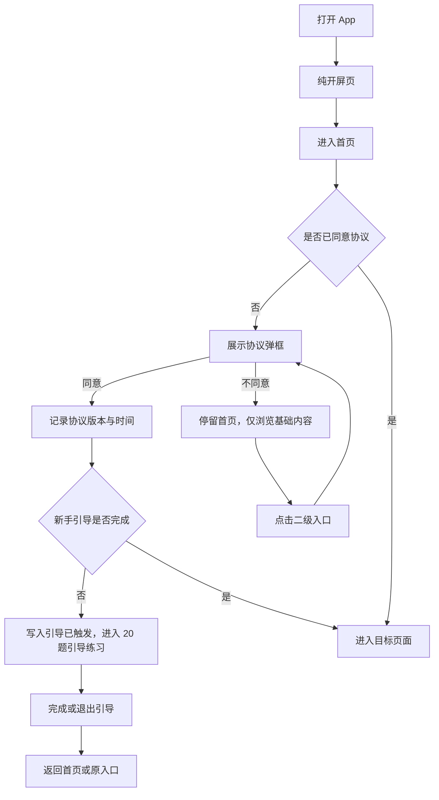
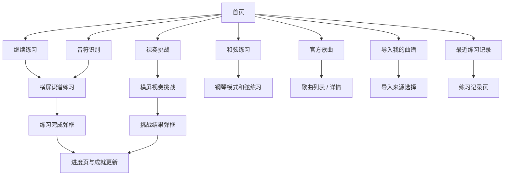
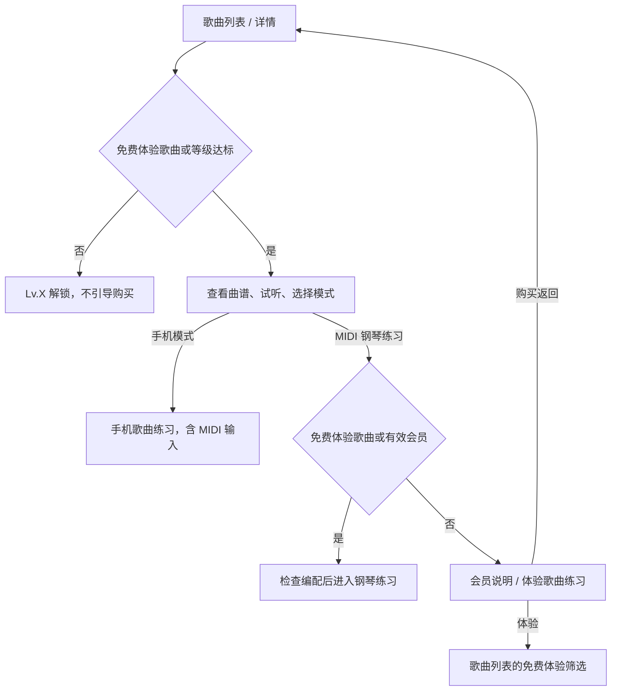
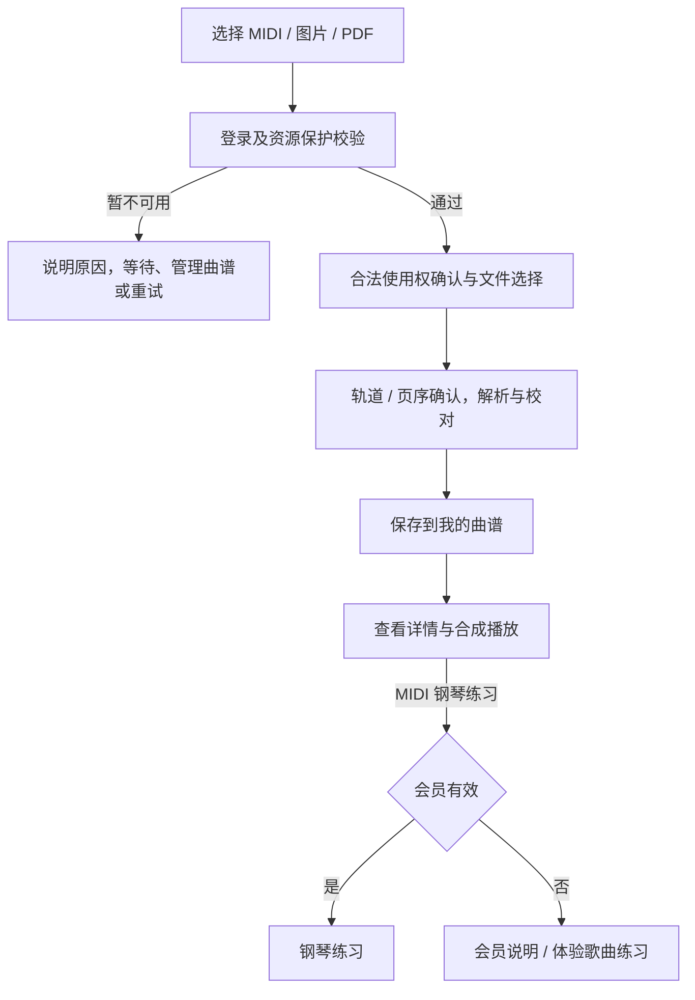
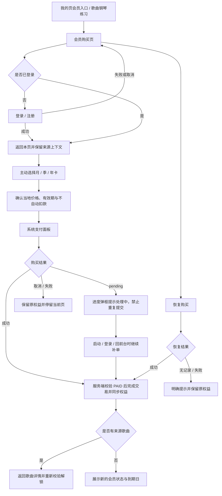
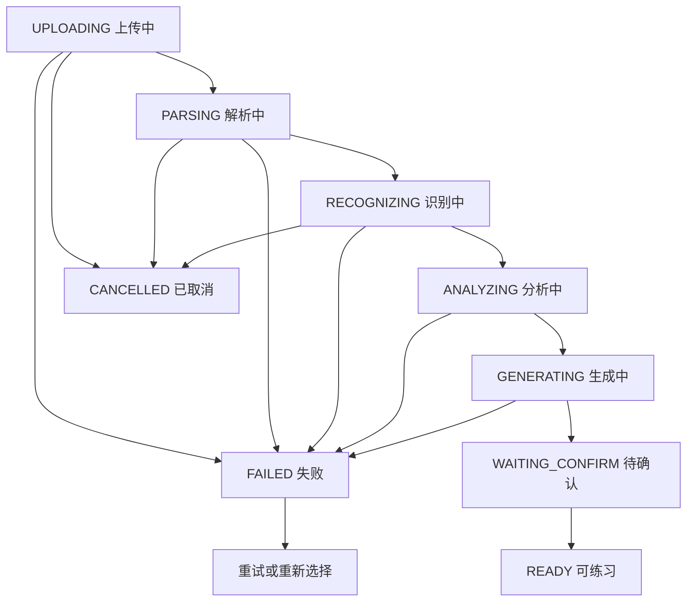

# 钢琴视奏（Solfeggio）产品总纲

> **基线文档**：`doc/product/` 描述线上产品现在的样子，对应线上版本 **v2.1.0**（2026-10-07 迁移时确认）。
> 以后的改动先写进 `doc/versions/vX.Y.Z/changes.md`，版本发布后再合并回这里；不在这里提前写未上线的内容。流程见 MakeCodePlanWord `workflow/00-总流程.md`。
> 下面的「文档版本 / 文档状态 / 本次修订」以及各分册开头的状态行是迁移前的原始信息，保留供追溯，不代表当前状态。

> 文档版本：v2.1（统一基线）｜修订 r4
> 文档状态：`draft`，待产品与设计评审
> 文档结构：本文件是**总纲**；页面级需求与模块专属规则见 `doc/product/` 下的 8 份模块分册（见 0.6 与第 7 章）
> 本次修订（2026-09-28）：歌曲内容、导入与 MIDI 钢琴练习权限分离；收敛页面标签，仅歌曲列表展示免费体验标签。保留现有页面结构及支付商品。
> 覆盖范围：v2.0.0 定稿基线 + v2.0.1 智能曲谱导入 + 工程现存能力补全
> 取代文档：`钢琴视奏 v2.0 产品需求文档`（v2.0.0）、`钢琴视奏 App｜智能曲谱导入与练习生成 PRD`（v2.0.1）
> 阅读方式：本文档可脱离聊天上下文与历史变更单独立阅读，用于需求评审、设计出图与验收对照

---

## 0. 文档说明

### 0.1 为什么重写

此前两份文档分别描述"基础练习 + 歌曲 + 会员"和"智能曲谱导入"两条线，存在三个问题：

1. **拆成两本，看不到全貌**。同一个 App 的练习入口、账号规则、会员边界在两份文档中重复描述，口径分散。
2. **模块缺口**。练习记录、意见反馈、账号注销、钢琴音色包更新、个人曲谱合成播放等已在工程中存在的能力，两份文档均未登记。
3. **口径冲突未收敛**。登录时机、曲谱播放能力、`WAITING_CONFIRM` 是否可跳过等规则在两份文档里描述粒度不同。

v2.1 把全部能力合并为一份文档，按模块组织，逐页展开。

### 0.2 文档基准

- **以产品规划为准**：本文档描述产品应当是什么样子，是需求与验收的唯一来源。
- **工程现状仅用于补全**：通读工程后补齐了此前缺失的模块与页面，但不把代码实现细节写成需求；当代码与本文档冲突时，以本文档为准，冲突项登记到第 13 章。
- **不含技术方案**：不规定架构、模型选型、数据库、接口协议、工时与排期。第 9.6 节的数据来源对照仅用于说明能力边界。

### 0.3 章节导航

| 章节 | 内容 |
| --- | --- |
| 1–3 | 产品概述、版本范围、用户与场景 |
| 4 | 功能地图（全景表，先看这里） |
| 5 | 整体流程（六条主链路） |
| 6 | 信息架构、页面清单、路由对照 |
| 7 | **模块文档索引与页面摘要**（页面细节去分册看；含改动指引） |
| 8 | **跨模块共享规则**（输入模式、播放、实时判定、失败处理、首页数据契约、练习页范式、评分防线）+ 规则归属索引 |
| 9–12 | 数据与同步、视觉、非功能、里程碑 |
| 13–14 | 待确认项、附录 |

### 0.4 术语约定

| 术语 | 含义 |
| --- | --- |
| 识谱练习 / 音符识别 | 看单个音符 → 在键盘上找到对应键的基础练习 |
| 视奏挑战 | 复用识谱练习页的达标模式，用于等级晋级判定 |
| 手机模式 | 屏幕单音键盘 / MIDI，只练右手旋律，不加载大谱表 |
| 钢琴模式 | 外接 MIDI 键盘 + 钢琴大谱表，按同一时间点目标音组判定 |
| 官方歌曲 | 由后台曲库配置、经版权复核后上架的曲目 |
| 个人曲谱 | 用户通过智能导入生成、只属于本账号的曲谱 |
| 学习门槛 | 普通官方歌曲的 `requiredLevel`；和弦阶段不参与歌曲解锁 |
| 练习权限 | `isFreePractice`、歌曲来源、官方等级与会员状态共同决定歌曲钢琴练习权限 |
| 二级页面 | 从首页 / 进度 / 我的继续进入的功能页、设置页、详情页、练习页 |
| 资源保护 | 服务端对文件、存储、并发与频率的统一保护，不是会员权益 |
| 免费体验歌曲 | 可完整体验 MIDI 钢琴练习的配置曲目；不受会员及等级限制 |

### 0.5 本次产品口径调整

- 歌曲与个人曲谱是内容；会员唯一核心权限是普通歌曲的 MIDI 钢琴练习。
- 普通官方歌曲按等级解锁，会员不能跳级；和弦阶段与歌曲解锁独立。
- 免费体验歌曲完整开放；手机歌曲练习（含 MIDI）及基础练习不检查会员。
- 导入、解析、校对、保存、查看与管理不依赖会员。资源保护统一由服务端决定，不作为会员额度或频率权益。
- 到期后保留内容、历史和进度，只重新限制普通歌曲与个人曲谱的钢琴练习。
- 仅歌曲列表给免费体验歌曲贴“免费练习”标签；首页、导入、个人曲谱和详情不贴免费或会员内容标签。导入来源页在选文件前、我的曲谱页在搜索区上方各有一段简短权限说明，告知导入与查看免费、导入曲谱的 MIDI 钢琴练习需会员，并建议先用免费体验歌曲确认设备与体验；具体练习入口仍按权限状态提示。
- 本次不改页面结构、支付商品、后端接口、数据库、算法或免费曲目配置。历史变更记录保留作追溯，不作为现行规则。

### 0.6 文档结构

本产品文档由**一份总纲 + 八份模块分册**组成，目的是让"改一个模块的细节"只需要动一个文件。

```
doc/product/
   ├─ 00-总纲.md                      ← 总纲（本文件）
   ├─ 01-基础框架.md                  G-01 ~ G-05
   ├─ 02-账号与合规.md                A-01 ~ A-09
   ├─ 03-识谱练习与学习体系.md         N-01 ~ N-10
   ├─ 04-和弦练习.md                  C-01
   ├─ 05-官方歌曲.md                  S-01 ~ S-05
   ├─ 06-智能曲谱导入与个人曲谱.md      I-01 ~ I-09
   ├─ 07-会员与支付.md                M-01 ~ M-02
   └─ 08-全局弹框.md                  D-01 ~ D-24
```

**总纲负责**：产品定位与目标、版本范围、用户与场景、功能地图与付费边界、整体流程、信息架构与页面清单、跨模块共享规则、数据与同步、视觉与非功能要求、里程碑、附录。

**分册负责**：本模块的定位与边界、页面清单与路由、关键流程、**页面级详细需求**、**模块专属规则**、模块级验收要点、模块待确认项、变更记录。

**冲突时**：页面与模块专属规则以分册为准；产品范围、功能地图、跨模块规则以总纲为准。

**新增页面的登记顺序**：总纲 6.3 / 6.5 登记 ID 与路由 → 分册写详细需求 → 总纲 7.2 补一行摘要。

---

## 1. 产品概述

### 1.1 产品名称

钢琴视奏 / 钢琴识谱练习（工程代号 Solfeggio）

### 1.2 产品定位

钢琴视奏是一款**五线谱识谱辅助 App**，帮助准备学习、正在学习或读谱较慢的钢琴学习者，用更轻松、不痛苦的方式提升识谱能力，并把识谱能力用到真实曲子的练习和复习中。

它**不是**钢琴游戏，不是完整钢琴课程，不是按单曲交易的曲库商城，不是曲谱社区或网盘，不是制谱 / 编曲软件，也不替代老师和教材。

产品的核心价值分两层：

- **把枯燥的识谱过程拆小**：单音 → 和弦 → 视奏挑战 → 整曲，每一步都有即时反馈和明确进度。
- **把用户手上的曲谱变成可练习的内容**：官方曲库解决"练什么好听"，智能导入解决"练我正在学的那一首"。

> 一句话表达：**你提供曲谱，我帮你把它变成可以练习的钢琴课。**

### 1.3 版本迭代原则

- v2.x 是在 v1.2 现有页面和能力上迭代，不推翻重做。
- 页面可以统一重设计，但**不能遗漏当前已有功能**。
- 会员唯一核心权限是普通官方歌曲和个人曲谱的 MIDI 钢琴练习；音符、视奏、和弦、手机歌曲练习及基础记录不受会员限制。
- 智能曲谱导入、解析、查看和管理不检查会员；个人曲谱的钢琴练习单独检查会员。
- 会员只提供月 / 季 / 年卡，一次付费、到期不自动扣款，不引入自动续费、单曲购买或曲包商城。
- 底部导航固定为"首页 / 进度 / 我的"，任何新能力都不新增一级 Tab。
- 音频（录音 / 麦克风）转乐谱明确排除，不做入口也不做占位。

### 1.4 产品目标

1. 让识谱练习足够轻量：打开 App 后 5 秒内能开始一次有效练习。
2. 让能力成长可见：等级、准确率、平均反应时间、连续天数、成就形成闭环。
3. 让练习内容不受限：官方曲库之外，用户自己的 MIDI / 图片 / PDF 也能进入同一套练习体系。
4. 让识别结果可解释、可修正：不承诺 100% 准确，但每个可疑位置都能被定位和修改。
5. 让付费边界清晰：用户能在购买前看清"付的是什么、多久、会不会自动扣款"。

### 1.5 成功信号

- 用户无需阅读帮助文档就能找到练习入口和导入入口，并区分三类导入来源。
- 新用户首次进入后能自然完成一次新手引导练习并留下首条记录。
- 导入的合法文件能创建任务、离页继续、恢复查看，并最终进入 MIDI 钢琴模式练习。
- 用户能定位并处理全部低可信度问题，不会把未确认的识别结果误当成可练习曲谱。
- 失败状态都能说明原因和下一步动作，且不破坏其他曲谱与练习记录。
- 会员购买、续卡、恢复、到期四个环节没有权益丢失或重复扣费投诉。

---

## 2. 版本范围

### 2.1 本版本包含

| 能力域 | 范围 |
| --- | --- |
| 基础框架 | 启动页、首页、进度页、我的页；三 Tab 导航；隐私协议守卫；新手引导 |
| 账号 | 账号注册 / 登录、iOS Apple 登录、Android Google 登录、游客继续、登出、账号注销、跨设备同步 |
| 识谱练习 | 音符识别练习、视奏挑战、三种输入模式（屏幕 / MIDI / 拾音）、练习设置、音符设置、音效、提醒、MIDI 设备管理 |
| 学习体系 | Lv.1–Lv.10 等级、和弦阶段 `none / basic / inversion`、每日目标、成就与里程碑、练习记录 |
| 和弦练习 | 屏幕琴键 / MIDI 三和弦与转位练习，使用本地题库 |
| 官方歌曲 | 曲库列表、详情、手机模式练习、钢琴模式练习、结果页、后台曲库配置与版权门槛 |
| 智能曲谱导入 | MIDI / 图片 / PDF 导入、校对、个人曲谱；按统一资源保护校验，不按会员限制 |
| 个人曲谱 | 查看、合成播放、重命名与管理不受会员限制；MIDI 钢琴练习检查会员，结果只展示真实统计 |
| 会员与支付 | 会员购买页、月 / 季 / 年非自动续费卡、续卡顺延、恢复购买、补单与订单恢复 |
| 支撑能力 | 帮助中心、意见反馈、关于应用、语言设置、协议 Web 页、钢琴音色包更新 |

### 2.2 本版本不包含

- 音频、录音或麦克风输入转乐谱；麦克风只用于**单音识别**，不参与和弦、复音或歌曲判定。
- 用户间分享、公开发布、个人曲谱进入官方曲库或曲谱商店。
- 专业排版、完整制谱、编曲、转调、移调、打印、MusicXML 导出。
- 手机屏幕单音键盘练习**个人导入曲谱**（导入曲谱只支持 MIDI 钢琴模式）。
- 第三方云盘直连、网页链接抓取、扫描外部曲谱网站。
- 自动续费、免费试用、优惠券、首购折扣、单曲 / 曲包购买、独立订单中心、App 内外部支付。
- 对识谱练习、视奏挑战、和弦练习、进度统计、设置与同步增加会员限制。
- 对个人曲谱的导入、查看、校对、播放与管理增加会员限制；个人歌曲钢琴练习按统一会员规则处理。
- 按导入次数单独计费、购买额度包或加油包。
- 独立练习中心页、独立歌曲 Tab、课程平台式学习计划页。
- 微信登录、手机号验证码登录。
- 技术架构、模型选型、数据库设计、工时与开发计划。

### 2.3 关键产品决策

| 决策项 | 口径 |
| --- | --- |
| 导航 | 固定"首页 / 进度 / 我的"三 Tab；导入、曲谱、练习均为二级页面 |
| 协议守卫 | 未同意协议可浏览首页；进入二级页面或隐私相关能力前再次弹框，不同意则拦截；`/onboarding`、`/`、`/login`、`/web`、`/language_settings` 始终放行 |
| 新手引导 | 首次同意协议后自动进入一次 20 题音符识别练习，题量只对当次生效 |
| 登录时机 | 浏览不登录；同步、歌曲进度、导入建任务、购买会员时要求登录 |
| 输入方式 | 识谱练习支持屏幕 / MIDI / 拾音；和弦与歌曲手机练习支持屏幕 / MIDI；歌曲钢琴练习仅 MIDI |
| 导入来源 | MIDI、图片、PDF 同版纳入；音频明确排除 |
| 导入练习模式 | 个人曲谱只生成 MIDI 钢琴模式练习，不生成手机模式 |
| 后台任务 | 允许离开处理页，任务后台继续，从"我的曲谱"恢复查看 |
| 原始文件 | 最多保存 7 天后自动删除；结构化曲谱持续保存至用户删除 |
| 会员范围 | 普通官方歌曲及个人曲谱的 MIDI 钢琴练习；不解锁官方等级，不限制导入和查看 |
| 导入的定位 | 标记为 `Beta`，识别结果存在不确定性，不承担主要卖点，不做准确率承诺 |
| 资源保护 | 服务端对文件、存储、并发与频率的统一保护，不是会员权益 |
| 资源校验 | 创建前向服务端确认；受限提示原因及恢复方式，不引导购买 |
| 会员到期 | 内容与历史保留，查看、播放及导入不受影响；普通歌曲钢琴练习需重新开通 |
| 会员形态 | 月 / 季 / 年一次性购买，到期不自动扣款；iOS 非续期订阅，Android 预付费订阅 |
| 解锁顺序 | 普通官方歌曲先等级，点击钢琴练习再查会员；免费体验歌曲不受等级与会员限制 |
| 版权 | 官方曲库三项联合门槛（地区 / 来源 / 编配）；个人曲谱由用户确认合法使用权且不可公开传播 |

### 2.4 输入限制（默认值）

以下为设计与异常文案所需的默认上限，需在真实样本验证后复核；调整阈值不改变页面结构。

| 类型 | 默认上限 | 不支持情况 |
| --- | --- | --- |
| MIDI | 单文件 20 MB、最长 30 分钟、最多 64 条轨道 | 损坏文件、无音符事件、超限文件 |
| 图片 | 一次最多 20 张、单张 20 MB；JPG / JPEG / PNG / HEIC | 严重模糊、非曲谱图片、页序无法确认、超限图片 |
| PDF | 单文件 50 MB、最多 50 页 | 加密 / 口令保护、损坏、无可识别曲谱、超限文件 |

---

## 3. 目标用户与核心场景

### 3.1 目标用户

| 用户类型 | 特征 | 主要使用路径 |
| --- | --- | --- |
| 五线谱准备学习者 | 对钢琴有兴趣，尚未建立谱面与键盘的对应关系 | 新手引导 → 音符识别 → Lv.1–3 |
| 正在学习者 | 上课或自学中，觉得识谱枯燥、反馈慢 | 音符识别 + 视奏挑战 + 每日目标 |
| 读谱慢的学习者 | 看得懂但读得慢，练曲卡在认音找键 | 视奏挑战 + 和弦练习 + 歌曲手机模式 |
| 复习曲子的学习者 | 靠肌肉记忆弹会，隔一段时间忘掉 | 官方歌曲 / 个人曲谱 + 分段重练 |
| 有明确曲目目标的用户 | 官方曲库没有他要练的那首 | 智能导入 → 校对 → 钢琴模式练习 |
| 教材 / 作业驱动的学生 | 需要把老师布置的纸质或电子谱转成练习 | 图片 / PDF 导入 → 分手分段提速 |
| 钢琴老师或陪练 | 为学生准备分手、分段、提速材料 | 导入 + 练习方案 + 结果复盘 |
| MIDI 键盘用户 | 有真实键盘，希望获得接近演奏场景的反馈 | 和弦练习 + 钢琴模式 + 实时判定 |

### 3.2 核心场景

1. **首次使用**：开屏 → 首页 → 协议弹框 → 同意 → 20 题新手引导 → 完成弹框 → 回到首页。
2. **日常识谱**：首页"继续练习"或模式卡片 → 横屏练习 → 完成弹框 → 进度页查看趋势。
3. **等级晋级**：首页视奏挑战 → 按等级条件出题 → 挑战结果弹框显示达标 / 差距。
4. **和弦进阶**：连接 MIDI → 和弦练习 → 完成阶段挑战（准确率 ≥ 80%）→ 解锁更高 `requiredChordStage` 的歌曲。
5. **官方歌曲练习**：歌曲列表 → 详情（看学习门槛与访问权益）→ 试听 → 手机 / 钢琴模式 → 结果页。
6. **购买会员**：歌曲钢琴练习入口或首页 / 设置会员入口 → 会员购买页 → 登录 → 选卡 → 系统支付 → 返回来源并刷新权限。
7. **导入 MIDI**：首页导入卡片 → 选择 MIDI → 登录 → 轨道与左右手确认 → 任务处理 → 曲谱检查 → 生成练习。
8. **导入拍照曲谱**：拍摄多张 → 调整页序与裁边 → 识谱 → 按问题清单校对 → 确认 → 练习。
9. **导入 PDF**：选择多页 PDF → 选页面范围 → 处理 → 部分页失败时替换 → 确认整首。
10. **离页恢复**：退出处理页 → 稍后从"我的曲谱"看到完成 / 待校对 / 失败状态并继续。
11. **薄弱点专项（后续）**：基于逐次练习数据识别薄弱片段 → 预填范围的专项练习 → 再次判定；本期先保存明细。
12. **换设备恢复**：新设备登录同一账号 → 恢复购买 → 会员权益、练习记录与个人曲谱同步回来。
13. **账号退出与注销**：我的页 → 账户信息 → 退出登录 / 提交注销申请并查看回执。

### 3.3 用户故事

- 作为新用户，我希望第一次进入就有人告诉我"先选八度、再按这个键"，而不是面对一张空白谱面。
- 作为学习者，我希望知道自己现在是几级、差什么才能升级，而不是只看到一个准确率数字。
- 作为学习者，我希望导入老师发来的 MIDI 就能直接练，而不必等官方上架。
- 作为纸质谱用户，我希望拍照后只处理系统标出的问题，而不是重新录入整首曲子。
- 作为长曲谱用户，我希望离开页面后任务继续，完成后能从列表恢复。
- 作为 MIDI 键盘用户，我希望导入曲谱和官方曲谱使用一致的判定与结果反馈。
- 作为付费用户，我希望清楚知道到期后会发生什么，并且换手机后权益还在。
- 作为内容所有者，我希望删除曲谱时相关文件和练习记录一起删除。

### 3.4 核心痛点

- 教材式识谱练习枯燥、反馈慢，容易放弃。
- 看得懂但读得慢，练曲效率低；靠肌肉记忆几个月后忘得快。
- 单音、和弦、视奏和整曲练习之间缺少自然过渡。
- 手机屏幕不适合双手大谱表和复音输入，需要专门定义轻量模式。
- 官方曲库无法覆盖每个人正在学的教材和老师布置的曲目。
- 手上的 MIDI / 图片 / PDF 只能看和播，进不了分手、分段、变速和实时判定流程。
- 付费规则说不清（价格、有效期、是否自动扣款、到期后权益）会直接劝退下单。

---

## 4. 功能地图

### 4.1 能力全景

| # | 模块 | 子能力 | 是否需登录 | 是否收费 | 对应页面组 |
| --- | --- | --- | --- | --- | --- |
| 1 | 基础框架 | 开屏、三 Tab 导航、协议守卫、新手引导、多语言 | 否 | 免费 | G-01 ~ G-05、A-04、A-05 |
| 2 | 账号体系 | 注册 / 登录、Apple / Google 登录、游客、登出、注销、同步 | 部分 | 免费 | A-01 ~ A-03 |
| 3 | 识谱练习 | 音符识别出题与判定、三种输入模式、即时反馈、完成结算 | 否 | 免费 | N-01、N-02、D-06 ~ D-09 |
| 4 | 视奏挑战 | 按等级条件出题、达标判定、升级结算 | 否 | 免费 | N-03、D-10 |
| 5 | 学习体系 | Lv.1–10 等级、每日目标、连续天数、成就与里程碑 | 否 | 免费 | G-04、N-10 |
| 6 | 练习配置 | 音符范围 / 调号 / 题量、练习偏好、音效、提醒 | 否 | 免费 | N-04 ~ N-07 |
| 7 | 设备管理 | USB / BLE MIDI 扫描与连接、权限流程、钢琴音色包更新 | 否 | 免费 | N-08、D-13 |
| 8 | 练习记录 | 历史记录列表、按类型与日期筛选、单次详情 | 否 | 免费 | N-09 |
| 9 | 和弦练习 | 三和弦与转位出题、目标音组判定、阶段达标 | 否 | 免费 | C-01 |
| 10 | 官方歌曲 | 曲库浏览、筛选、试听、详情、解锁条件展示 | 否 | 部分收费 | S-01、S-02 |
| 11 | 歌曲练习 | 手机模式右手旋律、钢琴模式大谱表、片段强化、结果 | 是（进度同步） | 部分收费 | S-03 ~ S-05 |
| 12 | 智能导入 `Beta` | 来源、预处理、轨道与任务生命周期 | 是 | 不检查会员，仅资源保护 | I-01 ~ I-04 |
| 13 | 识别校对 | 问题定位、单音符编辑、草稿与确认 | 是 | 随导入任务 | I-05 |
| 14 | 个人曲谱 | 曲谱中心、详情、合成播放、练习方案、重命名与删除 | 是 | 免费（已导入内容） | I-06、I-07 |
| 15 | 个人曲谱练习 | MIDI 钢琴模式、分手分段、真实结果统计；薄弱片段分析后续 | 是 | 免费（已导入内容） | I-08、I-09 |
| 16 | 会员与支付 | 权益说明、三档卡、购买、续卡顺延、恢复、补单 | 是 | 付费 | M-01、M-02 |
| 17 | 支撑与合规 | 帮助中心、意见反馈、关于应用、协议 Web 页 | 否 | 免费 | A-06 ~ A-09 |

### 4.2 三条内容来源的对照

| 维度 | 官方歌曲 | 个人曲谱（导入） |
| --- | --- | --- |
| 内容来源 | 后台曲库配置、版权复核后上架 | 用户自有 MIDI / 图片 / PDF |
| 可见范围 | 全体用户 | 仅本账号 |
| 内容访问 | 普通官方歌曲按等级解锁 | 登录后访问自己的曲谱，无等级限制 |
| 钢琴练习 | 免费体验歌曲或有效会员，普通歌曲仍需等级达标 | 有效会员 |
| 资源保护 | 上下架与版权 | 统一资源保护，不按会员区分 |
| 练习模式 | 手机模式 + 钢琴模式 | 仅钢琴模式（MIDI） |
| 试听 / 播放 | 试听片段 | `READY` 后可完整合成播放 |
| 谱面质量 | 人工编配，可信 | 识别结果，需用户校对确认 |
| 分段方案 | 后台配置片段 | 自动生成 4–8 小节分段与提速方案 |
| 删除 | 用户不可删除，后台可下架 | 用户可删除，连同原始文件与记录 |

### 4.3 内容与练习权限矩阵

| 能力 | 非会员 | 有效会员 |
| --- | --- | --- |
| 基础练习、手机歌曲练习（含 MIDI）、基础记录 | 可用 | 可用 |
| 普通官方曲谱播放 | 已发布、版权可用且有可播放音符即可播放，不受等级限制 | 同左 |
| 普通官方内容查看与手机练习 | 按等级解锁 | 同样按等级解锁 |
| MIDI / PDF / 图片导入、解析、校对、保存与管理 | 可用，遵守资源保护 | 同样可用，遵守资源保护 |
| 个人曲谱查看与播放 | 可用 | 可用 |
| 免费体验歌曲完整 MIDI 钢琴练习 | 可用 | 可用 |
| 普通官方歌曲 MIDI 钢琴练习 | 需会员，先达到等级 | 等级达标后可用 |
| 个人曲谱 MIDI 钢琴练习 | 需会员 | 可用 |

会员到期不影响内容、导入与记录。页面不展示这张完整矩阵；仅歌曲列表保留体验歌曲“免费练习”标签，具体钢琴入口按需标注“需会员”。导入不承诺无限后台资源或识别准确率，资源限制不能包装成会员权益。

---

## 5. 整体流程

### 5.1 首次进入与协议守卫



### 5.2 日常练习主路径



### 5.3 官方歌曲解锁与练习



上下架、版权和模式编配可用性始终需要检查；会员不能绕过等级或内容不可用状态。

### 5.4 智能曲谱导入主流程



导入、解析、校对、保存及查看不检查会员；仅开始歌曲钢琴练习时检查会员。

### 5.5 会员购买、续卡与恢复



### 5.6 导入任务生命周期



---

## 6. 信息架构与页面清单

### 6.1 导航原则

- 底部一级导航固定为 **首页 / 进度 / 我的**，不新增一级 Tab、不新增独立练习中心、不新增曲库商城首页。
- **首页**负责发现与快速开始：学习状态、继续练习、四个练习模式入口、导入曲谱入口、最近练习。
- **进度**负责学习反馈：本周概览、每日得分、成就、下一个目标。
- **我的**负责账户与配置：用户卡、会员卡、我的曲谱、练习设置组、账户与帮助组、版本信息。
- 练习页与曲谱校对页为横屏；其余页面为竖屏。
- 导入、曲谱、歌曲、设置全部作为二级页面，受协议守卫保护。

### 6.2 一级导航

| 导航 | 页面 | 承担职责 |
| --- | --- | --- |
| 首页 | G-03 | 学习状态、继续练习、核心训练入口、导入入口、最近记录 |
| 进度 | G-04 | 学习表现、趋势、成就、下一目标 |
| 我的 | G-05 | 账户、会员、我的曲谱、练习设置、设备、帮助、关于 |

### 6.3 页面清单

| ID | 页面 | 类型 | 方向 | 主要入口 |
| --- | --- | --- | --- | --- |
| **G 基础框架** | | | | |
| G-01 | 启动 / 开屏页 | 既有 | 竖屏 | App 启动 |
| G-02 | 主框架与底部导航 | 既有 | 竖屏 | 开屏后 |
| G-03 | 首页 | 既有改版 | 竖屏 | 一级导航 |
| G-04 | 进度页 | 既有 | 竖屏 | 一级导航 |
| G-05 | 我的页 | 既有改版 | 竖屏 | 一级导航 |
| **A 账号与合规** | | | | |
| A-01 | 登录 / 注册页 | 新增 | 竖屏 | 我的页、会员页、导入流程、歌曲同步 |
| A-02 | 账户信息页 | 既有 | 竖屏 | 我的页 |
| A-03 | 账号注销流程 | 新增 | 竖屏 | 账户信息页 |
| A-04 | 协议与隐私弹框 | 既有 | — | 首页、二级页面守卫 |
| A-05 | 语言设置页 | 既有 | 竖屏 | 我的页（协议前也可进入） |
| A-06 | 帮助中心页 | 既有 | 竖屏 | 我的页 |
| A-07 | 意见反馈页 | 新增 | 竖屏 | 我的页、帮助中心 |
| A-08 | 关于应用页 | 既有 | 竖屏 | 我的页 |
| A-09 | 协议 / 隐私 Web 页 | 既有 | 竖屏 | 协议弹框、关于应用 |
| **N 识谱练习与学习体系** | | | | |
| N-01 | 横屏识谱练习页 | 既有核心页 | 横屏 | 首页 |
| N-02 | 新手引导练习状态 | 既有状态 | 横屏 | 首次同意协议 |
| N-03 | 视奏挑战模式 | 既有状态 | 横屏 | 首页 |
| N-04 | 音符设置页 | 既有 | 竖屏 | 我的页、练习页 |
| N-05 | 练习设置页 | 既有 | 竖屏 | 我的页 |
| N-06 | 音效设置页 | 既有 | 竖屏 | 我的页 |
| N-07 | 练习提醒页 | 既有 | 竖屏 | 我的页 |
| N-08 | MIDI 设备页 | 既有 | 竖屏 | 我的页、练习页、和弦练习 |
| N-09 | 练习记录页 | 新增 | 竖屏 | 首页最近练习、进度页 |
| N-10 | 成就列表页 | 既有 | 竖屏 | 进度页 |
| **C 和弦练习** | | | | |
| C-01 | 和弦练习页（钢琴模式） | 新增 | 横屏 | 首页 |
| **S 官方歌曲** | | | | |
| S-01 | 歌曲列表页 | 新增 | 竖屏 | 首页 |
| S-02 | 歌曲详情页 | 新增 | 竖屏 | 歌曲列表 |
| S-03 | 歌曲练习页：手机模式 | 新增 | 横屏 | 歌曲详情 |
| S-04 | 歌曲练习页：钢琴模式 | 新增 | 横屏 | 歌曲详情 |
| S-05 | 歌曲结果页 | 新增 | 竖屏 | 完成歌曲练习 |
| **I 智能曲谱导入与个人曲谱** | | | | |
| I-01 | 导入来源选择页 | 新增 | 竖屏 | 首页导入卡片、我的曲谱 |
| I-02 | 图片 / PDF 准备页 | 新增 | 竖屏 | 来源选择 |
| I-03 | MIDI 轨道选择页 | 新增 | 竖屏 | 来源选择 |
| I-04 | 导入任务进度页 | 新增 | 竖屏 | 创建任务、我的曲谱 |
| I-05 | 曲谱检查页 | 新增核心页 | 横屏优先 | 任务待确认 |
| I-06 | 我的曲谱（个人曲谱中心） | 新增核心页 | 竖屏 | 我的页、首页、任务返回 |
| I-07 | 个人曲谱详情与练习方案 | 新增 | 竖屏 | 曲谱检查、我的曲谱 |
| I-08 | 个人曲谱练习页 | 既有练习页增量 | 横屏 | 曲谱详情 |
| I-09 | 个人曲谱练习结果页 | 既有结果页增量 | 竖屏 | 完成练习 |
| **M 会员与支付** | | | | |
| M-01 | 会员购买页 | 新增 | 竖屏 | 我的页会员入口、歌曲钢琴练习 |
| M-02 | 购买进度与补单弹框 | 新增 | — | 购买 / 恢复 / 启动校验 |

### 6.4 全局弹框清单

> 本表是信息架构层面的清单；每个弹框的结构要点与通用规则见 [product/08-全局弹框.md](08-全局弹框.md)，触发条件见触发它的模块分册。

| ID | 弹框 | 触发位置 | 必须二次确认 |
| --- | --- | --- | --- |
| D-01 | 用户协议与隐私政策 | 首页、二级页面守卫 | — |
| D-02 | 通知权限说明 | 开启练习提醒 | — |
| D-03 | 蓝牙权限说明 | 连接 BLE MIDI | — |
| D-04 | 麦克风权限说明 | 切换拾音输入模式 | — |
| D-05 | 权限失败 / 前往设置 | 权限被拒或永久拒绝 | — |
| D-06 | 练习设置（练习中快捷） | 练习页设置按钮 | — |
| D-07 | 钢琴录音音域说明 | 练习设置弹框内 | — |
| D-08 | 停止练习确认 | 练习 / 挑战退出 | 是 |
| D-09 | 普通练习完成 | 识谱练习结束 | — |
| D-10 | 视奏挑战结果 | 挑战结束 | — |
| D-11 | 编辑昵称 / 编辑邮箱 | 账户信息页 | — |
| D-12 | 退出登录确认 | 账户信息页、我的页 | 是 |
| D-13 | 钢琴音色包更新 | 启动或进入需要音色的练习 | — |
| D-14 | 清除缓存确认 | 我的页 | 是 |
| D-15 | 合法使用权确认 | 选择导入文件前 | 是 |
| D-16 | 取消导入确认 | 任务进度页 | 是 |
| D-17 | 删除曲谱确认 | 我的曲谱、曲谱详情 | 是 |
| D-18 | 未保存校对离开确认 | 曲谱检查页 | 是 |
| D-19 | 文件超限 / 加密 / 损坏 / 无可识别内容 | 导入校验 | — |
| D-20 | MIDI 无明显钢琴轨提示 | MIDI 轨道选择 | — |
| D-21 | 账号注销确认与回执 | 账户信息页 | 是 |
| D-22 | 购买进度 / 补单提示 | 会员购买与恢复 | — |
| D-23 | 导入资源限制提示 | 选定导入来源后额度校验未通过 | — |
| D-24 | 导入频率提示 | 选定导入来源后频率校验未通过 | — |

### 6.5 页面与路由对照

| 页面 ID | 路由名 | 备注 |
| --- | --- | --- |
| G-01 | `onboarding` | 协议守卫放行 |
| G-02 / G-03 / G-04 / G-05 | `main` | 单路由承载三 Tab，守卫放行 |
| A-01 | `login` | 守卫放行；支持 `returningToSong` / `returningToPayment` / `returningToProfile` 回跳上下文 |
| A-02 | `account_info` | |
| A-05 | `language_settings` | 守卫放行 |
| A-06 | `help_center` | |
| A-07 | `feedback` | |
| A-08 | `about_app` | |
| A-09 | `web` | 守卫放行 |
| N-01 / N-02 / N-03 | `practice` | 同一路由，靠参数区分普通 / 引导 / 挑战 |
| N-04 | `note_settings` | |
| N-05 | `practice_settings` | |
| N-06 | `sound_settings` | |
| N-07 | `practice_reminder` | |
| N-08 | `midi_device` | |
| N-09 | `practice_records` | |
| N-10 | `achievements` | |
| C-01 | `chord_practice` | |
| S-01 | `song_list` | |
| S-02 | `song_detail` | 路径含 `songId` |
| S-03 | `song_practice_phone` | |
| S-04 | `song_practice_piano` | |
| S-05 | `song_result` | |
| I-01 | `score_import_source` | |
| I-02 | `score_import_image_preparation` | |
| I-03 | `score_import_midi_tracks` | |
| I-04 | `score_import_progress` | |
| I-05 | `score_import_review` | |
| I-06 | `personal_scores` | |
| I-07 | `personal_score_detail` | |
| I-08 / I-09 | 复用 `song_practice_piano` 与结果页语义 | 以个人曲谱上下文进入 |
| M-01 | `payment` | |
| M-02 | 独立路由承载的进度弹框 | 避免被页面返回打断 |

---

## 7. 模块文档索引与页面摘要

页面级的详细需求已拆分为 8 份**模块分册**，存放在 `doc/product/` 下。本章只保留索引与一句话摘要，用于快速定位；细节以分册为准。

### 7.1 模块分册一览

| 模块 | 代号 | 页面范围 | 分册文件 | 承载的专属规则 |
| --- | --- | --- | --- | --- |
| 基础框架 | `G` | G-01 ~ G-05 | [product/01-基础框架.md](01-基础框架.md) | 协议守卫与新手引导 |
| 账号与合规 | `A` | A-01 ~ A-09 | [product/02-账号与合规.md](02-账号与合规.md) | 账号、权益与登录时机 |
| 识谱练习与学习体系 | `N` | N-01 ~ N-10 | [product/03-识谱练习与学习体系.md](03-识谱练习与学习体系.md) | 等级体系、每日目标与成就 |
| 和弦练习 | `C` | C-01 | [product/04-和弦练习.md](04-和弦练习.md) | 和弦阶段与达标规则 |
| 官方歌曲 | `S` | S-01 ~ S-05 | [product/05-官方歌曲.md](05-官方歌曲.md) | 内容等级与钢琴练习权限 |
| 智能曲谱导入与个人曲谱 | `I` | I-01 ~ I-09 | [product/06-智能曲谱导入与个人曲谱.md](06-智能曲谱导入与个人曲谱.md) | 导入校验、任务状态、轨道与左右手、识别校对、练习生成、**额度**、**频率限制** |
| 会员与支付 | `M` | M-01 ~ M-02 | [product/07-会员与支付.md](07-会员与支付.md) | 会员支付与权益 |
| 全局弹框 | `D` | D-01 ~ D-24 | [product/08-全局弹框.md](08-全局弹框.md) | 弹框通用规则与细则 |

### 7.2 页面一句话摘要

#### 基础框架（G）

| ID | 页面 | 一句话 |
| --- | --- | --- |
| G-01 | 启动 / 开屏页 | 纯品牌开屏，后台完成初始化，不放任何数据与入口 |
| G-02 | 主框架与底部导航 | 三 Tab 容器，保持各 Tab 状态，统一承接协议守卫 |
| G-03 | 首页 | 继续练习 + 学习数据 + 导入入口 + 四个模式入口 + 最近练习 |
| G-04 | 进度页 | 本周概览、每日得分、当前等级与下一目标、成就入口 |
| G-05 | 我的页 | 用户卡、会员卡、我的曲谱卡、练习设置组、账户与帮助组 |

#### 账号与合规（A）

| ID | 页面 | 一句话 |
| --- | --- | --- |
| A-01 | 登录 / 注册页 | 账号 + Apple / Google + 游客，按四类来源上下文回跳并恢复原操作 |
| A-02 | 账户信息页 | 身份、同步状态、学习档案摘要，承载登出与注销入口 |
| A-03 | 账号注销流程 | 自助注销：影响清单 → 二次确认 → 提交 → 可查回执 |
| A-04 | 协议与隐私弹框 | 首次、版本更新或进入二级页面前确认，不同意不强制退出 |
| A-05 | 语言设置页 | 跟随系统 / 简中 / 繁中 / English，协议未同意也可进入 |
| A-06 | 帮助中心页 | FAQ 分类与详情，覆盖 MIDI、权限、会员、导入四类高频阻塞 |
| A-07 | 意见反馈页 | 站内提交问题与建议，明示随附的环境信息 |
| A-08 | 关于应用页 | 版本、协议、隐私、反馈入口 |
| A-09 | 协议 / 隐私 Web 页 | 富文本承接页，协议未同意前也可打开 |

#### 识谱练习与学习体系（N）

| ID | 页面 | 一句话 |
| --- | --- | --- |
| N-01 | 横屏识谱练习页 | 核心练习页，承载普通 / 引导 / 挑战三种形态与三种输入方式 |
| N-02 | 新手引导练习状态 | 首次同意协议后自动进入的 20 题引导，先选八度再找键 |
| N-03 | 视奏挑战模式 | 按等级条件出题的达标判定，准确率与平均时间同时达标即晋级 |
| N-04 | 音符设置页 | 音域、谱号、调号、变音符号、题量等出题范围配置 |
| N-05 | 练习设置页 | 全局练习偏好，作为练习页默认值，不被练习内临时设置覆盖 |
| N-06 | 音效设置页 | 播放音、正误音效、音量、振动 |
| N-07 | 练习提醒页 | 提醒时间与重复日，先解释用途再请求通知权限 |
| N-08 | MIDI 设备页 | USB / BLE 扫描与连接，被和弦、歌曲钢琴模式、个人曲谱共用 |
| N-09 | 练习记录页 | 全类型练习历史，按类型与日期筛选，可一键再练一次 |
| N-10 | 成就列表页 | 成就与累计练习里程碑（5 / 10 / 30 / 50 / 100 / 300 / 1000 次） |

#### 和弦练习（C）

| ID | 页面 | 一句话 |
| --- | --- | --- |
| C-01 | 和弦练习页（钢琴模式） | 屏幕 / MIDI 按目标音组判定，答对才推进，首次准确率 ≥ 80% 即达标 |

#### 官方歌曲（S）

| ID | 页面 | 一句话 |
| --- | --- | --- |
| S-01 | 歌曲列表页 | 浏览、筛选、试听，只展示第一个未满足的解锁条件 |
| S-02 | 歌曲详情页 | 解锁条件、试听、历史成绩、两种练习模式入口 |
| S-03 | 歌曲练习页：手机模式 | 屏幕单音键盘 / MIDI，只练右手旋律，答对才推进，不加载大谱表 |
| S-04 | 歌曲练习页：钢琴模式 | MIDI + 大谱表，按同一时间点目标音组判定 |
| S-05 | 歌曲结果页 | 完成度、准确率、错误小节、复习建议与片段重练 |

#### 智能曲谱导入与个人曲谱（I）

| ID | 页面 | 一句话 |
| --- | --- | --- |
| I-01 | 导入来源选择页 | 三类来源说明与入口，承载登录、额度与频率三道校验 |
| I-02 | 图片 / PDF 准备页 | 页序、裁边、透视与质量预检，确认最终提交的页面 |
| I-03 | MIDI 轨道选择页 | 钢琴轨推荐、多选合并、左右手建议确认 |
| I-04 | 导入任务进度页 | 步骤化进度，可离页继续、恢复查看、取消与重试 |
| I-05 | 曲谱检查页 | 问题定位与单音符编辑，三类来源的必经确认页 |
| I-06 | 我的曲谱 | 个人曲谱与任务的统一管理中心，状态恢复与额度提示 |
| I-07 | 个人曲谱详情与练习方案 | 元信息、合成播放、自动分段与提速方案 |
| I-08 | 个人曲谱练习页 | 播放与练习两种模式；练习仅由 MIDI 判定，错音停线、订正后推进 |
| I-09 | 个人曲谱练习结果页 | 展示真实练习统计并保存逐次明细；薄弱项指导后续提供 |

#### 会员与支付（M）

| ID | 页面 | 一句话 |
| --- | --- | --- |
| M-01 | 会员购买页 | MIDI 钢琴练习说明、现有套餐、当地价格、续卡与恢复 |
| M-02 | 购买进度与补单弹框 | 异步支付链路可视化，独立路由承载，保证不重复扣费不丢订单 |

#### 全局弹框（D）

D-01 ~ D-24 共 24 个弹框，清单见 6.4，结构要点与归属见 [product/08-全局弹框.md](08-全局弹框.md)。

### 7.3 改动指引

| 想改什么 | 改哪个文件 |
| --- | --- |
| 某个页面的结构、交互、状态、验收 | 对应模块分册的「页面级详细需求」 |
| 某个模块专属的业务规则（如导入额度、和弦达标） | 对应模块分册的「模块核心规则」 |
| 某个弹框的结构要点 | `product/08-全局弹框.md` |
| 某个弹框的触发条件 | 触发它的那个模块分册 |
| 输入模式、播放、实时判定、失败处理这四类跨模块规则 | 本文档第 8 章 |
| 产品范围、功能地图、免费付费边界、里程碑 | 本文档第 2、4、12 章 |
| 页面清单、路由、信息架构 | 本文档第 6 章 |
| 视觉、非功能、国际化、可访问性 | 本文档第 10、11 章 |

> 新增页面时：先在本文档 6.3 / 6.5 登记 ID 与路由，再到对应模块分册写详细需求，最后在 7.2 补一行摘要。

---

## 8. 跨模块共享规则

模块专属规则已下放到各模块分册，本章只保留**被多个模块共用**的规则。

### 8.1 规则归属索引

| 规则 | 归属 |
| --- | --- |
| 协议守卫与新手引导 | [基础框架](01-基础框架.md) |
| 账号、权益与登录时机 | [账号与合规](02-账号与合规.md) |
| 等级体系（Lv.1–10） | [识谱练习与学习体系](03-识谱练习与学习体系.md) |
| 每日目标、连续天数与成就 | [识谱练习与学习体系](03-识谱练习与学习体系.md) |
| 和弦练习与阶段达标 | [和弦练习](04-和弦练习.md) |
| 官方歌曲解锁与练习 | [官方歌曲](05-官方歌曲.md) |
| 导入与校验 | [智能曲谱导入与个人曲谱](06-智能曲谱导入与个人曲谱.md) |
| 导入任务状态 | 同上 |
| MIDI 轨道与左右手 | 同上 |
| 曲谱识别与校对 | 同上 |
| 练习生成（分段与提速） | 同上 |
| **导入资源保护** | 同上 |
| **导入频率限制与防刷** | 同上 |
| 会员支付与权益 | [会员与支付](07-会员与支付.md) |
| 弹框通用规则 | [全局弹框](08-全局弹框.md) |
| **输入模式规则** | 本章 8.2 |
| **曲谱播放规则** | 本章 8.3 |
| **MIDI 实时判定规则** | 本章 8.4 |
| **失败处理规则** | 本章 8.5 |
| **首页与二级页面的数据契约** | 本章 8.6 |
| **练习页的两类范式与共性约束** | 本章 8.7 |
| **应用商店评分与差评防线** | 本章 8.8 |
| **曲库列表的本地保底与远端合并** | 本章 8.9 |
| **进入练习前的数据校验** | 本章 8.9 |

### 8.2 输入模式规则

| 场景 | 屏幕键盘 | MIDI | 麦克风拾音 |
| --- | --- | --- | --- |
| 音符识别 / 视奏挑战 | 支持（默认） | 支持 | 支持（仅单音） |
| 和弦练习 | 支持 | 支持 | 不支持 |
| 官方歌曲手机模式 | 支持（单音） | 支持（单音） | 不支持 |
| 官方歌曲钢琴模式 | 不支持 | **仅支持** | 不支持 |
| 个人曲谱练习 | 不支持 | **仅支持** | 不支持 |

- 拾音模式需展示支持音域说明，并明确不识别复音与和弦。
- MIDI 未连接时相关页面必须给出明确状态与一键前往设备页的入口。
- MIDI 中途断开：钢琴练习暂停计时与判定，重连后继续当前目标；和弦与手机练习仍可用屏幕琴键作答。断连取消旧提示计时，恢复可答题后重新计时，不计 Miss。

### 8.3 曲谱播放规则

- 三类来源生成的曲谱进入 `READY` 后均可播放，**不依赖 MIDI 键盘连接**。
- 播放控制至少包括：播放 / 暂停、按时间或小节定位、当前小节显示、播放结束与重新开始。
- 播放速度支持 50%–100% 快捷值与 BPM 40 至原始 BPM 的自定义值。
- 手别支持双手 / 右手独奏 / 左手独奏 / 分别静音；不提供无法解释的自动手别切换。
- 播放设置与练习设置相互独立；只有用户点击开始练习时练习页才采用练习设置。
- 播放缓冲或失败时提供重试；失败不改变 `READY` 状态，也不阻止进入练习。
- 官方歌曲的试听遵循同样的控制语义，但受试听范围限制；已发布、版权可用且有可播放音符即可播放，不受等级和会员限制。

### 8.4 MIDI 实时判定规则

- 歌曲钢琴页（S-04）及复用它的个人曲谱页（I-08）本期采用**播放 / 练习**两个互斥模式。播放真实 MIDI 曲谱，播放线随音频推进，屏幕琴键可单独发声；播放不建立练习会话、不评分、不保存练习数据。
- 练习需显式开始与结束，只接收外接 MIDI 作答；屏幕琴键发声但不计分。播放线跟随当前目标音组；按对键为绿，按错键为红且播放线变红停住，重弹正确后自动前进。
- 练习逐次保存目标、实际 MIDI 音高、正误、作答与反应时间、手别和范围；结算只展示真实统计。基于这些数据的薄弱项与音符识别建议留待后续版本。
- **当前练习模式**：只有目标音组满足后才推进；多弹或错音记录错误但不推进。
- **节奏模式**及 Perfect / Good / Early / Late / Miss / Wrong 时间窗口判定为后续能力，当前 S-04 / I-08 不提供。
- 同一时间点的多音目标按音组整体判断；首版不强制力度一致。
- MIDI 断开时暂停计时与判定，恢复连接后由用户继续，断开期间不计 Miss。
- 本期练习记录至少包括：目标音、实际音、错误类型、响应时间与手别；节奏偏差仅在后续节奏模式实际采集时保存。
- 时间窗口与音组容差阈值需由真实设备验证后确定，本文档不预设数值。

### 8.5 失败处理规则

| 场景 | 提示重点 | 用户动作 |
| --- | --- | --- |
| MIDI 无明显钢琴轨 | 未检测到明显钢琴轨，不代表文件不可用 | 手动选择轨道 |
| MIDI 无音符 / 损坏 | 文件中没有可用音符或无法读取 | 重新选择 |
| 图片模糊 / 裁切不完整 | 标出具体页面与区域 | 重拍、替换、调整裁边 |
| 图片非曲谱 | 当前页面未识别到五线谱 | 删除该页或重新选择 |
| PDF 过大 / 页数过多 | 显示当前值与上限 | 压缩、拆分、重新选择 |
| PDF 加密 / 损坏 | 当前文件无法预览或读取 | 使用未加密文件 |
| PDF 部分页面失败 | 显示失败页码，不丢弃成功页 | 替换页面、移除或重试 |
| 曲谱内容加载失败 | 说明是内容读取失败而非曲谱损坏 | 重试或稍后再看 |
| 网络中断 | 已完成步骤保留到可恢复节点 | 恢复网络后重试 |
| 服务暂不可用 | 不改变已有曲谱与任务数据 | 稍后重试 |
| 保存校对失败 | 明确未保存，阻止确认 | 重试保存或保留草稿 |
| MIDI 设备断开 | 判定已暂停，不计为错误 | 重新连接后继续 |
| 支付校验超时 | 订单已保留，会继续校验 | 稍后查看或联系帮助 |
| 商店无可恢复记录 | 明确说明未找到记录 | 检查账号或联系帮助 |
| 登录失效 | 说明需要重新登录，本地数据保留 | 重新登录后恢复 |
| 导入资源上限 | 说明当前占用情况及限制原因 | 管理曲谱后重试，不引导购买 |
| 导入资源校验超时 | 暂时无法确认资源状态 | 重试；重试前不创建任务 |
| 触达创建频率上限 | 说明是频率限制而非失败，并给出大致可恢复时间 | 等待后重试 / 查看进行中任务 |

---

---

### 8.6 首页与二级页面的数据契约

首页改为「主行动 + 能力入口 + 反馈」三层后，它显示的几乎每样东西都是二级页面的投影。这四条契约定义了**谁负责产出、口径怎么算、失效怎么办**。任何一条没落地，首页都会显示错的或打不开的东西。

#### 契约 1 · 续练点（首页主行动卡的唯一数据来源）

首页主卡要写出「曲名 · 第几段 · 手别 · 速度 · 小节范围」，因此**每个练习页在离开时都必须写回一条统一结构的续练点**，首页只读最近一条。

| 字段 | 说明 |
| --- | --- |
| 来源类型 | 识谱练习 / 视奏挑战 / 和弦练习 / 官方歌曲 / 个人曲谱 |
| 标题 | 曲名，或"音符识别 Lv.4"这类可读名称 |
| 段落与范围 | 段落标识 + 起止小节 |
| 手别、速度 | 右手 / 左手 / 双手；速度百分比或 BPM |
| 完成度 | 该段落的完成百分比 |
| 更新时间 | 用于取"最近一条" |
| 回跳参数 | 足以直接拉起对应练习页的全部参数 |

写回时机：**练习完成、中途退出、从结果页离开，三种情况都要写**。只写完成的那种，会让中途退出的用户第二天打开首页看到更早的内容。

失效与降级（必须实现，否则首页会指向打不开的目标）：

| 失效原因 | 首页表现 |
| --- | --- |
| 个人曲谱已被删除 | 回落为"开始今天的识谱练习" |
| 官方曲目已下架 | 同上 |
| 会员到期导致钢琴练习受限 | 保留续练点，点击时提示会员或体验其他歌曲，不清空内容 |
| 曲谱内容加载失败 | 保留卡片，主按钮触发重试 |
| 从未练习过（新用户） | 显示"从音符识别开始" |

#### 契约 2 · 入口描述下沉

能力入口横排去掉了描述文字，**解释职责下沉到各二级页的首屏**：

| 入口 | 二级页要自己说清楚的事 |
| --- | --- |
| 音符识别 | 首次进入时一行说明：看谱面 → 在键盘上找到对应键 |
| 视奏挑战 | 当前目标等级与达标条件（准确率、平均时间、题量）常驻可见 |
| 和弦练习 | 当前阶段、阶段包含哪些和弦、达标条件常驻可见 |
| 官方歌曲 | 列表顶部一句定位，说明这是识谱的应用场景而非商城 |
| 我的曲谱 | 空状态给出完整价值说明与"导入第一份曲谱" |

#### 契约 3 · 首页摘要的口径

| 首页元素 | 产出方 | 口径 |
| --- | --- | --- |
| 本周表现曲线 | 进度页 G-04 | 近 7 个自然日的准确率；无数据日留空档不补零；不足 3 天不画 |
| 三个数字 | 进度页 G-04 | 今日练习时长、连续打卡天数、平均反应时间 |
| 与上周对比 | 进度页 G-04 | 本周均值减上周均值 |
| 最近任务 2 条 | 练习记录 N-09 | 与记录页同一排序、同一口径，不另算 |
| 我的曲谱 3 份 + 总数 | 我的曲谱 I-06 | 按最近更新排序；待校对的优先露出；总数为已占用名额数 |
| 首页推荐曲目 | 歌曲列表 S-01 | 按内容等级、难度与历史推荐；不按会员给歌曲贴锁，不宣传会员解锁曲目数量 |
| 进行中任务条 | 任务进度 I-04 | 只在存在未完成任务时出现 |

**硬规则：首页任何数字点进去，落地页必须显示同一个数。** 这是最容易出 bug、也最伤信任的地方——首页说"7 份"，点进去只有 5 条，用户会开始怀疑所有数据。

#### 契约 4 · 「为你挑的」建议来源

会员版首页的建议条不能是编的，按优先级取第一条命中的：

1. 上次练习结果页产出的**薄弱片段**（后续能力；当前没有真实分析结果时跳过）。
2. 处于**待校对**状态的导入曲谱。
3. 距离**升级最近**的挑战（只差一项达标时）。
4. 以上都没有 → **不显示这条**。

薄弱片段分析上线后，结果页（S-05、I-09）才把真实分析结果写入首页可读取的队列。本期只有练习明细与真实统计，不根据单次结果编造“音符识别不准”或“不够熟悉”的评价。

---

### 8.7 练习页的两类范式与共性约束

**这些练习页是不同的页面，不得强行统一成一套布局。** 它们只共享少数几条约束，其余按范式分开定义。

#### 四个独立的练习页

| 页面 | 路由 | 范式 | 输入方式 | 谱面形态 |
| --- | --- | --- | --- | --- |
| N-01 识谱练习 / N-03 视奏挑战 | `practice` | 出题式 | 屏幕键盘 / MIDI / 麦克风拾音 | 单个目标音符 |
| C-01 和弦练习 | `chord_practice` | 出题式 | 屏幕琴键 / MIDI | 叠置音符（目标和弦） |
| S-03 歌曲手机模式 | `song_practice_phone` | 跟谱式 | 屏幕单音键盘 / MIDI | 右手旋律单谱表 |
| S-04 歌曲钢琴模式 | `song_practice_piano` | 跟谱式 | **练习仅 MIDI；播放和屏幕琴键可发声** | 钢琴大谱表 + 播放线 |

两处复用关系，仅此两处：

- **识谱练习与视奏挑战是同一个页面的两种形态**，靠路由参数区分（新手引导是第三种形态）。
- **个人曲谱练习（I-08）复用歌曲钢琴模式的页面语义**，差别只在上下文与校对入口。

和弦练习与歌曲练习之间、歌曲手机模式与钢琴模式之间，**没有复用关系**。歌曲练习本身就是按输入方式拆成两个页面的，不要把它们当成同一页的两个状态。

#### 两类范式的根本差别

| 维度 | 出题式（识谱 / 视奏 / 和弦） | 跟谱式（歌曲手机 / 歌曲钢琴 / 个人曲谱） |
| --- | --- | --- |
| 内容单位 | 一道题 | 一份曲谱的一个片段 |
| 推进方式 | 答对推进下一题 | 练习答对当前目标才沿谱面推进；播放随音频推进 |
| 时间概念 | 无时间线，只记录反应时间 | 有小节、速度、播放位置 |
| 进度表达 | 第几题 / 共几题 | 第几小节 / 片段完成度 |
| 谱面职责 | 只呈现当前目标 | 呈现上下文，需要预读 |
| 结束条件 | 题量用尽，或达标判定 | 走完选定片段 |
| 主要设置 | 题量、音域范围、输入模式 | 手别与片段范围预选、播放速度；钢琴页切换播放 / 练习 |

#### 只对出题式成立的规则

- **识谱 / 视奏提示递进规划**：同一题连续答错时逐级加强——第一次只标错 → 第二次高亮正确位置 → 第三次给出音名。和弦练习执行下述统一延时提示规则。
- **达标条件常驻**（视奏挑战、和弦阶段挑战）：目标与当前差距全程可见。
- 没有播放线、没有时间轴，不得引入跟谱式的速度与循环控件。

#### 只对跟谱式成立的规则

- **当前位置保持在屏幕左 1/3**，右侧留预读空间。视奏的本质是提前看到后面要弹什么，摆正中等于砍掉一半预读。
- **歌曲钢琴与个人曲谱的播放、练习必须视觉可分**：播放线随实际播放时间移动；练习线随正确作答移动，答错变红且停在原目标。
- 手别切换、片段循环、速度调整是这一类的常驻控件。
- 与曲谱详情页（S-02 / I-07）的手别与段落标识保持同一套。

#### 和弦、歌曲手机与歌曲钢琴练习的判题与提示

- 三页答错停在当前目标，订正正确才通过；先错后对仍按首次错误计分。手机练习手动跳小节不算通过，随后补练未通过音。
- 开题先展示谱面当前位置与普通琴键标签，不立即高亮目标键。和弦名称始终可见，组成音开题隐藏，随提示延时展示。
- 三页读取既有 `hintDelay`：默认 3 秒，`none` 不预先提示，旧值 `instant` 按最短 3 秒处理，其余按设置延时。换题、重试、暂停、断连、退出取消旧计时；恢复可答题后重新计时。作答后的正误反馈照常显示，播放态按键显示不变。
- 续练保存明确已通过目标与首次错误状态；旧续练点中的位置不能证明音符已通过，仍需补练。完整结果先本机落盘，再按既有队列同步。

#### 真正的共性约束（五条）

以下五条对所有练习页成立，也仅有这五条：

1. **谱面是视觉主体**，顶部控制条与统计区不得挤压它。
2. **练习中弱化统计**：只显示进度（第几题或第几小节）。准确率、平均反应时间、错误数留到结算——练习中盯着准确率既分散注意力又制造焦虑。
3. **不遮挡当前目标**：设置、提示、MIDI 断开、权限说明一律就地显示，**不用盖住谱面的模态框**；反馈位置固定，不每次换地方。
4. **横屏安全区**：刘海侧与 Home 指示条避让，键盘、谱面与浮层不得互相遮挡。
5. **中断与退出**：来电、切后台、设备断开恢复后从中断处继续，并给一个缓冲（倒数或"准备好了点继续"），不要一回来就判定；退出时写回续练点（见 8.6 契约 1）。

横屏练习页**不适用**主文档 10.4 的卡片、阴影与圆角规范。

---

### 8.8 应用商店评分与差评防线

自然曝光依赖商店排名，排名又受评分影响——**评分本身就是增长资产**，早期尤其。本节定义全站统一的评分保护做法。

#### 差评防线（按有效性排序）

| # | 做法 | 为什么有效 |
| --- | --- | --- |
| 1 | **用命名做期望管理**：不确定性高的能力标 `Beta` | 无法被跳过，出现在每个入口，且用户对 Beta 的容忍度天然高一档。**作用大于任何免责文案** |
| 2 | **付费前可预验**：导入、查看和播放不检查会员，体验歌曲提供完整钢琴练习 | 用户可以了解解析结果与练习体验，再决定是否开通会员 |
| 3 | **系统先于用户承认问题** | 结果不理想时由系统主动说明并给出出路，发生在问题当下。系统先认错，用户就不觉得被骗 |
| 4 | **给不满一个比商店更近的出口** | 在问题发生的场景内直达意见反馈，预填上下文。App 内有宣泄口，用户大概率不去商店写评价 |
| 5 | **控制评分请求时机**（见下） | 在正确的时刻请求，能拉高好评基数 |

**免责声明不在这个列表里**。它防的是"我被骗了"，防不住"这东西不好用"：没人读购买流程里的小字，读了也不会改变拿到坏结果时的情绪，而写得太重还会压转化。免责说明该写，但它是法律与期望的底线，**不是差评的防线**；写法上要做成"帮用户选"的实用信息，不是法务腔的责任切割。

#### 评分请求时机

系统级评分请求每年可用次数有限，必须用在刀刃上。

**可以请求**（用户刚获得正反馈时）：

- 刚完成一次高准确率的练习。
- 刚完成等级晋级或和弦阶段达标。
- 连续打卡达到里程碑（7 天及以上）。
- 一次导入任务顺利完成且用户已开始练习。

**禁止请求**：

- 导入失败、识别质量差、校对问题数超阈值之后。
- 支付失败、`pending`、恢复购买无记录之后。
- MIDI 连接失败或中途断开之后。
- 任何一次练习中途异常退出之后。

同一用户的请求间隔不少于 60 天，且单个版本周期内不超过 2 次。

---

### 8.9 曲谱详情与练习入口的统一规则

官方歌曲（S 模块）与个人曲谱（I 模块）走两条独立的详情页，但最终推向同一批练习页（S-04 / I-08 复用同一套钢琴模式骨架，见 8.7）。这条汇合点必须遵守同一套规则，否则两边会各自演化出不一致的体验。

#### 曲库列表：本地保底与远端的关系是"合并"，不是"替换"

- 内置曲库（随包发布）用于首次打开与无网络时兜底展示，这一点已经做对。
- **远端曲库返回后，不能整体替换本地列表**——只在同一曲目 ID 上用远端数据覆盖本地字段；远端列表里没有但本地存在的曲目，继续保留展示，直到远端明确返回"该曲目已下架"。
- 这条只对**曲目基础信息与曲库列表**成立。单曲的编配详情与谱面数据本来就已经是合并逻辑（远端元数据 + 本地谱面兜底），不用改。

#### 进入练习前必须校验，两个模块用同一条判定

**任何一次"开始 / 继续练习"，在真正跳转到练习页之前，必须确认将要使用的谱面数据完整可用**——不是"曲目或曲谱记录存在"就够了，而是练习页真正要读的谱面内容本身非空、可解析。

- 校验不通过时，命中「失败处理规则」（8.5）里的"曲谱内容加载失败"一行：说明是内容读取失败而非曲谱本身有问题，提供重试；重试前停留在详情页，不跳转到练习页。
- 谱面内容缺失但按理"应该有"时，先尝试重新拉取一次，仍然拿不到才判定为失败——不能因为一次网络抖动就把用户拦在门外，也不能因为拿不到就悄悄放行一份空谱面。
- 这一条对官方歌曲与个人曲谱同等适用，**不允许一边有校验、一边没有**。

#### 详情页呈现可以不同，但"能不能开始练习"的判定必须共用一处

- 官方普通歌曲需先达到等级；个人曲谱没有等级门槛。两者的普通歌曲钢琴练习都检查会员，内容查看和手机模式不因会员受限。
- 但两者共同拥有的最后一步——"谱面数据是否已经就绪，能不能安全进入练习"——判断标准必须完全一致，不能两个模块各写一份、各自决定什么算"就绪"。

---

## 9. 内容、数据与同步

### 9.1 官方曲库配置字段

| 字段 | 说明 |
| --- | --- |
| `songId` | 曲目唯一标识 |
| `title` | 曲名 |
| `composer` / `source` | 作曲者或来源 |
| `level` | 推荐等级 |
| `difficulty` | 难度 |
| `keySignature` | 调号 |
| `timeSignature` | 拍号 |
| `bpm` | 原始速度 |
| `requiredLevel` | 普通官方歌曲的内容等级；免费体验歌曲不受此限制 |
| `requiredChordStage` | 兼容学习信息，不参与歌曲权限 |
| `accessTier` | 保留现有兼容字段，映射 `isFreePractice`；不代表内容需付费 |
| `previewAvailable` | 内容可访问后的试听配置，不以会员锁定试听 |
| `phoneModeAvailable` | 是否支持手机右手练习 |
| `pianoModeAvailable` | 是否支持钢琴大谱表练习 |
| `arrangementVersion` | 编配版本 |
| `movementKey` / `movementIndex` / `movementTitle` | 分段或乐章标识 |
| `copyrightStatus` | 授权 / 公共领域 / 原创 / 待复核 |
| `rightsTerritories` | 已完成复核并允许发布的地区范围 |
| `rightsReviewRecord` | 来源、地区、编配复核记录；缺失时不得上架 |
| `onlineStatus` | 上架 / 下架 / 草稿 |

### 9.2 初始曲库候选

| 曲目 | 建议用途 | 版权处理 |
| --- | --- | --- |
| 小星星 | **固定免费**入门五音 / 八度练习 | 公共领域旋律自制编配 |
| 欢乐颂 | **固定免费**入门旋律 | 自制简化编配 |
| G 大调小步舞曲 | **固定免费**古典入门 | 常被误标为巴赫，按佩措尔德来源复核 |
| 生日快乐歌 | 入门旋律、右手手机模式 | 公共领域背景需按地区与编配复核 |
| 献给爱丽丝 | 经典片段、钢琴模式 | 公共领域原作片段自制编配 |
| C 大调前奏曲 BWV 846 | 双手入门 / 分解和弦 | 公共领域原作片段自制编配 |
| 土耳其进行曲片段 | 中级片段 | 公共领域原作片段自制编配 |
| 绿袖子 | 民谣旋律 | 公共领域旋律自制编配 |
| 奇异恩典 | 民谣旋律 | 公共领域旋律自制编配 |
| 铃儿响叮当 | 入门节奏 / 节日曲 | 公共领域旋律自制编配 |
| D 大调卡农片段 | 分解和弦 / 伴奏感 | 公共领域原作片段自制编配 |

**候选名单不等于发布批准。**

### 9.3 版权边界

- 官方曲库只使用授权曲目、公共领域曲目、原创练习曲或自制教学编配。
- 不直接复制现代乐谱平台、教材、付费曲库、现代编曲、排版图片或录音资源。
- 上线是三项联合门槛：**目标地区、作品 / 素材来源、实际编配版本**均完成复核并留下记录；任一项缺失不得上线。
- 后台必须保留版权状态、地区范围、来源说明、编配版本、复核记录与下架能力；会员或免费标记不能覆盖版权门槛。
- 个人曲谱由用户确认合法使用权，仅供个人学习，不提供分享、公开发布或进入官方曲库的能力。

### 9.4 个人曲谱数据对象

个人曲谱的字段定义（曲谱摘要、识别与校对信息、练习信息、内容存放形态）属于导入模块的专属数据，见 [product/06-智能曲谱导入与个人曲谱.md](06-智能曲谱导入与个人曲谱.md) 的「数据与保存」。

要点复述：结构化曲谱结果分内联与外部存储两种形态，大结果只返回内容标识，客户端凭限时读取票据获取并以摘要校验完整性；用户侧只感知"曲谱加载中 / 加载失败可重试"。

### 9.5 保存与同步

- 跟随账号同步：用户资料、登录状态、协议确认版本、新手引导完成状态、当前等级、和弦阶段、练习记录、准确率与平均时间、成就与连续天数、每日统计、歌曲解锁状态与进度、用户设置（音符范围、练习偏好、音效、提醒、语言）、会员卡种与状态与到期时间与来源平台、最近一次购买状态、购买绑定账号与最后一次权益校准结果、个人曲谱已占用名额数与当前额度上限。
- 同步：结构化个人曲谱、用户修正、练习方案与练习进度。
- **原始 MIDI / 图片 / PDF 仅用于处理与重新识别，最多保存 7 天后自动删除。**
- 原始文件删除后，已确认的结构化曲谱仍可继续练习；需要重新识别时要求用户重新上传。
- 用户删除曲谱时，同步删除结构化曲谱、原始文件、处理产物、修正与练习记录，且不可恢复。
- 离线时可进行基础练习并记录在本地，联网后合并同步；离线不允许发起新购买与新导入任务。
- 最近一次购买状态仅用于展示购买反馈，不代替商店与服务端校准后的会员权益状态。

### 9.6 数据来源对照（用于说明能力边界，不作为接口约定）

| 能力 | 数据来源 |
| --- | --- |
| 学习总览、练习记录同步、偏好同步 | 学习域接口 |
| 官方曲库列表、详情、编配 | 曲库域接口 |
| 歌曲练习会话（开始 / 更新 / 完成） | 歌曲练习域接口 |
| 和弦练习会话与答题 | 本地题库与判题，逐次尝试及完成记录进入既有同步队列 |
| 会员商品、订单创建 / 确认 / 取消、订单列表、会员状态 | 支付域接口 |
| 导入资源秒传与直传、任务创建 / 查询 / 取消 / 重试 / 校对 / 确认 | 导入域接口 |
| 个人曲谱列表、详情、删除、内容读取票据 | 个人曲谱域接口 |
| 导入额度与创建频率的校验与计数 | 导入域接口（服务端为准，客户端不自行放行） |
| 钢琴音色包清单 | 资源域接口 |
| 账号注册 / 登录 / 第三方登录 / 刷新 / 游客会话 / 注销申请 | 账号域接口 |

### 9.7 隐私与合规

- 选择文件前说明上传范围、处理方式、保存期限与删除方式。
- 用户确认拥有合法使用权，且只用于个人学习。
- 图片与 PDF 可能包含姓名、批注等个人信息，页面提示用户在上传前自行遮挡不必要信息。
- 用户删除后，列表与所有可访问入口不再显示该曲谱；后台清理时限需与隐私政策保持一致。
- 权限申请统一"先解释用途、再请求系统权限"；被永久拒绝时提供前往系统设置的引导。
- 账号注销提供自助入口，影响范围、是否可撤销与生效时间在提交前可见。
- 意见反馈随附的环境信息必须在页面上明示。

### 9.8 曲谱内容的运行时数据格式（grandStaff，v1）

官方歌曲的编排（`SongArrangement.sheetJson`）与个人曲谱的识别结果（`PersonalScore.score`）最终是同一种数据——喂给播放与判定引擎的谱面 JSON。这套格式此前没有正式定义，不同来源各自输出，解析端只能靠猜多个别名兼容；本节把它定版。

#### 顶层结构

| 字段 | 说明 |
| --- | --- |
| `version` | 格式版本号，当前为 `1`。历史内容缺失此字段按 `0`（旧格式）处理，见下方迁移说明 |
| `timeSignature` | `{ numerator, denominator }` |
| `measureBeats` | 按小节号覆盖拍数的稀疏表，用于不完全小节（弱起）与变拍 |
| `tempoMap` | 速度变化点列表：`{ beat, bpm }` |
| `dynamicsEvents` | 力度包络事件（仅用于合成播放的表现力，不参与判定）：`{ beat, hand, velocity }` |
| `grandStaff` | 音符组列表，是本格式的主体，见下 |
| `sourceMusicXmlAssetPath` | 可选，来源 MusicXML 文件的引用路径，**仅供参考与未来重新生成使用，运行时不读取** |

#### `grandStaff` 音符组

每个元素是同一拍点上一起处理的一组音符（可以是单音，也可以是和弦）：

| 字段 | 说明 |
| --- | --- |
| `id` | 组的稳定标识，建议格式 `m{小节}_b{拍位}`，用于校对高亮与结果页定位薄弱片段 |
| `measure` | 小节号，从 1 开始 |
| `beat` | 组在小节内的起始拍位 |
| `notes` | 该组包含的音符列表，见下 |

#### 单个音符

| 字段 | 说明 |
| --- | --- |
| `midi` | **权威字段**，MIDI 音高（0–127 整数） |
| `hand` | `left` / `right` |
| `duration` | 时值，单位为拍 |
| `beatOffset` | 组内的精细拍位偏移，用于同组内不完全同时的起音（装饰音、琶音） |
| `tie` | 是否连音，连音不重复计入判定的下一次起音 |
| `velocity` | 力度，1–127，缺省 80 |
| `articulations` | 演奏法标记数组，如 `staccato`、`accent`，缺省空数组 |

**不再保留的写法**：音符列表曾出现 `targetNotes` / `pitches` / `chord` / `group` 等别名，统一收敛为 `notes`；拍位曾出现 `startBeat` / `position`，统一收敛为 `beat`；音高可以只给音名 `label`（如 `"C4"`）而没有 `midi`。v1 里 `label` 只作展示用，由 `midi` 反推生成，不再作为输入来源。

#### 适用范围

本格式只覆盖**跟谱式**内容：官方歌曲（S-03 / S-04）与个人曲谱（I-07 / I-08）。识谱练习、视奏挑战、和弦练习是出题式，每次只需要一个目标音或目标和弦，不整份曲谱化，沿用各自现有的轻量目标结构（见 8.7）。

#### 迁移

- 已有内容视为 `version: 0`（缺省即 0），解析器按 v0 规则用旧的多别名兼容逻辑处理，不需要批量重新生成官方曲库或用户已导入的曲谱。
- 新产出的内容（新曲目上线、新的导入识别结果）一律按 v1 输出。
- `sourceMusicXmlAssetPath` 若存在，只用于核对或未来重新生成 `grandStaff`；任何情况下都不作为运行时读取谱面的入口。

---

## 10. 视觉与交互要求

### 10.1 总体风格

- 简约、轻盈、低干扰；延续现有产品气质。
- 毛玻璃用于顶部控制区、状态浮层、结果弹框、权限弹框与设置浮层。
- **谱面、键盘、问题定位与练习反馈的优先级高于任何装饰效果**；毛玻璃不得遮挡关键音符。
- 动效用于答对、答错、连续错误、完成、解锁与切换片段；要轻、短、明确。

### 10.2 一致性要求

- 三类导入来源必须通过标题、图形与格式文字共同区分，不只依赖颜色。
- 长任务使用步骤列表、已完成项与当前动作；百分比只作辅助。
- 低可信度与警告同时使用颜色、图标、文字与问题列表。
- 主动作在长页面中保持稳定位置；取消、删除、放弃使用低优先级样式并二次确认。
- 横屏谱面校对与练习需保留安全区；键盘、谱面与浮层不得互相遮挡。
- 空状态必须给出下一步动作，不只显示"暂无数据"。

### 10.3 明确禁止

- 任何页面不得出现音频转乐谱入口、波形、麦克风图标（拾音识别设置除外）或"即将支持"占位。
- 会员页不得使用倒计时、伪紧迫性、隐藏关闭按钮或诱导点击。
- 个人曲谱不出现整张内容的会员锁；会员提示仅在歌曲 MIDI 钢琴练习入口出现，新建导入不引导购买。
- “免费练习”标签仅用于歌曲列表体验歌曲；其他页面不贴免费标签、不反复宣传免费。导入来源页与我的曲谱页各保留一段必要的练习权限说明，使用次要正文，不做标签或权益面板。
- 不得在页面常态展示剩余导入额度倒数（如"还剩 998 份"），只在触达上限时提示。
- 处理页不得只显示"Loading"或单一百分比。
- 不得宣传识别"100% 准确"。

---

### 10.4 版式体系（首页确立，二级页面遵守）

首页改版确立了一套版式规则，二级页面沿用，避免每个页面各长一套。

| 规则 | 口径 |
| --- | --- |
| 渐变 | 只用于**当前页面的主行动**，每屏最多一处。二级页的主按钮可用同一条渐变，其余元素全部白底或描边 |
| 卡片层级 | 只有两级：内容卡（白底 + 柔和阴影 + 20 圆角）、条目卡（白底 + 更轻阴影 + 16 圆角）。不设第三级 |
| 圆角 | 大卡 20–22、条目卡 16、小元素 10–12。不再出现四种混用 |
| 次要文字 | 统一使用满足 4.5:1 的灰色起步，不使用更浅的灰紫 |
| 章节标题 | 16px / 700 + 右侧"查看全部 ›"，全站一致 |
| 五线谱母题 | 主行动卡背景、曲谱缩略图、空状态插画统一使用五线谱纹理，作为全站音乐属性的视觉载体 |
| 曲谱缩略图 | 官方曲目与个人曲谱的卡片都使用真实谱面渲染的缩略图，不用通用图标占位 |
| 数据展示 | 同一屏内不重复展示同一个指标；趋势优先于并排大数字 |
| 横屏练习页 | **不适用**卡片体系。谱面与判定反馈优先，不加装饰性容器与阴影 |

---

## 11. 非功能要求

### 11.1 可理解性

- 所有失败信息包含**原因、受影响对象、下一步动作**三要素。
- 识别准确性使用可信度与可修正表达。
- 弹框内容简短，按钮语义明确。

### 11.2 性能目标

以下为产品体验目标，需技术评估与真实样本验证：

- 文件选择后的格式 / 上限校验在 2 秒内给出结果。
- 常规 10 MB、10 分钟内 MIDI 的目标处理时间不超过 60 秒。
- 10 张清晰图片的目标处理时间不超过 5 分钟。
- 20 页 PDF 的目标处理时间不超过 10 分钟。
- 超过 10 秒的任务必须支持离页继续与状态恢复。
- 练习页面的输入到反馈延迟需低到不影响节奏判定（具体阈值由真机验证确定）。

### 11.3 稳定性与一致性

- 重试同一任务不得生成重复曲谱。
- 任务失败、取消或网络中断不得破坏已有个人曲谱与练习记录。
- 列表、详情、进度与结果中的状态与进度必须一致。
- 支付补单不得重复扣费或重复发放权益。
- 切换账号后不得出现上一账号的曲谱、记录或订单。

### 11.4 可访问性

- 状态不只依赖颜色。
- 主要按钮、问题列表与编辑控件具备清晰可读标签。
- 进度变化可被辅助技术读取，但不因高频刷新造成连续打断。
- 文字缩放后不遮挡确认、保存、取消等关键动作。

### 11.5 国际化

- 支持跟随系统、简体中文、繁体中文、English。
- 格式、文件大小、日期、时长与 BPM 展示可本地化。
- 曲名与作曲者允许多语言字符。
- 文件名过长时保留扩展名与可辨识前缀，不溢出布局。

### 11.6 离线与网络

- 离线可进行识谱练习、视奏挑战与和弦练习；和弦可用屏幕琴键或已连接的 MIDI。记录保存在本地并在联网后同步。
- 离线不允许发起新购买与新导入任务，并给出明确说明。
- 离线时已缓存的曲谱与曲库信息可浏览，但标注为缓存数据。

---

## 12. 里程碑与优先级

本章表达产品交付顺序，不是研发工时计划。

### 12.1 P0：必须形成闭环

- 基础框架：开屏、三 Tab、协议守卫、新手引导。
- 账号：注册 / 登录、Apple / Google 登录、游客、登出、四类来源回跳。
- 识谱练习：出题、三种输入模式、判定、完成结算、练习设置与音符设置。
- 学习体系：Lv.1–10 等级、视奏挑战达标、每日目标、连续天数。
- 和弦练习：`basic` / `inversion` 阶段与 80% 达标规则。
- 官方歌曲：列表、详情、手机模式、钢琴模式、结果页；等级内容与钢琴会员权限分离。
- 会员：购买页、月 / 季 / 年非自动续费、续卡顺延、恢复购买、补单与订单恢复。
- 智能导入：三类来源、任务生命周期、曲谱检查、个人曲谱中心、曲谱详情与播放、钢琴模式练习、真实结果统计；薄弱片段分析后续上线。
- 导入资源保护：统一资源、文件、并发与频率保护，不按会员区分，不提供购买解除限制入口。
- 导入创建频率限制：并发、每小时、每日三层阈值，服务端计数、后台可配置、触达时的非失败式提示。
- 删除、取消、失败重试、合法使用权确认与原始文件保存说明。
- 合规：协议弹框、权限链路、账号注销、意见反馈。
- 明确排除音频，不出现任何音频入口。

### 12.2 P1：同版本完善项

- 练习记录的筛选与单次详情增强。
- MIDI 轨道试听与更清晰的多轨摘要。
- 部分失败页面替换而非整份重新上传。
- 问题列表批量确认、撤销与草稿恢复。
- 任务完成 / 失败的系统通知（需用户授权）。
- 更细的难度解释与自动练习建议说明。
- 成就列表视觉优化、歌曲片段强化、歌曲结果错误分析增强。
- 钢琴音色包的增量更新与失败重试体验。

### 12.3 P2：后续评估

- 上传曲谱与 AI 曲谱的更多能力扩展。
- 拾音模式复杂和弦识别。
- 个人曲谱的手机模式练习。

### 12.4 产品验收顺序

1. 基础框架、协议守卫、新手引导与账号体系。
2. 识谱练习、等级体系、视奏挑战与练习记录。
3. 和弦练习与阶段达标。
4. 官方歌曲端到端（解锁 → 练习 → 结果）。
5. 会员购买、续卡、恢复与补单。
6. MIDI 导入端到端。
7. 图片导入端到端（含校对）。
8. PDF 多页、部分失败与校对。
9. 三类输入的任务恢复、删除、隐私与无障碍检查。

---

## 13. 待确认项

以下项目不阻止本文档进入评审，但需在设计定稿或上线前确认。各模块分册的末尾也各自维护了一份本模块的待确认项，本表是汇总视图：

| # | 待确认 | 影响 |
| --- | --- | --- |
| 1 | 输入上限是否采用 MIDI 20 MB / 30 分钟 / 64 轨、图片 20 张 / 单张 20 MB、PDF 50 MB / 50 页 | 异常文案与预检逻辑 |
| 2 | 原始文件 7 天自动删除是否满足重新识别与客服排障需要 | 隐私政策与重识别体验 |
| 3 | 任务完成 / 失败是否在首版提供系统通知，还是只做站内状态 | 通知权限链路 |
| 4 | 曲谱检查是否默认横屏，竖屏仅展示问题列表，或需要完整竖屏编辑布局 | I-05 设计稿数量 |
| 5 | 低 / 中可信度阈值、节奏判定时间窗口与音组容差，需真实样本与真机验证 | 判定口径与文案 |
| 6 | 普通练习累计晋级的信用阈值与进度展示分母是否对用户可见、如何解释 | G-04 与 D-09 文案 |
| 7 | 账号注销是否设置冷静期、是否支持生效前撤销 | A-03 文案与合规 |
| 8 | 意见反馈是否需要附件上传与工单回复查看 | A-07 范围 |
| 9 | 钢琴音色包是否强制更新、更新失败时是否降级为基础音色 | D-13 规则 |
| 10 | 统一资源保护是否需要额外总存储限制 | I-06 与后台资源策略 |
| 12 | 统一资源保护阈值的配置与恢复提示 | 后台配置项 |
| 13 | 统一并发与频率阈值是否需要按实际用量调整 | 导入分册 5.7 |
| 15 | 游客在 iOS 上主动建立游客会话购买后的权益归属与转移策略 | M-01 与账号绑定规则 |
| 16 | 练习记录是否保留全部历史或按时间窗口归档 | N-09 分页与同步 |

---

## 14. 附录

### 14.1 状态枚举汇总

| 域 | 枚举 |
| --- | --- |
| 导入任务 | `UPLOADING` / `PARSING` / `RECOGNIZING` / `ANALYZING` / `GENERATING` / `WAITING_CONFIRM` / `READY` / `FAILED` / `CANCELLED` |
| 曲谱来源 | `MIDI` / `IMAGE` / `PDF` |
| 和弦阶段 | `none` / `basic` / `inversion` |
| 歌曲访问层 | `free` / `membership` |
| 会员状态 | `free` / `active` / `expired` |
| 会员卡种 | `monthly` / `quarterly` / `annual` |
| 购买状态 | `pending` / `success` / `cancelled` / `failed` |
| 练习输入模式 | 屏幕键盘 / MIDI / 麦克风拾音 |
| 练习手别 | 双手 / 右手 / 左手 |
| 节奏判定 | Perfect / Good / Early / Late / Miss / Wrong |
| 等级 | Lv.1 – Lv.10 |
| 导入额度占用 | 占用（`UPLOADING` ~ `READY`）/ 不占用（`FAILED`、`CANCELLED`） |
| 导入频率闸门 | 并发上限 / 每小时上限 / 每自然日上限 |

### 14.2 速度与范围常量

| 项 | 取值 |
| --- | --- |
| 快捷速度百分比 | 50% / 60% / 70% / 80% / 90% / 100% |
| 自定义 BPM 范围 | 40 至原始 BPM |
| 默认练习段落长度 | 4–8 小节（乐句结构优先） |
| 新手引导题量 | 20 题（仅当次生效） |
| 每日目标 | 3 次有效练习 |
| 里程碑阶梯 | 5 / 10 / 30 / 50 / 100 / 300 / 1000 次 |
| 和弦阶段达标准确率 | ≥ 80% |
| 会员基准价 | 月 `$2.99` / 季 `$6.99` / 年 `$19.99` |
| 个人曲谱资源上限 | 沿用服务端资源保护策略，不按会员区分 |
| 导入并发上限 | 沿用服务端统一配置，与会员无关 |
| 导入每小时上限 | 沿用服务端统一配置，与会员无关 |
| 导入每日上限 | 沿用服务端统一配置，与会员无关 |
| 原始文件保留 | 最多 7 天 |

### 14.3 与旧文档的对应关系

| 旧文档 | 对应本文档 |
| --- | --- |
| v2.0.0 第 1–5 章 | 第 1–6 章（已合并智能导入内容） |
| v2.0.0 第 6 章页面 6.1–6.31 | 分册 01 / 02 / 03 / 08 |
| v2.0.0 第 6 章页面 6.32–6.39 | 分册 04 / 05 / 07 |
| v2.0.0 第 7–12 章 | 第 8–12 章 |
| v2.0.1 第 6 章 IMP-01 ~ IMP-11 | 分册 06（I-01 ~ I-09）及分册 01 的 G-03 / G-05 入口增量 |
| v2.0.1 第 7–12 章 | 分册 06 的模块核心规则，以及本文档第 8、9、11、12 章 |
| 本文档 7.A ~ 7.H、8.1 ~ 8.3、8.5 ~ 8.11、8.14 ~ 8.17（r2 编号） | 已下放到 `doc/product/` 的八份模块分册，见 0.6 与第 7 章 |
| 两份文档均未覆盖 | A-03 账号注销、A-07 意见反馈、N-09 练习记录、D-13 音色包更新、D-23 额度不足、D-24 频率提示、M-02 补单与订单恢复、导入权益与额度、导入频率限制、个人曲谱内容存放、9.6 数据来源对照 |
| 导入与练习权限历史差异 | 以本次 0.5、4.3 和导入分册 5.6 为准；导入不检查会员，钢琴练习单独判断 |

### 14.4 外部参考

仅用于产品机制理解与曲目候选核查，不用于复制曲库、谱面、界面资源、现代编曲、录音或受版权保护内容。

- Apple 应用内购买类型（非续期订阅）：https://developer.apple.com/help/app-store-connect/reference/in-app-purchases-and-subscriptions/in-app-purchase-types
- Apple App Review Guidelines：https://developer.apple.com/app-store/review/guidelines/
- Google Play 订阅说明（预付费非自动续费）：https://support.google.com/googleplay/android-developer/answer/12154973
- 生日快乐歌公共领域背景：https://www.cbsnews.com/news/happy-birthday-song-officially-recognized-in-public-domain/
- 献给爱丽丝 IMSLP：https://imslp.org/wiki/F%C3%BCr_Elise%2C_WoO_59_%28Beethoven%2C_Ludwig_van%29
- 贝多芬第九交响曲 IMSLP（欢乐颂来源核查）：https://imslp.org/wiki/Symphony_No.9%2C_Op.125_%28Beethoven%2C_Ludwig_van%29
- 巴赫 C 大调前奏曲 BWV 846 IMSLP：https://imslp.org/wiki/Prelude_and_Fugue_in_C_major%2C_BWV_846_%28Bach%2C_Johann_Sebastian%29
- G 大调小步舞曲 IMSLP：https://imslp.org/wiki/Minuet_in_G_major%2C_BWV_Anh.114_%28Pezold%2C_Christian%29
- 铃儿响叮当 IMSLP：https://imslp.org/wiki/The_One_Horse_Open_Sleigh_%28Pierpont%2C_James%29
- D 大调卡农 IMSLP：https://imslp.org/wiki/Canon_and_Gigue_in_D_major%2C_P.37_%28Pachelbel%2C_Johann%29
