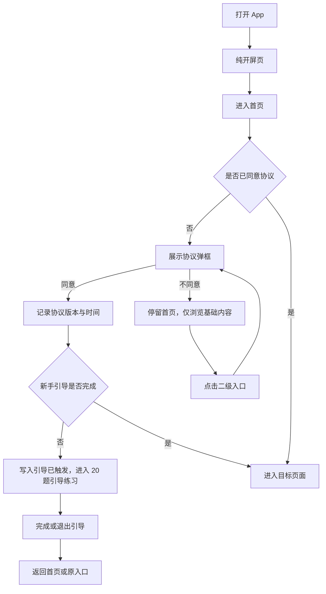
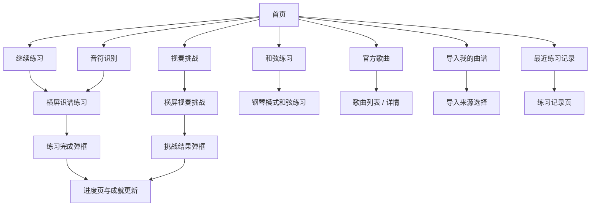
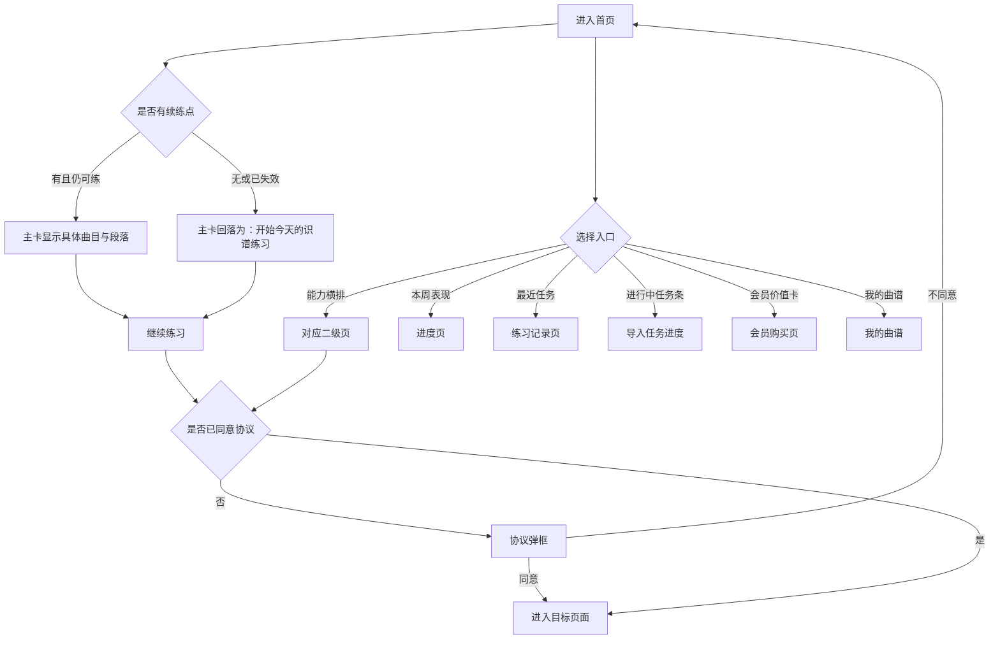
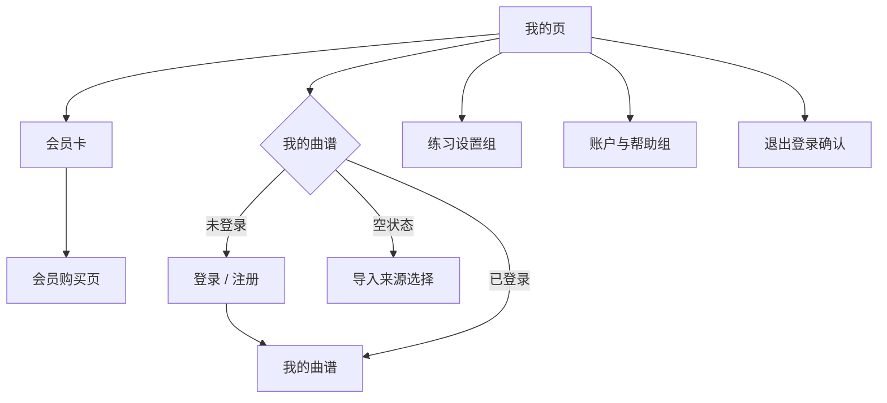

# 钢琴视奏｜基础框架 模块产品文档

> 模块代号：`G`　｜　页面范围：G-01 ~ G-05
> 所属产品文档：[00-总纲.md](00-总纲.md)（v2.1 r3）
> 文档状态：`draft`，待产品与设计评审
> 最后修订：2026-09-28

> **阅读约定**
> 本文件是《钢琴视奏产品文档 v2.1》的模块分册，负责本模块的页面级需求与专属规则，改动本模块只需改这一个文件。
> 跨模块的共享规则（输入模式矩阵、曲谱播放、MIDI 实时判定、失败处理总表）、产品范围、功能地图、视觉与非功能要求仍以主文档为准。
> 两者冲突时，**页面与本模块专属规则以本文件为准，跨模块规则以主文档为准**。

---

## 1. 模块定位与边界

### 1.1 定位

承载 App 的外壳：开屏、三 Tab 导航、首页的能力聚合、进度反馈与"我的"入口集合。本模块本身不产生练习内容，但决定用户**能否在 5 秒内回到练习**，以及所有二级能力的可发现性。

### 1.2 本模块包含

- 开屏页与冷启动初始化。
- 主框架与底部三 Tab（首页 / 进度 / 我的）。
- 首页：继续练习、学习数据、导入入口、四个练习模式入口、最近练习。
- 进度页：本周概览、每日得分、等级与下一目标、成就入口。
- 我的页：用户卡、会员卡、我的曲谱卡、练习设置组、账户与帮助组。
- 隐私协议守卫与新手引导的**触发时机**。

### 1.3 本模块不包含

- 协议弹框本体与账号能力 → 见《账号与合规》。
- 练习页与新手引导的页面实现 → 见《识谱练习与学习体系》。
- 会员卡点击后的购买页 → 见《会员与支付》。
- 我的曲谱列表与导入流程 → 见《智能曲谱导入与个人曲谱》。

### 1.4 与其他模块的关系

| 出口 | 去向模块 |
| --- | --- |
| 首页四个模式入口 | 识谱练习 / 和弦练习 / 官方歌曲 |
| 首页导入卡片、我的页我的曲谱卡 | 智能曲谱导入与个人曲谱 |
| 我的页会员卡 | 会员与支付 |
| 我的页账户与帮助组 | 账号与合规 |
| 进度页成就入口、首页最近练习 | 识谱练习与学习体系 |

---

## 2. 页面清单与路由

| ID | 页面 | 类型 | 方向 | 路由名 |
| --- | --- | --- | --- | --- |
| G-01 | 启动 / 开屏页 | 既有 | 竖屏 | `onboarding`（守卫放行） |
| G-02 | 主框架与底部导航 | 既有 | 竖屏 | `main`（守卫放行） |
| G-03 | 首页 | 既有改版 | 竖屏 | `main` |
| G-04 | 进度页 | 既有 | 竖屏 | `main` |
| G-05 | 我的页 | 既有改版 | 竖屏 | `main` |

---

## 3. 关键流程

### 3.1 首次进入与协议守卫

### 3.2 日常练习主路径

---

## 4. 页面级详细需求

### G-01 启动 / 开屏页

**页面定位**：单纯品牌开屏页，只承担短暂停留和品牌露出，同时在后台完成初始化。

**入口与出口**：App 冷启动进入；完成初始化后进入主框架首页。

**页面结构**：居中品牌符号（可结合钢琴键与五线谱）、应用名、轻量加载感或留白。

**主要功能**：展示品牌 → 后台完成必要初始化 → 进入首页。

**详细交互说明**

- 开屏页**不展示**学习数据、检查项、协议入口、隐私入口、版本信息、底部状态或重试按钮。
- 协议确认不在开屏页完成，统一由首页或二级入口守卫触发。
- 初始化异常在进入首页后用独立提示处理，不把错误留在开屏页。

**关键状态与异常**：首次安装、协议更新、已确认协议、初始化未完成、初始化失败。

**验收标准**

- 画面是纯开屏页，无任何数据或入口元素。
- 初始化未完成时不会跳到需要协议的二级页面。

### G-02 主框架与底部导航

**页面定位**：承载三 Tab 的容器，保证任何功能扩展都不改变一级导航结构。

**页面结构**：内容区 + 底部导航（首页 / 进度 / 我的）。

**主要功能**：Tab 切换、保持各 Tab 滚动位置与数据状态、接收全局状态刷新事件。

**详细交互说明**

- Tab 切换不重建已加载数据；练习完成后回到首页时刷新学习统计。
- 二级页面统一以 push 方式打开，返回后回到原 Tab 与原滚动位置。
- 未同意协议时三个 Tab 均可浏览，但点击任一二级入口都触发 D-01。

**关键状态与异常**：未同意协议、游客、已登录、数据刷新中、同步失败。

**验收标准**：底部导航永远是三项；不因新增能力增加 Tab 或隐藏 Tab。

### G-03 首页

**页面定位**：练习主面板。首页只回答一个问题——**今天练什么**；其余一切都是配角。

**入口与出口**：一级导航；出口包括练习页、和弦练习、歌曲列表、我的曲谱、导入来源选择、导入任务进度、练习记录、进度页、会员购买页。

#### 三层结构

首页自上而下分三层，层与层之间是**主次关系而不是并列关系**：

| 层 | 职责 | 视觉权重 |
| --- | --- | --- |
| 第一层 · 主行动 | 直接给出今天该练的那一段，一键进入 | 全页唯一的渐变、唯一的主按钮 |
| 第二层 · 能力入口 | 五个练习与内容入口，一排横放 | 等权、轻量、无描述文字 |
| 第三层 · 反馈与积累 | 本周表现、最近任务、我的曲谱 / 会员价值 | 白底内容卡，可滚动 |

**页面结构**（自上而下）

1. **顶栏**：问候语 + 一行状态副标题（非会员：距离升级还差多少；会员：会员有效期）+ 右上角等级章。
2. **主行动卡**（第一层）：标签"今天接着练" + **具体曲名** + 段落 / 手别 / 速度 / 小节范围 + 今日目标进度条 + 单一主按钮"继续练习"。
3. **今日建议条**（仅会员，条件出现）：来源说明 + 一句建议 + 直达。
4. **能力入口横排**（第二层）：音符识别 · 视奏挑战 · 和弦练习 · 官方歌曲 · 我的曲谱，五个等宽，只有图标与名称。
5. **进行中任务条**（条件出现）：正在识别的曲谱名与已完成小节，点击进入 I-04。
6. **为你推荐**（第三层）：曲库内容横排，3 首"当前等级够得着的"曲目，带谱面缩略图。
7. **本周表现**：一张卡内含近 7 天准确率曲线 + 与上周的对比 + 今日练习 / 连续打卡 / 平均反应三个数字；会员多一条"本周进步"。
8. **我的曲谱横排**（有曲谱时）：最近 3 份缩略卡 + 新增导入，不按会员隐藏个人内容。
9. **最近任务**：2 条记录，带谱面缩略图。
10. **会员价值提示**（仅非会员）：保留现有卡片，以 MIDI 钢琴练习价值说明和了解会员为主，不宣传免费导入或曲库解锁。
11. 底部导航。

**主要功能**

- 一键继续上次练习（跨练习类型，见主文档「首页与二级页面的数据契约」）。
- 进入五个能力入口。
- 查看本周表现与最近任务，进入进度页与练习记录页。
- 会员：查看今日建议与我的曲谱摘要。
- 非会员：了解会员权益并进入购买页。
- 进入二级页面前执行协议守卫。

**交互流程图**

**详细交互说明**

*主行动卡*

- 卡片文案必须**具体到内容**：曲名 + 第几段 + 手别 + 速度 + 小节范围，而不是泛泛的"继续练习"。
- 续练点失效时（曲谱被删、曲目下架、会员到期导致不可练、原始文件过期需重识别）**优雅降级**，回落为"开始今天的识谱练习"，不得指向一个打不开的目标，也不得显示空卡。
- 新用户无任何练习记录时，主卡显示"从音符识别开始"，并说明这是第一步。
- 今日目标进度条并入本卡，**不在别处重复展示**。

*能力入口横排*

- 五个入口去掉描述文字；解释职责下沉到各二级页的首屏（见主文档「首页与二级页面的数据契约」契约 2）。
- “我的曲谱”入口正常展示，可进入 I-06，不贴会员锁或免费标签。
- 首页任何位置都不展示剩余导入额度数字。

*为你推荐与付费主次*

- 推荐区保留现有横排布局，帮助用户按等级与难度发现想练的歌曲。
- 推荐卡片表达内容状态：已解锁或“Lv.X 解锁”，不暗示钢琴练习已经获得会员权限。
- 非会员与会员看到相同的内容等级规则，不给曲目加会员或免费标签。
- 会员卡文案聚焦“连接 MIDI 钢琴，用喜欢的曲谱开始练习”，不承诺解锁曲库或附赠导入。
- 所有推荐卡片保持详情入口，内容权限按等级判断；会员不能跳过等级。
- 会员版的区块顺序为"本周表现 → 我的曲谱"：本周表现所有会员都有，我的曲谱只有用过导入的人才有，**高频的在前**。

*`Beta` 标记*

- 能力横排的"我的曲谱"入口、会员版"我的曲谱"区块标题，都要带 `Beta`（见主文档 8.8）。
- 导入入口不按会员改变可用样式；资源限制仅在具体操作时按服务端结果提示。

*条件出现的区块*

- 今日建议条、进行中任务条、我的曲谱横排、会员价值卡都是**条件出现**，没有内容时整块不占位，不留空状态骨架。
- 今日建议条没有可靠来源时宁可不显示，不得为了占位而显示一条正确但无用的建议。

*数据*

- 首页所有数字都是二级页面的投影，口径必须与落地页一致；点进去看到的数必须等于首页显示的数。
- 学习数据来自本地记录与账号同步的合并结果；离线时展示本地数据并标注待同步。
- 曲线的近 7 天按自然日取，无数据日留空档，**不补零**。

*视觉*

- 全页**只有主行动卡使用渐变**，只有一个主按钮；其余全部白底卡。
- 导入相关内容不得出现音频图标、波形、麦克风或"即将支持"占位。
- 遵循主文档「版式体系」定义的卡片层级、圆角、文字色与五线谱母题。

**关键状态与异常**

新用户无历史、游客、未同意协议、续练点失效、有进行中导入任务、有待校对曲谱、导入资源受限、会员已过期、网络不可用、同步失败、曲线数据不足 3 天。

**验收标准**

- 打开首页 5 秒内能知道"今天练什么"并一键进入，不需要先做选择。
- 全页只有一处渐变、一个主按钮。
- 续练点失效时主卡有明确回落，不出现打不开的目标。
- 首页显示的每个数字，在落地页看到的是同一个数。
- 条件区块无内容时不占位。
- 个人内容、导入入口与内容推荐不按会员锁定；会员状态只用于相关会员入口和钢琴练习权限。
- 官方曲目推荐保留内容入口，不以会员身份标记曲谱。
- 推荐的曲目都是当前等级够得着的，不出现够不着的曲子。
- 会员提示与 M-01 的 MIDI 钢琴练习口径一致，不宣传导入额度或免费标签。
- 导入相关入口带 `Beta` 标记。
- 未同意协议时首页可浏览，二级入口不可绕过守卫。
- 页面不出现音频转乐谱入口或占位，也不展示剩余额度数字。

### G-04 进度页

**页面定位**：首页把学习数据压成了一条曲线和三个数字，**被压掉的细节全部由本页承接**。进度页是完整版的学习反馈，也是等级体系的解释页。

**入口与出口**：一级导航；首页"本周表现 → 查看全部"；出口为成就列表与练习记录。

**页面结构**（自上而下）

1. 顶部标题。
2. **等级卡（本页主体）**：当前 Lv 与名称、这一级练什么（音域 / 调号 / 变音符号）、两条晋级路径的当前进度、离升级还差什么。
3. **表现曲线**：可切换维度——准确率 / 练习时长 / 平均反应时间 / 练习次数；可切换范围——近 7 天 / 近 30 天。
4. **本周概览**：准确率、练习次数、学习时长、连续天数，各带与上周的对比。
5. **按练习类型拆分**：识谱 / 视奏 / 和弦 / 歌曲 / 个人曲谱各自的次数与准确率。
6. **下一个目标**：一条具体的、可执行的建议。
7. **成就入口**：一行，不占整屏。
8. 底部导航。

**主要功能**

- 查看等级现状与升级条件。
- 切换维度与时间范围看趋势。
- 查看分类型表现。
- 进入成就列表与练习记录。

**详细交互说明**

- **等级卡要讲清楚"在练什么"**：不只显示 Lv.4，还要说明这一级的音域、调号、是否含升降号，以及挑战达标需要的准确率与平均反应时间。用户想升级，得先知道自己在练什么。
- **两条晋级路径都要可见**：挑战模式一次达标即可晋级；普通练习按累计信用推进，展示为 N/5 形式的轻量进度。
- 曲线按自然日聚合，**无数据日留空档不补零**；数据不足 3 天时不画曲线，改为"再练几天就能看到趋势"。
- 与首页的关系：首页曲线固定为"近 7 天准确率"，是本页曲线的默认视图；两处的数值必须一致。
- 成就是次要激励，本页只给一行入口；成就本身在 N-10 展开。
- 趋势展示为学习反馈，不做排行榜与竞争机制。

**关键状态与异常**：无数据、新用户、数据不足以画趋势、刚晋级、已是最高等级、离线待同步、同步失败。

**验收标准**

- 首页被压缩掉的每一项（练习次数、学习时长、分类型表现）在本页都有地方看。
- 用户能说出"我现在几级、这一级在练什么、还差什么才能升级"。
- 曲线可切换维度与范围，首页那条等于本页的默认视图。
- 不出现强游戏化竞争元素。

### G-05 我的页

**页面定位**：账户、会员、个人内容与全部配置的集合入口。

**页面结构**（自上而下）

1. 顶部标题。
2. 用户卡：头像、昵称、登录状态（游客 / 已登录）。
3. **会员卡**：未开通时说明 MIDI 钢琴练习价值，有效时展示会员状态与到期日，已过期保留续卡入口。
4. **我的曲谱卡**：总数、处理中、待校对与查看全部；空态提示导入第一份曲谱，不增加会员额度或免费标签。
5. 练习设置组：音符设置、练习设置、音效设置、练习提醒、MIDI 设备。
6. 账户与帮助组：账户信息、帮助中心、意见反馈、语言设置、关于应用。
7. 版本信息与底部导航。

**主要功能**：查看会员状态并进入 M-01；进入 I-06 我的曲谱；进入各设置页；退出登录；清除缓存。

**交互流程图**

**详细交互说明**

- 页面对用户呈现为"我的"，内部沿用既有设置页结构，v1.2 能力不得遗漏。
- 会员卡点击始终进入 M-01；有效会员在该页查看到期日并可提前续卡。
- 我的曲谱卡数量变化不改变卡片高度；有失败任务时显示"有任务需要处理"，且不只用红色表达。
- 我的曲谱摘要数字必须与 I-06 的筛选结果一致。
- MIDI 设备项显示当前连接状态的快捷摘要。

**关键状态与异常**：游客 / 未登录、免费、会员有效、会员已过期、权益同步中、无曲谱、有处理中任务、有待校对、有失败任务、缓存清除中、退出登录。

**验收标准**

- v1.2 设置能力全部保留；底部导航仍为三项。
- 会员卡能区分未开通 / 有效 / 已过期三态并正确跳转。
- 我的曲谱空状态一次点击即可进入来源选择。
- 个人曲谱区域不贴会员锁或免费标签；具体 MIDI 钢琴练习入口才按需提示会员。

---

---

## 5. 模块核心规则

### 5.1 协议守卫与新手引导

- 始终放行：开屏、主框架（三 Tab）、登录页、协议 Web 页、语言设置页。
- 其余全部二级页面在进入前检查协议状态；未同意则弹出 D-01，不同意即中止本次进入。
- 同意时记录协议版本与确认时间；协议版本更新后需重新确认。
- 新手引导只在**首次同意协议**后触发；进入前先写入"引导已完成"标记以避免重复触发。
- 引导使用识谱练习页，自动开始，临时题量 20，且不写回长期练习设置。
- 引导提示顺序固定：先帮助用户选对八度区间，再帮助用户找到目标音名对应按键。

---

## 6. 模块级验收要点

- 底部导航永远是三项，不因任何新能力增减或隐藏。
- 开屏页是纯品牌页：无学习数据、无协议入口、无版本信息、无重试按钮。
- 未同意协议时三个 Tab 均可浏览，但任一二级入口都会触发协议弹框。
- 首页一屏内可识别：当前学习状态、如何继续练习、导入支持三类来源。
- 首页与我的页展示的曲谱数量、会员状态、学习统计，必须与对应模块页面的数据一致。
- 全站不出现音频转乐谱入口或占位。

---

## 7. 本模块待确认项

| # | 待确认 | 影响 |
| --- | --- | --- |
| 1 | 普通练习累计晋级的信用阈值与进度分母是否对用户可见、如何解释 | G-04 等级卡与 D-09 文案 |
| 2 | 首页"最近练习"展示条数与是否区分练习类型 | G-03 与 N-09 的分工 |

---

## 8. 变更记录

| 日期 | 变更 |
| --- | --- |
| 2026-09-28 | 按批准方案分离内容等级、导入资源保护与歌曲钢琴练习会员权限；仅歌曲列表保留免费体验标签。以下早期记录用于追溯，现行规则以正文为准。 |
| 2026-09-18 | 拆自主文档 v2.1 r2（主文档同步升级为 r3），含 7.A 全部页面与 8.1 协议守卫规则；首页导入卡片补会员标识、我的页曲谱卡补额度提示 |
| 2026-09-18 | G-03 首页改为「主行动 / 能力入口 / 反馈」三层：渐变与主按钮唯一化、能力入口横排五个、统计合并为趋势卡、按会员状态分化内容量；G-04 进度页承接被压缩的统计细节，等级卡升为主体 |
| 2026-09-19 | G-03 随导入降级为附赠 Beta 而调整：新增「为你推荐」曲库内容横排（主卖点的内容露出）、会员价值卡改为曲目在前导入在后的解锁提示条、导入入口加 `Beta`、会员版本周表现移到我的曲谱之前 |
