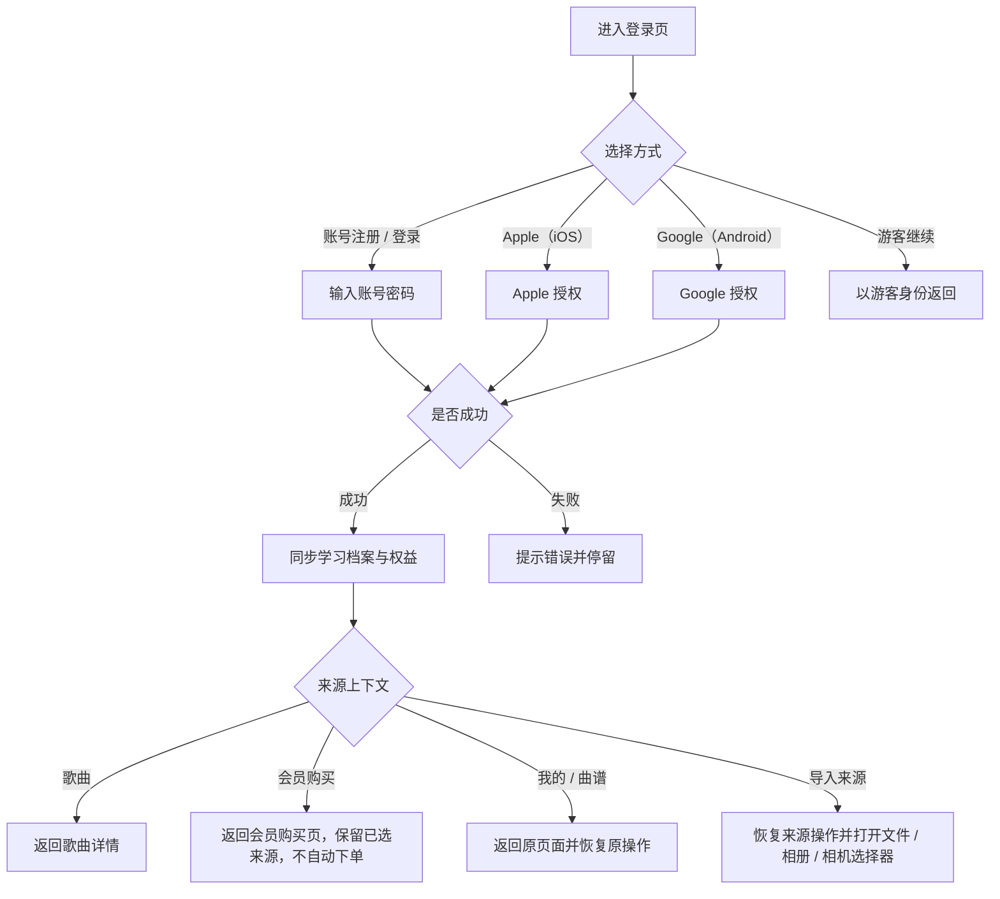

# 钢琴视奏｜账号与合规 模块产品文档

> 模块代号：`A`　｜　页面范围：A-01 ~ A-09
> 所属产品文档：[00-总纲.md](00-总纲.md)（v2.1 r3）
> 文档状态：`draft`，待产品与设计评审
> 最后修订：2026-09-28

> **阅读约定**
> 本文件是《钢琴视奏产品文档 v2.1》的模块分册，负责本模块的页面级需求与专属规则，改动本模块只需改这一个文件。
> 跨模块的共享规则（输入模式矩阵、曲谱播放、MIDI 实时判定、失败处理总表）、产品范围、功能地图、视觉与非功能要求仍以主文档为准。
> 两者冲突时，**页面与本模块专属规则以本文件为准，跨模块规则以主文档为准**。

---

## 1. 模块定位与边界

### 1.1 定位

管理用户身份与法律合规：注册登录、第三方登录、游客、同步、登出、注销，以及协议、语言、帮助、反馈、关于这些合规与支撑页面。本模块决定**什么时候必须让用户登录**，以及登录后如何不打断他原来的动作。

### 1.2 本模块包含

- 登录 / 注册页与四类来源上下文回跳。
- 账户信息页、账号注销流程。
- 用户协议与隐私政策弹框、协议 Web 页。
- 语言设置、帮助中心、意见反馈、关于应用。
- 登录时机规则与游客能力边界。

### 1.3 本模块不包含

- 协议守卫在哪些路由生效 → 见《基础框架》。
- 会员购买与权益 → 见《会员与支付》。
- 导入额度与频率 → 见《智能曲谱导入与个人曲谱》。

### 1.4 与其他模块的关系

| 来源模块 | 进入本模块的原因 | 回跳要求 |
| --- | --- | --- |
| 官方歌曲 | 开始练习需要同步进度 | 回歌曲详情 |
| 会员与支付 | 购买前必须登录 | 回购买页，保留已选套餐，不自动下单 |
| 智能曲谱导入 | 创建任务前必须登录 | 回来源选择页，恢复来源操作并重开选择器 |
| 基础框架 | 我的页、我的曲谱卡 | 回原页面并恢复原操作 |

---

## 2. 页面清单与路由

| ID | 页面 | 类型 | 方向 | 路由名 |
| --- | --- | --- | --- | --- |
| A-01 | 登录 / 注册页 | 新增 | 竖屏 | `login`（守卫放行，支持 `returningToSong` / `returningToPayment` / `returningToProfile`） |
| A-02 | 账户信息页 | 既有 | 竖屏 | `account_info` |
| A-03 | 账号注销流程 | 新增 | 竖屏 | 由 `account_info` 承接 |
| A-04 | 用户协议与隐私政策弹框 | 既有 | — | 全局弹框 D-01 |
| A-05 | 语言设置页 | 既有 | 竖屏 | `language_settings`（守卫放行） |
| A-06 | 帮助中心页 | 既有 | 竖屏 | `help_center` |
| A-07 | 意见反馈页 | 新增 | 竖屏 | `feedback` |
| A-08 | 关于应用页 | 既有 | 竖屏 | `about_app` |
| A-09 | 协议 / 隐私 Web 页 | 既有 | 竖屏 | `web`（守卫放行） |

---

## 3. 页面级详细需求

### A-01 登录 / 注册页

**页面定位**：把游客身份转换为可同步账户，是导入、歌曲进度与会员购买的前置。

**入口与出口**：我的页用户卡、账户信息页、我的曲谱、导入来源操作、会员购买页、歌曲进度同步。登录成功后必须**回到来源页并恢复来源操作**。

**页面结构**：登录价值说明、账号注册 / 登录表单、平台快捷登录、游客继续、协议入口、错误提示区。

**主要功能**

- 账号注册、账号登录。
- iOS 展示 Apple 登录；Android 展示 Google 登录。
- 游客继续（iOS 可主动建立游客会话）。
- 登录失败提示、找回路径说明。
- 按来源上下文回跳：歌曲、会员购买、我的页 / 曲谱三类来源分别记录。

**交互流程图**

**详细交互说明**

- 常规登录价值表达为保存进度、同步设备、恢复歌曲与曲谱；不把账号包装成主卖点。
- 从会员购买流程进入时，登录成功后返回会员购买页并保留来源歌曲，但**不自动选卡也不自动发起支付**。
- 从导入流程登录成功后校验资源保护，通过后恢复选定来源；受限则说明原因及重试方式，不引导购买。登录取消保留已选类型，不创建任务。
- 不提供微信登录与手机号验证码登录。
- 游客可使用识谱、和弦、视奏与四首固定免费歌曲，但**不能购买会员、不能创建导入任务**；导入资源保护按账号计算，不按会员身份区分。

**关键状态与异常**：账号或密码错误、注册冲突、Apple / Google 授权失败或取消、网络异常、游客数据合并、来源页返回失败、离线。

**验收标准**

- iOS 显示账号 + Apple 登录，Android 显示账号 + Google 登录。
- 游客继续可见但不允许游客购买。
- 四类来源上下文都能正确回跳并恢复原操作。

### A-02 账户信息页

**页面定位**：展示账户身份、同步状态与用户资料，承载登出与注销入口。

**页面结构**：头像与昵称、登录状态、邮箱、同步状态、学习档案摘要（等级、累计练习、会员状态）、编辑入口、退出登录、注销账号入口。

**主要功能**：编辑昵称、编辑邮箱、查看同步状态、手动触发同步、退出登录、进入账号注销。

**详细交互说明**

- 游客与正式账号区分展示：游客显示登录引导与"登录后可同步"说明。
- 同步状态区分：已同步 / 同步中 / 待同步 / 同步失败并可重试。
- 退出登录必须二次确认（D-12），并说明本地未同步数据的处理方式。
- 注销入口放在页面最下方、低优先级样式，不与退出登录并列在主要位置。

**关键状态与异常**：游客、账号用户、Apple 用户、Google 用户、同步中、同步失败、退出登录、注销申请处理中。

**验收标准**：用户能明确当前身份、同步状态和会员状态；危险操作层级清晰。

### A-03 账号注销流程

**页面定位**：满足应用商店合规要求，为用户提供自助删除账号的路径。

**入口与出口**：账户信息页 → 注销说明 → 二次确认 → 提交 → 回执。

**页面结构**：注销影响说明清单、冷静期与生效时间说明、确认勾选、提交按钮、提交后的回执信息（申请编号、提交时间、预计生效时间）。

**主要功能**

- 展示注销将删除的内容范围：账号资料、学习记录、成就、个人曲谱与原始文件、练习进度。
- 说明会员权益的处理：注销不退款，剩余有效期随账号一并失效。
- 提交注销申请并展示回执。
- 说明撤销方式（如在生效前重新登录可撤销，以最终策略为准）。

**详细交互说明**

- 注销必须二次确认（D-21），确认文案要求用户明确知晓不可恢复。
- 提交成功后本地立即退出登录，并保留回执信息可再次查看。
- 提交失败时明确提示原因并保持账号原状态，不做静默处理。

**关键状态与异常**：未登录（不展示入口）、提交中、提交成功、提交失败、已有进行中的注销申请、有未完成的支付订单。

**验收标准**：入口可自助到达；影响范围、是否可撤销、生效时间三项在提交前可见；提交后有可查回执。

### A-04 用户协议与隐私政策弹框

**页面定位**：首次进入、协议更新或进入二级页面前的必要确认。

**页面结构**：安全图标、标题、协议摘要说明、用户协议链接、隐私政策链接、不同意 / 同意并继续按钮。

**主要功能**：查看协议、同意并继续、不同意后回到当前一级页面。

**详细交互说明**

- 弹框独立展示，不放在开屏页底部；不可点击遮罩跳过。
- 同意后记录协议版本与确认时间；若协议版本更新需重新确认。
- 不同意不强制退出 App，允许停留 / 进入首页；再次点击受保护入口时重新弹出。
- 同意后若新手引导未完成，先进入 N-02 新手引导。
- `/onboarding`、`/`（主框架）、`/login`、`/web`、`/language_settings` 始终放行，其余路由均受守卫。

**关键状态与异常**：首次安装、协议版本更新、Web 加载失败、不同意后继续浏览、二级入口再次触发。

**验收标准**：两个协议链接与两个按钮完整；不同意后首页可见；二级页面不可绕过守卫。

### A-05 语言设置页

**页面定位**：切换应用显示语言，在协议同意前也可进入。

**页面结构**：跟随系统、简体中文、繁体中文、English 四个选项与当前选中态。

**主要功能**：选择语言并提示生效方式。

**详细交互说明**：选中项清晰标记；重复选择给出"已是当前语言"提示；切换后全局文案（含日期、时长、BPM 展示）随之本地化。

**关键状态与异常**：切换失败、需重启生效、未同意协议进入。

**验收标准**：四个选项与当前选中态清楚；协议未同意时可进入且可切换。

### A-06 帮助中心页

**页面定位**：提供常见问题与练习说明，降低客服成本。

**页面结构**：问题分类、FAQ 列表、问题详情、意见反馈入口、联系邮箱入口。

**主要功能**：浏览分类、查看答案、跳转意见反馈。

**详细交互说明**：内容围绕识谱练习、MIDI 连接、权限、账号与同步、歌曲解锁、会员与退款、曲谱导入与识别质量；内容简短实用，不做教程平台。

**关键状态与异常**：无网络、无结果、内容加载失败。

**验收标准**：常见阻塞问题（MIDI 连不上、会员没到账、导入失败、识别不准）均有对应条目。

### A-07 意见反馈页

**页面定位**：站内提交问题与建议，作为邮件反馈之外的主路径。

**入口**：我的页、帮助中心，以及**问题发生的当场**——曲谱检查页的识别质量提示条、导入失败页。场景入口需预填上下文（来源类型、任务状态、问题数），让用户少打字。不满的用户需要一个宣泄口，App 内有，他就大概率不会去应用商店写评价。

**页面结构**：反馈类型选择、问题描述输入、联系方式输入、可选附件或环境信息说明、提交按钮、提交结果提示。

**主要功能**：选择类型、填写描述与联系方式、提交、查看提交结果。

**详细交互说明**

- 描述为必填并提示最少字数；联系方式选填但提示"留下联系方式便于回复"。
- 提交时随附版本号、平台与语言等基础环境信息，并在页面上明示会附带哪些信息。
- 提交成功后清空表单并给出明确成功反馈；失败时保留已填内容。
- 保留帮助中心与关于应用中的邮件入口，不因本页移除。

**关键状态与异常**：未填必填项、提交中、提交成功、提交失败、网络异常、频繁提交限制。

**验收标准**：必填校验清楚；提交结果明确；失败不丢失已填写内容；页面明示随附的环境信息。

### A-08 关于应用页

**页面定位**：展示应用信息、版本、协议与隐私入口。

**页面结构**：应用图标、应用名、版本号与构建号、用户协议、隐私政策、意见反馈 / 联系邮箱、版权说明。

**主要功能**：查看版本、打开协议 / 隐私 Web 页、进入反馈。

**详细交互说明**：版本信息只放在本页，不放在开屏页底部；协议查看不等同首次确认。

**关键状态与异常**：Web 加载失败、版本号不可读。

**验收标准**：版本、协议、隐私、反馈入口清晰可达。

### A-09 协议 / 隐私 Web 页

**页面定位**：承接协议与隐私政策的富文本查看，协议未同意前也可打开。

**页面结构**：顶部返回与标题、Web 内容区、加载失败重试。

**详细交互说明**：作为内部承接页登记，不单独出设计稿；加载失败提供重试与"稍后再看"。

**验收标准**：未同意协议时可正常打开；返回后回到触发它的弹框或页面。

---

---

## 4. 模块核心规则

### 4.1 账号、权益与登录时机规则

| 动作 | 是否需要登录 |
| --- | --- |
| 浏览首页、进度、我的、歌曲列表与详情 | 否 |
| 识谱练习、视奏挑战、和弦练习 | 否（记录存本地） |
| 试听官方歌曲、查看历史成绩 | 否 |
| 练习四首固定免费歌曲 | 否 |
| 浏览导入来源说明 | 否 |
| 选定导入来源并创建任务 | **是**（仅统一资源保护） |
| 查看我的曲谱、校对、播放与管理 | **是**（不要求会员） |
| 个人曲谱 MIDI 钢琴练习 | **是**（检查会员） |
| 跨设备同步学习记录与设置 | **是** |
| 购买会员、续卡、恢复购买 | **是** |

- 登录成功后必须恢复来源操作；登录取消时返回来源页且不产生副作用。
- 游客数据在登录后合并到账号，冲突以服务端为准并提示同步结果。
- 个人曲谱不参与官方等级与和弦阶段规则；查看和管理不受会员限制，MIDI 钢琴练习单独检查会员。
- 新建导入仅受统一资源与频率保护，详见《智能曲谱导入与个人曲谱》5.6 / 5.7，不属于会员权限。
- 当前不对解析或文件单独收费，也不售卖导入额度；歌曲钢琴练习属于会员权限。

---

## 5. 模块级验收要点

- iOS 显示账号 + Apple 登录，Android 显示账号 + Google 登录；不出现微信与手机号验证码。
- 四类来源上下文都能正确回跳并恢复原操作，登录取消不产生任何副作用。
- 游客可练识谱、和弦、视奏与四首固定免费歌曲，但不能购买会员、不能创建导入任务。
- 协议未同意时，语言设置、协议 Web 页、登录页仍可进入。
- 账号注销可自助到达，影响范围、是否可撤销、生效时间在提交前可见，提交后有可查回执。
- 意见反馈必填校验清楚，失败不丢失已填内容，并明示随附的环境信息。

---

## 6. 本模块待确认项

| # | 待确认 | 影响 |
| --- | --- | --- |
| 1 | 账号注销是否设置冷静期、是否支持生效前撤销 | A-03 文案与合规 |
| 2 | 意见反馈是否需要附件上传与工单回复查看 | A-07 范围 |
| 3 | 游客在 iOS 上主动建立游客会话购买后的权益归属与转移策略 | A-01 与会员模块 |

---

## 7. 变更记录

| 日期 | 变更 |
| --- | --- |
| 2026-09-28 | 按批准方案分离内容等级、导入资源保护与歌曲钢琴练习会员权限；仅歌曲列表保留免费体验标签。以下早期记录用于追溯，现行规则以正文为准。 |
| 2026-09-18 | 拆自主文档 v2.1 r2（主文档同步升级为 r3），含 7.B 全部页面与 8.14 登录时机规则；登录回跳补导入额度校验、游客额度按账号计算 |
| 2026-09-18 | A-07 补场景入口：曲谱检查页的识别质量提示条与导入失败页可一键直达反馈，并预填上下文 |

---

## 迁移补入：账号绑定模型（⚠️ 待确认）

> 2026-10-07 迁移时补入。来源：`doc/history/v1/02-技术方案/account-binding.md`（CHG-20260926-ACCOUNT，用户已批准并实施，随 v2.1.0 上线）。本分册正文还没有写入这套规则。
> 请确认下面的描述和线上行为一致，然后并入正文对应页面（登录、账号信息、退出登录）和「模块核心规则」，并删除本节。

- 每台设备上先有一个**独立的本地账号**。练习记录、等级、上传队列、缓存、收藏、头像昵称和偏好按本地账号隔离；隐私同意、系统权限、服务器设置属于设备级。
- **注册新用户名、首次 Google 登录、首次游客登录**：绑定到当前本地账号，并上传当前本地数据。之后退出登录，会新建一个空白本地账号。
- **登录已有身份**：切换到该身份对应的账号，原本地数据不合并、不上传。退出后恢复到登录前的本地账号。
- **游客升级为正式身份**（未被占用的用户名或 Google）：保留同一个服务端用户及其订单、会员和资产，旧游客凭证与会话作废。退出后新建空白账号。
- 用户名 3–32 位，只能是 ASCII 字母、数字和下划线，不区分大小写；历史邮箱账号仍可登录。Google 只按 Google 账号本身识别，不按邮箱自动关联到已有账号。
- 登录或升级失败、取消时不切换账号；网络迟到的响应不会写进已经切换的账号。
- 退出时立即在本地切换；撤销旧会话的请求在线时立即发送，离线时稍后重试。
- 不包含：改绑 Google、修改密码、找回密码。
