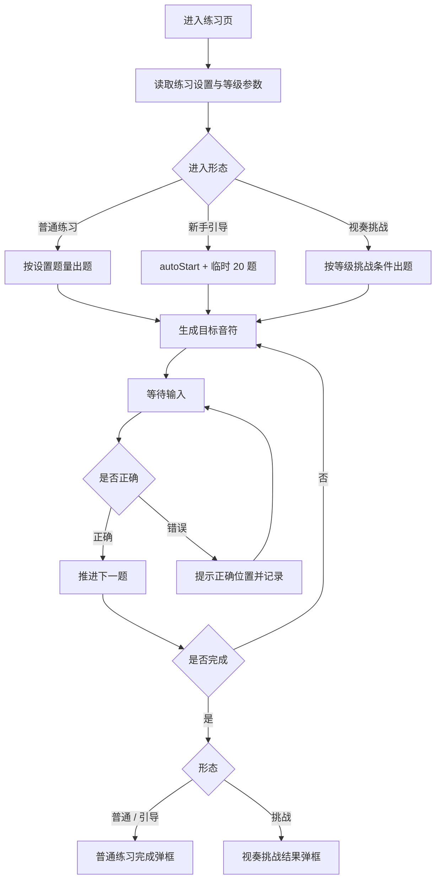
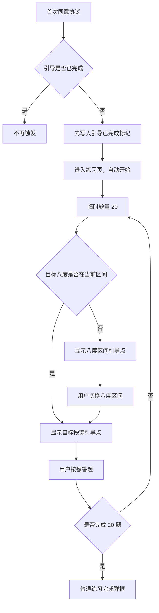
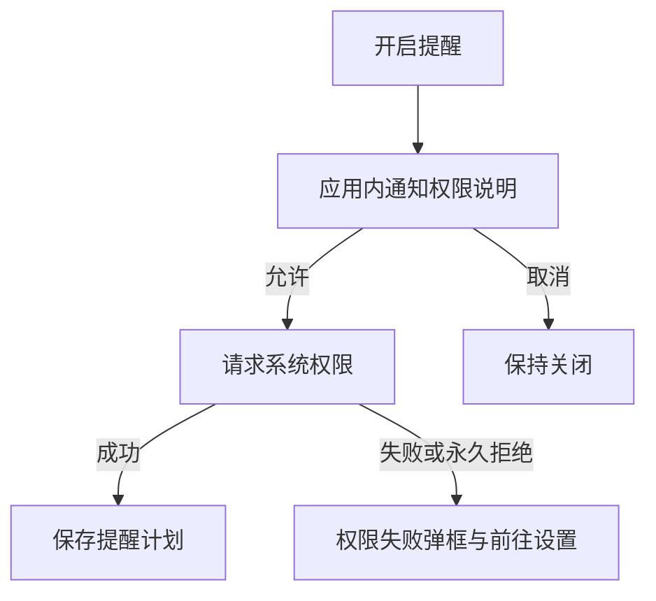

# 钢琴视奏｜识谱练习与学习体系 模块产品文档

> 模块代号：`N`　｜　页面范围：N-01 ~ N-10
> 所属产品文档：[00-总纲.md](00-总纲.md)（v2.1 r3）
> 文档状态：`draft`，待产品与设计评审
> 最后修订：2026-09-18

> **阅读约定**
> 本文件是《钢琴视奏产品文档 v2.1》的模块分册，负责本模块的页面级需求与专属规则，改动本模块只需改这一个文件。
> 跨模块的共享规则（输入模式矩阵、曲谱播放、MIDI 实时判定、失败处理总表）、产品范围、功能地图、视觉与非功能要求仍以主文档为准。
> 两者冲突时，**页面与本模块专属规则以本文件为准，跨模块规则以主文档为准**。

---

## 1. 模块定位与边界

### 1.1 定位

产品的核心练习循环与成长体系。识谱练习页是全 App 使用频次最高的页面，并同时承载三种形态：普通练习、新手引导、视奏挑战。学习体系（等级、每日目标、成就、练习记录）为这个循环提供反馈与目标感。

### 1.2 本模块包含

- 横屏识谱练习页及其三种形态。
- 三种输入方式的页面表现（屏幕键盘 / MIDI / 麦克风拾音）。
- Lv.1–Lv.10 等级体系与两条晋级路径。
- 每日目标、连续天数、成就与里程碑。
- 练习记录页与全部练习相关设置页（音符、练习、音效、提醒、MIDI 设备）。

### 1.3 本模块不包含

- 协议守卫与新手引导的触发时机 → 见《基础框架》5.1。
- 和弦练习 → 见《和弦练习》。
- 歌曲与个人曲谱的练习页 → 见对应模块。
- 输入模式的跨模块矩阵、MIDI 实时判定规则 → 见主文档第 8 章。

### 1.4 与其他模块的关系

| 关系 | 说明 |
| --- | --- |
| 上游 | 《基础框架》首页入口、首次同意协议后自动进入新手引导 |
| 下游 | 等级结果供《官方歌曲》做 `requiredLevel` 判定 |
| 共享 | N-08 MIDI 设备页被和弦练习、官方歌曲钢琴模式、个人曲谱练习共用 |
| 汇总 | N-09 练习记录页收录全部练习类型的记录，包括歌曲与个人曲谱 |

---

## 2. 页面清单与路由

| ID | 页面 | 类型 | 方向 | 路由名 |
| --- | --- | --- | --- | --- |
| N-01 | 横屏识谱练习页 | 既有核心页 | 横屏 | `practice` |
| N-02 | 新手引导练习状态 | 既有状态 | 横屏 | `practice`（参数区分） |
| N-03 | 视奏挑战模式 | 既有状态 | 横屏 | `practice`（参数区分） |
| N-04 | 音符设置页 | 既有 | 竖屏 | `note_settings` |
| N-05 | 练习设置页 | 既有 | 竖屏 | `practice_settings` |
| N-06 | 音效设置页 | 既有 | 竖屏 | `sound_settings` |
| N-07 | 练习提醒页 | 既有 | 竖屏 | `practice_reminder` |
| N-08 | MIDI 设备页 | 既有 | 竖屏 | `midi_device` |
| N-09 | 练习记录页 | 新增 | 竖屏 | `practice_records` |
| N-10 | 成就列表页 | 既有 | 竖屏 | `achievements` |

相关弹框（细则见《全局弹框》模块）：D-02 通知权限、D-03 蓝牙权限、D-04 麦克风权限、D-05 权限失败、D-06 练习设置、D-07 拾音音域说明、D-08 停止练习、D-09 练习完成、D-10 挑战结果、D-13 音色包更新。

---

## 3. 页面级详细需求

### N-01 横屏识谱练习页

**页面定位**：App 的核心练习页，承载音符识别、新手引导与视奏挑战三种形态。

**入口与出口**：首页继续练习 / 音符识别 / 视奏挑战、练习记录页再练一次、首次同意协议自动进入。出口为完成弹框或停止确认后返回。

**页面结构**

1. 顶部控制栏：返回 / 停止、模式标识、设置按钮、输入状态（屏幕 / MIDI / 拾音）。
2. 左侧统计区：当前题序、音符数、准确率、平均反应时间。
3. 谱面区：当前目标音符、谱号、调号、必要的辅助线。
4. 输入反馈区：正确 / 错误 / 等待输入的即时反馈。
5. 屏幕键盘区：八度区间切换 + 当前区间按键。
6. 右侧操作栏：暂停、设置、退出。

**主要功能**

- 按练习设置与当前等级生成目标音符。
- 接收屏幕点击、MIDI 输入或麦克风单音识别。
- 即时判定并给出正误反馈，错误时提示正确位置。
- 统计准确率与平均反应时间。
- 暂停、快捷设置（D-06）、停止确认（D-08）、完成结算（D-09 / D-10）。

**交互流程图**

**详细交互说明**

- 输入模式由练习设置弹框实时切换：默认（屏幕）、MIDI、钢琴录音（拾音）。
- MIDI 未连接时在状态区提示，并可一键进入 N-08。
- 拾音模式需要麦克风权限，并提示当前支持音域（D-07）。
- 错误不跳题，停留当前题直至答对或用户主动跳过（若允许跳过需在结果中单列）。
- 练习中退出必须二次确认，已完成部分按未完成记录保存。
- 完成后写入本地练习记录并触发统计与成就刷新；登录用户同步到账号。

**关键状态与异常**：MIDI 未连接 / 中途断开、麦克风权限缺失或被拒、音域超出设置范围、练习中来电或切后台、异常退出、离线。

**排版与信息层级要求**

本页是**出题式**练习页，也是唯一支持三种输入方式的练习页。遵循主文档 8.7 的五条共性约束与出题式规则；与和弦练习、歌曲练习**不共用布局**。

- **输入模式状态常驻可见**。屏幕 / MIDI / 拾音三种模式的当前状态放在顶部控制条，不藏进设置弹框——"现在到底是什么模式"是这一页最常见的困惑。
- **练习中只留进度**。左侧统计区在练习进行时只显示"第几题 / 共几题"；准确率与平均反应时间移到完成弹框，练习中不实时跳数。
- **提示按 8.7 的三级递进**：第一次只标错 → 第二次高亮正确按键 → 第三次给出音名。
- **反馈带位置固定**在谱面正下方，正确 / 错误 / 等待输入三种状态在同一处切换。
- 新手引导的"先选八度、再按键"引导点复用同一套递进提示，不另做一套视觉。

**验收标准**

- 顶部能一眼看出当前输入模式。
- 练习中不显示准确率与平均反应时间。
- 提示强度随连续错误递进。
- 谱面与键盘的对应关系清楚；当前音符、输入方式、进度与反馈同时可见。
- 三种输入模式均可用且状态明确。
- 中途退出不丢失已完成部分的统计。

### N-02 新手引导练习状态

**页面定位**：首次同意协议后的第一轮练习，帮助新用户理解"看谱面 → 选八度 → 找键 → 得到反馈"。

**入口与出口**：协议同意后自动进入；完成 20 题后展示普通练习完成弹框，返回首页或原入口。

**页面结构**：沿用 N-01 结构，叠加引导状态——自动开始、20 题临时进度、八度区间引导点、目标按键引导点、轻量说明浮层。

**主要功能**：自动开始练习；按目标音符先提示八度区间，再提示具体按键；完成后结算。

**交互流程图**

**详细交互说明**

- 引导不是课程页也不是独立关卡，只是练习页的辅助状态。
- 临时题量只覆盖当次练习，不写回用户长期题量设置。
- 为避免重复触发，进入引导前先写入"引导已完成"标记。
- 用户中途退出不再自动重新触发；可从首页正常开始练习。
- 未同意协议时不触发引导。

**关键状态与异常**：首次同意、已完成引导、引导中退出、目标音不在当前八度区间、连续答错。

**验收标准**：引导能从协议同意自然进入；"先选八度、再按目标键"的辅助可见；20 题只影响当次；完成后不再自动触发。

### N-03 视奏挑战模式

**页面定位**：等级晋级的达标判定形态，复用 N-01 页面结构。

**入口与出口**：首页视奏挑战入口；结束后进入 D-10 挑战结果弹框。

**页面结构**：沿用 N-01，顶部显示"挑战"标识与目标等级，统计区同时显示达标条件（目标准确率、目标平均时间、题量）。

**主要功能**：按目标等级的音域、调号、变音符号频率与题量出题；结束时判定是否达标；达标即晋级。

**详细交互说明**

- 挑战题目参数由等级定义决定，不受用户自定义音符设置影响，以保证达标口径一致。
- 挑战中退出按"退出挑战"语义二次确认，本次不计达标。
- 未达标可无限次重挑战，不设冷却与次数限制。
- 达标后写入新等级并刷新首页、进度页与歌曲解锁状态。

**关键状态与异常**：准确率未达标、平均时间未达标、两项都达标、中途退出、已是最高等级。

**排版与信息层级要求**

- **达标条件常驻**（主文档契约 2）：目标等级、需要的准确率、平均时间、题量，在挑战全程可见。
- **实时显示差距**，而不是只在结束时告诉他：「准确率 88%（需 90%）」比一个孤立的 88% 更有驱动力。这是挑战模式与普通练习在信息层级上的主要差别。
- 顶部用"挑战"标识与普通练习区分；**不使用"退出即失败"这类威胁性文案**，未达标可无限重挑战本来就是规则。

**验收标准**：挑战条件全程可见且实时显示差距；挑战条件与实际表现在结果弹框中一眼可读；达标即晋级且立即影响歌曲解锁展示。

### N-04 音符设置页

**页面定位**：配置音符识别练习的出题范围。

**页面结构**：音符范围（最低音 / 最高音）、谱号选择、调号选择、变音符号选项、题量、提示选项、保存状态。

**主要功能**：调整范围与题量、保存、恢复默认。

**详细交互说明**：设置只影响普通识谱练习，不影响视奏挑战的达标口径；范围过窄时给出提示但不强制阻断；修改后未保存离开需提示。

**关键状态与异常**：未保存修改、范围非法（最低音高于最高音）、范围过窄、恢复默认。

**验收标准**：用户能理解设置如何影响下一次练习；与挑战模式的关系有明确说明。

### N-05 练习设置页

**页面定位**：从我的页进入的全局练习偏好，作为练习页默认值。

**页面结构**：顶部返回与标题、题量、练习时长、输入方式偏好说明、答题反馈设置、提示显示设置、保存按钮。

**主要功能**：查看并保存全局练习偏好。

**详细交互说明**

- 从我的页进入为独立页面，不以弹框形式打开。
- 与 D-06 练习设置弹框的区别：本页管理全局默认值；D-06 只在练习中临时切换输入模式与播放音，不写回本页。
- 保存成功给出明确反馈，可停留也可返回。

**关键状态与异常**：未保存、保存失败、恢复默认、与设备连接状态不一致。

**验收标准**：包含题量、时长、输入说明、反馈、提示与保存；全局设置与练习内临时设置的关系表述清晰。

### N-06 音效设置页

**页面定位**：管理练习反馈音效、音符播放音与振动。

**页面结构**：音符播放音开关、正确 / 错误音效开关、音量、振动开关。

**主要功能**：开关音效、试听、保存。

**详细交互说明**：D-06 中的播放音开关与本页保持同一份设置；音效用于即时反馈，不得干扰谱面阅读。

**关键状态与异常**：系统静音、系统音量过低、设置同步失败。

**验收标准**：用户能快速控制反馈音；两处开关状态一致。

### N-07 练习提醒页

**页面定位**：设置固定练习提醒，帮助形成习惯。

**页面结构**：提醒开关、提醒时间、重复日期、权限状态说明。

**主要功能**：开启 / 关闭提醒、选择时间与重复日、处理通知权限。

**交互流程图**

**详细交互说明**：先应用内解释用途再请求系统权限；权限失败提供前往系统设置入口；关闭提醒时同步取消已计划通知。

**关键状态与异常**：未授权、永久拒绝、精确闹钟权限缺失、系统级通知被关闭、关闭提醒。

**验收标准**：权限链路完整，用户知道为何需要通知权限；关闭后不再收到提醒。

### N-08 MIDI 设备页

**页面定位**：管理外部 MIDI 键盘连接，是和弦练习与钢琴模式的前置。

**页面结构**：当前连接状态、设备列表、扫描 / 重连按钮、USB 与 BLE 说明、权限说明、故障排查提示。

**主要功能**：扫描、连接、断开、处理蓝牙权限、查看连接故障建议。

**详细交互说明**

- BLE MIDI 需要蓝牙权限，USB MIDI 不需要；页面需分别说明。
- 未连接时，练习页、和弦练习页与钢琴模式均显示未连接状态并可一键进入本页。
- 连接成功后返回原页面继续原操作。
- 设备断开时全局提示，并暂停正在进行的判定。

**关键状态与异常**：无设备、扫描中、连接中、连接失败、权限拒绝、设备断开、系统蓝牙关闭。

**验收标准**：用户能理解当前 MIDI 状态并完成连接或明确回退路径。

### N-09 练习记录页

**页面定位**：统一查看历史练习记录，是首页"最近练习"的完整视图。

**入口与出口**：首页最近练习、进度页；可从记录直接再次发起同类练习。

**页面结构**：顶部返回与标题、练习类型筛选（全部 / 音符识别 / 视奏挑战 / 和弦 / 歌曲 / 个人曲谱）、日期范围筛选、记录列表、空状态、分页加载。

**主要功能**

- 按类型与日期筛选记录。
- 查看单条记录摘要：类型、时间、题量或小节范围、准确率、平均反应时间、结果。
- 进入单次记录详情。
- 一键"再练一次"，带回该次练习的类型与主要参数。
- 重置筛选并回到列表顶部。

**详细交互说明**

- 默认按时间倒序；筛选变化时列表回到顶部并保留筛选条件。
- 未登录用户展示本地记录；登录后与账号记录合并展示，冲突以服务端为准并提示同步时间。
- 记录不可编辑；删除账号或删除个人曲谱时，相关记录随之清理。

**关键状态与异常**：空、加载中、加载失败、筛选无结果、离线仅本地、同步中。

**排版与信息层级要求**

- **按天分组，不做无限平铺**。每天一个小标题 + 当天汇总（例：3 次 · 28 分钟 · 平均 84%）。一条条平铺看不出规律，按天分组才能看出"我哪几天没练"。
- **单次记录要能回到谱面**。"第 12 小节错了 3 次"应该点得进去看到那一小节——这是记录页存在的意义，否则它只是一堆数字。
- 记录条目复用与 I-06、S-01 相同的谱面缩略图规格。
- 向首页提供最近 2 条，**与本页同一排序、同一口径**，不另算（见主文档契约 3）。

**验收标准**：筛选结果数量与列表一致；按天分组且每天有汇总；单次记录可回到出错的小节；首页那 2 条与本页前 2 条完全一致；每条记录能定位到练习类型与表现；"再练一次"能正确恢复参数。

### N-10 成就列表页

**页面定位**：展示成就与里程碑，提供温和的持续激励。

**页面结构**：成就分类、已获得成就、未完成成就与进度条、里程碑阶梯（累计练习 5 / 10 / 30 / 50 / 100 / 300 / 1000 次）。

**主要功能**：查看达成条件与当前进度。

**详细交互说明**：成就文案鼓励持续练习，不做夸张奖励与排行竞争；未完成成就展示"还差多少"。

**关键状态与异常**：暂无成就、同步失败、刚达成新成就。

**验收标准**：用户能看懂达成条件和下一步目标；与进度页展示的数据一致。

---

---

## 4. 模块核心规则

### 4.1 等级体系（Lv.1–Lv.10）

- 等级分三阶段：**Lv.1–3** 纯白键、无升降号、无调号；**Lv.4–6** 引入升降号与还原号、无调号；**Lv.7–10** 引入调号系统与调性变化。
- 每个等级定义：名称、能力描述、音域上下界、允许调号、是否含变音符号、达标最低准确率、达标最大平均反应时间、挑战题量、变音符号频率、代表曲目。
- **晋级有两条路径**：
  1. **视奏挑战**：完成本等级挑战题量，准确率与平均反应时间同时达标即晋级。
  2. **普通练习累计**：按自然日与目标等级累计"整局挑战等价"信用，达到阈值后晋级；界面以固定分母（如 N/5）展示进度。
- 等级只上升，不因单次表现下降。
- 等级同时作为官方歌曲 `requiredLevel` 的判定输入。

### 4.2 每日目标、连续天数与成就

- 每日目标默认为 3 次有效练习，完成后在首页与进度页体现。
- 连续天数按自然日计算；当日完成任意一次有效练习即算达成。
- 里程碑阶梯：累计练习 5 / 10 / 30 / 50 / 100 / 300 / 1000 次。
- 成就为学习反馈，不做强游戏化奖励，不引入排行榜与竞争机制。

### 4.3 与共享规则的关系

- 三种输入方式在各练习场景的可用性，见主文档「输入模式规则」。
- MIDI 输入的判定口径（等待 / 节奏模式、音组判定、断开处理），见主文档「MIDI 实时判定规则」。
- 本模块的失败与异常文案遵循主文档「失败处理规则」总表。

---

## 5. 模块级验收要点

- 识谱练习页三种形态共用一套谱面与键盘布局，形态差异只体现在顶部标识、题量来源与结算弹框。
- 新手引导只在首次同意协议后触发一次，临时题量不写回长期设置，完成后不再自动触发。
- 视奏挑战的出题参数由等级定义决定，不受用户自定义音符设置影响，保证达标口径一致。
- 等级只上升不下降；晋级后立即刷新首页、进度页与官方歌曲的解锁展示。
- N-05 全局练习设置与 D-06 练习中临时设置的关系表述清晰：临时设置不写回全局。
- 练习记录的筛选结果数量与列表一致，"再练一次"能正确恢复参数。
- MIDI 未连接时，所有依赖 MIDI 的页面都能一键跳到 N-08 并在连接后返回原操作。

---

## 6. 本模块待确认项

| # | 待确认 | 影响 |
| --- | --- | --- |
| 1 | 普通练习累计晋级的信用阈值与进度展示分母是否对用户可见、如何解释 | 4.1 与 D-09 文案 |
| 2 | 练习记录是否保留全部历史或按时间窗口归档 | N-09 分页与同步 |
| 3 | 拾音模式的支持音域与识别可靠性，需真机验证 | N-01 状态与 D-07 文案 |
| 4 | 钢琴音色包是否强制更新、更新失败时是否降级为基础音色 | N-08 与 D-13 |

---

## 7. 变更记录

| 日期 | 变更 |
| --- | --- |
| 2026-09-18 | 拆自主文档 v2.1 r2（主文档同步升级为 r3），含 7.C 全部页面与 8.2 / 8.3 学习体系规则 |
| 2026-09-18 | N-09 练习记录补排版要求：按天分组与当天汇总、单次记录可回到出错小节、与首页最近 2 条同口径 |
| 2026-09-18 | N-01 / N-03 补横屏排版要求：输入模式常驻、练习中只留进度、提示三级递进、挑战条件实时显示差距（范式与共性约束见主文档 8.7） |
| 2026-09-18 | 更正：撤回「五个练习页是同一套骨架」的说法。识谱与视奏共用一页、个人曲谱复用歌曲钢琴模式，此外各练习页互不复用；改为按出题式 / 跟谱式两类范式定义规则 |
