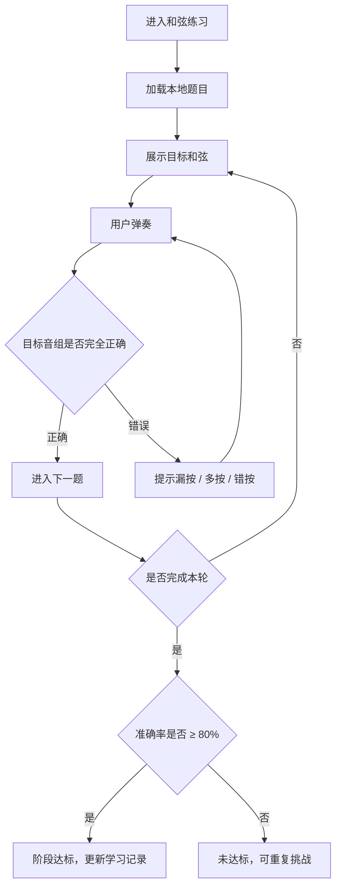

# 钢琴视奏｜和弦练习 模块产品文档

> 模块代号：`C`　｜　页面范围：C-01
> 所属产品文档：[00-总纲.md](00-总纲.md)（v2.1 r3）
> 文档状态：`draft`，待产品与设计评审
> 最后修订：2026-09-29

> **阅读约定**
> 本文件是《钢琴视奏产品文档 v2.1》的模块分册，负责本模块的页面级需求与专属规则，改动本模块只需改这一个文件。
> 跨模块的共享规则（输入模式矩阵、曲谱播放、MIDI 实时判定、失败处理总表）、产品范围、功能地图、视觉与非功能要求仍以主文档为准。
> 两者冲突时，**页面与本模块专属规则以本文件为准，跨模块规则以主文档为准**。

---

## 1. 模块定位与边界

### 1.1 定位

单音识别与真实钢琴谱之间的过渡训练。和弦阶段记录独立学习进度，不参与官方歌曲的内容等级或钢琴练习会员权限判断。

### 1.2 本模块包含

- 本地题库和弦出题，屏幕琴键与 MIDI 共用目标音组判定。
- 阶段体系 `none` / `basic` / `inversion` 与 80% 达标规则。
- 漏按 / 多按 / 错按反馈。

### 1.3 本模块不包含

- 麦克风复音识别。
- MIDI 设备连接页 → 见《识谱练习与学习体系》N-08。
- 歌曲解锁的组合判定 → 见《官方歌曲》。

### 1.4 与其他模块的关系

- 入口来自《基础框架》首页的和弦练习卡片。
- 前置依赖《识谱练习与学习体系》的 N-08 MIDI 设备页。
- 输出和弦阶段用于学习记录与阶段展示；官方歌曲仅按等级解锁。
- 判定细节遵循主文档的「MIDI 实时判定规则」。

---

## 2. 页面清单与路由

| ID | 页面 | 类型 | 方向 | 路由名 |
| --- | --- | --- | --- | --- |
| C-01 | 和弦练习页（钢琴模式） | 新增 | 横屏 | `chord_practice` |

---

## 3. 页面级详细需求

### C-01 和弦练习页（钢琴模式）

**页面定位**：帮助用户从单音识别过渡到多音组合与真实钢琴谱，同时记录独立的和弦学习阶段。

**入口与出口**：首页和弦练习入口；完成后进入结果结算并刷新和弦阶段。

**页面结构**

1. 顶部控制：返回、阶段标识（`beginner` / `inversion`）、MIDI 连接状态、设置。
2. 目标和弦区：和弦名称与谱面叠放音符。
3. 组成音提示区：开题隐藏，按提示延时展示。
4. 输入反馈区：已按下的音、漏按、多按、错按。
5. 统计区：题序、准确率、达标条件。

**主要功能**

- 按阶段生成和弦题目：`basic` 为大三 / 小三和弦原位；`inversion` 增加第一转位、第二转位与原位属七和弦。
- 接收屏幕琴键或 MIDI 输入，按目标音组整体判定；错答停在本题，订正后推进。
- 提示漏按 / 多按 / 错按。
- 记录结果，判定阶段是否达标（准确率 ≥ 80%）。

**交互流程图**

**详细交互说明**

- 题目取自本地题库，不由网络会话替换；屏幕琴键和 MIDI 均可答题，不使用麦克风复音识别。
- 开题先显示和弦名称与谱面，不显示组成音和目标键高亮。读取练习设置中的 `hintDelay` 后再显示组成音和目标键；`none` 不预先提示，旧值 `instant` 最早也在 3 秒后提示，默认 3 秒。答错后的正误反馈照常显示。
- 答错反馈结束后留在本题，答对才进入下一题。正确率按每题首次尝试计，先错后对仍计错。每次尝试先进入本地同步队列；整轮题目全部通过后保存完整结果。
- 判定以同一时间点的目标音组为准，允许短时间内先后按下形成完整音组（容差在 8.6 定义），不要求力度一致。
- 阶段达标以"已达成的最高阶段"为准，重复挑战不会降级。
- MIDI 断开不生成错误；屏幕琴键仍可用于作答。

**关键状态与异常**：MIDI 未连接 / 断开、漏按、多按、错按、超时无输入、练习完成、阶段刚达标。

**排版与信息层级要求**

本页是**独立的出题式练习页**，与识谱练习、歌曲练习都不共用布局。遵循主文档 8.7 的五条共性约束与出题式规则；不引入播放线、速度、循环这类跟谱式控件。

- **当前阶段与达标条件常驻可见**（主文档契约 2）：现在练的是 `basic` 还是 `inversion`、这个阶段包含哪些和弦、达标要 80%。
- **组成音和目标键按延时提示**：两个阶段开题都隐藏；和弦名称与谱面始终可见。
- **漏按 / 多按 / 错按用三种不同的视觉**，不要统统标红：漏按用虚线轮廓标出缺的那个音，多按标出多出来的键，错按用实心错色。三种错误的纠正动作完全不同，视觉必须能区分。
- 判定反馈位置固定在目标和弦下方。

**验收标准**

- 和弦名称与谱面开题可见，组成音与目标键只按提示设置延时出现。
- 漏按、多按、错按三种反馈视觉上可区分。
- 无 MIDI 时屏幕琴键可答题；错答不推进，订正后才推进。
- 和弦组成、当前阶段与反馈类型清楚。
- 达标规则只使用准确率 ≥ 80%，无时间门槛，可重复挑战。

---

---

## 4. 模块核心规则

### 4.1 和弦练习规则

- 阶段固定为 `none` / `basic` / `inversion`：
  - `none`：不要求和弦挑战。
  - `basic`：大三和弦、小三和弦原位。
  - `inversion`：在 `basic` 基础上增加第一转位、第二转位与原位属七和弦。
- 完成对应阶段挑战且准确率 **≥ 80%** 即为阶段达标；**无时间门槛**，允许重复挑战。
- 保留已达成的最高和弦阶段，不会因后续表现降级，也不影响歌曲解锁。
- 判定以目标音组为准，提示漏按、多按、错按；不要求力度一致。正确率按首次尝试计。
- 屏幕琴键与 MIDI 共用判题；不支持麦克风复音识别。

---

## 5. 模块级验收要点

- 屏幕琴键与 MIDI 均能作答，错答停留、订正推进。
- 达标规则只使用准确率 ≥ 80%，无时间门槛，可无限重复挑战。
- 阶段只上升不降级，达标后更新阶段展示；不作为官方歌曲的解锁门槛。
- MIDI 断开期间不计为错误，屏幕琴键仍可作答。

---

## 6. 本模块待确认项

| # | 待确认 | 影响 |
| --- | --- | --- |
| 1 | 同一时间点音组的容差窗口（允许先后按下多久算同时） | 判定口径，需真机验证 |
| 2 | `inversion` 阶段的题量与出题配比 | 达标难度 |

---

## 7. 变更记录

| 日期 | 变更 |
| --- | --- |
| 2026-09-28 | 和弦阶段与官方歌曲解锁独立，保留阶段学习进度和现有算法。 |
| 2026-09-18 | 拆自主文档 v2.1 r2（主文档同步升级为 r3），含 7.D 与 8.5 |
| 2026-09-18 | C-01 补横屏排版要求：阶段与达标条件常驻、组成音按阶段显示、漏按 / 多按 / 错按三种视觉区分；明确本页为独立的出题式 MIDI 练习页，不与其他练习页共用布局（见主文档 8.7） |
| 2026-09-18 | 更正：撤回「五个练习页是同一套骨架」的说法。识谱与视奏共用一页、个人曲谱复用歌曲钢琴模式，此外各练习页互不复用；改为按出题式 / 跟谱式两类范式定义规则 |
