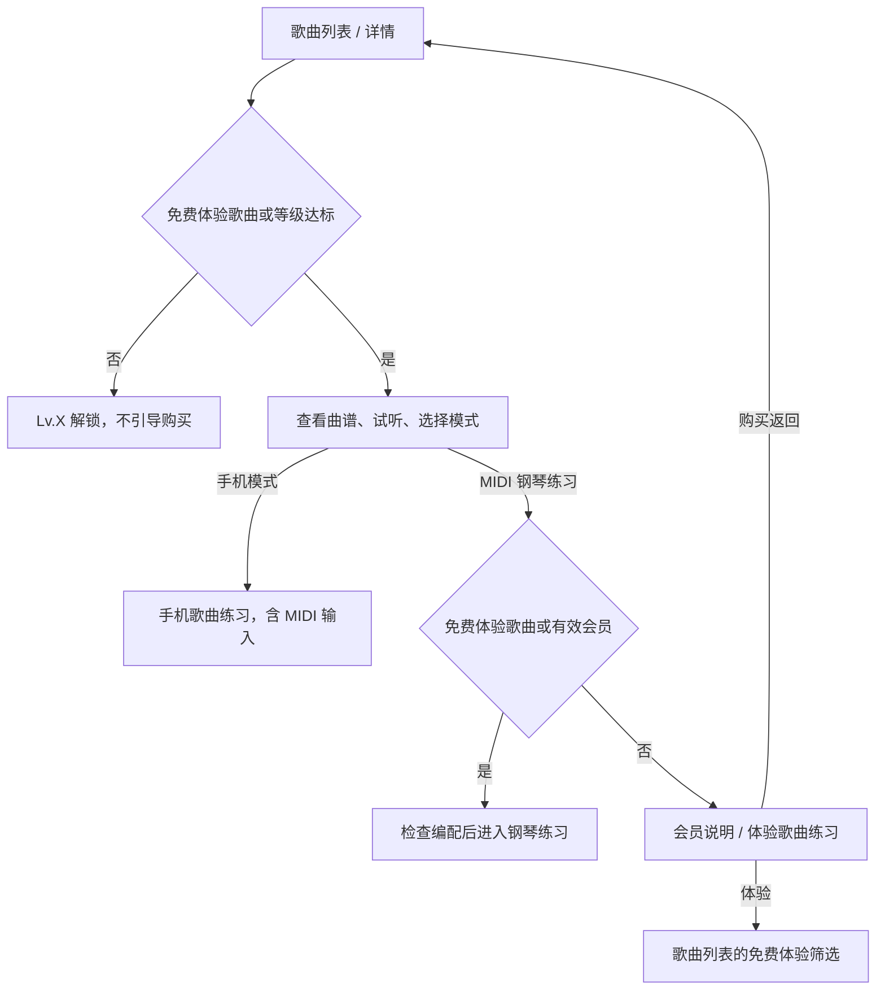

# 钢琴视奏｜官方歌曲 模块产品文档

> 模块代号：`S`　｜　页面范围：S-01 ~ S-05
> 所属产品文档：[00-总纲.md](00-总纲.md)（v2.1 r3）
> 文档状态：`draft`，待产品与设计评审
> 最后修订：2026-09-29

> **阅读约定**
> 本文件是《钢琴视奏产品文档 v2.1》的模块分册，负责本模块的页面级需求与专属规则，改动本模块只需改这一个文件。
> 跨模块的共享规则（输入模式矩阵、曲谱播放、MIDI 实时判定、失败处理总表）、产品范围、功能地图、视觉与非功能要求仍以主文档为准。
> 两者冲突时，**页面与本模块专属规则以本文件为准，跨模块规则以主文档为准**。

---

## 1. 模块定位与边界

### 1.1 定位

把识谱能力应用到真实曲子。歌曲是内容，等级决定官方内容进度；会员仅控制普通歌曲的 MIDI 钢琴练习，手机歌曲练习（含 MIDI 输入）不收费。

### 1.2 本模块包含

- 歌曲列表、筛选、搜索、试听。
- 歌曲详情与解锁条件展示。
- 手机模式（右手旋律）与钢琴模式（大谱表）练习。
- 歌曲结果页与片段重练。
- 后台曲库配置字段与版权门槛。

### 1.3 本模块不包含

- 会员购买、续卡、恢复 → 见《会员与支付》。
- 等级与和弦阶段的产生方式 → 见《识谱练习与学习体系》《和弦练习》。
- 个人导入曲谱 → 见《智能曲谱导入与个人曲谱》。

### 1.4 与其他模块的关系

| 依赖 | 来源 |
| --- | --- |
| `requiredLevel` 判定输入 | 识谱练习的等级体系 |
| 和弦阶段 | 记录独立学习进度，不作为歌曲解锁条件 |
| `isFreePractice` 与会员状态 | 歌曲钢琴练习权限；沿用当前配置映射，不迁移接口字段 |
| MIDI 连接 | 识谱练习 N-08 |
| 练习记录 | 汇入识谱练习 N-09 |

---

## 2. 页面清单与路由

| ID | 页面 | 类型 | 方向 | 路由名 |
| --- | --- | --- | --- | --- |
| S-01 | 歌曲列表页 | 新增 | 竖屏 | `song_list` |
| S-02 | 歌曲详情页 | 新增 | 竖屏 | `song_detail`（路径含 `songId`） |
| S-03 | 歌曲练习页：手机模式 | 新增 | 横屏 | `song_practice_phone` |
| S-04 | 歌曲练习页：钢琴模式 | 新增 | 横屏 | `song_practice_piano` |
| S-05 | 歌曲结果页 | 新增 | 竖屏 | `song_result` |

---

## 3. 关键流程

### 3.1 官方歌曲解锁与练习

上下架、版权和模式编配可用性始终需要检查；会员不能绕过等级或内容不可用状态。

---

## 4. 页面级详细需求

### S-01 歌曲列表页

**页面定位**：浏览、搜索、筛选歌曲，查看等级要求与练习进度，再进入详情。

**页面结构**：保留现有标题、搜索、全部 / 免费练习 / 继续练习 / 收藏筛选、等级与类型筛选及歌曲卡片。

**展示与交互**

- 仅免费体验歌曲在曲名旁显示“免费练习”；普通歌曲不贴会员标签，不按会员分区。
- 普通歌曲等级不足显示“Lv.X 解锁”；等级达到后显示“查看曲谱”，不因非会员锁住整张歌曲。
- 手机 / 钢琴模式分别显示“支持”“暂不支持”或等级要求；缺少编配不是会员限制。
- 会员属性只在详情页的 MIDI 钢琴练习入口表达，列表点击和试听入口保持现有详情跳转。
- 保留远端按曲目 ID 与内置曲库合并的行为；固定体验歌曲由现有同源配置维护，本次不变更名单。
- 不新增卡片分组或改动搜索、收藏、筛选与分页。

**验收标准**：免费体验标签只在本列表出现；普通歌曲没有会员标签；等级、缺少编配与付费权限不混用；原有筛选和详情跳转有效。

### S-02 歌曲详情页

**页面结构**：保留封面、曲名、等级难度、谱面试听、历史成绩、手机模式、MIDI 钢琴练习与片段入口。

**展示与交互**

- 标题与整张曲谱不显示免费或会员标签；内容状态显示“已解锁”“Lv.X 解锁”或不可用原因。
- 手机模式保持现有权限；钢琴入口命名为“MIDI 钢琴练习”，说明“连接 MIDI 钢琴，跟随五线谱练习”，不承诺音频识别。
- 等级达标、存在钢琴编配且缺少会员时，仅钢琴入口显示“需会员”。该按钮保持可点击样式，点击后打开现有会员说明。
- 会员说明提供“查看会员”“体验歌曲练习”和取消；体验动作进入歌曲列表现有免费体验筛选。
- 等级不足不引导购买；真正缺少编配显示“暂不支持”。进入练习前仍校验内容已就绪。
- 曲谱试听不受等级和会员限制；已发布、版权可用且有可播放音符时即可播放。练习入口继续按各自权限判断，购买返回重新校验权益及等级。
- 片段入口继续复用相同练习权限判断，不绕过门禁。
- 未连接 MIDI 时，连接提示提供“进入钢琴练习”和“连接 MIDI”；前者允许先进入钢琴页，再从页内连接设备，仍校验歌曲练习权限。

**验收标准**：曲谱内容与练习权限表达分离；会员入口可操作，缺少编配原因明确；没有全页会员锁或免费标签。

### S-03 歌曲练习页：手机模式

**页面定位**：没有真实钢琴时的右手旋律预习与轻量练习。

**页面结构**：顶部控制（返回、曲名、片段）、右手旋律谱面、延时目标键提示、局部虚拟键盘、小节进度。

**主要功能**：按当前右手目标音输入、即时正误反馈、片段重练、暂停、完成进入结果页。

**详细交互说明**

- **不加载钢琴大谱表**，不展示低音谱表与大括号。
- 使用屏幕单音键盘；首版不承载双手、和弦、多音同时输入，也不使用麦克风拾音。
- 屏幕琴键与 MIDI 共用判题：错音反馈后停在本音，订正正确才寻找下一未通过音。手动跳小节不计通过；正确率按首次尝试计。
- 开题显示谱面当前位置及普通琴键标签，不立即高亮目标键。目标键按 `hintDelay` 延时出现；`none` 不预先提示，旧 `instant` 最早 3 秒后提示。错误反馈正常显示。
- 连续错误时保留温和反馈，仍须在当前音订正后推进。
- 中途退出二次确认，已完成部分按未完成记录保存。

**关键状态与异常**：连续错误、片段强化、暂停、无手机模式编配、谱面加载失败、切后台。

**排版与信息层级要求**

本页是**跟谱式**练习页中唯一使用屏幕键盘的一个（识谱练习也用屏幕键盘，但那是出题式，两者布局不通用）。它与 S-04 钢琴模式是**两个独立页面**，不是同一页的两个状态。除主文档 8.7 的共性约束与跟谱式规则外，还要考虑单手持握：

- **键盘区落在拇指可及范围**，不要贴屏幕最上沿或最外缘。
- **谱面横向滚动，当前音符保持在屏幕左 1/3**，右侧留预读空间——视奏的本质是提前看到后面要弹什么，把当前音符放正中等于砍掉一半预读。
- 连续错误时保持反馈温和，提示计时从可继续作答时重新开始。

**验收标准**：键盘在拇指可及范围；当前音符位于左 1/3 且右侧有预读空间；只练右手旋律；无大谱表；不要求多音同时输入。

### S-04 歌曲练习页：钢琴模式

**页面定位**：同一张钢琴大谱表提供“播放”和“练习”两个互斥模式；播放用于听谱，练习由 MIDI 键盘作答。

**页面结构**：顶部播放控制与 MIDI 连接状态、钢琴大谱表（高音谱表 + 低音谱表 + 大括号）、播放线、可发声的屏幕钢琴键盘、播放 / 练习切换及练习开始 / 结束操作。

**主要功能**：加载大谱表；播放模式按曲谱 MIDI 时间轴发声并移动播放线；练习模式按同一时间点目标音组判定，结束后记录并展示真实练习数据。

**详细交互说明**

- **播放模式**：进入页面后可播放 / 暂停乐谱，播放线随真实音频时间轴移动；点击屏幕钢琴键盘可发对应声音。播放不建立练习记录，也不判定屏幕或外接 MIDI 按键。
- **练习模式**：用户显式点击“开始练习”后才建立会话并接收外接 MIDI 作答；点击“结束练习”、弹完范围或练习中返回时结算。屏幕钢琴键盘可发声，但不参与计分。
- 练习播放线停在当前目标拍点；按对的键绿色、错按的键红色。按错时播放线变红并停在原目标；重新弹对后自动恢复并前进。这里不实施 Perfect / Good / Early / Late / Miss 节奏评分。
- 新目标先显示谱面，按 `hintDelay` 延时后才高亮目标琴键；`none` 不预先提示，旧 `instant` 最早 3 秒后提示。播放模式仍按实际播放音显示按键。
- 单音按单音判定；双音、和弦或双手同一时间点按目标音组整体判定，不要求力度一致。
- 进入前选择右手 / 左手 / 双手及练习片段；播放与练习使用同一选择范围。
- MIDI 断开期间不判定，也不把断开计为漏音；连接恢复后可继续弹当前目标。
- 每次练习保存版本号、练习范围、目标与实际 MIDI 音高、正误、作答时间、反应时间、首答正确数和错误尝试数。播放不保存这些数据。薄弱项分析与音符识别建议后续上线，当前结果页不得生成推测性的分析。

**关键状态与异常**：播放 / 暂停 / 完成、练习待开始 / 进行中 / 已结束、MIDI 未连接 / 断开、漏按、多按、错按、无钢琴模式编配、未作答即结束。

**排版与信息层级要求**

本页是**跟谱式**页面，练习判定只支持 MIDI，与 S-03 手机模式是两个独立页面。遵循主文档 8.7 的共性约束与跟谱式规则：

- **播放线保持在屏幕左 1/3**，右侧留预读空间。
- **播放与练习必须视觉可分**：播放线随音频推进；练习线只随正确作答前进，答错时转红并停住。
- **左右手用稳定的颜色或位置区分**，且与 S-02 详情页的手别选择使用同一套标识。
- **MIDI 断开用就地提示条**，谱面保持原位并暂停判定，不要弹盖住谱面的模态框。

**验收标准**：播放有谱面声音且播放线与声音同步；屏幕键盘可发声但不计分；练习必须手动开始 / 结束；答错线红且停、订正后继续；只产生练习记录；未作答结果不伪造准确率；MIDI 断开不误判；使用大谱表。

### S-05 歌曲结果页

**页面定位**：总结本次歌曲练习表现；钢琴练习展示真实统计和基于首答准确率的鼓励评价，薄弱项指导待后续版本。

**页面结构**：歌曲名与练习模式、完成度、星级或评价、准确率、错音与错误小节统计、左右手表现（钢琴模式）、复习建议、重练片段、下一首、返回。

**主要功能**：查看结果、定位错误小节、重练片段、进入下一首、返回详情或首页。

**详细交互说明**

- 手机模式与钢琴模式必须标明模式；钢琴模式展示完成度、已答目标、首答准确率、首次答对数、错误尝试数与时长。未作答时准确率显示“尚未作答”；按本次所选范围结算，不生成节奏分或推断的薄弱项。
- 钢琴模式完成全部所选目标后，根据首答准确率显示鼓励评价：100% 为全部首次弹对，90% 及以上为表现良好，70% 及以上建议再练巩固，低于 70% 建议放慢速度重练。订正不覆盖首次作答记录；未完成或未作答时不显示正向评级。
- 钢琴自然完成后进入横屏结果页，评价与统计并排展示；竖屏查看历史时顺序展示。底部操作固定，较小屏幕或大字号可滚动查看全部数据。
- 从本次结果页左上角返回，会回到原钢琴页的待开始状态；点击“再练一次”立即开启新一轮，保留曲目、片段、手别与速度，独立记录每轮结果。历史结果的重练入口仍回到曲目或个人曲谱详情。
- 完成音效在本轮结果进入时播放一次；返回练习、查看历史与提前结束不重复播放。

**关键状态与异常**：未完成全曲、完美表现、数据不足、解锁下一首、同步失败。

**验收标准**：结果与练习模式对应清楚；钢琴评价与真实首答记录一致，未完成不误报完成；横屏可返回原练习页或直接重练，保留练习设置且每轮记录独立，完成音效不重复。

---

---

## 5. 模块核心规则

### 5.1 官方歌曲解锁与练习规则

- 先检查上下架和版权。免费体验歌曲完整开放，不受会员及等级限制；普通官方歌曲只以 `requiredLevel` 控制内容解锁。
- 已发布且版权可用的曲目，有可播放音符即可试听，不受等级和会员限制；手机歌曲练习（含 MIDI）不检查会员。
- 普通官方歌曲的 MIDI 钢琴练习按“等级 → 会员”判断；会员不能跳级。和弦阶段不参与歌曲权限。
- 复用 `SongAccessPolicy` / `PracticeAccessManager`；`accessTier` 仅保留兼容映射，不把歌曲定义为付费商品。
- 本轮保留现有免费体验歌曲配置，不新增歌曲或修改配置来源。
- 手机模式仍练右手旋律；钢琴模式使用大谱表与 MIDI 判定，算法遵循 S-03 / S-04。
- 上下架、编配、模式可用性与版权配置继续独立生效。

### 5.2 曲库内容与版权

本模块的曲库配置字段、初始曲库候选与版权三项联合门槛，见主文档第 9 章「内容、数据与同步」的 9.1 ~ 9.3；编配（`SongArrangement.sheetJson`）的运行时数据格式定义见主文档 9.8「曲谱内容的运行时数据格式」，与个人曲谱共用同一套格式。要点复述：

- 曲目上线是**三项联合门槛**：目标地区、作品 / 素材来源、实际编配版本均完成复核并留下记录，任一缺失不得上线。
- 会员或免费标记**不能覆盖**版权门槛。
- 候选名单不等于发布批准。

### 5.3 与共享规则的关系

- 钢琴模式的判定口径见主文档「MIDI 实时判定规则」。
- 试听的播放控制语义遵循主文档「曲谱播放规则」，但受试听范围限制。
- 失败与异常文案遵循主文档「失败处理规则」总表。
- **曲库列表的本地保底与远端合并、进入练习前的数据校验**，与个人曲谱共用同一条规则，见主文档「曲谱详情与练习入口的统一规则」。

---

## 6. 模块级验收要点

- 免费体验歌曲无需会员即可完成钢琴练习；普通歌曲等级不足时会员也不能绕过。
- 等级达标非会员可以查看曲谱和使用手机模式，点击钢琴练习才出现会员说明。
- 有效会员进入钢琴练习；到期后仅普通歌曲钢琴练习权限回收，历史与内容保留。
- 歌曲列表是唯一展示“免费练习”标签的位置；首页和详情不贴免费或会员内容标签。
- 缺少编配显示不可用，不显示“会员”；购买回流仍检查等级与编配。

---

## 7. 本模块待确认项

| # | 待确认 | 影响 |
| --- | --- | --- |
| 1 | 试听的默认范围与时长上限 | S-01 / S-02 试听体验 |
| 2 | 歌曲片段强化的默认分段策略是否与个人曲谱一致（4–8 小节） | S-02 片段列表 |
| 3 | 初始曲库每首曲目的三项版权复核进度 | 上线批次 |

---

## 8. 变更记录

| 日期 | 变更 |
| --- | --- |
| 2026-09-28 | 按批准方案分离内容等级、导入资源保护与歌曲钢琴练习会员权限；仅歌曲列表保留免费体验标签。以下早期记录用于追溯，现行规则以正文为准。 |
| 2026-09-27 | S-04 明确播放 / 练习两模式、真实 MIDI 音频与播放线、MIDI 订正判定及逐次练习明细；S-05 钢琴结果只展示真实统计，薄弱项指导延期 |
| 2026-09-20 | 5.2 补充引用主文档新增 9.8「曲谱内容的运行时数据格式」 |
| 2026-09-20 | S-01 补远端合并本地（而非整体替换）曲库列表的规则；S-02 补进入练习前的谱面数据校验；与个人曲谱共用同一条判定（见主文档新增 8.9） |
| 2026-09-18 | 拆自主文档 v2.1 r2（主文档同步升级为 r3），含 7.E 全部页面与 8.6 解锁规则 |
| 2026-09-18 | S-01 补三组分组（含「差一点就能练」）、人话锁定原因、谱面缩略图、从首页落在正确筛选态；S-02 补解锁阶梯与随状态唯一切换的主按钮 |
| 2026-09-18 | S-03 补拇指可及与左 1/3 预读；S-04 补等待 / 节奏模式视觉可分、左右手标识与详情页一致、MIDI 断开不遮挡谱面；明确 S-03 与 S-04 是两个独立页面（见主文档 8.7） |
| 2026-09-18 | 更正：撤回「五个练习页是同一套骨架」的说法。识谱与视奏共用一页、个人曲谱复用歌曲钢琴模式，此外各练习页互不复用；改为按出题式 / 跟谱式两类范式定义规则 |
