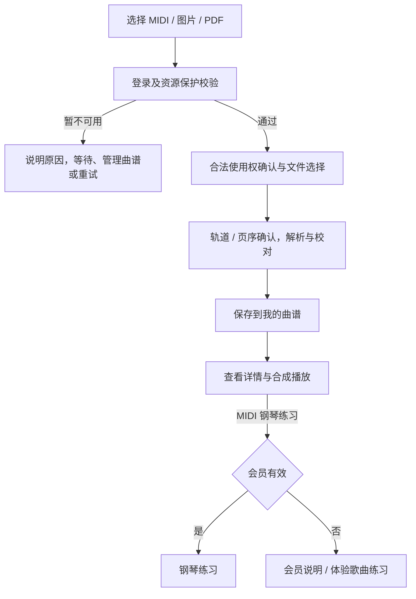
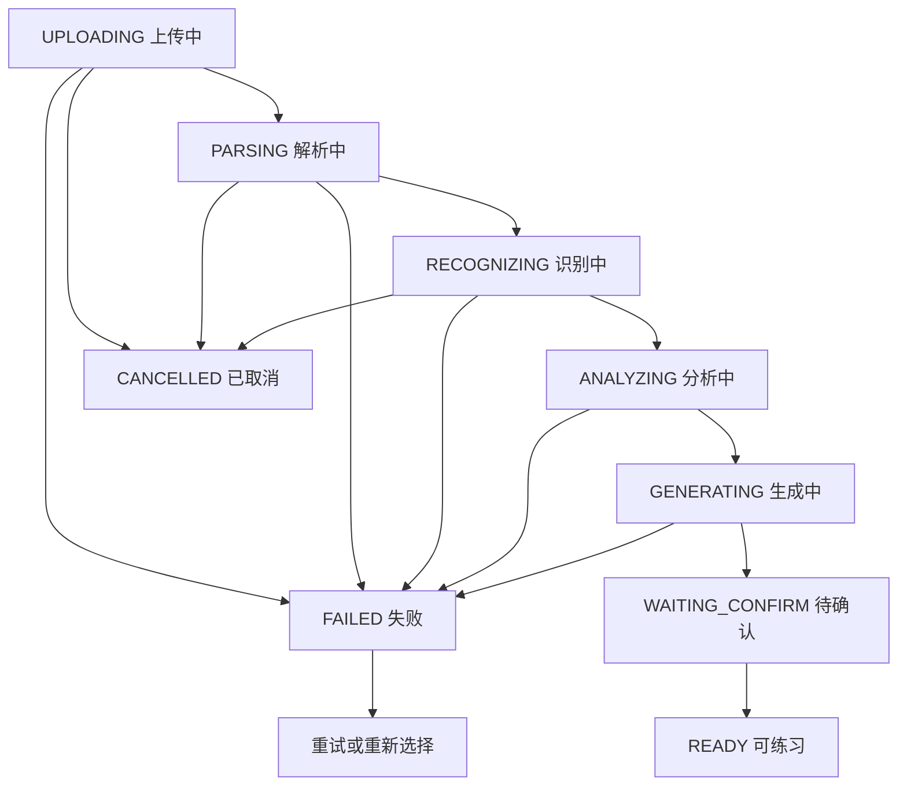
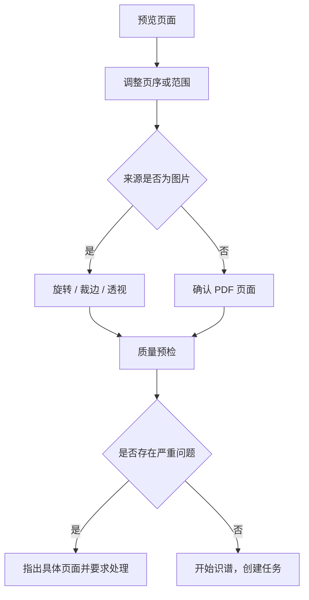
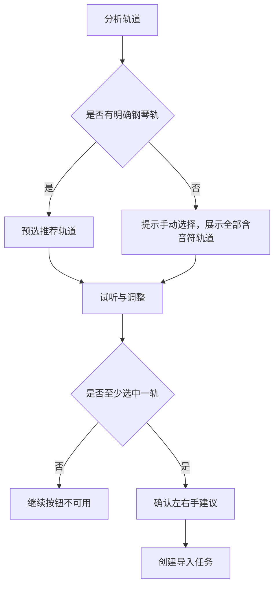
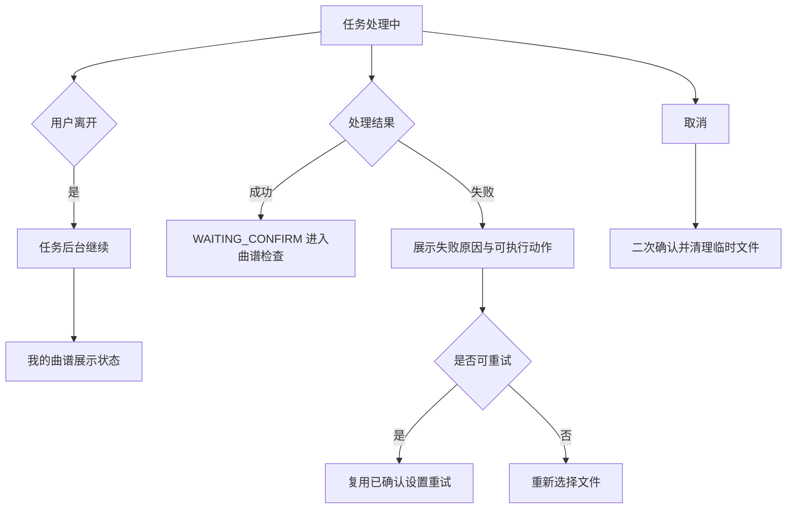
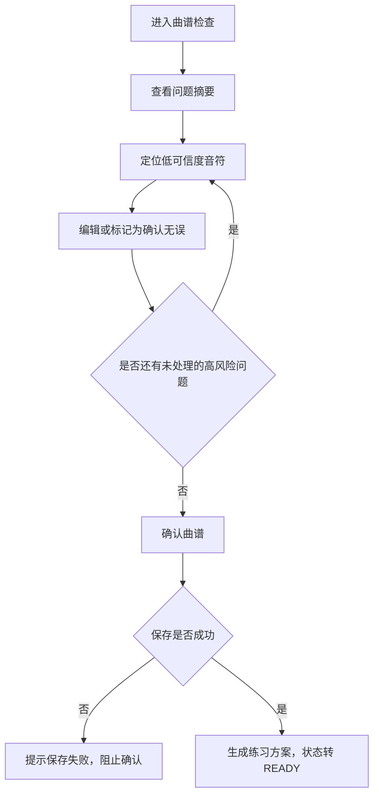
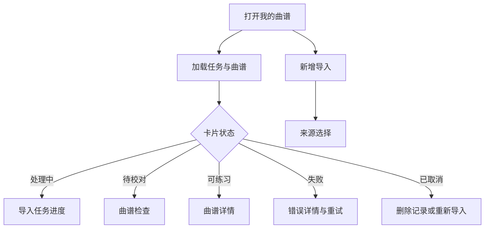
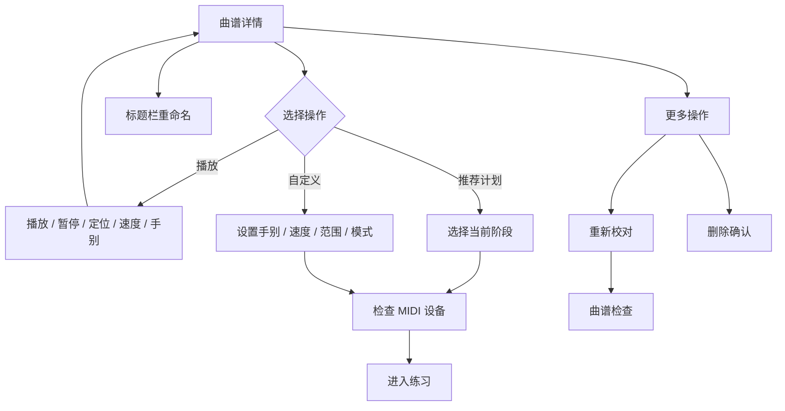
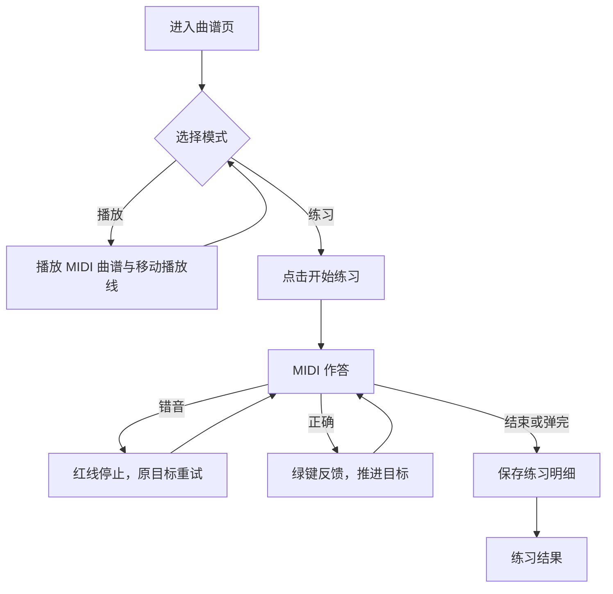

# 钢琴视奏｜智能曲谱导入与个人曲谱 模块产品文档

> 模块代号：`I`　｜　页面范围：I-01 ~ I-09
> 所属产品文档：[00-总纲.md](00-总纲.md)（v2.1 r3）
> 文档状态：`draft`，待产品与设计评审
> 最后修订：2026-09-28

> **阅读约定**
> 本文件是《钢琴视奏产品文档 v2.1》的模块分册，负责本模块的页面级需求与专属规则，改动本模块只需改这一个文件。
> 跨模块的共享规则（输入模式矩阵、曲谱播放、MIDI 实时判定、失败处理总表）、产品范围、功能地图、视觉与非功能要求仍以主文档为准。
> 两者冲突时，**页面与本模块专属规则以本文件为准，跨模块规则以主文档为准**。

---

## 1. 模块定位与边界

### 1.1 定位

把用户手上的 MIDI、曲谱图片和 PDF 变成可查看、播放与练习的个人内容。导入、解析、校对、保存和管理不依赖会员；个人曲谱的 MIDI 钢琴练习需要会员。

> 一句话表达：**你提供曲谱，我帮你把它变成可以练习的钢琴课。**

### 1.2 本模块包含

- 三类来源导入：MIDI、图片（JPG / JPEG / PNG / HEIC）、PDF。
- 图片与 PDF 预处理、MIDI 轨道与左右手确认。
- 导入任务生命周期与离页恢复。
- 曲谱检查（问题定位与单音符编辑）。
- 个人曲谱中心、曲谱详情与合成播放、自动练习方案。
- 个人曲谱的 MIDI 钢琴模式练习与真实结果统计；薄弱片段分析留待后续。
- **导入资源保护与创建频率限制**（不区分会员权益）。

### 1.3 本模块不包含

- 音频 / 录音 / 麦克风转乐谱（本版明确排除，不做入口也不做占位）。
- 个人曲谱的手机单音键盘模式（只生成 MIDI 钢琴模式）。
- 分享、公开发布、进入官方曲库、曲谱商店。
- 专业排版、制谱、编曲、转调、移调、打印、MusicXML 导出。
- 会员购买页本身 → 见《会员与支付》。

### 1.4 与其他模块的关系

| 关系 | 说明 |
| --- | --- |
| 入口 | 《基础框架》首页导入卡片、我的页我的曲谱卡 |
| 前置 | 《账号与合规》登录；导入服务的资源保护校验 |
| 前置 | 《识谱练习与学习体系》N-08 MIDI 设备连接 |
| 回流 | 个人曲谱详情的钢琴练习入口可进入会员说明；导入流程没有购买回流 |
| 汇总 | 练习记录汇入 N-09 |
| 共享 | 播放与实时判定遵循主文档共享规则 |

### 1.5 与官方歌曲的差异

| 维度 | 官方歌曲 | 个人曲谱 |
| --- | --- | --- |
| 可见范围 | 全体用户 | 仅本账号 |
| 内容访问 | 官方普通歌曲按等级解锁 | 登录后管理自己的曲谱，无等级和会员限制 |
| 资源保护 | 上下架及版权 | 统一资源保护，以服务端结果为准，不作为会员权益 |
| 练习模式 | 手机模式 + 钢琴模式 | 仅钢琴模式（MIDI） |
| 谱面质量 | 人工编配，可信 | 识别结果，需用户校对确认 |
| 会员到期 | 普通歌曲钢琴练习需重新开通，内容不锁定 | 内容保留可查看、播放和管理，钢琴练习需重新开通 |
| 删除 | 用户不可删除 | 用户可删除，连同原始文件与记录 |

---

## 2. 页面清单与路由

| ID | 页面 | 类型 | 方向 | 路由名 |
| --- | --- | --- | --- | --- |
| I-01 | 导入来源选择页 | 新增 | 竖屏 | `score_import_source` |
| I-02 | 图片 / PDF 准备页 | 新增 | 竖屏 | `score_import_image_preparation` |
| I-03 | MIDI 轨道选择页 | 新增 | 竖屏 | `score_import_midi_tracks` |
| I-04 | 导入任务进度页 | 新增 | 竖屏 | `score_import_progress` |
| I-05 | 曲谱检查页 | 新增核心页 | 横屏优先 | `score_import_review` |
| I-06 | 我的曲谱（个人曲谱中心） | 新增核心页 | 竖屏 | `personal_scores` |
| I-07 | 个人曲谱详情与练习方案 | 新增 | 竖屏 | `personal_score_detail` |
| I-08 | 个人曲谱练习页 | 练习页增量 | 横屏 | 复用 `song_practice_piano` 语义 |
| I-09 | 个人曲谱练习结果页 | 结果页增量 | 竖屏 | 复用结果页语义 |

相关弹框（细则见《全局弹框》模块）：D-15 合法使用权、D-16 取消导入、D-17 删除曲谱、D-18 未保存离开、D-19 文件异常、D-20 无明显钢琴轨、D-23 额度不足、D-24 频率提示。

---

## 3. 关键流程

### 3.1 智能曲谱导入主流程

导入、解析、校对、保存及查看不检查会员；仅开始歌曲钢琴练习时检查会员。

### 3.2 导入任务生命周期

---

---

## 4. 页面级详细需求

### I-01 导入来源选择页

**页面定位**：统一解释三类输入的差异、格式与预期结果，是所有导入任务的起点。

**页面结构**：返回与标题"导入我的曲谱"+ `Beta` 标记、一句价值说明、MIDI 卡片、五线谱图片卡片、PDF 卡片、支持格式与合法使用权说明。卡片顺序固定为 MIDI → 图片 → PDF。

**卡片内容**：来源图形、**准确度说明**、适用场景、支持格式、限制摘要、主要操作按钮。

#### 三类来源的准确度说明（正文文案，不是小字）

每张卡片必须带一段准确度说明。语气是**"帮你选"，不是"免我责"**——法务腔的免责条款既压转化又防不住差评，而一段能帮用户判断该用哪种方式的说明，反而会降低失望。

> **MIDI 文件**　准确
> MIDI 本身就包含音符信息，我们直接读取，不做识别，音高和时值是准确的。你只需要确认哪些轨道是钢琴、左右手怎么分。

> **PDF 曲谱**　通常不错
> 电子版 PDF 识别效果一般较好，扫描件会打折扣。生成后需要你核对一遍。

> **曲谱图片**　取决于照片质量　`Beta`
> 拍照识别是三种里最难的，结果**一定**需要你核对和修改，复杂乐段尤其。拍摄时保持谱面平整、光线均匀、避开阴影，准确率会明显提高。

#### `Beta` 标记规则

- 整个导入功能带 `Beta` 标记，出现在：首页导入入口、本页标题、我的曲谱页标题。
- **命名本身就是期望管理**：`Beta` 无法被跳过，出现在每一个入口，且用户对 Beta 的容忍度天然高一档。它的作用大于任何一段免责文案。
- 图片来源额外单独带 `Beta`，因为它的不确定性明显高于另外两种。
- 当自测数据表明某一来源的平均待修正处数稳定进入可接受区间时，可以单独摘掉该来源的标记；**MIDI 来源从一开始就不带 `Beta`**，它是确定性解析。

**主要功能**

- 选择 MIDI 文件（系统文件选择器）。
- 图片来源三选一：相机、相册、文件。
- 选择 PDF（系统文件选择器）。
- 查看格式、限制与隐私说明。
- 副标题保持“转换为可以播放和练习的曲谱”。其下、来源卡片之前用一段次要正文说明：曲谱导入与查看免费；连接钢琴进行导入曲谱的 MIDI 练习需要会员；可先用免费体验歌曲确认设备与练习体验。此处是选文件前的权限告知，不贴免费标签，也不展示会员权益面板。
- 在用户选定来源操作后依次检查登录与资源保护条件，通过后恢复该操作。

**交互流程图**

导入、解析、校对、保存及查看不检查会员；仅开始歌曲钢琴练习时检查会员。

**详细交互说明**

- **浏览本页不要求登录**；校验顺序固定为：点击具体来源操作 → 登录检查 → **资源保护检查** → **创建频率检查** → 合法使用权确认 → 打开系统选择器。
- 额度与频率同时不满足时只展示额度提示；频率提示必须说明是"暂时"而不是失败，并给出大致可恢复时间。
- 首次使用显示完整合法使用权说明；后续仍在选择文件前显示简短确认（D-15）。
- 登录取消时返回本页并保留已选来源类型，不创建任务；登录成功后恢复该来源操作并重新打开对应选择器。
- 系统选择器取消后返回本页，不创建任务。
- 不支持的格式必须在本页明确说明，不让用户走完长流程才发现。
- 本页不得出现音频、录音、麦克风入口或"即将支持"占位。

**关键状态与异常**：默认、未登录、登录取消、资源校验中、校验失败、资源上限、有任务处理中、频率限制、系统权限未授权、离线、文件选择取消、格式不支持、超限。

**验收标准**

- 只有 MIDI、图片、PDF 三类来源，三张卡片均显示格式与结果预期。
- 未登录可浏览；选定来源后才要求登录，登录成功能恢复原操作。
- 选文件前能读到导入、查看与 MIDI 钢琴练习的权限说明；说明完整可换行，不贴免费标签。
- 导入不检查会员；资源限制只给出原因及等待、管理或重试动作，不引导购买。
- 触达频率上限时展示的是"稍后可继续"而不是失败，且能直接跳到进行中的任务（如果是并发上限导致）。
- 三张卡片都带准确度说明，且写成正文而非小字；MIDI 卡片不带 `Beta`，图片卡片带。
- 本页不出现法务腔的免责条款；准确度说明读起来是在帮用户选，不是在免责。
- 未确认合法使用权不能提交文件。

### I-02 图片 / PDF 准备页

**页面定位**：在上传前确认页面范围、顺序与可识别质量；图片额外支持旋转、裁边与透视调整。

**页面结构**：顶栏与来源类型、页面缩略图列表（含页码与问题标记）、当前页大预览、图片调整工具或 PDF 页面选择、质量提示区、固定底部"开始识谱"。

**主要功能**

- 图片：添加、删除、拖动排序、旋转、四角裁边与透视校正、恢复原图。
- PDF：选择页面范围、检查页序、移除空白或非曲谱页。
- 质量预检：模糊、过暗、方向错误、谱面被裁断、重复页、空白页。
- 创建识谱任务。

**交互流程图**

**详细交互说明**

- 缩略图显示页码与问题标记；点击缩略图切换大预览。
- **严重问题阻止提交**（如整页非曲谱、谱面被裁断）；一般风险允许继续，但必须说明可能需要更多校对。
- 返回时保留本次页面调整；用户主动取消后清空临时选择并提示已上传的临时文件将被清理。
- 图片四角调整必须提供恢复入口。
- 用户提交前可见最终页面数量与顺序。

**关键状态与异常**：图片模糊 / 过暗 / 裁断 / 重复页 / 页序异常；PDF 加密、损坏、超 50 页、超 50 MB、无可预览页面；单张或单文件超限；总数超限。

**验收标准**：最终提交的页面数量与顺序明确可见；图片四角调整有恢复入口；PDF 加密或超限时不创建任务并提供重新选择。

### I-03 MIDI 轨道选择页

**页面定位**：把 MIDI 中可练习的钢琴内容交给用户确认，避免系统选错乐器或手部。

**页面结构**：文件名 / 时长 / 轨道数等元信息、推荐说明、轨道列表（名称、乐器、音符数、音域、试听）、多选与合并开关、左右手建议摘要、"继续生成"按钮。

**主要功能**：单选或多选轨道、短暂试听、合并选中轨道、确认或交换左右手建议、创建任务。

**交互流程图**

**详细交互说明**

- 明确钢琴轨默认选中；非钢琴轨不默认选择。
- 没有明显钢琴轨时**不报死错**，展示全部含音符轨道并要求手动选择（D-20）。
- 试听不自动开始，不与系统其他音频叠加，离开页面即停止。
- 多选时明确提示"将合并为一份练习曲谱"。
- 左右手建议可在 I-05 曲谱检查中继续修改。

**关键状态与异常**：无音符事件、无钢琴轨、轨道过多、轨道名称缺失、文件损坏、超出时长或大小上限。

**验收标准**：无明显钢琴轨时仍可手动继续；未选轨道不能创建任务；推荐选择与强制选择可区分。

### I-04 导入任务进度页

**页面定位**：解释长任务正在做什么，并允许用户安全离开、恢复查看、取消或重试。

**页面结构**：标题与曲谱临时名称、当前状态说明、步骤列表（上传 → 解析 / 识别 → 分析 → 生成）、已完成摘要（页数 / 小节数 / 音符数）、后台继续说明、操作区（取消 / 返回我的曲谱 / 失败重试）。

**主要功能**：查看实时状态、离开并继续处理、取消可取消阶段、失败后从可恢复节点重试或重新选择文件。

**交互流程图**

**详细交互说明**

- 使用步骤与已完成项表达进度；**百分比只能作为辅助，不得单独出现**。
- 返回按钮不等于取消，返回时提示"任务会继续，可在我的曲谱查看"。
- 取消必须二次确认（D-16），并说明已上传临时文件将被清理；不可取消阶段隐藏取消按钮并说明任务即将完成。
- 成功后进入待确认状态，**不自动跳过曲谱检查**。
- 重试复用同一任务卡与用户已确认的页面 / 轨道设置，除非失败原因要求重新选择；重试计入创建频率但不新增额度占用。

**关键状态与异常**：`UPLOADING` / `PARSING` / `RECOGNIZING` / `ANALYZING` / `GENERATING` / `WAITING_CONFIRM` / `FAILED` / `CANCELLED`；网络中断、服务暂不可用、文件失效、部分页面失败、任务超时。

**验收标准**：任一处理中状态都有当前动作、已完成项与可采取动作；离开后可从 I-06 恢复到同一任务；重试不产生重复曲谱卡片。

### I-05 曲谱检查页

**页面定位**：让用户在生成练习前确认识别结果，优先解决低可信度问题。三类来源的必经页。

**页面结构**：顶栏（曲名、保存状态、退出）、**固定说明条**、问题摘要（低可信度数 / 警告数 / 已处理数）、五线谱主画布、当前问题定位与上一项 / 下一项、音符编辑面板、"确认曲谱"主按钮。

#### 顶部固定说明条

本页顶部常驻一句，不可关闭：

> 识别结果由算法生成，确认前请核对一遍。**你确认的版本会作为练习判定的标准。**

后半句是关键：它解释了"为什么非核对不可"——用户才会真的去核对；同时把结果的归属交回用户自己手上。只写"可能有误差"没有这个效果。

**主要功能**

- 定位问题小节与音符。
- 修改音高、时值、升降号、左右手归属。
- 添加或删除音符。
- 撤销最近操作、保存草稿、确认曲谱。
- 修改曲名与作曲者等基本信息。

**交互流程图**

**详细交互说明**

- 低可信度使用高优先级标记，中可信度使用提醒标记；**颜色之外同时使用图标、文字与问题列表**。
- 点击问题列表时谱面滚动到对应小节并保持上下文。
- 修改后立即显示未保存状态；自动保存失败时阻止最终确认。
- 对无问题的 MIDI 提供"全部正常，确认并生成练习"的快速路径，但**不绕过本页与 `WAITING_CONFIRM` 状态**。
- 高风险问题未处理时点击确认，需明确说明并让用户返回处理，不静默通过。
- 未保存退出需二次确认（D-18），可选择保存草稿。

*系统先于用户承认问题*

- 当低可信度问题数超过阈值（阈值后台可配）时，进入本页**先由系统主动说明**，而不是让用户自己发现一屏红点：

  > 这份谱子识别得不太理想（37 处需要确认）。换一张更清晰的照片，或者改用 MIDI 导入，效果会好很多。

- **系统先认错，用户就不觉得被骗。** 这个提示出现在问题发生的当下，作用远大于购买前的免责小字。
- 提示同时给出三条出路：继续校对 / 换文件重新导入 / 放弃本次任务。不给出路的坦白只会加重挫败。

*给不满一个比应用商店更近的出口*

- 该提示条内，以及问题摘要区，都要有一个**一键直达意见反馈**的入口，预填当前任务的来源类型与问题数。
- 不满的用户需要一个宣泄口；App 内有，他大概率不会去应用商店写评价。**不要让他去"我的 → 帮助 → 反馈"翻三层。**

**关键状态与异常**：无问题、有低可信度、有一般警告、保存中、保存失败、离线、未保存退出、并发编辑冲突。

**验收标准**

- 所有问题均可从摘要一键定位。
- 状态不只通过红黄颜色表达。
- 编辑能力覆盖音高、时值、升降号、左右手、添加与删除。
- MIDI / 图片 / PDF 均经过 `WAITING_CONFIRM` 与本页确认。
- 顶部固定说明条常驻且不可关闭，并说明"确认后的版本是判定标准"。
- 低可信度问题超阈值时，系统主动说明并给出三条出路。
- 识别质量差的场景可一键直达意见反馈，不需要翻菜单。
- 保存失败时不能把任务标记为可练习。

### I-06 我的曲谱（个人曲谱中心）

**页面定位**：统一管理个人导入曲谱与未完成任务，是状态恢复与继续练习的中心。

**页面结构**：返回、标题与新增导入、练习权限简短说明、搜索、分类筛选（全部 / MIDI / 图片 / PDF）、处理中与待校对优先区域、曲谱列表、空状态与分页加载、额度提示条（仅在需要时出现）。

**卡片信息**：标题、来源类型、难度、拍号、BPM、练习进度、最近更新时间、当前状态。任务卡与可练习曲谱使用一致容器但不同主动作。

**主要功能**：搜索与筛选、查看任务、继续校对、查看曲谱、失败重试、重命名、删除、新建导入、资源限制时管理曲谱或重试。

**交互流程图**

**详细交互说明**

- 默认按最近更新排序；处理中与待校对可置顶，但仍属于筛选结果。
- 从导入进度页返回或取消任务后，清理本次导入流程的页面栈；“我的曲谱”的页面返回键和系统返回优先返回上一页，没有可返回页面时直接回到首页。
- 搜索只匹配当前账号的个人曲谱，不混入官方曲库。
- 已生成曲谱的卡片更多菜单提供“重命名”；输入去除首尾空格，非空且最多 120 字符。保存成功后按当前搜索、筛选条件刷新，若新名称不再匹配搜索，卡片从结果中移除。
- 删除前展示将删除的内容范围（结构化曲谱、原始文件、处理产物、修正与练习记录），确认后从所有分类移除（D-17）。
- 每个状态只有一个清晰主动作。
- 未登录进入时先引导登录，登录后回到本页。
- 搜索区上方始终显示与导入来源页一致的权限说明，包括空列表状态；它是正文说明，不附着在任何曲谱卡片上。
- 仅服务端返回资源限制时说明占用情况及恢复方式；平时不显示剩余数量，也不展示免费或会员标签。
- 删除成功后额度立即回收，提示条随之消失，"新增导入"恢复可用。
- 会员到期不影响曲谱的查看、播放、校对、删除及新增导入；只在详情页点击 MIDI 钢琴练习时检查会员。

**关键状态与异常**：空、加载中、加载失败、处理中、待校对、可查看、失败、已取消、离线仅展示缓存、资源校验中或受限。

**排版与信息层级要求**

- **卡片收敛成三行**：谱面缩略图 + 曲名 / 状态或练习进度 / 来源 + 最近更新。拍号、BPM、调号这类元信息移到 I-07 详情，不在列表卡上铺开——八个字段挤一张卡是这一页最容易失控的地方。
- **谱面缩略图用真实渲染**：取识别结果的前 1–2 小节画出来，不用通用图标占位。个人曲谱与官方曲目的最大区别就是"这是我的那一首"，看得出来才成立。
- 已生成曲谱的主动作统一为“查看曲谱”，进入详情后再选择练习，不把跳详情标成“继续练习”。
- **优先区排序写死**：待校对 › 失败 › 处理中 › 可练习（按最近更新）。待校对是用户欠系统的动作，最该先被解决。
- **空状态不显示额度**，只给价值说明与"导入第一份曲谱"。
- 向首页提供摘要：最近 3 份 + 总数，待校对的优先露出（见主文档契约 3）。

**验收标准**：权限说明在空列表与已有曲谱时均可见，且不成为卡片标签；已生成卡片可改名，取消或保存失败保留原名；四个筛选数量与列表一致；每个状态主动作唯一；卡片不超过三行信息且带真实谱面缩略图；已生成卡片以“查看曲谱”进入详情；失败卡片展示原因摘要而不只是"失败"；列表中不出现音频分类；额度提示只在达到上限时出现，平时页面不显示剩余数量；删除后额度立刻可用。

### I-07 个人曲谱详情与练习方案

**页面定位**：展示已确认曲谱的概览、合成播放、练习进度与自动生成方案，是开始或继续练习的主入口。

**页面结构**

1. 返回、标题栏改名入口与更多操作（重新校对、删除）。
2. 曲名、作曲者、来源类型与缩略谱面。
3. 元信息：难度、BPM、拍号、调号、小节数、预计时长。
4. **曲谱播放区**：播放 / 暂停、进度条与当前小节、速度、手别独奏 / 静音。
5. 总进度与最近练习。
6. 自动练习段落列表。
7. 手别、速度、范围与模式设置。
8. "开始 / 继续练习"主按钮。

**主要功能**

- 合成播放整份曲谱，定位进度，切换速度与手别。
- 开始推荐阶段练习。
- 自定义手别、速度、范围与循环。
- 重新进入曲谱检查。
- 重命名、删除曲谱。
- 标题栏可修改当前曲谱名称；保存后仅更新标题，不重置谱面与合成播放进度，返回列表和首页时显示新名称。重命名不要求会员。
- 直接进入详情时保留“我的曲谱”和主页面的返回路径；从列表打开详情后返回，保留原搜索与筛选。

**交互流程图**

**详细交互说明**

- 练习段落默认按 4–8 小节建议，但乐句、休止、重复结构、双小节线与难度突变优先于固定长度；每段显示手别、速度与完成状态。
- 新曲谱默认定位第一段右手低速练习，但**不自动开始**。
- 曲谱进入 `READY` 后即可播放，**不依赖 MIDI 键盘连接**。
- 播放控制与练习设置相互独立；只有用户点击开始练习时才采用练习设置。
- 播放进度可按时间拖动并显示当前小节；手别支持双手 / 右手独奏 / 左手独奏 / 分别静音。
- 快捷速度为 50%、60%、70%、80%、90%、100%；自定义 BPM 范围为 40 至识别 / 确认后的原始 BPM。
- 删除与重新校对放入更多菜单，避免误触。
- 个人曲谱的标题和整张曲谱不贴免费或会员标签。仅 MIDI 钢琴练习入口标注“需会员”，保持可点击并打开会员说明；查看、播放、编辑与管理始终可用。
- **「开始 / 继续练习」在真正跳转前必须校验谱面内容本身非空、可解析**——曲谱记录存在不等于内容已就绪。未就绪按「曲谱内容加载失败」处理并停留在本页；这条判定与官方歌曲详情（S-02）共用同一套标准（见主文档 8.9）。

**关键状态与异常**：新生成、播放中、已暂停、播放缓冲、播放结束、播放失败、练习中、已完成、需重新校对、MIDI 未连接、曲谱内容加载失败。

**排版与信息层级要求**

- **段落列表是本页主体，不是附属**。用户来这一页有八成是为了挑一段练：每段一行，段号 + 小节范围 + 手别 + 速度 + 完成状态 + 该段独立的"练这段"。
- **播放区与练习区分成两个视觉层**。播放是"听一下"，练习是"干活"，两者容易混：播放控制收成一条，主按钮全页只有"开始 / 继续练习"一个。
- **元信息收成一行小字**。难度、BPM、拍号、调号、小节数、预计时长排成一行，不要做成四个并排数据块——那是首页统计卡犯过的错。
- 谱面缩略图与 I-06 列表用同一套渲染，保证从列表点进来是同一张脸。
- 离开本页或从练习返回时写回续练点（见主文档契约 1）。

**验收标准**

- 段落列表是本页视觉重心，每段可独立进入练习。
- 全页只有一个主按钮；播放控制不与练习设置争抢。
- 元信息不占用超过一行。
- 本页可完成手别、速度、范围与模式选择。
- 三类来源生成的 `READY` 曲谱均可播放，并可完成播放 / 暂停、进度定位、当前小节、速度与手别控制。
- 播放失败展示重试，不改变 `READY` 状态，也不阻止进入练习。
- 自动计划与自定义设置互不覆盖，切回时恢复最近选择。

### I-08 个人曲谱练习页

**页面定位**：复用横屏钢琴模式练习，针对个人曲谱增加来源、段落与手别上下文。

**页面结构**：顶部控制（返回、曲名、速度、MIDI 状态）、大谱表与播放线、可发声的屏幕琴键反馈区、播放 / 练习切换与练习开始 / 结束按钮。

**主要功能**

- **播放模式**：真实播放选定范围与手别的 MIDI 曲谱，播放线随音频推进；屏幕琴键可单独发声，不产生练习记录。
- **练习模式**：显式开始后才由外接 MIDI 判定；按对显示绿色并推进，按错显示红色、播放线变红且停在当前目标，重弹正确后继续；显式结束或弹完范围后保存练习数据。
- 右手 / 左手 / 双手和分段范围在进入页面前选定；当前不提供节奏窗口分级判定。

**交互流程图**

**详细交互说明**

- 个人曲谱的**练习判定**只支持外接 MIDI；屏幕琴键仅供听音，不作为答案。
- 双手和弦按同一时间点目标音组判定，不要求力度完全一致。
- 错音反馈不遮挡谱面；MIDI 断开期间不判定，也不把断开记录为漏音。
- 练习中返回等同结束练习，已产生的数据按未完成结果保存；播放中返回不写练习结果。
- 谱面与判定是视觉最高优先级；来源信息只在标题或信息入口显示。

**关键状态与异常**：MIDI 未连接 / 连接中 / 断开、播放中 / 暂停 / 完成、练习待开始 / 进行中 / 结束、错音停止、未作答、曲谱内容加载失败。

**排版与信息层级要求**

本页**复用 S-04 官方歌曲钢琴模式的页面语义与视觉**——这是全部练习页之间唯一的复用关系（另一处是识谱与视奏共用一页）。差别只在上下文：

- 个人曲谱的来源（MIDI / 图片 / PDF）只在标题或信息入口显示，**不占用练习主区域**。
- 播放线位于当前目标；播放模式随音频移动，练习模式随正确作答移动；左右手标识与 I-07 详情页的手别选择一致。
- MIDI 断开用就地提示条，谱面保持原位。
- 识别结果可能存在残留问题：练习中若发现明显错音，给一个低优先级的"去校对这一小节"入口，直达 I-05 对应位置。**这是个人曲谱独有的，官方曲目没有。**

**验收标准**：与 S-04 的播放 / 练习交互一致；播放有声但不记练习；练习只由 MIDI 判定，错音红线停住、订正后推进；MIDI 断开不计漏音；结束后可从详情重新选择段落。

### I-09 个人曲谱练习结果页

**页面定位**：展示本次真实练习数据；基于跨次数据的薄弱项指导在后续版本提供。

**页面结构**：完成度、已答目标、首答准确率、首次答对数、错误尝试数、练习时长、再练一次 / 返回详情。逐次目标与实际 MIDI 音高、正误、反应时间、手别与范围保存在练习记录中。

**主要功能**：查看本次实测统计、返回详情重新练习。

**详细交互说明**

- 未作答就结束时显示“尚未作答”，不把准确率伪装成 0%。
- 当前不生成薄弱片段、音符识别评价或节奏评分；后续可依据已保存的逐次数据提示“音符识别不够准确 / 不够熟悉，需要多练习”。
- 结果页不显示任何会员状态。

**关键状态与异常**：正常完成、完美表现、未完成退出、数据不足、单手 / 双手结果、同步失败。

**验收标准**：统计与练习明细一致；旧记录兼容；播放无练习记录；不出现未经计算的薄弱项或会员状态。

---

---

## 5. 模块核心规则

### 5.1 导入与校验规则

- 创建任务前依次校验：登录状态 → **资源保护** → **创建频率** → 网络 → 合法使用权确认 → 文件格式 → 产品默认上限。
- 系统选择器取消、格式不支持、额度不足、触达创建频率上限或未确认合法使用权时不创建任务。
- 同一文件重复选择时提示"已存在同名 / 同内容任务"，允许查看已有任务或仍然新建；**默认不重复创建**。
- 图片必须由用户确认页序；PDF 默认按原页序，可移除非曲谱页。
- 图片严重质量问题阻止提交；一般风险允许继续但必须提示可能需要更多校对。
- 大文件采用分片或直传方式上传，用户侧只需看到"上传中"步骤与可取消状态。

### 5.2 任务状态规则

| 状态 | 用户可见文案 | 主动作 | 可取消 |
| --- | --- | --- | --- |
| `UPLOADING` | 正在上传文件 | 返回我的曲谱 / 取消 | 是 |
| `PARSING` | 正在读取曲谱结构 | 返回我的曲谱 / 取消 | 是 |
| `RECOGNIZING` | 正在识别音符与小节 | 返回我的曲谱 / 取消 | 是 |
| `ANALYZING` | 正在分析左右手与难度 | 返回我的曲谱 | 否 |
| `GENERATING` | 正在生成练习段落 | 返回我的曲谱 | 否 |
| `WAITING_CONFIRM` | 曲谱已识别，等待检查 | 检查曲谱 | 否 |
| `READY` | 可以开始练习 | 查看详情 / 开始练习 | 否 |
| `FAILED` | 导入失败，显示具体原因 | 重试 / 重新选择 | 否 |
| `CANCELLED` | 已取消 | 删除记录 / 重新导入 | 否 |

- 返回页面不改变任务状态。
- 不可取消阶段隐藏取消按钮并说明任务即将完成。
- 重试复用同一任务卡与用户已确认的页面 / 轨道设置，除非失败原因要求重新选择；重试计入创建频率（5.7），但不新增额度占用。
- 任务状态在列表、进度页、详情页三处必须一致。
- 额度占用随状态变化：创建任务即占用；进入 `FAILED` 或 `CANCELLED` 后释放；`READY` 后持续占用直到用户删除。

### 5.3 MIDI 轨道与左右手规则

- 明确钢琴轨优先推荐，非钢琴轨不默认选择。
- 多个钢琴轨允许多选合并；合并前明确说明结果会成为一份练习曲谱。
- 已有左右手轨道标签时优先采用；否则给出左右手建议与可信度。
- 单轨 MIDI **不以固定 C4 作为唯一拆手依据**；产品只要求结果可解释、可校对，不在本文档规定算法。
- 自动清理可明确判定的异常短音符，对无歧义的微小时间偏移做量化校正，并合并重复 NoteOn / 音符事件。
- 清洗结果存在不确定性时必须进入曲谱检查并标记给用户，**不得静默删除**可能有意义的音符。
- 踏板与力度可保留用于播放与结果信息；首版判定不要求力度匹配。

### 5.4 曲谱识别与校对规则

- 识别结果至少覆盖：谱号、调号、拍号、音符、休止符、小节线、和弦、升降号、连音 / 延音关系与左右手建议。
- 每个可疑位置分为低可信度、一般警告与正常；**不得宣传"100% 准确"**。
- 三类来源均必须进入 `WAITING_CONFIRM` 并由用户完成曲谱检查；图片 / PDF 的高风险问题必须处理，MIDI 无问题时可提供单步快速确认，但不得绕过页面与状态。
- 修改后的结果优先于原识别结果，并持续显示未保存 / 已保存状态。
- 部分页面完全无法识别时，用户可删除问题页、重新上传对应页或放弃整次任务。
- 低 / 中可信度的具体阈值由真实样本验证后确定，本文档不预设算法数值。

### 5.5 练习生成规则

- 难度使用 Lv.1–Lv.10，依据音高、节奏、速度、跨度、和弦、左右手独立性与跳跃等维度综合生成。
- 默认段落目标为 4–8 小节，但乐句、休止、重复结构、双小节线与难度突变优先于固定长度。
- 新段落默认建议顺序：**右手低速 → 左手低速 → 双手中速 → 双手原速**；用户可跳过或自定义。
- 百分比快捷速度固定为 50%、60%、70%、80%、90%、100%；自定义 BPM 范围为 40 至识别 / 确认的原始 BPM。
- 练习范围只能选择连续小节；跨不连续片段通过多个专项练习完成。

### 5.6 导入资源保护规则

- MIDI、PDF、图片导入、解析、保存、查看、编辑与管理不检查会员，也没有非会员体验份数或会员专属额度。
- 文件大小、并发、存储及异常请求限制用于保护资源，不是购买权益。阈值沿用服务端配置，本次不修改接口或后台参数。
- 仅收到资源限制时解释具体原因；可管理曲谱、等待或重试，不提供“购买会员解除限制”。
- 校验失败允许重试；不能把请求失败解释成无会员资格，也不擅自放行。
- 会员到期不删除、锁定或降级个人内容；新增导入继续按统一资源规则处理。开始个人曲谱 MIDI 钢琴练习时单独检查会员。

### 5.7 导入频率限制与防刷规则

- 并发、每小时与每日限制独立于会员，不提供更高会员频率权益；实际阈值及计数以服务端为准。
- 并发受限说明等待任务完成；频率受限给出服务端返回的可恢复时间并允许重试。
- 资源限制与频率限制同时存在时，按服务端主要阻塞原因提示，不堆叠弹框。
- 页面不常态展示剩余次数或数量，也不以“免费”宣传资源额度。

### 5.8 与共享规则的关系

- 曲谱合成播放的控制语义见主文档「曲谱播放规则」。
- 练习时的 MIDI 判定遵循主文档 8.4 的本期播放 / 练习规则；节奏分级判定留待后续。
- 失败文案遵循主文档「失败处理规则」总表，本模块相关行包括：MIDI 无钢琴轨、图片模糊、PDF 加密、部分页失败、曲谱内容加载失败、保存校对失败、额度已满、频率上限、资源校验超时。
- **进入练习前的数据校验**与官方歌曲共用同一条判定，见主文档「曲谱详情与练习入口的统一规则」。

---

## 6. 数据与保存

### 6.1 个人曲谱数据对象

本节只定义页面与业务所需字段，不定义数据库或接口结构；`score` 字段本身的 JSON 结构定义见主文档 9.8「曲谱内容的运行时数据格式」，与官方歌曲编排共用同一套格式。

**曲谱摘要**：曲谱 ID、导入任务 ID、标题、作曲者（可空）、来源类型、BPM、拍号、调号、小节数、时长、难度、导入时间、最近更新时间、当前状态、练习进度。

**识别与校对信息**：小节、音符、休止、和弦、左右手、可信度、问题类型、用户修正、保存状态、确认时间、内容版本。

**练习信息**：本期保存分段范围（起止小节）、手别、播放 / 练习模式、完成状态、首答准确率、逐次目标与实际 MIDI 音高、错误类型及反应时间；节奏准确率与薄弱片段属后续计算字段。

**内容存放**：结构化曲谱结果分为内联与外部存储两种形态——结果较小时直接随任务返回，结果较大时只返回内容标识，客户端凭限时读取票据获取，并以内容摘要校验完整性。用户侧不感知这一差异，只感知"曲谱加载中 / 加载失败可重试"。

### 6.2 保存、同步与删除

- 同步：结构化个人曲谱、用户修正、练习方案与练习进度、已占用名额数与当前额度上限。
- **原始 MIDI / 图片 / PDF 仅用于处理与重新识别，最多保存 7 天后自动删除。**
- 原始文件删除后，已确认的结构化曲谱仍可继续练习；需要重新识别时要求用户重新上传。
- 用户删除曲谱时，同步删除结构化曲谱、原始文件、处理产物、修正与练习记录，且不可恢复；删除后额度立即回收。
- 离线时可浏览缓存的曲谱，但不允许发起新导入任务。

### 6.3 隐私与版权

- 选择文件前说明上传范围、处理方式、保存期限与删除方式。
- 用户确认拥有合法使用权，且只用于个人学习；不提供分享、公开发布或进入官方曲库的能力。
- 图片与 PDF 可能包含姓名、批注等个人信息，页面提示用户在上传前自行遮挡不必要信息。
- 用户删除后，列表与所有可访问入口不再显示该曲谱；后台清理时限需与隐私政策保持一致。

---

## 7. 模块级验收要点

- 只有 MIDI、图片、PDF 三类来源；全模块不出现音频入口、波形、麦克风或"即将支持"占位。
- 校验顺序固定：登录 → 额度 → 频率 → 合法使用权 → 格式与上限；任一未通过都不创建任务。
- 额度不足与频率上限**都不是失败状态**：不用失败样式、不进失败列表、不产生任务记录；且都必须给出可执行的出路。
- 三类来源都必须经过 `WAITING_CONFIRM` 与曲谱检查；无问题 MIDI 只缩短操作，不绕过页面与状态。
- 任务可离页继续，并能从 I-06 恢复到同一任务；重试不产生重复曲谱卡片。
- 保存失败时不能把任务标记为可练习。
- 三类来源生成的 `READY` 曲谱都可合成播放，且不依赖 MIDI 键盘连接。
- 个人曲谱只支持 MIDI 钢琴模式，不出现手机单音键盘切换。
- 会员到期后曲谱仍可导入、查看、播放和管理；只有 MIDI 钢琴练习需要重新校验会员。
- 平时不展示剩余额度数字与频率计数，只在触达上限时提示。

---

## 8. 本模块待确认项

| # | 待确认 | 影响 |
| --- | --- | --- |
| 1 | 输入上限是否采用 MIDI 20 MB / 30 分钟 / 64 轨、图片 20 张 / 单张 20 MB、PDF 50 MB / 50 页 | 异常文案与预检逻辑 |
| 2 | 原始文件 7 天自动删除是否满足重新识别与客服排障需要 | 隐私政策与重识别体验 |
| 3 | 任务完成 / 失败是否在首版提供系统通知，还是只做站内状态 | 通知权限链路 |
| 4 | 曲谱检查是否默认横屏，竖屏仅展示问题列表，或需要完整竖屏编辑布局 | I-05 设计稿数量 |
| 5 | 低 / 中可信度阈值需真实样本验证 | 5.4 与问题标记文案 |
| 6 | 统一资源保护是否需要额外总存储限制 | I-06 与后台资源策略 |
| 7 | 资源保护阈值是否需要按实际使用量调整 | 防刷与使用体验 |
| 8 | 额度与频率阈值保存在 Solfeggio 随包 `service-data/apps/solfeggio/app-configs.json`，是否按用户分组 | 5.6 / 5.7 与后台 |
| 9 | 并发与频率限制的恢复时间展示精度 | 5.7 |

---

## 9. 变更记录

| 日期 | 变更 |
| --- | --- |
| 2026-09-28 | 按批准方案分离内容等级、导入资源保护与歌曲钢琴练习会员权限；仅歌曲列表保留免费体验标签。以下早期记录用于追溯，现行规则以正文为准。 |
| 2026-09-27 | I-08 复用 S-04 的播放 / 练习语义；I-09 保存练习明细、只展示真实统计，节奏判定与薄弱项指导延期 |
| 2026-09-20 | 6.1 补充引用主文档新增 9.8「曲谱内容的运行时数据格式」 |
| 2026-09-20 | I-07 补「开始/继续练习」前的谱面内容校验，与官方歌曲共用同一条判定（见主文档新增 8.9） |
| 2026-09-18 | 拆自主文档 v2.1 r2（主文档同步升级为 r3），含 7.F 全部页面与 8.7–8.11、8.16、8.17 规则，以及 9.4 数据对象 |
| 2026-09-18 | 导入由免费能力调整为会员权益；新增数量额度（非会员 1 / 会员 1000）与创建频率限制两道闸门 |
| 2026-09-18 | I-06 卡片收敛为三行 + 真实谱面缩略图 + 可练习卡直达练习 + 优先区排序写死；I-07 段落列表升为页面主体、播放与练习分层、元信息收成一行 |
| 2026-09-18 | I-08 与 S-04 共用横屏骨架与视觉，补练习中直达该小节校对的入口（复用关系见主文档 8.7） |
| 2026-09-18 | 更正：撤回「五个练习页是同一套骨架」的说法。识谱与视奏共用一页、个人曲谱复用歌曲钢琴模式，此外各练习页互不复用；改为按出题式 / 跟谱式两类范式定义规则 |
| 2026-09-18 | 导入降为会员附赠能力并标记 `Beta`；I-01 三类来源补准确度说明（正文非小字）；I-05 加顶部固定说明条、系统主动承认识别质量、场景内反馈入口（防线见主文档 8.8） |
