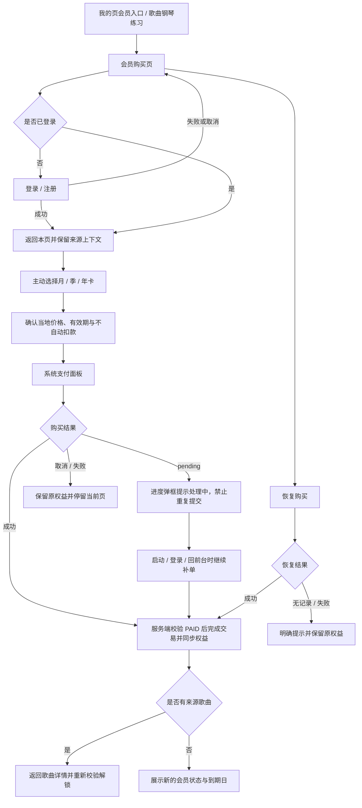

# 钢琴视奏｜会员与支付 模块产品文档

> 模块代号：`M`　｜　页面范围：M-01 ~ M-02
> 所属产品文档：[00-总纲.md](00-总纲.md)（v2.1 r3）
> 文档状态：`draft`，待产品与设计评审
> 最后修订：2026-09-28

> **阅读约定**
> 本文件是《钢琴视奏产品文档 v2.1》的模块分册，负责本模块的页面级需求与专属规则，改动本模块只需改这一个文件。
> 跨模块的共享规则（输入模式矩阵、曲谱播放、MIDI 实时判定、失败处理总表）、产品范围、功能地图、视觉与非功能要求仍以主文档为准。
> 两者冲突时，**页面与本模块专属规则以本文件为准，跨模块规则以主文档为准**。

---

## 1. 模块定位与边界

### 1.1 定位

产品唯一的收入来源，也是最容易出事故的链路（扣款未到账、到账未完成交易、重复扣费、换设备权益丢失）。本模块的目标不是转化最大化，而是**让用户在购买前就看清付的是什么、多久、会不会自动扣款**，并保证任何中断都不损失权益。

### 1.2 本模块包含

- 会员购买页：权益说明、三档卡、当地价格、非自动续费说明。
- 购买、续卡顺延、恢复购买。
- 购买进度与补单恢复。
- 会员权益规则与状态枚举。

### 1.3 本模块不包含

- 登录本身 → 见《账号与合规》。
- 歌曲解锁的组合判定 → 见《官方歌曲》。
- 导入额度与频率的具体规则 → 见《智能曲谱导入与个人曲谱》。
- 自动续费、免费试用、优惠券、单曲购买、独立订单中心、App 内外部支付（本版不做）。

### 1.4 唯一核心付费权限

会员解锁普通官方歌曲及个人曲谱的 MIDI 钢琴练习。官方普通歌曲仍需达到等级；免费体验歌曲不受会员和等级限制。

导入、解析、查看、播放、管理个人曲谱，以及手机歌曲练习（含 MIDI）、音符、视奏、和弦及基础记录不属于会员权益。会员到期不影响内容，只重新限制普通歌曲钢琴练习。

### 1.5 与其他模块的关系

| 入口来源 | 购买成功后回到 |
| --- | --- |
| 我的页会员卡 | 停留本页，展示新到期日 |
| 歌曲列表 / 详情的锁定状态 | 该歌曲详情，并重新校验学习门槛 |
| 个人曲谱钢琴练习入口 | 返回个人曲谱详情，重新检查会员 |

---

## 2. 页面清单与路由

| ID | 页面 | 类型 | 方向 | 路由名 |
| --- | --- | --- | --- | --- |
| M-01 | 会员购买页 | 新增 | 竖屏 | `payment` |
| M-02 | 购买进度与补单弹框 | 新增 | — | 独立路由承载（D-22） |

---

## 3. 关键流程

### 3.1 会员购买、续卡与恢复

---

## 4. 页面级详细需求

### M-01 会员购买页

**页面定位**：承接 MIDI 钢琴练习的购买、续卡与恢复，不销售曲库或导入权限。

**页面结构**：保留现有返回、轮播图、标题与副标题、月 / 季 / 年卡、支付渠道、购买按钮、协议及恢复购买。套餐选择和推荐样式沿用当前实现，本轮不修改商品、价格与支付流程。

- 标题：“解锁完整 MIDI 钢琴练习”。
- 副标题：“用已解锁的官方歌曲或自己的曲谱，连接 MIDI 钢琴开始练习。”
- 不新增大块权益说明，不宣传曲目数量、会员导入额度、附赠导入或免费权益。
- 入口为首页 / 设置会员入口、官方或个人曲谱的钢琴练习说明；导入资源限制不跳转会员购买。
- 展示价格与期限仍使用现有商品和商店数据；恢复购买和协议入口保持可达。
- 登录后保留套餐与协议选择，不自动下单；取消、失败、账号冲突不覆盖原权益。
- 购买返回重新检查当前曲谱权限，会员不能跳过官方等级或缺少编配。

**验收标准**：布局保持稳定；文案只承诺 MIDI 钢琴练习；三档商品、协议、购买及恢复路径保持原有行为；长文案可换行，小屏与三语可用。

### M-02 购买进度与补单弹框

**页面定位**：把"发起购买 → 商店扣款 → 服务端校验 → 权益到账"这条异步链路可视化，避免用户在中间态重复下单。

**入口与出口**：发起购买、恢复购买、启动 / 登录 / 回到前台 / 再次购买前的未完成交易检查。

**页面结构**：阶段说明（创建订单 → 商店支付 → 校验中 → 完成）、当前阶段状态、超时说明、稍后再试 / 联系帮助入口。

**主要功能**

- 展示当前购买阶段与进度。
- 超时时保留订单并说明后续会自动继续校验。
- 恢复购买时展示同一套阶段语义。
- 校验成功后关闭并刷新会员状态。

**详细交互说明**

- 使用独立路由承载，避免被页面返回手势打断导致状态丢失。
- 只有服务端确认订单已支付时才完成商店交易，避免"扣款未到账"与"到账未完成交易"。
- 客户端按订单持久化、串行校验并按账号隔离；在启动、登录、回前台与购买前检查未完成交易并继续补单。
- 弹框展示期间禁止重复发起购买。
- 失败时明确区分"支付未完成"与"支付成功但校验未完成"，后者不要求用户重新付款。

**关键状态与异常**：创建订单失败、商店面板取消、扣款成功但校验中、校验失败、超时、网络中断、切换账号、退款或撤销。

**验收标准**：任一中间态都有明确文案与可执行动作；不会因为退出弹框导致订单丢失；补单不会重复扣费或重复发放权益。

---

---

## 5. 模块核心规则

### 5.1 会员支付与权益规则

- 会员唯一核心权限为普通官方歌曲与个人曲谱的 MIDI 钢琴练习，内容与导入不收费。
- 识谱练习、视奏挑战、和弦练习、进度统计、成就、练习记录、全部设置与同步保持免费，不因会员未开通、到期、退款或撤销而受限。
- 个人曲谱的导入、校对、查看、播放和管理不受会员状态影响；钢琴练习单独检查会员，不删除用户内容。
- 商品只包含月卡、季卡、年卡，有效期为 1 个自然月 / 3 个自然月 / 1 年，美元基准价 `$2.99` / `$6.99` / `$19.99`。
- 实际展示币种与价格以商店返回为准，不写死地区换算价。
- 三档卡均不自动续费，不提供免费试用、优惠券或首购折扣。
- iOS 通过 App Store 非续期订阅购买，Android 通过 Google Play 预付费订阅购买；App 内不提供外部支付入口或兑换码解锁。
- 购买前必须登录 App 账号，购买成功绑定当前账号；同一账号在 iOS / Android 上共享有效权益。
- 无有效会员时时长从购买成功时开始；已有有效会员时新时长从当前到期日**顺延**，允许不同期限叠加。
- 会员到期、退款或撤销后收回普通歌曲钢琴练习权限，保留曲谱、试听、历史成绩、歌曲进度及新增导入。
- 购买状态为 `pending` 时禁止重复发起；`cancelled` 或 `failed` 不改变原有权益。
- 只有服务端确认订单已支付时才完成商店交易；客户端按订单持久化、串行校验、按账号隔离，并在启动、登录、回前台与购买前检查未完成交易。
- 恢复购买需覆盖恢复成功、无可恢复记录与恢复失败；商店购买已绑定其他账号时不自动转移绑定。
- 状态枚举：会员状态 `free` / `active` / `expired`；卡种 `monthly` / `quarterly` / `annual`；购买状态 `pending` / `success` / `cancelled` / `failed`。

### 5.2 与共享规则的关系

- 登录时机与游客边界见《账号与合规》的「账号、权益与登录时机规则」。
- 官方内容等级与歌曲钢琴练习权限独立，详见《官方歌曲》5.1。
- 导入额度与频率见《智能曲谱导入与个人曲谱》的 5.6 / 5.7。
- 支付相关失败文案遵循主文档「失败处理规则」总表。

---

## 6. 模块级验收要点

- 仅普通歌曲及个人曲谱的 MIDI 钢琴练习检查会员；导入和内容管理不检查会员。
- 免费体验曲完整可练，会员不能绕过普通官方歌曲等级。
- 保留当前套餐、价格、协议、登录与购买回流，恢复购买可达；未登录不自动下单。
- 有效会员续卡从当前到期日顺延；服务端确认支付后完成商店交易；补单不重复发放权益。
- 到期后内容、历史和进度保留，普通歌曲钢琴练习重新校验会员。
- 页面无倒计时、隐藏关闭或诱导点击，无曲库或导入额度权益宣传。

---

## 7. 本模块待确认项

| # | 待确认 | 影响 |
| --- | --- | --- |
| 1 | 游客在 iOS 上主动建立游客会话购买后的权益归属与转移策略 | M-01 与账号绑定规则 |
| 3 | 退款 / 撤销后的权益回收时延与用户提示方式 | 5.1 与客服口径 |

---

## 8. 变更记录

| 日期 | 变更 |
| --- | --- |
| 2026-09-28 | 按批准方案分离内容等级、导入资源保护与歌曲钢琴练习会员权限；仅歌曲列表保留免费体验标签。以下早期记录用于追溯，现行规则以正文为准。 |
| 2026-09-18 | 拆自主文档 v2.1 r2（主文档同步升级为 r3），含 7.G 全部页面与 8.15 会员规则 |
| 2026-09-18 | 会员权益由一项扩展为两项，新增导入相关的入口与回跳 |
| 2026-09-18 | M-01 补排版要求：权益具体到数字、每月折合价、三档不做推荐标记、到期后果前置、恢复购买可达 |
| 2026-09-18 | M-01 权益说明改为主次结构：官方高级曲目为主卖点，曲谱导入为附赠 `Beta`，不并列展示 |

---

## 迁移补入（⚠️ 待确认）

> 2026-10-07 迁移时补入。下面两项已在线上，但本分册正文还没有写入。请确认后并入正文（第 1 节边界、第 4 节页面、第 5 节规则），并删除本节。

### 订单记录（随 v2.1.0 上线）

- 会员页有「订单记录」入口，只读：分页、空态、加载中、失败重试；每条显示商品名称、状态、币种金额、订单号、时间。
- 切换账号时清空列表，并丢弃上一个账号的迟到请求。没有取消、删除、支付操作。
- 来源：`doc/history/v1/05-联调与测试/pingcode-2026-09-25.md`（GQS-57）。
- ⚠️ 与第 1.3 节「不包含：独立订单中心」冲突。请确认订单记录属于现行范围，并修改第 1.3 节的说法。

### 订单金额与币种（2026-10-06 后端修复已上线）

- Apple / Google 核验过的订单，返回**商店实际交易的币种和总额**（含优惠和税费），例如美区 USD 2.99 返回 `amountCents=299, currency=USD`。App 的购买确认、订单列表和详情都显示这个金额。
- 未核验的待支付订单和历史订单，仍返回内部定价快照，不能当作实际扣款。
- 后台订单台账、人民币收入汇总和邀请佣金仍按内部定价计算，没有做汇率换算。
- 来源：service 仓库 `docs/store-order-amount.md`；对应线上问题记录见 `doc/versions/v2.1.1/fix.md` 的 F-01。
