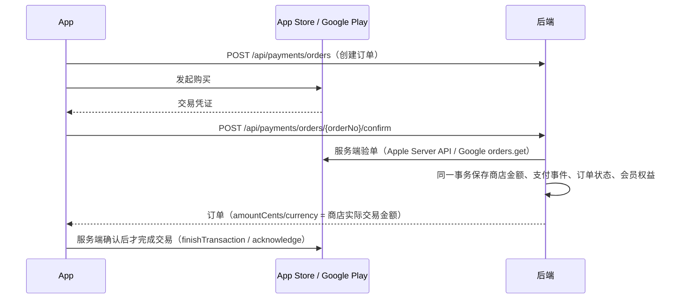

# 技术架构

> 基线文档：线上（v2.1.0）的技术架构。2026-10-07 迁移时根据旧工作区技术方案、App 和后端代码整理。
> 以后有架构级变化，先写在版本文件夹的 `tech-design.md`，发布时合并到这里。

## 1. 总体结构

```
Flutter App（Solfeggio）
  │  HTTPS，X-App-Code: solfeggio，Bearer Token
  ▼
Java 后端（service，多 App 共用）──► PostgreSQL（schema: solfeggio）
  │                                  Redis
  ├──► Apple App Store Server API / Google Play Developer API（验单、通知、退款）
  └──◄ 本地曲谱识别 Worker（主动领取任务，HTTPS 回传）
```

- App 本地优先：练习、等级、记录先存本地，按本地账号隔离，登录后同步到云端。
- 后端是多 App 共用的 Spring Boot 服务，钢琴视奏的专属业务在 `com.soul.service.app.solfeggio`，认证、订单、商品、会员、资源上传等公共能力在 `core`。
- 正式环境：`https://www.lumentrain.com`。

## 2. 技术栈

| 端 | 技术 |
|---|---|
| App | Flutter（Dart SDK ^3.5.3）、GetX 状态管理、go_router 路由、Dio 网络 |
| App 本地存储 | GetStorage、Hive、flutter_secure_storage |
| 乐谱 | 本地包 `packages/simple_sheet_music`（五线谱 / 大谱表渲染） |
| MIDI / 音频 | flutter_midi_command（MIDI 输入）、flutter_midi_pro + 本地包 `packages/solfeggio_midi_pro_ios`（钢琴发声、音色包）、flutter_pitch_detection |
| 支付 | in_app_purchase（StoreKit / Google Play Billing） |
| 登录 | google_sign_in；用户名密码；游客 |
| 其他 | in_app_review（评价邀请）、flutter_local_notifications（练习提醒）、友盟统计（`UmengBridge`）、三语（简中 / 繁中 / 英文） |
| 后端 | Java 21、Spring Boot 3.3.0、Gradle；后端版本号见 `build.gradle`（当前 5.0.0） |
| 数据库 | PostgreSQL + Flyway（`common` + 各 App 专属迁移），Redis |
| 曲谱识别 | 本地 Worker（`service/worker/`）：图片 / PDF 用 Audiveris，MIDI 用 Java 解析 |

## 3. 仓库与目录

| 仓库 | 路径 | 规范入口 |
|---|---|---|
| App | `/Users/soul/code/soul/Solfeggio` | 根目录 `AGENTS.md` → `.cursor/rules/` |
| 后端 | `/Users/soul/code/soul/service` | 根目录 `AGENTS.md` → `.cursor/rules/` |

App `lib/` 分层：

| 目录 | 作用 |
|---|---|
| `apis/` | 接口静态方法（auth、song、song_practice、chord_practice、score_import、payment、feedback、piano_soundfont、solfeggio） |
| `pages/` | 页面：home、main、onboarding、login、practice、practice_records、progress、achievements、song、score_import、payment、settings、web |
| `services/` | 业务服务：midi、piano_audio、piano_practice、song_practice、chord_practice、score_import、score_playback、solfeggio_sync、review_prompt、notification、umeng 等 |
| `store/` | GetX 全局状态：user、config、payment、practice_history、solfeggio_sync、solfeggio_catalog 等 |
| `routes/`、`widgets/`、`components/`、`models/`、`utils/`、`l10n/` | 路由、通用组件、模型、工具、多语言 |

完整目录索引：App 仓库 `.cursor/rules/02-project-map.mdc`。

后端分层：`framework / core / app / admin / bootstrap / thirdparty`，钢琴视奏专属代码在 `app/solfeggio/`（auth、payment、scoreimport、reviewprompt、accountdeletion、soundfont 等），后台曲库管理在 `admin/controller/AdminSolfeggio*`。完整目录索引：后端仓库 `.cursor/rules/02-项目结构目录.mdc`。

## 4. 关键流程

### 4.1 购买会员



- 客户端按订单持久化、串行校验、按账号隔离；启动、登录、回前台、购买前检查未完成交易并补单。
- Apple 有服务端持久化补单任务（`solfeggio_iap_confirmation_tasks`）；续期和退款通过商店通知回调处理。

### 4.2 歌曲钢琴练习权限

- 内容（查看、试听、谱面）只看学习等级；免费体验曲目不受等级和会员限制。
- 只有非免费歌曲的钢琴模式（`mode=PIANO`）检查会员：先等级，再会员。
- 个人曲谱 MIDI 钢琴练习开始时调用 `practice-access`，失败不能静默放行。

### 4.3 曲谱导入

App 通过资源接口上传原文件（按 `resource.storage_policy` 保存在服务器本地，保留 7 天）→ 后端创建任务 → 本地 Worker 领取、识别、回传 → App 校对（review）→ 确认生成个人曲谱。导入受统一资源保护（并发 / 每小时 / 每自然日）限制。

## 5. 环境与构建

| 项 | 说明 |
|---|---|
| App 服务器地址 | `lib/global.dart`：默认正式地址，可用 `--dart-define=SOLFEGGIO_API_BASE_URL=...` 覆盖 |
| iOS 构建配置 | `ios/Flutter/Release-AppStore.xcconfig`、`Release-Internal.xcconfig` |
| 出包脚本 | App 仓库 `make_ios.sh`、`build_and_upload.sh` / `build_and_upload.py`；内测分发 `pgyer_upload.sh`（蒲公英） |
| 后端部署 | 见后端仓库 `README.md` 与 `docs/`（部署、Flyway 冻结边界、商品数据脚本） |
| 后端固定配置 | `service/src/main/resources/service-data/apps/solfeggio/`（products、app-configs、song-access-policy） |

## 6. 三方服务

| 服务 | 用途 | 备注 |
|---|---|---|
| Apple App Store（StoreKit、Server API、Server Notifications） | 内购、验单、续期 / 退款通知 | 沙盒说明见后端 `docs/apple-sandbox-access.md` |
| Google Play Billing / Android Publisher API / RTDN | 内购、验单、订单金额、退款 | 见后端 `docs/google-play-*.md` |
| Google Sign-In | 登录 | App 仓库 `doc/Google_Login_Setup.md` |
| 友盟 | 统计 | 需在隐私同意后初始化 |
| Audiveris | 图片 / PDF 曲谱识别（本地 Worker） | |
