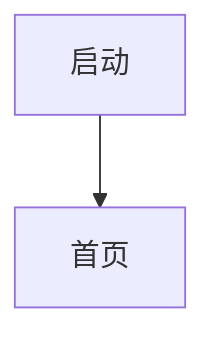

# 产品概览

> 基线文档：描述线上产品"现在是什么样"。只在版本发布时更新，不写版本痕迹。

## 1. 产品定位
一两句话：给谁用、解决什么问题。

## 2. 目标用户与地区
- 用户：
- 主要地区：（影响币种、语言、时区、合规）
- 不上线的地区：

## 3. 商业模式
- 免费部分：
- 付费部分：（订阅档位、主推档位、付费边界）
- 价格来源：（商店配置 / 后台配置）

## 4. 全局规则
| 规则 | 当前定义 |
|---|---|
| 账号体系 | （游客 / 注册 / 第三方登录；数据如何归属和合并） |
| 支持语言 | |
| 时区与"自然日" | （以哪个时区计算每日限制等） |
| 货币 | （展示用商店本地价格；订单记录商店实际币种） |
| 离线能力 | |

## 5. 模块清单
| 模块 | 文件 | 一句话 |
|---|---|---|
| 账号 | `account.md` | |

## 6. 页面地图
| 页面 | 所属模块 | 用途 | 入口 |
|---|---|---|---|

## 7. 全局流程

