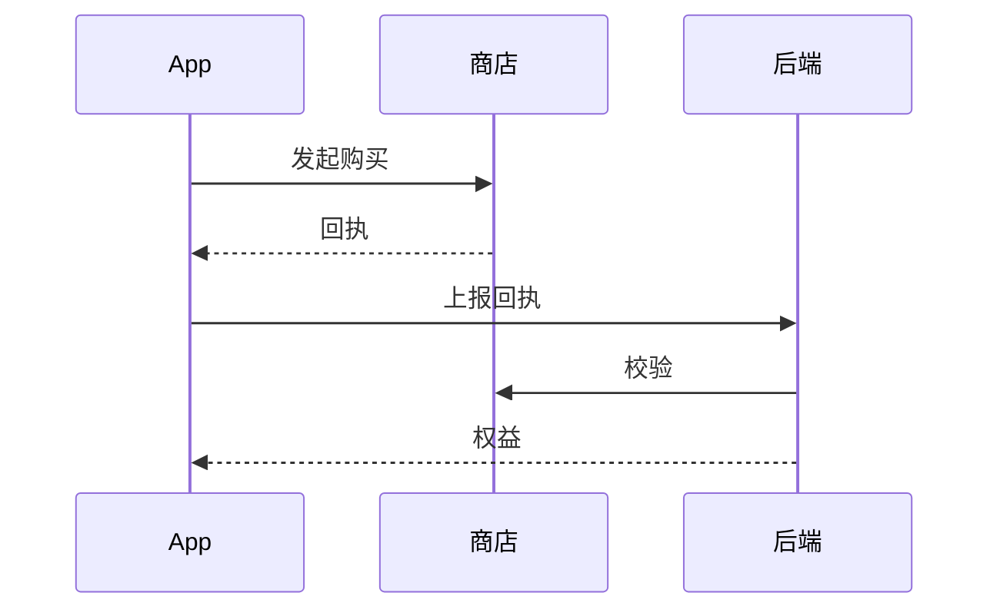

# 技术架构

> 基线文档：当前线上的技术架构。版本发布时把 `tech-design.md` 和 `plan.md` 中的架构变化合并进来。

## 1. 技术栈
| 端 | 技术 | 版本 |
|---|---|---|
| App | Flutter | |
| 后端 | Java / Spring Boot | |
| 数据库 | PostgreSQL | |
| 缓存 | Redis | |

## 2. 仓库
| 仓库 | 路径 | 说明 |
|---|---|---|
| App | | |
| 后端 | | 多 App 共用时写明 App Code 和隔离方式 |

## 3. 分层与目录
App 和后端各自的目录结构摘要；详细规范见各仓库 `doc/rules/`。

## 4. 关键流程
用时序图或流程图说明跨端的关键流程（登录、购买、同步……）。

## 5. 环境与配置
| 环境 | 后端地址 | 说明 |
|---|---|---|
| dev | | |
| prod | | |

配置文件位置、关键配置项（功能开关、限额等）。

## 6. 三方服务
| 服务 | 用途 | 接入位置 | 备注（隐私声明、密钥位置） |
|---|---|---|---|
